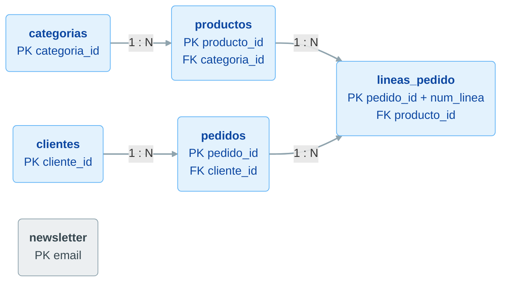

# Modelo relacional, SELECT, FROM, WHERE y AS

**Bloque 2 -- SQL y bases de datos | Sesión 1 de 6**

[← Volver al índice del curso](../README.md#bloque-2--sql-y-bases-de-datos)

---

## 1. Introducción

En el bloque 1 los datos nos llegaron en archivos CSV: un **extracto** que alguien había sacado de los sistemas de Café Lumen y nos había pasado ya preparado. Las tablas de la sesión 1.1.3 también nos llegaron hechas. En este bloque vamos un paso más atrás en el ciclo de vida del dato: trabajamos **directamente sobre la base de datos** y calculamos nosotros cada cifra con **SQL**, el lenguaje con el que se consultan las bases de datos relacionales.

SQL es la herramienta más usada por un analista de datos. Aparece en casi todas las ofertas de empleo del sector, y la usaremos en el resto del curso: desde Python (bloque 3), en la nube (bloque 5) y por debajo de Power BI, Tableau y Qlik (bloques 7 a 9).

El bloque tiene seis sesiones en dos partes:

**2.1 Consultas básicas.** Esta sesión (modelo relacional, carga de la base de datos y las primeras consultas), la 2.1.2 (agregar, agrupar y ordenar) y la 2.1.3 (combinar tablas con JOIN y operaciones de conjuntos).

**2.2 SQL intermedio.** Subconsultas, vistas y CTEs, y funciones de ventana.

### Objetivos de la sesión
- Entender el modelo relacional: tablas, filas, columnas, tipos de datos, claves primarias y claves foráneas.
- Leer el diagrama de una base de datos e identificar cómo se relacionan sus tablas.
- Saber qué es SQL y distinguir las instrucciones que definen la estructura (DDL) de las que manipulan los datos (DML).
- Crear la base de datos del bloque en PostgreSQL y cargarla con dos scripts desde pgAdmin.
- Escribir consultas con `SELECT`, `FROM`, `WHERE` y `AS`: elegir columnas, calcular columnas nuevas y filtrar filas.
- Entender qué es `NULL` y cómo se filtra.

### Prerequisitos
- Sesión 0.1.5 completada: PostgreSQL y pgAdmin instalados y funcionando.
- Bloque 1 completado: sabemos qué es una dimensión, una medida, la granularidad de una tabla y un criterio de exclusión.

---

## 2. El caso del bloque: Casa Olivo

**Casa Olivo** es una tienda online de artículos para el hogar: vajilla de gres, ropa de cama y de mesa de lino, utensilios de cocina de madera, velas, cestas y lámparas, muchos de ellos fabricados por pequeños talleres españoles. Abrió su web el **1 de marzo de 2024** y vende a toda España.

Su fundadora, **Clara Benítez**, dirige un equipo de seis personas. La web la mantiene una agencia externa y guarda toda su actividad en una base de datos PostgreSQL. Hasta ahora, Clara solo ha mirado las cifras que muestra el panel de administración de la tienda: ventas del día y pedidos pendientes.

### El encargo

En enero de 2026, mientras prepara el plan del año, Clara nos pide tres cosas:

1. **¿Cómo hemos crecido y qué vendemos?** Evolución de las ventas mes a mes, temporadas fuertes y flojas, categorías y productos que sostienen el negocio.
2. **¿Quiénes son nuestros clientes?** De dónde vienen, dónde viven y cuántos vuelven a comprar.
3. **¿Dónde se nos escapa dinero?** Pedidos cancelados, devoluciones, productos que no se venden y personas que se registran pero nunca compran.

### Los datos

La agencia no nos ha mandado un extracto en CSV, sino una **copia de la base de datos** con toda la actividad desde la apertura hasta el 31 de diciembre de 2025. La copia viene en dos scripts SQL, en la carpeta [`dataset/`](dataset/) de este bloque:

| Archivo | Qué hace |
|---|---|
| `01_crear_tablas.sql` | Crea las seis tablas vacías, con sus columnas, tipos de datos y reglas. |
| `02_insertar_datos.sql` | Rellena las tablas con los datos. |

Y estas son las tablas que obtendremos:

| Tabla | Qué contiene | Una fila es... | Filas |
|---|---|---|--:|
| `categorias` | Las familias del catálogo | una categoría | 6 |
| `productos` | El catálogo, con precio de venta y coste | un producto | 48 |
| `clientes` | Las personas registradas en la web | un cliente | 5.244 |
| `pedidos` | La cabecera de cada pedido: quién, cuándo, cómo pagó, estado | un pedido | 6.974 |
| `lineas_pedido` | El detalle de cada pedido | un producto dentro de un pedido | 12.881 |
| `newsletter` | Los suscriptores del boletín de correo | una dirección de email | 3.927 |

La columna "una fila es..." es la **granularidad** de cada tabla (sesión 1.1.2). Es lo primero que conviene tener claro antes de escribir cualquier consulta.

---

## 3. El modelo relacional

### Por qué no una sola tabla

Recordemos `ventas.csv` de Café Lumen: cada fila era una línea de ticket y llevaba **todo** repetido. Si una persona compraba un flat white, la fila incluía el código del producto, su nombre, su categoría, la tienda... Si mañana el flat white cambiara de nombre, habría que cambiarlo en miles de filas, y bastaría con olvidar una para que el mismo producto apareciera con dos nombres distintos.

Una base de datos de un sistema operacional, como la de una tienda online, no se organiza así. Separa la información en **tablas**, cada una sobre **un único tipo de cosa** (productos, clientes, pedidos), y guarda cada dato **una sola vez**. El nombre de un producto está solo en `productos`. Una línea de pedido no repite el nombre, sino que guarda una **referencia** al producto: su `producto_id`.

Esta forma de organizar los datos es el **modelo relacional**, propuesto por Edgar F. Codd en 1970. Sigue siendo la base de casi todos los sistemas de gestión de empresas: ERP, CRM, tiendas online, bancos.

### Los elementos de una tabla

Veamos la tabla `productos`:

| producto_id | nombre | categoria_id | precio | coste | fecha_alta | activo |
|--:|---|--:|--:|--:|---|---|
| 101 | Taza de gres Arena 350 ml | 1 | 12,90 | 4,80 | 2024-03-01 | true |
| 102 | Juego de 4 platos llanos Lino | 1 | 42,00 | 16,50 | 2024-03-01 | true |
| 103 | Bol de gres Musgo | 1 | 9,90 | 3,60 | 2024-03-01 | true |

- **Tabla:** un conjunto de datos sobre un mismo tipo de cosa. También se llama **relación**, y de ahí viene el nombre del modelo.
- **Fila** (o registro): un elemento concreto, aquí un producto.
- **Columna** (o campo, o atributo): una característica que tienen todas las filas. Cada columna tiene un nombre y un **tipo de datos**.

### Tipos de datos

En un CSV todo es texto (sesión 1.1.1). En una base de datos, **cada columna declara su tipo**, y la base de datos rechaza cualquier valor que no encaje. Estos son los tipos que usa Casa Olivo:

| Tipo en PostgreSQL | Qué guarda | Ejemplo en Casa Olivo |
|---|---|---|
| `INTEGER`, `SMALLINT` | Números enteros (el segundo, más pequeños) | `producto_id`, `cantidad` |
| `NUMERIC(7,2)` | Números decimales exactos: 7 cifras en total, 2 de ellas decimales | `precio`, `subtotal` |
| `VARCHAR(60)` | Texto de hasta 60 caracteres | `nombre`, `email` |
| `DATE` | Fechas | `fecha_pedido`, `fecha_registro` |
| `BOOLEAN` | Verdadero o falso | `activo` |

Para cantidades de dinero se usa `NUMERIC`, que es exacto, y no los tipos de coma flotante (`REAL`, `DOUBLE PRECISION`), que guardan aproximaciones: con ellos, 0,1 + 0,2 no da exactamente 0,3.

### Clave primaria

La **clave primaria** (*primary key*, PK) es la columna, o combinación de columnas, que identifica cada fila sin repetirse. Ya la vimos en la sesión 1.1.2; la diferencia es que aquí **la base de datos la hace cumplir**. Si intentamos insertar un segundo producto con `producto_id = 101`, PostgreSQL lo rechaza.

- En `productos`, la clave primaria es `producto_id`.
- En `lineas_pedido`, ninguna columna sola identifica una fila: un pedido tiene varias líneas y un producto aparece en muchos pedidos. La clave es la **combinación** `pedido_id` + `num_linea`. Es una **clave compuesta**.
- En `newsletter`, la clave es el propio `email`.

### Clave foránea

La **clave foránea** (*foreign key*, FK) es una columna que **apunta a la clave primaria de otra tabla**. `productos.categoria_id` apunta a `categorias.categoria_id`: el producto 101 tiene `categoria_id = 1`, y en `categorias` la fila 1 es *Cerámica*.

La clave foránea también es una regla: PostgreSQL no permite crear un producto con `categoria_id = 9` si la categoría 9 no existe, ni borrar una categoría que todavía tenga productos. Así se garantiza la **integridad referencial**: ninguna referencia apunta a la nada.

### El diagrama de Casa Olivo

Las relaciones entre tablas se dibujan en un **diagrama entidad-relación** (ER). Para que se lea de un vistazo, en cada tabla mostramos solo sus claves; el resto de columnas no interviene en las relaciones:



Cada flecha es una relación **uno a muchos** (1 : N). Sale de la tabla del lado "uno" y llega a la del lado "muchos", que es la que guarda la clave foránea.

- Una categoría agrupa **muchos** productos; un producto pertenece a **una** categoría.
- Un cliente hace **cero o muchos** pedidos. Puede no haber hecho ninguno: se registró y nunca compró.
- Un pedido contiene **una o muchas** líneas; cada línea pertenece a **un** pedido.
- Un producto aparece en **cero o muchas** líneas. Puede que en ninguna, si nunca se ha vendido.

La relación entre pedidos y productos es de **muchos a muchos**: un pedido tiene varios productos y un producto está en muchos pedidos. El modelo relacional la resuelve con una **tabla intermedia**, aquí `lineas_pedido`, que tiene una clave foránea hacia cada lado.

`newsletter` no tiene ninguna flecha: la gestiona otra herramienta de marketing y **no está unida a `clientes` por ninguna clave**. Solo comparten un dato, el email. En la sesión 2.1.3 veremos cómo cruzarlas igualmente.

### La frase clave

> Cada dato se guarda una sola vez, en la tabla a la que pertenece. Las tablas no se copian datos entre sí: se apuntan con claves. Consultar es volver a juntar esas piezas.

---

## 4. SQL, el lenguaje de las bases de datos

**SQL** (*Structured Query Language*) es el lenguaje estándar para trabajar con bases de datos relacionales. Nació en IBM en los años setenta y es un estándar ISO desde 1987. Tiene una característica que lo diferencia de Python: es **declarativo**. Le decimos **qué** queremos ("los productos de más de 50 €") y no **cómo** encontrarlo (qué archivo abrir, en qué orden recorrer las filas). De eso se encarga la base de datos.

Las instrucciones de SQL se agrupan en familias:

| Familia | Para qué | Instrucciones | En Casa Olivo |
|---|---|---|---|
| **DDL** (*Data Definition Language*) | Definir la estructura | `CREATE TABLE`, `ALTER TABLE`, `DROP TABLE` | `01_crear_tablas.sql` |
| **DML** (*Data Manipulation Language*) | Añadir, cambiar o borrar datos | `INSERT`, `UPDATE`, `DELETE` | `02_insertar_datos.sql` |
| **DQL** (*Data Query Language*) | Consultar | `SELECT` | Todo lo que haremos en el bloque |

Por eso la agencia nos ha mandado **dos** scripts: uno con la estructura (DDL) y otro con los datos (DML). Un analista pasa la mayor parte de su tiempo en la tercera familia: **consulta** datos que otros sistemas han escrito. Muchas veces ni siquiera tiene permiso para modificarlos.

Cada sistema gestor (PostgreSQL, MySQL, SQL Server, Oracle, BigQuery, Snowflake...) habla un **dialecto** de SQL: el núcleo es común, y cada uno añade funciones propias. Todo lo que aprendamos en este bloque sirve en cualquiera de ellos; cuando usemos algo específico de PostgreSQL, lo indicaremos.

---

## 5. Cargar Casa Olivo en PostgreSQL paso a paso


### Paso 1: descargar los scripts

Entramos en la carpeta [`dataset/`](dataset/) de este bloque en GitHub. Abrimos cada script y pulsamos **Download raw file** (la flecha hacia abajo, arriba a la derecha). `02_insertar_datos.sql` pesa casi 2 MB y GitHub puede decir que es demasiado grande para mostrarlo, pero el botón de descarga funciona igual.

Guardamos los dos en una carpeta nueva del portfolio: `practicas/bloque-02/dataset/`.

### Paso 2: crear la base de datos

Abrimos **pgAdmin 4** y desplegamos el servidor con la contraseña de `postgres` (sesión 0.1.5). Hacemos clic derecho sobre **Databases** → **Create** → **Database...**

- **Database:** `casa_olivo`
- **Owner:** `postgres`

Pulsamos **Save**. Usamos una base de datos propia para el caso, separada de `curso_data_analytics`, igual que en una empresa cada aplicación tiene la suya.

### Paso 3: crear las tablas

Seleccionamos `casa_olivo` en el árbol y abrimos el **Query Tool** (clic derecho → **Query Tool**). Comprobamos que la pestaña del Query Tool muestra `casa_olivo`: si dice `postgres` o `curso_data_analytics`, las tablas se crearán en la base de datos equivocada.

Con el icono de la carpeta (**Open File**) abrimos `01_crear_tablas.sql`. Merece la pena leerlo antes de ejecutarlo: cada `CREATE TABLE` declara las columnas con su tipo, y aparecen las reglas que hemos visto en la sección 3:

```sql
CREATE TABLE productos (
    producto_id   INTEGER       PRIMARY KEY,
    nombre        VARCHAR(60)   NOT NULL,
    categoria_id  SMALLINT      NOT NULL REFERENCES categorias (categoria_id),
    precio        NUMERIC(7,2)  NOT NULL CHECK (precio > 0),
    ...
```

- `PRIMARY KEY`: la clave primaria.
- `REFERENCES categorias (categoria_id)`: la clave foránea.
- `NOT NULL`: la columna es obligatoria.
- `CHECK (precio > 0)`: una regla de negocio, porque un precio no puede ser cero ni negativo.
- `UNIQUE` (en `clientes.email`): no puede haber dos clientes con el mismo email.

Ejecutamos con **F5**. Abajo aparecen unos avisos (`NOTICE: table "lineas_pedido" does not exist, skipping`) que no son errores: la primera línea del script borra las tablas si ya existían, y la primera vez no existen. Al final debe aparecer *Query returned successfully*.

### Paso 4: cargar los datos

En el mismo Query Tool abrimos `02_insertar_datos.sql` y lo ejecutamos con **F5**. Tarda unos segundos. Es una larga serie de `INSERT INTO ... VALUES`:

```sql
INSERT INTO categorias (categoria_id, nombre, descripcion) VALUES
    (1, 'Cerámica', 'Vajilla, tazas y piezas de gres y barro hechas en talleres de Manises y La Bisbal'),
    (2, 'Textil', 'Ropa de cama y de mesa, mantas y cojines de lino y algodón'),
    ...
```

El orden de las tablas no es casual. `productos` se carga después de `categorias` y `lineas_pedido` después de `pedidos` y `productos`, porque la clave foránea impide insertar una referencia a una fila que todavía no existe.

### Paso 5: comprobar la carga

En el árbol, desplegamos **casa_olivo > Schemas > public > Tables** (si no aparece nada, clic derecho → **Refresh**). Deben estar las seis tablas. Para ver las relaciones, clic derecho sobre `casa_olivo` → **ERD For Database**: pgAdmin dibuja el diagrama de la sección 3 a partir de las claves foráneas.

Volvemos al Query Tool, borramos su contenido y escribimos nuestra primera consulta sobre Casa Olivo:

```sql
SELECT * FROM categorias;
```

| categoria_id | nombre | descripcion |
|--:|---|---|
| 1 | Cerámica | Vajilla, tazas y piezas de gres y barro hechas en talleres de Manises y La Bisbal |
| 2 | Textil | Ropa de cama y de mesa, mantas y cojines de lino y algodón |
| 3 | Cocina | Utensilios, tablas y accesorios de madera, vidrio y acero |
| 4 | Decoración | Jarrones, velas, cestas, espejos y pequeños objetos para la casa |
| 5 | Iluminación | Lámparas de mesa, de pie y de techo, apliques y luces decorativas |
| 6 | Baño | Toallas, albornoces, alfombras y accesorios de baño |

Seis filas: la carga ha funcionado. Repetimos con las otras tablas y comprobamos el número de filas contra la tabla de la sección 2. pgAdmin lo indica bajo los resultados.

> **Un truco:** si en el editor hay varias consultas y **seleccionamos** una con el ratón, F5 ejecuta solo la selección. Así podemos ir acumulando consultas en el mismo archivo y lanzarlas de una en una.

---

## 6. SELECT y FROM: elegir columnas

Toda consulta tiene, como mínimo, dos partes: **qué columnas** queremos (`SELECT`) y **de qué tabla** (`FROM`).

```sql
SELECT nombre, precio
FROM productos;
```

Devuelve las 48 filas de `productos`, pero solo con las dos columnas pedidas y en el orden en que las hemos escrito. El asterisco `SELECT *` pide todas las columnas. Es útil para echar un primer vistazo a una tabla, pero en un análisis conviene nombrar siempre las columnas: la consulta se lee mejor y no se rompe si mañana alguien añade una columna a la tabla.

Algunas reglas de escritura:

- SQL **no distingue mayúsculas de minúsculas** en las palabras clave ni en los nombres de tabla y columna: `select`, `SELECT` y `Select` son lo mismo. La convención, que seguiremos en el curso, es escribir las palabras clave en mayúsculas y los nombres en minúsculas.
- Los saltos de línea y los espacios no importan. Escribimos una cláusula por línea para que se lea bien.
- Cada consulta termina con **punto y coma**. Es obligatorio cuando hay varias seguidas.
- Lo que va detrás de `--` es un **comentario** hasta el final de la línea. Lo usaremos para documentar las consultas.

### LIMIT: echar un vistazo

`clientes` tiene más de 5.000 filas. Para ver qué aspecto tienen sin traerlas todas:

```sql
SELECT *
FROM clientes
LIMIT 5;
```

| cliente_id | nombre | apellidos | email | fecha_nacimiento | ciudad | provincia | fecha_registro | origen |
|--:|---|---|---|---|---|---|---|---|
| 1 | Julia | Molina Garrido | jmolinagarrido@example.com | [null] | Barcelona | Barcelona | 2024-03-01 | Instagram |
| 2 | Claudia | Peña Ortiz | cpenaortiz@example.com | 2000-02-21 | Alcalá de Henares | Madrid | 2024-03-01 | Instagram |
| 3 | Noelia | Prieto Molina | nprietomolina@example.net | 1966-04-15 | Madrid | Madrid | 2024-03-01 | Instagram |
| 4 | Julia | Morales Castro | julia.morales@example.net | [null] | Béjar | Salamanca | 2024-03-01 | Recomendación |
| 5 | Sofía | Gómez Santos | sofia.gomez@example.net | 1967-06-18 | Jerez de la Frontera | Cádiz | 2024-03-01 | Newsletter |

Dos detalles. `[null]` es como pgAdmin muestra una celda **vacía**: estas dos personas no dieron su fecha de nacimiento al registrarse, porque era opcional (sección 8). Y `LIMIT 5` no devuelve "los cinco primeros clientes" en ningún sentido de negocio: devuelve **cinco filas cualesquiera**. Aquí coinciden con los cinco primeros porque la tabla está recién cargada, pero una tabla no tiene un orden garantizado. Para pedir un orden concreto existe `ORDER BY`, que veremos en la 2.1.2.

### DISTINCT: valores sin repetir

```sql
SELECT DISTINCT provincia
FROM clientes;
```

Devuelve 25 filas: las provincias en las que Casa Olivo tiene clientes, cada una una sola vez. `DISTINCT` elimina las filas duplicadas **del resultado**. Si pedimos `SELECT DISTINCT provincia, ciudad`, elimina las combinaciones repetidas de las dos columnas.

---

## 7. Columnas calculadas y alias con AS

En el `SELECT` no solo podemos poner columnas: podemos poner **expresiones** que calculan valores nuevos a partir de ellas.

```sql
-- Margen de los productos de Iluminación
SELECT nombre,
       precio,
       coste,
       precio - coste                              AS margen_unitario,
       ROUND((precio - coste) / precio * 100, 1)   AS margen_pct
FROM productos
WHERE categoria_id = 5;
```

| nombre | precio | coste | margen_unitario | margen_pct |
|---|--:|--:|--:|--:|
| Lámpara de mesa Duna | 89,00 | 38,50 | 50,50 | 56,7 |
| Lámpara de pie Arco | 189,00 | 86,00 | 103,00 | 54,5 |
| Pantalla de lino para techo | 59,00 | 24,00 | 35,00 | 59,3 |
| Guirnalda de luces cálidas | 24,90 | 9,80 | 15,10 | 60,6 |
| Aplique de pared de latón | 99,00 | 44,00 | 55,00 | 55,6 |
| Farol de metal y vidrio | 34,50 | 13,90 | 20,60 | 59,7 |
| Lámpara colgante de mimbre | 79,00 | 33,00 | 46,00 | 58,2 |

- Los operadores aritméticos son los habituales: `+`, `-`, `*`, `/`.
- `ROUND(valor, decimales)` redondea. Es una **función**: un nombre seguido de sus argumentos entre paréntesis. Iremos conociendo muchas.
- **`AS` pone un alias**, un nombre a la columna del resultado. Sin él, pgAdmin titularía la columna `?column?`. El alias solo existe en el resultado: no cambia la tabla.

El alias puede tener espacios o mayúsculas si va entre **comillas dobles**: `AS "Margen (%)"`. Es cómodo para un resultado que vamos a enseñar, pero incómodo para trabajar, así que lo normal es usar nombres en minúsculas y con guiones bajos.

El operador `||` **concatena** textos:

```sql
SELECT nombre || ' ' || apellidos AS cliente,
       ciudad
FROM clientes
LIMIT 3;
```

| cliente | ciudad |
|---|---|
| Julia Molina Garrido | Barcelona |
| Claudia Peña Ortiz | Alcalá de Henares |
| Noelia Prieto Molina | Madrid |

Y una columna calculada que usaremos mucho: el importe total que paga el cliente por un pedido es el subtotal de los productos más los gastos de envío.

```sql
SELECT pedido_id,
       subtotal,
       gastos_envio,
       subtotal + gastos_envio AS total
FROM pedidos
LIMIT 5;
```

---

## 8. WHERE: filtrar filas

`SELECT` elige **columnas**; `WHERE` elige **filas**. Detrás de `WHERE` va una condición, y el resultado solo incluye las filas en las que la condición es verdadera.

```sql
SELECT nombre, precio
FROM productos
WHERE precio > 50;
```

Devuelve 13 productos, desde la *Lámpara de pie Arco* (189 €) hasta la *Manta de algodón Duna* y la *Pantalla de lino para techo* (59 €).

### Operadores de comparación

| Operador | Significa | Ejemplo |
|---|---|---|
| `=` | igual | `WHERE categoria_id = 5` |
| `<>` (o `!=`) | distinto | `WHERE estado <> 'Entregado'` |
| `>`, `<` | mayor, menor | `WHERE precio > 50` |
| `>=`, `<=` | mayor o igual, menor o igual | `WHERE fecha_pedido >= '2025-01-01'` |

Los **textos y las fechas van entre comillas simples**: `'Madrid'`, `'2025-01-01'`. Las comillas dobles se reservan para los nombres de columna (como en el alias de la sección anterior). Confundirlas es uno de los errores más frecuentes al inicio.

La comparación de textos **distingue mayúsculas, minúsculas y tildes**: `WHERE provincia = 'madrid'` no devuelve nada, porque en la tabla está escrito `Madrid`.

```sql
-- Clientes de la provincia de Madrid
SELECT nombre, apellidos, ciudad
FROM clientes
WHERE provincia = 'Madrid';          -- 1.087 filas
```

Las columnas `BOOLEAN` se filtran con `TRUE` o `FALSE`:

```sql
-- Productos retirados del catálogo
SELECT *
FROM productos
WHERE activo = FALSE;
```

Una sola fila: la *Toalla de playa de rizo*, que se vendió los veranos de 2024 y 2025 y se retiró del catálogo.

### Combinar condiciones: AND, OR, NOT

- `AND`: se tienen que cumplir **las dos** condiciones.
- `OR`: basta con que se cumpla **una**.
- `NOT`: invierte la condición.

```sql
-- Pedidos cancelados que se pagaron por transferencia
SELECT *
FROM pedidos
WHERE estado = 'Cancelado'
  AND metodo_pago = 'Transferencia';     -- 101 filas
```

Cuando se mezclan `AND` y `OR`, **`AND` se evalúa primero**, igual que en matemáticas la multiplicación va antes que la suma. Estas dos consultas parecen la misma, pero no lo son:

```sql
-- Sin paréntesis: cancelados de cualquier método, más devueltos por transferencia
SELECT * FROM pedidos
WHERE estado = 'Cancelado' OR estado = 'Devuelto' AND metodo_pago = 'Transferencia';      -- 255 filas

-- Con paréntesis: cancelados o devueltos, pagados por transferencia
SELECT * FROM pedidos
WHERE (estado = 'Cancelado' OR estado = 'Devuelto') AND metodo_pago = 'Transferencia';    -- 118 filas
```

La regla práctica: **siempre que mezclemos `AND` y `OR`, ponemos paréntesis**, aunque no hagan falta. Se leen mejor y evitan errores.

### IN, BETWEEN y LIKE

Tres atajos para condiciones muy frecuentes:

```sql
-- IN: el valor está en una lista
SELECT * FROM clientes
WHERE provincia IN ('Islas Baleares', 'Las Palmas', 'Santa Cruz de Tenerife');   -- 373 filas

-- BETWEEN: el valor está en un rango, con los dos extremos incluidos
SELECT * FROM pedidos
WHERE fecha_pedido BETWEEN '2025-11-24' AND '2025-11-30';    -- semana del Black Friday: 371 filas

-- LIKE: el texto sigue un patrón
SELECT DISTINCT ciudad FROM clientes
WHERE ciudad LIKE 'San%';        -- Santander, San Sebastián, Santiago de Compostela...
```

`IN (a, b, c)` equivale a `= a OR = b OR = c`, pero se lee mucho mejor además de ser más eficiente. En `LIKE`, el símbolo `%` significa "cualquier texto, incluido ninguno" y `_` significa "exactamente un carácter". `'%lino%'` encuentra los nombres que contienen "lino" en cualquier posición. `LIKE` distingue mayúsculas: PostgreSQL ofrece **`ILIKE`**, que no las distingue.

### NULL: el valor que no existe

Una celda puede estar **vacía**: no tiene un valor, ni siquiera cero o un texto vacío. En SQL ese "no valor" se llama **`NULL`**, y significa "desconocido" o "no aplica". En Casa Olivo aparece en dos columnas:

- `clientes.fecha_nacimiento`: el dato era opcional y muchos clientes no lo dieron.
- `pedidos.codigo_promo`: la mayoría de los pedidos no usan ningún código.

`NULL` tiene comportamiento diferente al resto de valores: **no es igual a nada, ni siquiera a otro `NULL`**. Cualquier comparación con `NULL` da "desconocido", y `WHERE` descarta esas filas. Por eso esta consulta **no devuelve ninguna fila**, aunque haya cientos de clientes sin fecha de nacimiento:

```sql
SELECT * FROM clientes WHERE fecha_nacimiento = NULL;     -- ✗ siempre 0 filas
```

Para preguntar por los vacíos existen operadores propios:

```sql
SELECT * FROM clientes WHERE fecha_nacimiento IS NULL;        -- 1.882 filas
SELECT * FROM pedidos  WHERE codigo_promo IS NOT NULL;        -- pedidos con código
```

`NULL` también afecta a los cálculos: `5 + NULL` es `NULL`. Una suma en la que falta un dato da "desconocido", no el resto de la suma.

### La frase clave

> `SELECT` elige las columnas, `FROM` dice de dónde salen y `WHERE` decide qué filas entran. Un `NULL` no es un cero ni un texto vacío: es un dato que no tenemos, y se pregunta por él con `IS NULL`.

---

## 9. Práctica: reconocimiento de la base de datos

Vamos a responder con consultas a las primeras preguntas que nos surgen al conocer Casa Olivo, y a guardarlas en el portfolio como un script documentado.

### Paso 1: crear el script

En pgAdmin abrimos un Query Tool nuevo sobre `casa_olivo` y escribimos cada consulta precedida de un comentario con la pregunta que responde. Una consulta por pregunta, y al lado de cada una apuntamos en otro comentario el número de filas que devuelve:

```sql
-- =====================================================================
-- Casa Olivo · 2.1.1 · Reconocimiento de la base de datos
-- Autor: <nombre> · <fecha>
-- =====================================================================

-- 1. ¿Cuántos productos tiene el catálogo y qué aspecto tienen?
SELECT * FROM productos;

-- 2. ¿Hay productos retirados?
...
```

Las preguntas:

1. El catálogo completo.
2. Los productos retirados (`activo = FALSE`).
3. Los productos de Iluminación con su margen unitario y su margen en porcentaje.
4. Los productos dados de alta en 2025. ¿Cuándo entró cada uno?
5. Los clientes de las islas (Baleares y Canarias). Para ellos, los gastos de envío son distintos.
6. Los pedidos de la semana del Black Friday de 2025 (del 24 al 30 de noviembre).
7. Todos los pedidos cancelados y, después, solo los cancelados que se pagaron por transferencia.
8. Los pedidos con un subtotal de 200 € o más, con su importe total (subtotal más envío).

Lo guardamos con **File > Save As** (o el icono del disquete) en `practicas/bloque-02/2.1.1-reconocimiento.sql`.

### Paso 2: anotar las primeras observaciones

Al final del script añadimos un bloque de comentarios con lo que nos ha llamado la atención. Por ejemplo, a partir de las preguntas 4 y 7:

```sql
-- =====================================================================
-- Primeras observaciones
-- =====================================================================
-- * Hay 5 productos dados de alta en 2025. Tres entraron en la última
--   semana de diciembre: no han tenido tiempo de venderse. El rallador
--   de cerámica lleva desde marzo. ¿Se ha vendido alguno? (-> 2.1.3)
-- * 101 de los 238 pedidos cancelados se pagaron por transferencia.
--   Los pedidos por transferencia son 562 de 6.974 (un 8 %), pero se
--   llevan el 42 % de las cancelaciones. ¿Por qué? (-> 2.1.2)
```

Fijémonos en el segundo punto: sin saber todavía agrupar ni contar, combinando tres filtros y el número de filas que devuelve cada uno, ya hemos encontrado algo que merece una explicación. En la 2.1.2 lo calcularemos de forma sistemática para los cuatro métodos de pago.

---

## 10. Ejercicios

**Ejercicio 1: filtros combinados.** ¿Cuántos clientes de la provincia de Barcelona nacieron antes de 1970?

<details>
<summary>Ver la solución</summary>

```sql
SELECT *
FROM clientes
WHERE provincia = 'Barcelona'
  AND fecha_nacimiento < '1970-01-01';
```

108 filas. Los clientes sin fecha de nacimiento no aparecen: para ellos la comparación da "desconocido" y `WHERE` los descarta. Cuando un filtro se aplica a una columna con `NULL`, conviene preguntarse siempre qué pasa con los vacíos.

</details>

**Ejercicio 2: LIKE e ILIKE.** Busca los productos cuyo nombre contiene la palabra "lino", primero con `LIKE '%lino%'` y después con `ILIKE '%lino%'`. ¿Por qué no salen los mismos?

<details>
<summary>Ver la solución</summary>

`LIKE` devuelve 7 productos e `ILIKE`, 10. Los tres que faltan con `LIKE` son los de la colección **Lino** de cerámica (*Juego de 4 platos llanos Lino*, *Juego de 4 platos hondos Lino* y *Vajilla Lino 16 piezas*), escritos con mayúscula. Y ojo: no son de lino, sino de gres. Un filtro por texto encuentra palabras, no significados.

</details>

**Ejercicio 3: columnas calculadas.** Lista los productos que cuestan menos de 15 € con su precio, su coste y su margen en porcentaje. ¿Qué observas en el margen de los productos baratos frente a los de Iluminación de la sección 7?

<details>
<summary>Ver la solución</summary>

```sql
SELECT nombre,
       precio,
       coste,
       ROUND((precio - coste) / precio * 100, 1) AS margen_pct
FROM productos
WHERE precio < 15;
```

Seis productos, todos con márgenes entre el 62,8 % y el 68,5 %, por encima de los de Iluminación (entre el 54,5 % y el 60,6 %). Las lámparas dejan más euros por unidad (103 € la *Lámpara de pie Arco*), pero un porcentaje menor. Las dos lecturas son ciertas y responden a preguntas distintas.

</details>

**Ejercicio 4: encuentra los errores.** Cada una de estas consultas tiene un error. Encuéntralo y corrígelo.

```sql
-- a)
SELECT nombre, precio FROM productos WHERE nombre = "Bol de gres Musgo";
-- b)
SELECT pedido_id, subtotal + gastos_envio AS total FROM pedidos WHERE total > 600;
-- c)
SELECT * FROM pedidos WHERE codigo_promo = NULL;
-- d)
SELECT * FROM pedidos WHERE metodo_pago = 'Bizum' OR metodo_pago = 'PayPal' AND estado = 'Cancelado';
```

<details>
<summary>Ver la solución</summary>

- **a)** El texto va entre comillas dobles, y PostgreSQL lo interpreta como el nombre de una columna: `column "Bol de gres Musgo" does not exist`. Se escribe `'Bol de gres Musgo'`.
- **b)** El alias `total` no se puede usar en el `WHERE`: `column "total" does not exist`. Hay que repetir la expresión: `WHERE subtotal + gastos_envio > 600` (4 pedidos). La razón está en la sección 11.
- **c)** `= NULL` nunca es verdadero. Se escribe `WHERE codigo_promo IS NULL`.
- **d)** Sin paréntesis, el `AND` se evalúa primero: devuelve **todos** los pedidos de Bizum más los de PayPal cancelados. Si lo que queríamos eran los cancelados de cualquiera de los dos métodos: `WHERE (metodo_pago = 'Bizum' OR metodo_pago = 'PayPal') AND estado = 'Cancelado'`, o mejor `WHERE metodo_pago IN ('Bizum', 'PayPal') AND estado = 'Cancelado'`.

</details>

**Ejercicio 5: de la pregunta a la consulta.** El equipo de marketing quiere saber cuántos clientes de la provincia de Valencia llegaron por redes sociales (Instagram o Pinterest). Escribe la consulta.

<details>
<summary>Ver la solución</summary>

```sql
SELECT *
FROM clientes
WHERE provincia = 'Valencia'
  AND origen IN ('Instagram', 'Pinterest');
```

177 clientes.

</details>

---

## 11. Lo que hay por debajo: el orden en que se ejecuta una consulta

Escribimos `SELECT ... FROM ... WHERE ...`, pero la base de datos **no lo procesa en ese orden**. El orden lógico es:


Primero se toma la tabla, después se filtran las filas y solo al final se calculan las columnas del resultado. Esto explica el error del ejercicio 4b: cuando se evalúa el `WHERE`, el alias `total` todavía no existe, porque se crea en el paso 3.

Este orden se irá ampliando en las próximas sesiones con `GROUP BY`, `HAVING`, `ORDER BY` y `JOIN`. Tenerlo en la cabeza resuelve la mayoría de los errores desconcertantes de SQL.

Un último detalle. Entre la consulta que escribimos y el resultado, PostgreSQL hace un trabajo que no vemos: el **planificador** decide **cómo** obtener las filas (recorrer la tabla entera o usar un índice, por ejemplo). Es la ventaja de un lenguaje declarativo: nosotros decimos qué queremos y la base de datos elige el camino más rápido. Lo veremos con `EXPLAIN` en la 2.1.3.

---

## 12. Errores comunes y troubleshooting

**1. "relation "productos" does not exist".** El Query Tool está conectado a otra base de datos (lo indica la pestaña) o el script de creación no se ejecutó. Abrimos el Query Tool desde `casa_olivo` y, si hace falta, ejecutamos de nuevo los dos scripts en orden.

**2. "duplicate key value violates unique constraint" al ejecutar `02_insertar_datos.sql`.** Los datos ya estaban cargados y el script intenta insertarlos otra vez: la clave primaria lo impide. Ejecutamos `01_crear_tablas.sql`, que borra y recrea las tablas vacías, y después `02_insertar_datos.sql`.

**3. "insert or update on table ... violates foreign key constraint".** Se ha ejecutado solo una parte del script de datos, o en otro orden. Mismo remedio: `01` y después `02`, completos.

**4. "column "madrid" does not exist".** Hemos escrito el texto entre comillas dobles o sin comillas. Los valores de texto van entre comillas simples: `'Madrid'`.

**5. "La consulta no devuelve nada y debería."** Revisamos mayúsculas y tildes (`'Cancelado'`, no `'cancelado'`), espacios de más dentro de las comillas y si estamos comparando con `= NULL` en lugar de `IS NULL`.

**6. "syntax error at or near ..."** Suele ser una coma de más al final de la lista del `SELECT` (justo antes de `FROM`), una coma de menos entre dos columnas o un punto y coma olvidado entre dos consultas. PostgreSQL señala la posición del error: el problema está justo antes.

**7. "pgAdmin ha ejecutado todas las consultas del archivo y solo veo el último resultado."** F5 ejecuta todo el editor y el panel de resultados muestra el de la última consulta. Seleccionamos la consulta que queremos y pulsamos F5.

**8. "El resultado tiene la columna `?column?`."** Falta el alias de una columna calculada. Añadimos `AS nombre_descriptivo`.

---

## 13. Conclusión

En esta sesión hemos visto cómo organiza la información una base de datos relacional: tablas sobre un único tipo de entidad, columnas con un tipo de datos, claves primarias que identifican cada fila y claves foráneas que unen las tablas sin repetir datos. Hemos distinguido las familias de SQL (DDL para la estructura, DML para los datos y `SELECT` para consultar) y, con ellas, hemos creado y cargado en PostgreSQL la base de datos de Casa Olivo, la tienda online de este bloque. Después hemos escrito las primeras consultas: elegir columnas con `SELECT`, calcular otras nuevas con un alias `AS` y filtrar filas con `WHERE`, `AND`, `OR`, `IN`, `BETWEEN`, `LIKE` e `IS NULL`. El resultado es `practicas/bloque-02/2.1.1-reconocimiento.sql`, un script documentado con las primeras respuestas y dos pistas para seguir: un producto que quizá no se vende y un método de pago que acumula cancelaciones. En la 2.1.2 dejaremos de contar filas a mano: con las funciones de agregación y `GROUP BY` resumiremos 6.974 pedidos en las tablas que Clara necesita.

---

## 14. Para profundizar

### Un poco de historia: de dónde vienen las bases de datos y SQL

**Antes del modelo relacional.** En los años sesenta las empresas ya guardaban sus datos en ordenadores, pero lo hacían en bases de datos **jerárquicas** (como IMS, que IBM desarrolló para el programa Apolo) o **en red** (el modelo CODASYL, impulsado por Charles Bachman). En ellas los registros estaban enlazados con punteros, y para encontrar un dato el programador tenía que escribir el **camino** exacto: empezar por el cliente, bajar a sus pedidos, recorrerlos uno a uno... Si la estructura cambiaba, había que reescribir los programas. Cada pregunta nueva era un pequeño proyecto de programación.

**1970: la idea de Codd.** Edgar F. Codd, un matemático que trabajaba en el laboratorio de IBM en San José, publicó *A Relational Model of Data for Large Shared Data Banks*. Su propuesta era separar **cómo se guardan** los datos de **cómo se consultan**: el usuario ve tablas (las *relaciones* de la teoría de conjuntos, de ahí el nombre) y pide lo que quiere describiendo el resultado, sin saber nada de punteros ni de archivos. Es exactamente lo que hemos llamado en la sección 4 un lenguaje **declarativo**. Las claves primarias y foráneas de esta sesión salen de ese artículo.

**1974: nace SEQUEL.** La propia IBM tardó en apostar por la idea, porque IMS le daba mucho dinero. Aun así montó un proyecto de investigación, **System R**, donde Donald Chamberlin y Raymond Boyce diseñaron un lenguaje que pudiera escribir alguien que no fuera programador, con palabras en inglés: **SEQUEL** (*Structured English Query Language*). Un problema de marcas registradas obligó a acortarlo a **SQL**, y por eso todavía hoy hay quien lo pronuncia "sícuel" y quien lo deletrea "ese-cu-ele". Las dos formas son correctas.

**1979: la carrera comercial.** Mientras IBM investigaba, Larry Ellison leyó los artículos de System R y su pequeña empresa, Relational Software, lanzó en 1979 **Oracle**, la primera base de datos relacional comercial con SQL. IBM llegó después con SQL/DS y **DB2** (1983). En paralelo, en la Universidad de Berkeley, Michael Stonebraker había creado **Ingres**, otro sistema relacional con un lenguaje propio que acabó perdiendo frente a SQL. Para que todos los fabricantes hablaran el mismo idioma, SQL se convirtió en estándar ANSI en 1986 e ISO en 1987; la revisión de 1992 (SQL-92) fijó gran parte de lo que usamos hoy.

**1986: de Ingres a PostgreSQL.** Stonebraker empezó en Berkeley un sucesor de Ingres, **Postgres** (literalmente, *post-Ingres*). En 1995 dos estudiantes le añadieron SQL, en 1996 pasó a llamarse **PostgreSQL** y desde entonces lo desarrolla una comunidad de código abierto. El programa que hemos instalado tiene, por tanto, casi cuarenta años de historia.

**De los 2000 a hoy: SQL sobrevive a todo.** Con internet llegaron volúmenes de datos enormes y, hacia 2009, las bases de datos **NoSQL** (MongoDB, Cassandra...), que renunciaban a las tablas para escalar mejor. Durante unos años pareció que SQL tenía los días contados. No fue así: las grandes plataformas de análisis en la nube, como **BigQuery** o **Snowflake**, y herramientas como Spark acabaron ofreciendo SQL, porque es el idioma que ya conocían los analistas. Codd recibió el premio Turing (el "Nobel" de la informática) en 1981 y Stonebraker en 2014. Medio siglo después, las consultas que escribiremos en este bloque siguen la idea que Codd describió en 1970.

| Año | Hito |
|---|---|
| Años 60 | Bases de datos jerárquicas (IMS) y en red (CODASYL): navegar con punteros |
| 1.970 | Codd publica el modelo relacional |
| 1.974 | Chamberlin y Boyce presentan SEQUEL en el proyecto System R de IBM |
| 1.979 | Oracle, primera base de datos relacional comercial con SQL |
| 1.983 | IBM lanza DB2 |
| 1986-1987 | SQL se convierte en estándar ANSI e ISO |
| 1.992 | SQL-92, la revisión que fija el núcleo actual del lenguaje |
| 1.996 | Postgres pasa a llamarse PostgreSQL |
| Años 2000-2010 | Auge de NoSQL y del *big data* |
| Años 2010 | BigQuery, Snowflake y Spark: SQL vuelve como idioma del análisis |

### Normalización

El proceso de repartir los datos en tablas para que cada dato se guarde una sola vez se llama **normalización**, y se describe con una serie de **formas normales**. Las tres primeras son las más citadas: valores atómicos en cada celda (1FN), ninguna columna que dependa solo de una parte de la clave (2FN) y ninguna columna que dependa de otra columna que no sea la clave (3FN). La base de datos de Casa Olivo está en tercera forma normal. Los extractos como `ventas.csv` y los modelos de los *data warehouse* hacen lo contrario a propósito, **desnormalizan**, porque así se leen más deprisa. Lo veremos en los bloques 5 y 7.

### El catálogo del sistema: information_schema

Una base de datos guarda también información sobre sí misma: qué tablas tiene, qué columnas y de qué tipo. Se consulta con SQL como cualquier otra tabla:

```sql
SELECT table_name, column_name, data_type, is_nullable
FROM information_schema.columns
WHERE table_schema = 'public'
  AND table_name = 'pedidos';
```

Es la forma de documentar una base de datos que no conocemos sin depender de que alguien nos pase el diagrama.

### NULL y la lógica de tres valores

En SQL una condición no es solo verdadera o falsa: puede ser **desconocida** (`UNKNOWN`), que es lo que da cualquier comparación con `NULL`. `WHERE` solo deja pasar las filas en las que la condición es **verdadera**. De ahí salen comportamientos que hay que conocer: `NOT (x = 5)` tampoco devuelve las filas en las que `x` es `NULL`, y `NULL = NULL` no es verdadero. PostgreSQL ofrece `IS DISTINCT FROM`, una comparación que trata dos `NULL` como iguales.

### Esquemas

En el árbol de pgAdmin, las tablas cuelgan de **Schemas > public**. Un **esquema** es una carpeta dentro de una base de datos que agrupa tablas. En proyectos grandes se usan varios (`ventas`, `marketing`, `staging`...) para ordenar las tablas y dar permisos por áreas. Nosotros trabajaremos siempre en `public`, el esquema por defecto.

---

## 15. Recursos

- **Documentación de PostgreSQL: tutorial de SQL** (introducción oficial, muy recomendable): <https://www.postgresql.org/docs/current/tutorial-sql.html>
- **Documentación de PostgreSQL: tipos de datos:** <https://www.postgresql.org/docs/current/datatype.html>
- **pgAdmin: Query Tool:** <https://www.pgadmin.org/docs/pgadmin4/latest/query_tool.html>
- **pgAdmin: ERD Tool:** <https://www.pgadmin.org/docs/pgadmin4/latest/erd_tool.html>
- **SQLBolt**, lecciones interactivas de SQL en el navegador: <https://sqlbolt.com/>
- **E. F. Codd, *A Relational Model of Data for Large Shared Data Banks*** (1970), el artículo que dio origen al modelo relacional: <https://dl.acm.org/doi/10.1145/362384.362685>
- **Documentación de PostgreSQL: breve historia de PostgreSQL** (de Ingres a hoy): <https://www.postgresql.org/docs/current/history.html>

---

*Guía del alumno · Sesión 1 · Bloque 2 - SQL y bases de datos · Casa Olivo*
