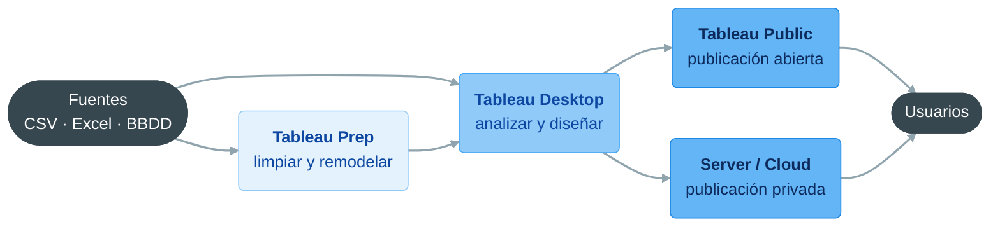
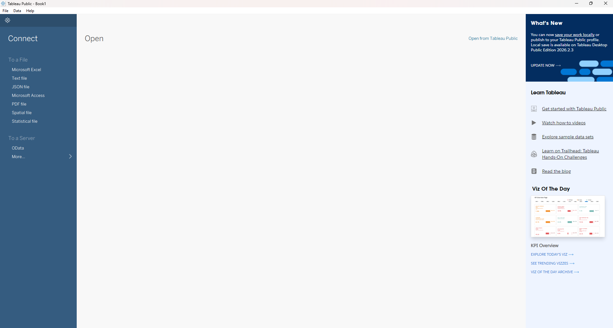
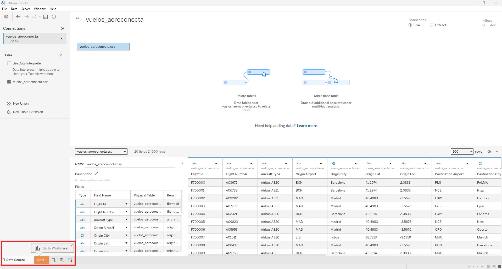
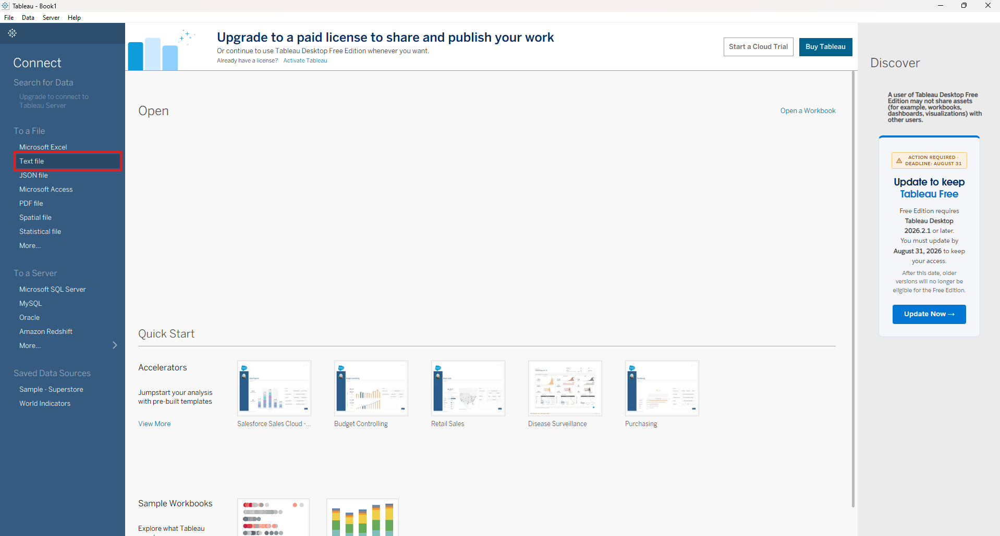
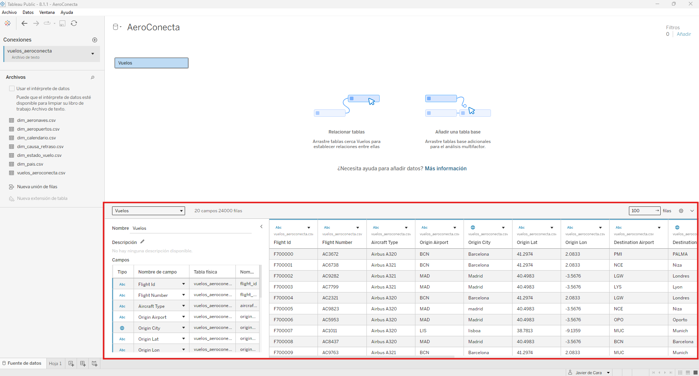
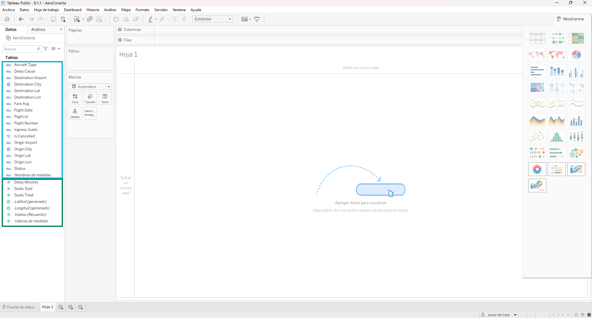
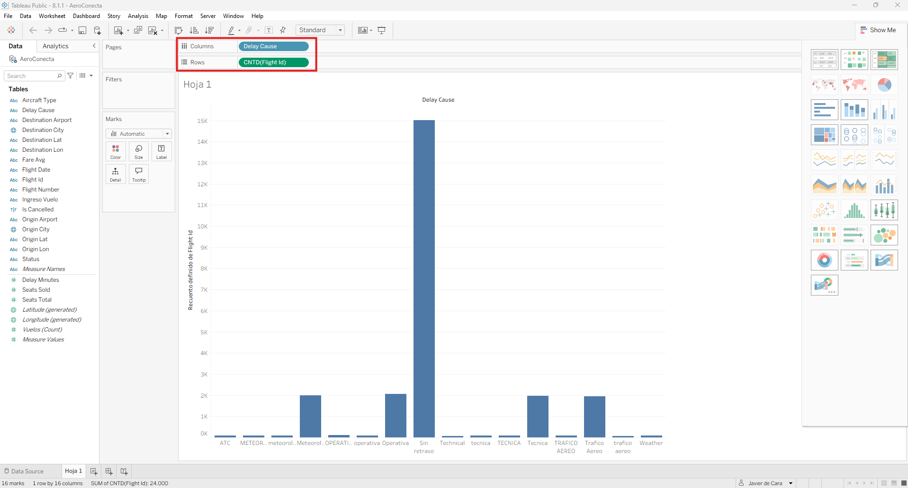

# Tableau: instalación, configuración e interfaz de trabajo

**Bloque 8 -- Tableau | Sesión 1 de 11**

[← Volver al índice del curso](../../README.md#bloque-8---tableau)

---

## 1. Introducción

Durante las próximas **11 sesiones** vamos a aprender Tableau, la segunda gran herramienta de Business Intelligence del curso después de Power BI. Al terminar el bloque sabremos conectar y preparar datos, construir visualizaciones y dashboards interactivos, escribir cálculos de tabla y expresiones LOD, trabajar con mapas y publicar el resultado.

El bloque está organizado en cinco áreas:

**8.1 · Fundamentos (8.1.1 a 8.1.5).** Instalación e interfaz, conexión y limpieza de datos, gráficos fundamentales, dashboards interactivos y publicación con buenas prácticas de diseño.

**8.2 · Preparación de datos (8.2.1).** Tableau Prep, la herramienta hermana de Tableau Desktop dedicada a limpiar y remodelar datos con un flujo visual. Con ella montaremos el modelo en estrella de AeroConecta.

**8.3 · Cálculo avanzado (8.3.1 y 8.3.2).** Cálculos rápidos y de tabla, y la pieza conceptual más importante del bloque: las expresiones LOD (`FIXED`, `INCLUDE`, `EXCLUDE`), lo más parecido que tiene Tableau a `CALCULATE` en DAX.

**8.4 · Interactividad y escala (8.4.1 y 8.4.2).** Parámetros, acciones, navegación y seguridad a nivel de fila; mapas geoespaciales, rendimiento y extractos `.hyper`.

**8.5 · Cierre (8.5.1).** Proyecto práctico: un dashboard interactivo completo, de principio a fin.

Venir de Power BI es una ventaja enorme y, a la vez, un riesgo. La ventaja: ya sabemos pensar en dimensiones, medidas, contexto de filtro, modelado y diseño de dashboards, y casi todo ese conocimiento se transfiere. El riesgo: Tableau **no es Power BI con otro logo**. Usa los mismos conceptos con otra filosofía de interacción (arrastrar campos a estantes en lugar de configurar paneles de visualización) y con un lenguaje de cálculo distinto de DAX. Cuando algo nos recuerde a Power BI, aprovecharemos la intuición; cuando no, la dejaremos a un lado y aprenderemos la forma nativa de Tableau.

### Objetivos de la sesión
- Conocer la estructura del bloque y el caso conductor, AeroConecta.
- Entender qué productos forman la familia Tableau y para qué sirve cada uno.
- Instalar Tableau Desktop eligiendo con criterio entre la edición Free y la edición Public.
- Recorrer la interfaz: Start Page, Data Source page, Worksheet, Dashboard y Story.
- Tener a mano una tabla de equivalencias Tableau ↔ Power BI para todo el bloque.
- Conectar `vuelos_aeroconecta.csv`, diagnosticar sus problemas de calidad y construir una primera visualización.

### Prerequisitos
- Bloque 7 (Power BI) completado: dimensiones y medidas, contexto de filtro, modelado y diseño de dashboards.
- Windows o macOS con conexión a internet para la instalación (Linux, con alternativas: sección 4).

---

## 2. El caso conductor: AeroConecta

Dejamos atrás HotelesMediterraneum. En el bloque de Tableau trabajamos con una empresa ficticia de otro sector: **AeroConecta**, una aerolínea. La elección es deliberada: es el caso donde Tableau tiene más que enseñarnos frente a Power BI, porque **el mapa deja de ser un adorno y se convierte en la visualización central del negocio**.

### La empresa

Aerolínea *low cost* europea fundada en 2014, con sede en Madrid. Opera desde **tres bases** (Madrid, Barcelona y Lisboa) una red de corto y medio radio que conecta **16 aeropuertos en seis países**:

| País | Aeropuertos |
|---|---|
| España | Madrid (base), Barcelona (base), Palma, Málaga, Sevilla |
| Portugal | Lisboa (base), Oporto |
| Italia | Roma, Milán, Nápoles |
| Francia | París, Lyon, Niza |
| Alemania | Berlín, Múnich |
| Reino Unido | Londres |

La flota combina **Airbus A320** (180 plazas) y **Airbus A321** (220 plazas). Todos los vuelos del dataset salen de una de las tres bases.

### El encargo

La dirección de operaciones quiere sustituir los informes semanales en Excel, que hoy tardan un día entero en montarse a mano, por dashboards interactivos que cualquier responsable de base o de ruta pueda explorar por su cuenta: filtrar por aeropuerto, ruta, causa de retraso o periodo, sin depender de un analista. El objetivo del comité de dirección cabe en una frase: **ver el negocio en un mapa**, no solo en una tabla.

Para ello, el equipo de sistemas nos entrega una muestra de **24.000 vuelos** entre enero de 2023 y septiembre de 2025, con un ingreso conjunto de casi **399 millones de euros**. Los archivos están en la carpeta [`8.0 - Dataset/`](../8.0%20-%20Dataset/). Hoy trabajamos solo con la tabla de vuelos; las tablas `dim_*.csv` las presentaremos en la 8.1.2 y las uniremos en la 8.2.1.

### Los seis KPIs de referencia

El sector aéreo comparte buena parte de la lógica del hotelero (ocupación, precio medio, ingreso combinado), así que podemos apoyarnos en lo que construimos con HotelesMediterraneum:

1. **Ocupación % (Load Factor).** Asientos vendidos divididos entre asientos disponibles. Es el equivalente exacto de la Ocupación de HotelesMediterraneum, aplicado a un avión en lugar de a un hotel. Hoy está en torno al **76%**.

2. **Yield medio (€/asiento vendido).** Ingreso total dividido entre asientos vendidos. Es el precio medio que consigue AeroConecta por cada asiento realmente ocupado — el equivalente exacto del ADR hotelero. Hoy ronda los **110 €**.

3. **Ingreso medio por asiento disponible.** Ingreso total dividido entre asientos disponibles (vendidos o no). Es el RevPAR del sector aéreo, conocido en la industria real como RASK (*Revenue per Available Seat Kilometer*, aquí simplificado sin el componente de distancia). Igual que `RevPAR = Ocupación × ADR` en hotelería, aquí `Ingreso medio por asiento disponible = Ocupación % × Yield medio` — hoy ronda los **83 €**.

4. **Retraso medio (minutos).** Media de `delay_minutes` sobre todos los vuelos. El indicador operativo por excelencia de cualquier aerolínea; hoy está en torno a los **20 minutos**.

5. **Tasa de Cancelación %.** Vuelos con `status = "Cancelado"` divididos entre vuelos totales. Exactamente el mismo concepto que la Cancellation Rate de HotelesMediterraneum; hoy ronda el **6,9%**.

6. **Ingreso Total.** Suma de `ingreso_vuelo` de todos los vuelos, desglosable por ruta, aeropuerto de origen, aeropuerto de destino, aeronave o periodo.

Aprenderemos a calcular estos seis indicadores con Tableau —primero con agregaciones simples, después con cálculos rápidos y, en la sesión 8, con expresiones LOD cuando la pregunta de negocio lo exija.

---

## 3. ¿Qué es Tableau y qué no?

**Tableau es una plataforma de analítica visual**: su especialidad es convertir datos en gráficos interactivos que se exploran arrastrando campos, sin escribir consultas. Igual que Power BI, no es un programa sino una **familia de productos**:

| Producto | Qué es | Equivalente en Power BI | En el bloque |
|---|---|---|---|
| **Tableau Desktop** | Aplicación de escritorio donde se conecta el dato, se calcula y se diseñan hojas y dashboards | Power BI Desktop | Todo el bloque |
| **Tableau Prep Builder** | Aplicación independiente para limpiar y remodelar datos con un flujo visual de pasos | Power Query | 8.2.1 |
| **Tableau Public** | Servicio gratuito en la nube donde se publican workbooks **públicos** (y nombre de una edición de Desktop) | Publicar en la web | 8.1.5 |
| **Tableau Server / Cloud** | Plataforma de pago para publicar dentro de la organización, con permisos, refrescos programados y suscripciones | Power BI Service | 8.1.5 y 8.4.1 |



Prep es opcional: Desktop conecta directamente a las fuentes y tiene herramientas de limpieza propias, que usaremos en la 8.1.2. Prep entra en juego cuando la preparación se complica (varios joins, remodelados, flujos que se repiten).

### Un poco de historia: de dónde viene Tableau

La historia de Tableau explica varias de sus diferencias con Power BI. Nace en **2003** como *spin-off* de un proyecto de investigación de la **Universidad de Stanford**: Chris Stolte, en su doctorado bajo la dirección de **Pat Hanrahan**, estudiaba cómo visualizar bases de datos relacionales de forma directa e interactiva. Aquel prototipo se llamó **Polaris** y de él salió **VizQL** (*Visual Query Language*), que sigue siendo el corazón de Tableau: traduce cada campo que arrastramos a un estante en una **consulta** a los datos y, a la vez, en un **gráfico**.

Por eso en Tableau "arrastramos campos a estantes" en lugar de "elegir un tipo de gráfico en un panel": el producto se construyó alrededor de esa idea, no al revés. Y por eso Tableau ha priorizado siempre la **exploración visual fluida** por encima de la potencia del lenguaje de cálculo o la integración con un ecosistema corporativo, terreno donde Power BI, nacido en Microsoft casi una década después, juega con ventaja. Desde 2019 Tableau pertenece a **Salesforce**. (Más detalles en *Para profundizar*.)

### Comparación con lo que ya conocemos

| Frente a... | Tableau gana en... | Pierde en... |
|---|---|---|
| **Power BI** | Libertad visual, velocidad de exploración, cartografía, dashboards pulidos con poco formato manual | Integración con Microsoft 365, potencia del lenguaje de modelado (DAX), precio para empresas que ya pagan Microsoft |
| **Excel** | Volumen de datos, relaciones entre tablas, exploración interactiva por varios usuarios | Rapidez para un cálculo puntual, familiaridad |
| **pandas** | Entregar exploración visual a quien no programa | Transformaciones complejas, estadística y machine learning |

### La frase clave

> Si ya sabemos Power BI, no estamos aprendiendo Business Intelligence desde cero: estamos aprendiendo un segundo dialecto del mismo idioma. Los conceptos (dimensión, medida, filtro, agregación, dashboard) son los mismos; la gramática (estantes en lugar de paneles, LOD en lugar de `CALCULATE`) es distinta.

---

## 4. Instalación paso a paso

### Qué ediciones existen

> **Información actualizada el 4 de septiembre de 2026.** Tableau cambia sus productos y licencias con frecuencia: verifícalo en <https://www.tableau.com>.

| Edición | Coste | Guardado | Conexión a datos | Publicar | Para qué sirve |
|---|---|---|---|---|---|
| **Desktop Free Edition** *(desde marzo de 2026)* | Gratis, sin caducidad | Local (`.twb` / `.twbx`), sin límite de filas | Completa: más de 100 conectores, bases de datos privadas, conexión *live* | **No** | Aprender y analizar en local, también con datos privados |
| **Desktop Public Edition** | Gratis | Solo en la nube de Tableau Public; máximo 15 millones de filas | Limitada: archivos y algunos conectores web; sin BBDD privadas; *live* solo a Google Drive | **Sí**, a la galería pública | Aprender, publicar y montar un portfolio público. **Prohibido el uso comercial** |
| **Trial de Desktop** | Gratis 14 días | Como Professional | Completa | Completa | Probar la publicación antes de comprar |
| **Desktop Professional** (licencia **Creator**) | ~75 $/usuario/mes, facturación anual; incluye Prep Builder | Local y publicación | Completa | Public, Cloud y Server | Uso profesional |
| **Tableau for Students** | Gratis 1 año, renovable acreditando ser estudiante | Como Creator | Completa | Completa | Estudiantes con verificación académica |

### La decisión importante: Free o Public

Entre las dos opciones gratuitas y permanentes hay que elegir **una** y mantenerla todo el bloque:


- **Free Edition.** Sin límite de filas, con todos los conectores y guardado 100 % local. Es la buena elección si queremos aprender la herramienta a fondo y, más adelante, usarla con datos propios o de empresa. A cambio, **no podremos publicar** nuestro dashboard en la 8.1.5.
- **Public Edition.** Limitada a 15 millones de filas, sin bases de datos privadas y con guardado solo en la nube pública. Es la buena elección si queremos **publicar de verdad** el dashboard y empezar un portfolio público.

> **Los workbooks de una edición no se abren en la otra.** La Public Edition no abre un `.twbx` guardado en local, y la Free Edition no abre un workbook alojado en Tableau Public. Si cambiamos de edición a mitad del bloque, habrá que reconectar el CSV y rehacer el trabajo. Por eso la decisión se toma **hoy, una sola vez**.

Si dudamos, la opción más segura es **Public Edition**: nuestras 24.000 filas están muy lejos del límite de 15 millones, no necesitamos bases de datos privadas en todo el bloque y dejamos abierta la puerta a publicar.

### Windows y macOS

A diferencia de Power BI Desktop (solo Windows), **Tableau Desktop tiene versión nativa para Windows y para macOS**, una buena noticia para quien tuvo que recurrir a una máquina virtual en el bloque 7.

Descargamos el instalador de la edición elegida:

- **Free Edition:** <https://www.tableau.com/products/desktop-free/download>
- **Public Edition:** <https://public.tableau.com/>. Pide crear antes una cuenta gratuita, porque es donde vivirán nuestros workbooks.

En ninguno de los dos casos se pide clave de licencia ni tarjeta.

### Linux

No hay versión de Tableau Desktop para Linux. Las alternativas son las mismas que vimos para Power BI: máquina virtual con Windows o escritorio remoto.

### Primer arranque

Al abrir Tableau Desktop aparece la **Start Page**, con tres columnas: **Connect** (a la izquierda, los conectores de datos), **Open** (en el centro, los archivos recientes) y **Discover** (a la derecha, recursos y ejemplos).



---

## 5. Recorrido por la interfaz: las cuatro superficies de trabajo

Tableau organiza el trabajo en cuatro superficies, accesibles con las pestañas de la parte inferior de la ventana. Es la primera diferencia estructural con Power BI: allí teníamos varios visuales en el lienzo de una página; aquí cada gráfico vive en **su propia hoja**, y las hojas se combinan después.

| Superficie | Qué se hace en ella | Equivalente en Power BI |
|---|---|---|
| **Data Source page** | Ver la vista previa de los datos, corregir tipos, renombrar campos y combinar tablas (relaciones, joins y uniones) | Vista Data y parte de Power Query |
| **Worksheet** (hoja) | Construir **una** visualización arrastrando campos a los estantes y a la tarjeta Marks | Un objeto visual concreto del lienzo |
| **Dashboard** | Combinar varias hojas en un panel con filtros compartidos e interacciones | Una página de Report view |
| **Story** | Encadenar hojas o dashboards como una presentación narrativa, con texto entre pasos | Sin equivalente directo (lo más parecido: marcadores) |



### Worksheet por dentro

Worksheet es donde pasaremos la mayor parte del bloque. Sus areas:

- **Panel Data** (izquierda): los campos de la fuente, separados en **dimensiones** (arriba) y **medidas** (abajo).
- **Estantes** (*shelves*): **Columns** y **Rows** (qué va en cada eje), **Filters** (qué datos entran) y **Pages** (animación por valores).
- **Tarjeta Marks**: el tipo de marca (barra, línea, círculo, mapa...) y sus propiedades: **Color**, **Size**, **Label**, **Detail** y **Tooltip**.
- **Show Me** (arriba a la derecha): sugiere tipos de gráfico según los campos seleccionados.

En Power BI no hay estantes: se elige primero el visual y luego se rellenan sus casillas. En Tableau el orden es el inverso: **colocamos campos y Tableau deduce el gráfico**.

### El motor que hay por debajo: Hyper

Por debajo trabaja **Hyper**, el motor de consulta en memoria de Tableau. Es un motor columnar, conceptualmente equivalente a VertiPaq en Power BI. Comprime los datos para que las agregaciones sobre millones de filas respondan casi al instante. No tiene interfaz propia; lo notaremos cuando trabajemos con **extractos** `.hyper` (8.1.2 y 8.4.2).

---

## 6. Mapa conceptual: Tableau ↔ Power BI

Esta tabla es la referencia rápida de todo el bloque. Cuando dudemos de cómo se llama algo en Tableau, volvemos aquí.

| Concepto | Power BI | Tableau |
|---|---|---|
| Motor de consulta en memoria | VertiPaq | Hyper |
| Preparación de datos con flujo de pasos | Power Query (lenguaje M) | Tableau Prep (flujo visual de nodos) |
| Lenguaje de cálculo | DAX | Fórmulas de Tableau (sintaxis parecida a Excel) y expresiones LOD |
| Cambiar el contexto de un cálculo | `CALCULATE` | Expresiones LOD (`FIXED`, `INCLUDE`, `EXCLUDE`) |
| Carga y tipado de datos | Vista Data / Editor de Power Query | Data Source page |
| Relaciones entre tablas | Vista Model | Data Source page (relaciones y joins) |
| Lienzo con varios gráficos | Página de Report view | Dashboard |
| Un gráfico individual | Visual del lienzo | Worksheet |
| Filtro para el usuario | Segmentador (*slicer*) | Filtro (estante Filters) o Parameter |
| Interacción entre gráficos al hacer clic | Filtrado cruzado / Editar interacciones | Dashboard Actions (Filter, Highlight, URL) |
| Publicación en la nube | Power BI Service | Tableau Server / Cloud / Public |
| Archivo de trabajo | `.pbix` | `.twb` (sin datos) / `.twbx` (empaquetado con datos) |
| Datos importados en memoria | Modo Import | Extract (`.hyper`) |

---

## 7. El dataset vuelos_aeroconecta.csv

### Diccionario de datos

| Columna | Tipo esperado | Descripción |
|---|---|---|
| `flight_id` | Texto | Identificador único del vuelo, de `F700000` a `F723999` |
| `flight_number` | Texto | Número de vuelo comercial (por ejemplo, `AC3672`) |
| `aircraft_type` | Texto | Modelo de avión: Airbus A320 o Airbus A321 |
| `origin_airport` | Texto | Código IATA del aeropuerto de origen (una de las tres bases) |
| `origin_city` | Texto | Ciudad de origen |
| `origin_lat`, `origin_lon` | Decimal | Coordenadas del aeropuerto de origen |
| `destination_airport` | Texto | Código IATA del aeropuerto de destino |
| `destination_city` | Texto | Ciudad de destino |
| `destination_lat`, `destination_lon` | Decimal | Coordenadas del aeropuerto de destino |
| `flight_date` | Fecha | Fecha del vuelo |
| `seats_total` | Entero | Asientos disponibles (180 o 220, según el avión) |
| `seats_sold` | Entero | Asientos vendidos |
| `fare_avg` | Decimal | Tarifa media de venta, en euros |
| `ingreso_vuelo` | Decimal | Ingreso total del vuelo, en euros |
| `delay_minutes` | Entero | Minutos de retraso sobre la hora programada |
| `delay_cause` | Texto | Causa del retraso: Sin retraso, Meteorología, Operativa, Tráfico Aéreo, Técnica |
| `status` | Texto | Estado final: Completado, Cancelado, Desviado |
| `is_cancelled` | Booleano | Indicador de cancelación |

La granularidad de la tabla es **un vuelo por fila**. Como en el bloque 7, es un dato **desnormalizado**: la ciudad y las coordenadas del aeropuerto viajan pegadas a cada vuelo en lugar de vivir en una tabla de aeropuertos aparte. Es intencionado: así llega el dato en muchas integraciones reales con sistemas de operaciones.

> Igual que en el bloque 7, el dataset **tiene problemas de calidad intencionados**. Hoy los **detectamos**; en la 8.1.2 los **resolvemos**.

---

## 8. Práctica: conectar el dataset paso a paso

### Paso 1: elegir el conector

En la Start Page, columna **Connect**, bajo **To a File**, pulsamos **Text file**.



### Paso 2: abrir el archivo

Navegamos hasta `8.0 - Dataset/vuelos_aeroconecta.csv` y lo abrimos. Tableau nos lleva directamente a la **Data Source page**.

### Paso 3: leer la cuadrícula de vista previa

En la parte inferior aparece una cuadrícula con las primeras filas. Cada columna muestra su nombre y un icono con el **tipo de dato detectado**: `Abc` para texto, `#` para número y un calendario para fecha. Al hacer clic en el icono podemos cambiar el tipo.



El primer síntoma salta a la vista: `flight_date` tiene el icono `Abc`, no el del calendario. Igual que pasó con `booking_date` en el bloque 7, es la pista de que hay formatos de fecha mezclados.

### Paso 4: observar sin tocar

Dedicamos dos minutos a recorrer la cuadrícula **sin cambiar nada**. Columna a columna: ¿las ciudades se escriben siempre igual?, ¿la causa de retraso tiene variantes?, ¿hay celdas vacías?

### Paso 5: ir a la hoja de trabajo

Pulsamos la pestaña **Sheet 1**. En el panel **Data** aparecen los campos del archivo, separados en **dimensiones** y **medidas**. Volveremos sobre esta distinción en la 8.1.3, porque es la clave de cómo Tableau decide qué gráfico dibujar.



---

## 9. Diagnóstico del dataset

Tableau no tiene un panel equivalente a *Column quality* y *Column distribution* de Power Query. El diagnóstico se hace a mano: en la Data Source page, ordenando la vista previa desde el desplegable de cada cabecera, y en una Worksheet, arrastrando un campo a **Rows** para ver todos sus valores distintos de un vistazo (lo haremos en el ejercicio 4).

Esta es la lista completa de hallazgos, con las cifras exactas del archivo:

| Tipo de problema | Columna | Qué encontramos | Se resuelve en |
|---|---|---|---|
| **Tipado** | `flight_date` | Texto con tres formatos: `2025-03-10` (15.743 filas), `23/04/2023` (5.934) y `8-4-24` (2.323) | 8.1.2 |
| **Tipado** | `fare_avg`, `ingreso_vuelo` y las cuatro coordenadas | Con Windows en español, aparecen como texto (`Abc`) y en el bloque de dimensiones: el CSV usa punto decimal (`41.2974`) y Tableau espera coma | 8.1.2 |
| **Valores inconsistentes** | `origin_city` | Solo hay 3 ciudades de origen (las bases), pero escritas de **10** formas: `Madrid`, `MADRID`, `madrid`, `Lisbon`... | 8.1.2 |
| **Valores inconsistentes** | `destination_city` | 16 ciudades escritas de **56** formas: mayúsculas mezcladas y nombres en otros idiomas (`Rome`, `Nice`, `Porto`, `London`, `Milano`, `Muenchen`...) | 8.1.2 |
| **Valores inconsistentes** | `delay_cause` | 5 causas escritas de **16** formas, con variantes en inglés (`Weather`, `Technical`, `ATC`) | 8.1.2 |
| **Nulos** | `aircraft_type` | 1.213 vuelos (5 %) sin tipo de avión | 8.1.2 |
| **Valores imposibles** | `seats_sold` | 62 vuelos con asientos vendidos negativos | 8.1.2 |
| **Coherencia entre columnas** | `status` / `is_cancelled` | 748 filas en desacuerdo: `status` marca 1.653 cancelados e `is_cancelled`, 2.333 | 8.1.2 |
| **Coherencia entre columnas** | `ingreso_vuelo` | No siempre cuadra con `seats_sold × fare_avg` (posibles ingresos extra: equipaje, cambios) | 8.1.2 |
| **Valores extremos** | `ingreso_vuelo` | Unos pocos ingresos muy por encima del resto: ¿chárter o errores de captura? | 8.1.2 |

La lista es el objetivo de la próxima sesión.

---

## 10. Práctica: la primera visualización

Volvemos a **Sheet 1** para construir un gráfico de barras: número de vuelos por causa de retraso.

### Paso 1: la dimensión a Columns

Arrastramos `delay_cause` desde el panel Data al estante **Columns**. Aparece una cabecera por cada valor distinto y, como el dato aún está sucio, hay muchas más de las cinco esperadas.

### Paso 2: la medida a Rows

Arrastramos `flight_id` al estante **Rows**. Como es una dimensión de texto, Tableau no puede sumarla; desde el desplegable de la píldora elegimos **Measure > Count (Distinct)**. Tableau dibuja automáticamente un gráfico de barras.



No hemos elegido el tipo de gráfico: **ha aparecido solo**, deducido de qué campos están en qué estantes. Una dimensión discreta en Columns y una medida continua en Rows producen, por defecto, barras verticales.

### Paso 3: el efecto del dato sucio

Tableau trata `Tecnica`, `TECNICA` y `tecnica` como **tres causas distintas**, cada una con su barra. En Power BI parte de este problema quedaba oculto, porque VertiPaq no distingue mayúsculas al agrupar textos; aquí se ve con toda su crudeza. La barra de "Técnica" real es la suma de cinco barras.

### Paso 4: renombrar y guardar

Doble clic sobre la pestaña "Sheet 1" y la renombramos a **Vuelos por Causa de Retraso (sucio)**. Guardamos con **File > Save As** como `AeroConecta_8.1.1.twbx`.

Tableau ofrece dos formatos de guardado local:

| Formato | Qué contiene | Cuándo usarlo |
|---|---|---|
| **`.twb`** | Solo la definición del workbook (hojas, cálculos, formato), con la **ruta** a los datos | Conexiones *live* a una base de datos compartida a la que el destinatario también tiene acceso |
| **`.twbx`** | El workbook **empaquetado** con los datos (CSV o extracto `.hyper`) y recursos como imágenes | Cuando el archivo tiene que abrirse en otro equipo sin depender de rutas externas. Equivale al `.pbix` |

**En el curso usaremos siempre `.twbx`**, para que cada entrega sea autosuficiente. Con la **Public Edition**, el `.twbx` local sirve como copia de trabajo, pero la entrega final del bloque será la versión publicada en Tableau Public (8.1.5).

---

## 11. Lo que Tableau ha hecho por debajo

Cada vez que soltamos un campo en un estante, VizQL hace dos cosas: **genera una consulta** a los datos y **decide cómo dibujar** el resultado.


Nuestro gráfico de barras equivale a esta consulta SQL:

```sql
SELECT delay_cause, COUNT(DISTINCT flight_id) AS vuelos
FROM vuelos_aeroconecta
GROUP BY delay_cause;
```

`GROUP BY delay_cause` sale de la dimensión en Columns, y `COUNT(DISTINCT flight_id)`, de la agregación que elegimos en la píldora de Rows. Igual que en Power BI, es una **agregación automática**: perfecta para prototipar, pero insuficiente en cuanto necesitamos una ocupación, un yield o una comparación con el periodo anterior. Para eso escribiremos **campos calculados** a partir de la 8.1.3, el equivalente en Tableau a las medidas explícitas de DAX.

Lo que el gráfico ya permite decir: la mayoría de los vuelos (unos 15.000 de 24.000) no tienen retraso relevante, y entre las causas identificadas ninguna domina de forma aplastante. Lo que todavía **no** podemos afirmar es el reparto exacto, porque cada causa está fragmentada en variantes.

---

## 12. Ejercicios

**Ejercicio 1: de Power BI a Tableau.** Sin mirar la sección 6, escribe cómo se llama en Tableau cada uno de estos elementos de Power BI:

1. Un visual dentro de una página de informe.
2. Una página de informe con varios visuales.
3. Un segmentador.
4. El archivo `.pbix`.
5. Power Query.
6. VertiPaq.

<details>
<summary>Ver la solución</summary>

1. **Worksheet** (hoja). 2. **Dashboard**. 3. **Filtro** en el estante Filters, mostrado como control, o un **Parameter**. 4. **`.twbx`** (el `.twb` no incluye los datos). 5. **Tableau Prep** para flujos complejos; para limpiezas sencillas, la **Data Source page**. 6. **Hyper**.

</details>

**Ejercicio 2: ¿`.twb` o `.twbx`?** Elige el formato en cada caso y justifícalo en una frase:

- **A.** Enviamos por correo a la directora de operaciones el análisis de puntualidad, construido sobre un CSV de nuestro portátil.
- **B.** Todo el equipo de BI trabaja contra la misma base de datos PostgreSQL de la empresa, en conexión *live*, y guarda los workbooks en una carpeta compartida.
- **C.** Entregamos la práctica de la 8.1.1 al profesor.

<details>
<summary>Ver la solución</summary>

**A: `.twbx`.** La directora no tiene nuestro CSV; con un `.twb` el workbook no encontraría los datos. **B: `.twb`.** Todos acceden a la misma base de datos, así que empaquetar una copia de los datos solo duplicaría información y la dejaría desactualizada. **C: `.twbx`.** La entrega tiene que abrirse en otro equipo sin depender de rutas locales.

</details>

**Ejercicio 3: predecir el gráfico.** Antes de probarlo en Tableau, anticipa qué dibujará cada combinación. Después compruébalo.

1. `origin_airport` en **Rows** y `SUM(seats_sold)` en **Columns**.
2. `SUM(seats_sold)` en **Columns** y `SUM(delay_minutes)` en **Rows**.
3. Lo mismo que en el punto 2, añadiendo `flight_id` al recuadro **Detail** de la tarjeta Marks.

<details>
<summary>Ver la solución</summary>

1. **Barras horizontales**, una por base (BCN, LIS, MAD). Es el mismo gráfico del paso a paso, girado: la dimensión manda en el eje vertical.
2. **Un único punto.** Con dos medidas y ninguna dimensión, Tableau agrega toda la tabla en una sola marca: el total de asientos vendidos frente al total de minutos de retraso.
3. **Un diagrama de dispersión de 24.000 puntos**, uno por vuelo. `flight_id` en Detail obliga a Tableau a desagregar por vuelo sin añadir ejes. Es la primera vez que vemos que el **nivel de detalle** de la vista lo deciden las dimensiones presentes, una idea que retomaremos a fondo con las expresiones LOD en la 8.3.2.

</details>

**Ejercicio 4: medir la suciedad.** En una hoja nueva, arrastra `destination_city` a **Rows** y `COUNTD(flight_id)` a **Columns**.

1. ¿Cuántas barras aparecen? ¿Cuántas deberían aparecer?
2. Repite con `delay_cause`. ¿Cuántos valores distintos hay?
3. ¿Qué variante de "Múnich" es la más frecuente después de la correcta?

Pista: la cifra de marcas aparece en la barra de estado, abajo a la izquierda de la ventana.

<details>
<summary>Ver la solución</summary>

1. **56 barras** para 16 ciudades reales.
2. **16 valores** para 5 causas reales.
3. Además de `Munich` (1.510 vuelos), aparecen `MUNICH` (41), `Muenchen` (37) y `munich` (35). La más frecuente de las variantes es `MUNICH`.

Este recuento es el que repetiremos en la 8.1.2 después de limpiar, para comprobar que hemos llegado a 16 y a 5.

</details>

---

## 13. Errores comunes y troubleshooting

**1. "No encuentro dónde conectar un archivo nuevo."** Para abrir un workbook existente, **File > Open**. Para añadir una fuente de datos dentro de un workbook ya abierto, **Data > New Data Source**.

**2. "El gráfico sale vacío aunque he arrastrado los campos."** Comprobamos que están en **Columns** y **Rows**, no en Filters ni en Pages. Soltar un campo en la zona equivocada es el error más frecuente del primer día.

**3. "Aparecen caracteres raros, como `é` en lugar de `é`."** Es un problema de codificación. El archivo está en UTF-8; en la Data Source page, desde el menú de la fuente de datos (arriba a la izquierda), revisamos la opción de codificación del archivo de texto.

**4. "`fare_avg`, `ingreso_vuelo` o las coordenadas aparecen como texto (`Abc`) y no puedo sumarlas."** Tableau interpreta los números del CSV según la configuración regional del sistema. Con Windows en español espera coma decimal, y `41.2974` no le parece un número. Se corrige en la Data Source page: menú de la fuente de datos (arriba a la izquierda) → **Text File Properties** → **Locale: English (United States)**. Lo haremos al empezar la 8.1.2. Si los números ya se leen bien y solo cambia cómo se ven (coma o punto), es un tema de formato: clic derecho sobre la píldora → **Format**.

**5. "`origin_lat` y `origin_lon` se comportan como números normales, no como coordenadas."** Tableau no adivina que dos columnas numéricas son latitud y longitud. Hay que asignarles el **rol geográfico**: clic derecho sobre el campo → **Geographic Role > Latitude** / **Longitude**. Lo haremos en la 8.1.3, al construir el primer mapa.

**6. "He cambiado el formato y quiero volver atrás."** `Ctrl + Z` deshace paso a paso. Para limpiar todo el formato de una hoja: **Worksheet > Clear > Formatting**.

**7. "He cambiado `flight_date` a fecha desde la cuadrícula y salen muchos nulos."** Es lo esperado: con tres formatos mezclados en la misma columna, un simple cambio de tipo no puede interpretarlos todos. Lo resolveremos en la 8.1.2 con un campo calculado, el equivalente al reto de `booking_date` en Power Query.

---

## 14. Conclusión

En esta sesión hemos conocido la estructura del bloque y a AeroConecta, la aerolínea que nos acompañará hasta la 8.5.1, con sus seis KPIs y su equivalencia con los de HotelesMediterraneum. Hemos visto qué productos forman la familia Tableau, de dónde viene su forma de trabajar arrastrando campos a estantes y cómo se compara con Power BI. Hemos instalado Tableau Desktop eligiendo entre la edición Free y la Public, hemos recorrido sus cuatro superficies y hemos dejado una tabla de equivalencias para todo el bloque. Por último, hemos conectado `vuelos_aeroconecta.csv`, hemos diagnosticado diez problemas de calidad con cifras exactas y hemos construido una primera visualización que demuestra cómo el dato sucio distorsiona el análisis. El resultado es `AeroConecta_8.1.1.twbx`. En la 8.1.2 limpiaremos el dataset en la Data Source page y guardaremos nuestro primer extracto `.hyper`.

---

## 15. Para profundizar

### Polaris y VizQL

El artículo de Stolte, Tang y Hanrahan *Polaris: A System for Query, Analysis, and Visualization of Multidimensional Relational Databases* (IEEE TVCG, 2002) describe la idea fundacional de Tableau: un **álgebra** que traduce la colocación de campos en los ejes de una tabla visual en consultas a la base de datos. Si lo leemos hoy, ya aparece casi todo lo que usamos en Tableau: los estantes Rows y Columns, las marcas y la regla que vimos en el ejercicio 3. Cada dimensión que añadimos a la vista la divide en más marcas (una por aeropuerto, una por vuelo...) y las medidas se agregan dentro de cada una.

### Show Me y la selección automática de gráficos

El botón **Show Me** viene de otra línea de investigación de Jock Mackinlay, también en Tableau: la selección automática de la representación más eficaz según el tipo de los datos (*Show Me: Automatic Presentation for Visual Analysis*, 2007). Sus reglas se basan en la percepción humana: la posición en un eje común se lee con más precisión que el área o el color, y por eso Show Me sugiere barras antes que sectores.

### Algunas fechas de la historia de Tableau

| Año | Hito |
|---|---|
| 2003 | Fundación de Tableau Software (Christian Chabot, Chris Stolte y Pat Hanrahan) como *spin-off* de Stanford |
| 2004 | Primera versión comercial de Tableau Desktop |
| 2010 | Lanzamiento de Tableau Public |
| 2013 | Salida a bolsa en la NYSE con el *ticker* `DATA` |
| 2016 | Compra de **Hyper**, una *startup* alemana surgida de la Universidad Técnica de Múnich |
| 2018 | Hyper sustituye al antiguo motor TDE (versión 10.5) |
| 2019 | Salesforce compra Tableau por unos 15.700 millones de dólares. Pat Hanrahan recibe el **Premio Turing** (junto a Ed Catmull) por sus contribuciones a los gráficos por computador, incluido RenderMan, de Pixar |

### Relaciones frente a joins

Desde la versión 2020.2, la Data Source page tiene **dos capas**: una **lógica**, donde las tablas se combinan con **relaciones** (las líneas flexibles que la comunidad llama *noodles*, parecidas a las relaciones de la vista Model de Power BI), y una **física**, donde se combinan con **joins** clásicos. Las relaciones no fusionan las tablas: Tableau decide el join adecuado en cada hoja según los campos usados. Lo veremos en la 8.1.2 y compararemos ambos enfoques con Prep en la 8.2.1.

### La galería de Tableau Public

Tableau Public aloja millones de visualizaciones de usuarios de todo el mundo, y cada día destaca una como **Viz of the Day**. Es la mejor fuente de inspiración para el diseño (y la mejor forma de aprender trucos: casi todas se pueden descargar y abrir para ver cómo están hechas). Comunidades como *Makeover Monday* o *Workout Wednesday* proponen un reto semanal sobre un dataset común.

---

## 16. Recursos

- **Ayuda oficial de Tableau Desktop** (en español): <https://help.tableau.com/current/pro/desktop/es-es/default.htm>
- **Vídeos de formación gratuitos de Tableau**: <https://www.tableau.com/learn/training>
- **Galería de Tableau Public y Viz of the Day**: <https://public.tableau.com/app/discover/viz-of-the-day>
- **Artículo original de Polaris** (Stanford): <http://graphics.stanford.edu/papers/polaris/>
- **Makeover Monday**, reto semanal de visualización: <https://makeovermonday.co.uk/>

---

*Guía del alumno · Sesión 1 · Bloque 8 - Tableau · AeroConecta*
