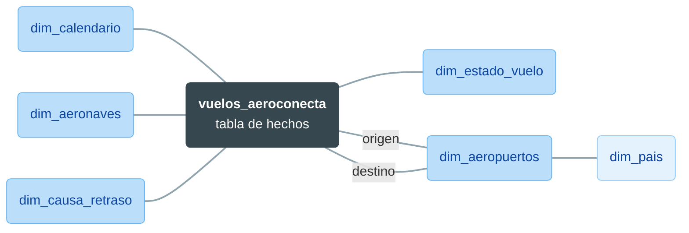
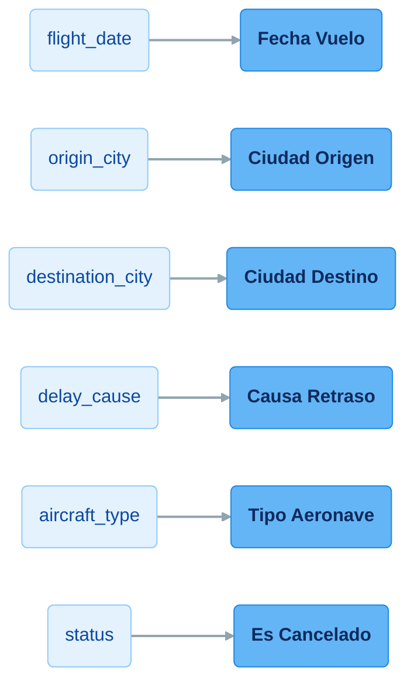

# Tableau: conexión de datos (Excel, CSV, bases de datos)

**Bloque 8 -- Tableau | Sesión 2 de 11**

[← Volver al índice del curso](../../README.md#bloque-8---tableau)

---

## 1. Introducción

En la 8.1.1 conectamos `vuelos_aeroconecta.csv`, recorrimos la interfaz y cerramos con un diagnóstico de diez problemas de calidad: fechas en tres formatos, decimales leídos como texto, ciudades y causas de retraso escritas de muchas formas, nulos, valores negativos, columnas que se contradicen e ingresos atípicos. El avance quedó en `AeroConecta_8.1.1.twbx`.

Hoy resolvemos esa lista. Para hacerlo vamos a conocer a fondo la **Data Source page**: qué tipos de fuente admite Tableau, cómo combina tablas y, sobre todo, cómo se limpia el dato con sus herramientas nativas. Son herramientas distintas de las de Power Query y, en algunos casos, más limitadas. Eso también es una lección: **cada herramienta tiene un techo de transformación**, y saber dónde está forma parte del oficio.

Al terminar, `vuelos_aeroconecta` estará limpio en Tableau, tendremos el primer extracto `.hyper` del bloque y sabremos cuándo conviene pasar la limpieza a Tableau Prep.

### Objetivos de la sesión
- Conocer los tipos de conexión de Tableau y elegir entre Live y Extract.
- Distinguir relaciones, joins y uniones en la Data Source page, y presentar el modelo en estrella de AeroConecta.
- Corregir la lectura de decimales con la configuración regional del archivo.
- Convertir `flight_date` en fecha con `DATEPARSE`.
- Unificar ciudades y causas de retraso con **Group** y con campos calculados.
- Resolver nulos, negativos, atípicos y la contradicción entre `status` e `is_cancelled`.
- Generar y guardar el primer extracto `.hyper`.

### Prerequisitos
- `AeroConecta_8.1.1.twbx` con la conexión a `vuelos_aeroconecta.csv`.
- La tabla de diagnóstico de la 8.1.1 (sección 9).

---

## 2. Tipos de conexión

### Archivos

**Text file** (CSV, TXT), **Microsoft Excel**, **JSON**, **PDF**, **Spatial file** (mapas) y **Statistical file** (SPSS, SAS, R). Cada archivo, o cada hoja de un Excel, aparece como una tabla en la Data Source page.

### Bases de datos y servicios

Tableau trae **conectores nativos** para decenas de motores y servicios: PostgreSQL, MySQL, SQL Server, Oracle, Snowflake, BigQuery, Redshift, Salesforce, Google Sheets... Al conectar, pide credenciales, muestra los esquemas y tablas disponibles y deja arrastrarlas al lienzo igual que si fueran archivos. Con el conector de PostgreSQL podríamos leer directamente la base de datos del bloque 1, sin pasar por un CSV.

> La edición **Public** solo conecta a archivos y a unos pocos servicios web. Los conectores de bases de datos necesitan la edición Free o una licencia (8.1.1, sección 4).

### Live o Extract

Es la decisión más importante al conectar, y tiene un equivalente directo en Power BI (**DirectQuery** frente a **Import**):

| | Live | Extract |
|---|---|---|
| Qué hace | Consulta la fuente original **cada vez** que tocamos la vista | Copia los datos al motor **Hyper**, en un archivo `.hyper` comprimido |
| Datos | Siempre al día | "Congelados" hasta el siguiente refresco |
| Rendimiento | Depende de la fuente (un CSV grande o una base de datos lenta se notan) | Rápido y constante |
| Sin conexión | No | Sí |
| Equivalente en Power BI | DirectQuery | Import |

Con un archivo de texto, Tableau empieza en Live. Al final de la sesión crearemos un extracto, porque es lo que haríamos con una fuente real más grande y porque las sesiones siguientes trabajarán sobre él. En la 8.4.2 mediremos la diferencia de rendimiento.

---

## 3. La Data Source page en profundidad

### Relaciones, joins y uniones

La parte superior de la Data Source page es el **lienzo**, donde se combinan las tablas. Según cómo soltemos una segunda tabla, Tableau crea una cosa u otra:

| Combinación | Cómo se crea | Qué hace | Equivalente |
|---|---|---|---|
| **Relationship** (relación) | Soltar la tabla junto a la primera, en el lienzo principal | Mantiene las tablas separadas y decide en cada hoja cómo unirlas, sin duplicar filas | Relaciones de la vista Model de Power BI |
| **Join** | Doble clic en una tabla para abrir la capa física y soltar ahí la segunda | Fusiona las tablas en una sola (Inner, Left, Right, Full) | `JOIN` de SQL, *Merge* de Power Query |
| **Union** | Soltar la tabla debajo de la primera o usar **New Union** | Apila filas de tablas con las mismas columnas | `UNION ALL` de SQL, *Append* de Power Query |

En esta sesión trabajamos con una sola tabla de hechos, así que no construiremos relaciones ni joins: los haremos en la 8.2.1 con Tableau Prep. Sí veremos la **Union**, porque es muy habitual recibir las exportaciones de operaciones en archivos mensuales.

### El modelo en estrella de AeroConecta

En la carpeta del dataset, junto a `vuelos_aeroconecta.csv`, hay seis tablas de dimensión:

| Archivo | Filas | Clave | Se une con la tabla de vuelos por... |
|---|--:|---|---|
| `dim_aeropuertos.csv` | 16 | `iata_code` | `origin_airport` y `destination_airport` (dos veces) |
| `dim_aeronaves.csv` | 4 | `modelo` | el campo limpio `Tipo Aeronave` (sección 8) |
| `dim_calendario.csv` | 1.096 | `fecha` | el campo limpio `Fecha Vuelo` (sección 6) |
| `dim_causa_retraso.csv` | 16 | `valor_original` | `delay_cause` **sin limpiar**: es una tabla de mapeo (sección 7) |
| `dim_estado_vuelo.csv` | 3 | `status` | `status` (sección 9) |
| `dim_pais.csv` | 6 | `pais_iso` | `dim_aeropuertos.pais_iso`, no la tabla de vuelos |



Es el **esquema en estrella** del bloque 7: una tabla de hechos rodeada de dimensiones que describen sus claves. `dim_pais` cuelga de `dim_aeropuertos` y no de los vuelos: es una **dimensión copo de nieve** (*snowflake*). La idea de fondo es la misma que en Power BI: la ciudad, el país y las coordenadas no deberían viajar pegadas a cada vuelo, sino vivir una sola vez en `dim_aeropuertos` y unirse por el código IATA.

Hoy solo las presentamos. En cada limpieza señalaremos qué dimensión la resolvería con un join, para llegar a la 8.2.1 con el mapa claro.

---

## 4. Uniones (Union) con comodín

### El escenario

Es frecuente que un sistema de operaciones exporte **un CSV por mes** en lugar de un archivo único. Unirlos a mano, archivo a archivo, no escala. Tableau resuelve esto con la **Union por comodín** (*wildcard*).

### Cómo se configura

En la Data Source page, clic derecho sobre la tabla `vuelos_aeroconecta.csv` → **Convert to Union**. En el diálogo, elegimos **Wildcard (automatic)** y escribimos el patrón `vuelos_aeroconecta*.csv`.

Tableau apila **todos** los archivos de la carpeta que encajen con el patrón y añade una columna **Path** o **Table Name** con el archivo de origen de cada fila. Si el mes que viene aparece `vuelos_aeroconecta_octubre.csv` en la misma carpeta, entra solo en el siguiente refresco, sin tocar el workbook.

> **Cuidado con el patrón.** En la carpeta conviven los `dim_*.csv`. Un patrón demasiado abierto (`*.csv`) apilaría también las dimensiones, que tienen otras columnas, y Tableau rellenaría de nulos las que no encajan.

Como solo tenemos un archivo de vuelos, cerramos el diálogo sin aplicar el comodín: basta con conocer el mecanismo.

---

## 5. Práctica: el plan de limpieza

Antes de empezar, este es el plan completo. Cada problema de la 8.1.1 tiene su técnica y su campo resultante:

| Problema | Técnica en Tableau | Campo limpio | Sección |
|---|---|---|---|
| Decimales leídos como texto | Configuración regional del archivo | (los mismos campos, ya numéricos) | 5 |
| `flight_date` en tres formatos | Campo calculado con `DATEPARSE` | `Fecha Vuelo` | 6 |
| `origin_city`: 3 ciudades, 10 grafías | **Group** | `Ciudad Origen` | 7 |
| `destination_city`: 16 ciudades, 56 grafías | Campo calculado con `CASE` | `Ciudad Destino` | 7 |
| `delay_cause`: 5 causas, 16 grafías | Campo calculado con `CASE` | `Causa Retraso` | 7 |
| `aircraft_type` con nulos | Campo calculado que deduce el modelo | `Tipo Aeronave` | 8 |
| `seats_sold` negativos | Filtro de fuente de datos | (filas excluidas) | 8 |
| `ingreso_vuelo` atípico | Campo de marca para revisar | `Revisar Ingreso` | 8 |
| `status` frente a `is_cancelled` | Campo calculado | `Es Cancelado` | 9 |

Una diferencia importante con Power Query: en Tableau **la limpieza no sustituye la columna original**. Cada técnica crea un **campo nuevo**, y el original sigue en el panel Data. Lo comentamos en la sección 11.

### Paso 1: leer bien los decimales

Lo primero es que Tableau lea los números como números. Con Windows en español, Tableau espera coma decimal y el CSV usa punto (`41.2974`), así que `fare_avg`, `ingreso_vuelo` y las coordenadas aparecen como texto.

En la Data Source page, abrimos el menú de la tabla `vuelos_aeroconecta.csv` en el lienzo (la flecha junto a su nombre) → **Text File Properties**. En **Locale**, elegimos **English (United States)** y aceptamos.

> **[CAPTURA 5.1]** `0.Capturas/8.1.2/5.1_Text_File_Properties.png`: diálogo *Text File Properties* con el desplegable *Locale* en *English (United States)*.

Los seis campos pasan a tener el icono `#` y, en la hoja, aparecen en el bloque de medidas. Si con tu configuración ya salían como números, este paso no cambia nada.

---

## 6. Fechas con formatos mezclados

### Por qué no basta con cambiar el tipo

Si hacemos clic en el icono `Abc` de `flight_date` y elegimos **Date**, Tableau solo entiende bien parte de las filas: las que siguen el formato ISO (`2025-03-10`). El resto queda en `Null` o, peor, mal interpretado. Lo deshacemos (`Ctrl + Z`) y vamos a la solución.

### Los tres formatos

| Formato | Ejemplo | Filas | Patrón de Tableau |
|---|---|--:|---|
| ISO | `2025-03-10` | 15.743 | `yyyy-MM-dd` |
| Día/mes/año | `23/04/2023` | 5.934 | `dd/MM/yyyy` |
| Mes-día-año corto | `6-13-24` | 2.323 | `M-d-yy` |

¿Cómo sabemos que el tercero es mes-día y no día-mes? Porque en 1.413 de esas filas el segundo número es mayor que 12, y ningún mes pasa de 12. Con el formato con barras ocurre lo contrario: el primer número supera 12 en 3.618 filas, así que es el día. **Antes de elegir un patrón, se comprueba con los datos.**

### El campo calculado

`DATEPARSE(formato, texto)` convierte un texto en fecha según un patrón explícito. Como admite un patrón por llamada, primero detectamos el formato de cada fila y después aplicamos el suyo.

En el panel **Data**, clic derecho en una zona vacía → **Create Calculated Field...**. Lo llamamos `Fecha Vuelo`:

```
IF CONTAINS([flight_date], "/") THEN
    DATEPARSE("dd/MM/yyyy", [flight_date])
ELSEIF LEN([flight_date]) = 10 THEN
    DATEPARSE("yyyy-MM-dd", [flight_date])
ELSE
    DATEPARSE("M-d-yy", [flight_date])
END
```

La lógica usa dos pistas: si hay barra, es `dd/MM/yyyy`; si no, la longitud distingue el ISO (siempre 10 caracteres) del formato corto (entre 6 y 8).

> **[CAPTURA 6.1]** `0.Capturas/8.1.2/6.1_Calculo_Fecha_Vuelo.png`: editor de campo calculado con el nombre *Fecha Vuelo*, la fórmula completa y el mensaje *The calculation is valid*.

### Comprobar el resultado

En una hoja nueva, arrastramos `Fecha Vuelo` a **Rows**: debe mostrar los años 2023, 2024 y 2025, y ningún `Null`. Si apareciera un `Null`, habría un formato que la fórmula no contempla y tocaría añadir otra rama `ELSEIF`.

A partir de ahora usamos `Fecha Vuelo` en lugar de `flight_date` para cualquier análisis temporal.

> **Con `dim_calendario`.** `Fecha Vuelo` será la clave para unir los vuelos con `dim_calendario.csv` (clave `fecha`, de 2023 a 2025). Esa dimensión trae ya calculados el año, el trimestre, el mes, la semana, el día de la semana, si es fin de semana y la **temporada** (alta de junio a septiembre, media en abril, mayo y octubre, baja de noviembre a marzo). El join, en la 8.2.1.

---

## 7. Ciudades y causas de retraso

### Dos técnicas, según el volumen

| | Group | Campo calculado con `CASE` |
|---|---|---|
| Cómo funciona | Seleccionamos variantes con el ratón y las fundimos en un miembro | Escribimos la regla que convierte cada variante en su valor correcto |
| Ventaja | Rápido y visual, sin fórmulas | Reproducible y fácil de revisar; aguanta variantes nuevas si la regla es general |
| Inconveniente | Tedioso con muchas variantes; una variante nueva queda fuera | Hay que escribir y mantener la fórmula |
| Lo usamos para | `origin_city` (10 grafías) | `destination_city` (56) y `delay_cause` (16) |

### Ciudad de origen con Group

En una hoja nueva, arrastramos `origin_city` a **Rows** para ver sus 10 valores. Seleccionamos con `Ctrl + clic` las variantes de Lisboa (`Lisboa`, `LISBOA`, `lisboa`, `Lisbon`), clic derecho → **Group**. Tableau las funde y nos deja renombrar el grupo: `Lisboa`. Repetimos con Madrid (3 variantes) y Barcelona (3).

> **[CAPTURA 7.1]** `0.Capturas/8.1.2/7.1_Group_Origen.png`: lista de `origin_city` en Rows con las cuatro variantes de Lisboa seleccionadas y el menú contextual abierto en *Group*.

Tableau crea un campo nuevo, `origin_city (group)`, que renombramos a **`Ciudad Origen`**. El campo original no cambia.

### Ciudad de destino con un campo calculado

Con 56 grafías, el Group sería largo y fácil de equivocar. Observamos que casi todas las variantes son problemas de mayúsculas, y solo 8 son nombres en otro idioma. Creamos el campo calculado `Ciudad Destino`:

```
CASE LOWER(TRIM([destination_city]))
    WHEN "rome"     THEN "Roma"
    WHEN "london"   THEN "Londres"
    WHEN "porto"    THEN "Oporto"
    WHEN "nice"     THEN "Niza"
    WHEN "naples"   THEN "Napoles"
    WHEN "milano"   THEN "Milan"
    WHEN "muenchen" THEN "Munich"
    WHEN "lisbon"   THEN "Lisboa"
    ELSE PROPER(TRIM([destination_city]))
END
```

- `TRIM` quita espacios al principio y al final; `LOWER` pasa todo a minúsculas para comparar sin preocuparnos de cómo venía escrito.
- Las 8 ramas `WHEN` traducen los nombres en otro idioma.
- Para el resto, `PROPER` pone en mayúscula la primera letra de cada palabra: `MALAGA` y `malaga` acaban como `Malaga`.

Los nombres finales van sin tilde (`Malaga`, `Napoles`, `Munich`) a propósito: son los mismos que usa `dim_aeropuertos.ciudad`, y así los dos caminos dan el mismo resultado.

### Causa de retraso con un campo calculado

Mismo patrón, campo `Causa Retraso`:

```
CASE LOWER(TRIM([delay_cause]))
    WHEN "weather"     THEN "Meteorologia"
    WHEN "technical"   THEN "Tecnica"
    WHEN "atc"         THEN "Trafico Aereo"
    WHEN "sin retraso" THEN "Sin retraso"
    ELSE PROPER(TRIM([delay_cause]))
END
```

La rama de `sin retraso` es necesaria porque `PROPER` devolvería `Sin Retraso`, con la "R" en mayúscula, y queremos el mismo valor que en `dim_causa_retraso`.

> **El camino del join: `dim_causa_retraso`.** Esa dimensión es una **tabla de mapeo**: una fila por cada una de las 16 grafías observadas (`valor_original`), con su causa correcta y atributos de negocio: `categoria`, `imputable_aerolinea` (Sí/No) y `prioridad_gestion`. Unida por `delay_cause = valor_original`, limpia las 16 variantes sin fórmulas y además dice si el retraso es responsabilidad de la aerolínea. Es la **limpieza por diccionario**, que veremos en la 8.2.1.

### Comprobar

`Ciudad Origen` debe tener 3 valores; `Ciudad Destino`, 16; `Causa Retraso`, 5. Lo verificamos en el ejercicio 3.

---

## 8. Nulos, negativos y atípicos

### Nulos en aircraft_type

Hay 1.213 vuelos sin modelo de avión. En lugar de etiquetarlos como "Desconocido", podemos **deducirlo**: solo hay dos modelos, cada uno con una capacidad fija (A320 = 180 plazas, A321 = 220), y `seats_total` está completo. Campo calculado `Tipo Aeronave`:

```
IF NOT ISNULL([aircraft_type]) THEN [aircraft_type]
ELSEIF [seats_total] = 180 THEN "Airbus A320"
ELSEIF [seats_total] = 220 THEN "Airbus A321"
ELSE "Desconocido"
END
```

Con nuestros datos se resuelven los 1.213: 613 pasan a A320 y 600 a A321. La rama `"Desconocido"` no se usa hoy, pero protege el cálculo si mañana llega un avión con otra capacidad.

Una deducción no es un dato de origen, así que la **documentamos** en la descripción del campo (clic derecho → **Default Properties > Comment**). Si no quisiéramos asumirla, la alternativa prudente sería `IFNULL([aircraft_type], "Sin identificar")`, el equivalente de `COALESCE` en SQL.

> **Con `dim_aeronaves`.** La regla "A320 = 180, A321 = 220" vive en `dim_aeronaves.csv` (columna `plazas_estandar`), junto con fabricante, familia, alcance o año de incorporación. Incluye además filas para `Desconocido` y `Sin identificar`, para que el join por `Tipo Aeronave = modelo` no pierda ningún vuelo.

### Asientos vendidos negativos

Hay 62 vuelos con `seats_sold` negativo, y en esos mismos 62 el ingreso también es negativo. No es un dato que se pueda "arreglar" inventando un valor: es un error de captura. Lo correcto es excluirlo y comunicarlo al equipo de origen.

Lo excluimos con un **filtro de fuente de datos**, que se aplica a todas las hojas del workbook: en la Data Source page, arriba a la derecha, **Filters > Add... > Add** → `seats_sold` → **Range of values**, con mínimo `0`. El recuento de vuelos pasa de 24.000 a **23.938**.

### Ingresos que no cuadran

Si comparamos `ingreso_vuelo` con `seats_sold × fare_avg`, hay dos grupos de filas que no cuadran:

| Grupo | Filas | Qué vemos | Decisión |
|---|--:|---|---|
| Desviaciones moderadas | 483 | Diferencias de hasta un ±50 % | Plausibles (equipaje, cambios de tarifa). No se tocan: `ingreso_vuelo` es la cifra de finanzas |
| Atípicos extremos | 29 | Ingresos de 60.000 € a 523.000 €, **exactamente 15 veces** lo esperado | Casi seguro un error de captura, pero la decisión es de finanzas. Se marcan para revisar |

Un factor exacto y repetido no es casualidad: apunta a un error sistemático (una unidad mal convertida, un campo multiplicado dos veces). Esos 29 vuelos suman 7,8 millones de euros cuando deberían sumar unos 0,5: inflan el ingreso total en más de 7 millones.

No los excluimos, pero sí creamos un campo para encontrarlos con facilidad, `Revisar Ingreso`:

```
[ingreso_vuelo] > 5 * [seats_sold] * [fare_avg]
```

Es un campo booleano: `True` en los 29 vuelos sospechosos. Lo usaremos como filtro cuando un análisis de ingresos lo necesite.

---

## 9. status frente a is_cancelled

Igual que en `reservas.csv` del bloque 7, hay dos columnas que deberían decir lo mismo y no siempre lo hacen. En 748 vuelos se contradicen:

| `status` | `is_cancelled` | Vuelos |
|---|---|--:|
| Completado | True | 690 |
| Desviado | True | 24 |
| Cancelado | False | 34 |

La decisión de negocio: **`status` es la fuente de verdad**, porque lo gestiona directamente el sistema de operaciones; `is_cancelled` es un indicador derivado que a veces no se sincroniza. Creamos el campo `Es Cancelado`:

```
[status] = "Cancelado"
```

Es un booleano que sustituye a `is_cancelled` en todo el bloque, también en el KPI de tasa de cancelación. La diferencia no es pequeña: con `status`, la tasa es del **6,9 %**; con `is_cancelled`, del **9,7 %**.

> **Con `dim_estado_vuelo`.** `status` es la clave de `dim_estado_vuelo.csv`, que añade `es_operado`, `es_cancelado`, `cuenta_puntualidad` y `genera_ingreso`. Deja explícito, por ejemplo, que un vuelo desviado sí cuenta para la puntualidad y sí genera ingreso.

---

## 10. Práctica: guardar el extracto .hyper

### Paso 1: cambiar a Extract

En la Data Source page, arriba a la derecha, cambiamos **Connection** de **Live** a **Extract**.

### Paso 2: revisar la configuración

Junto a la opción aparece el enlace **Edit**. Por defecto, el extracto incluye todas las filas y todos los campos. Lo dejamos así; en la 8.4.2 veremos cómo reducir el volumen con filtros de extracto. El filtro de fuente de datos `seats_sold >= 0` se aplica también al extracto.

> **[CAPTURA 10.1]** `0.Capturas/8.1.2/10.1_Extract_Filtro.png`: esquina superior derecha de la Data Source page con *Extract* seleccionado y *Filters: 1*.

### Paso 3: generar el extracto

Al ir a una hoja, Tableau pide dónde guardar el extracto. Lo guardamos como `vuelos_aeroconecta.hyper` en la carpeta del dataset. En unos segundos procesa las filas y deja el archivo listo.

Desde ese momento, todas las hojas consultan el `.hyper` y no el CSV. Con 23.938 filas la mejora apenas se nota; con millones de filas es la diferencia entre esperar y no esperar.

### Paso 4: guardar el workbook

**File > Save As**, como `AeroConecta_8.1.2.twbx`. El `.twbx` empaqueta el extracto dentro, así que el archivo funciona en cualquier equipo.

---

## 11. Lo que Tableau ha hecho por debajo

### Campos derivados en lugar de pasos aplicados

En Power Query, cada limpieza era un paso de la lista *Applied Steps* que transformaba la columna. En Tableau, cada limpieza ha creado un **campo nuevo** y el original sigue ahí:



La consecuencia práctica: **es responsabilidad nuestra usar siempre los campos limpios**. No hay un "Cerrar y aplicar" que lo imponga. Un buen hábito es ocultar los originales que ya no usaremos: clic derecho → **Hide**. Siguen existiendo (y los cálculos que dependen de ellos funcionan), pero desaparecen del panel Data y no se pueden arrastrar por error.

Y el extracto `.hyper` no guarda "los pasos": guarda los datos ya leídos con la configuración regional y el filtro aplicados. Los campos calculados se evalúan sobre él.

### Cuándo pasar a Tableau Prep

Todo lo de hoy se ha podido hacer en Desktop, pero con fórmulas artesanales y con algo de repetición. La regla práctica:

| Si la limpieza... | Herramienta |
|---|---|
| Cabe en unos pocos campos calculados claros | Tableau Desktop (Data Source page y cálculos) |
| Acumula fórmulas anidadas, se repite en varias tablas, necesita varios joins, pivotar columnas o un perfil de calidad por columna | Tableau Prep (8.2.1) |

### Los campos limpios son las claves del modelo

No es casualidad que los campos limpios coincidan casi uno a uno con las claves de las dimensiones de la sección 3. Limpiar un campo y **modelar** con él son la misma tarea en dos momentos: hoy dejamos las claves en condiciones; en la 8.2.1 haremos los joins y la ciudad, el país, la temporada o si un retraso es imputable a la aerolínea llegarán servidos por su dimensión.

---

## 12. Ejercicios

**Ejercicio 1: ¿Live o Extract?** Elige el modo de conexión y justifícalo en una frase:

- **A.** Un dashboard de la torre de control de AeroConecta que muestra los retrasos de los vuelos que están operando ahora mismo.
- **B.** El informe mensual de ingresos por ruta, que la dirección consulta el primer lunes de cada mes.
- **C.** Un análisis exploratorio sobre un CSV de 30 millones de filas en un portátil.

<details>
<summary>Ver la solución</summary>

**A: Live.** El valor del dashboard es que los datos estén al día al minuto. **B: Extract**, con un refresco programado tras el cierre de mes: los datos no cambian durante el mes y el rendimiento es mejor. **C: Extract.** Consultar en Live un archivo plano de ese tamaño en cada interacción sería muy lento; Hyper está pensado justo para esto.

</details>

**Ejercicio 2: patrones de fecha.** Escribe el patrón de `DATEPARSE` para cada texto:

1. `2024.03.15`
2. `15-Mar-2024`
3. `20240315`
4. `3/15/24 14:30`

<details>
<summary>Ver la solución</summary>

1. `yyyy.MM.dd`. 2. `dd-MMM-yyyy` (`MMM` es la abreviatura del mes; ojo, depende del idioma). 3. `yyyyMMdd`. 4. `M/d/yy HH:mm`. Cuidado con `MM` (mes) frente a `mm` (minutos): es el error más frecuente.

</details>

**Ejercicio 3: comprobar la limpieza.** En una hoja nueva, comprueba cada campo limpio arrastrándolo a **Rows** y mirando el número de marcas en la barra de estado:

1. ¿Cuántos valores tienen `Ciudad Origen`, `Ciudad Destino` y `Causa Retraso`?
2. ¿Cuántos vuelos hay con `COUNTD(flight_id)` tras el filtro de fuente de datos?
3. ¿Cuántos vuelos tienen `Revisar Ingreso = True`?
4. ¿Cuántos vuelos de `Tipo Aeronave` hay de cada modelo?

<details>
<summary>Ver la solución</summary>

1. **3, 16 y 5**. Si sale alguno más, hay una variante que la fórmula no cubre (por ejemplo, un espacio interno doble).
2. **23.938** (24.000 menos los 62 negativos).
3. **29**.
4. A320: 11.475 con modelo de origen + 613 deducidos = **12.088**. A321: 11.312 + 600 = **11.912**. Coinciden exactamente con los vuelos de 180 y 220 plazas, que es la comprobación de que la regla es coherente. (Las cifras son antes de aplicar el filtro; tras él cambian ligeramente.)

</details>

**Ejercicio 4: el coste de elegir mal la fuente de verdad.** Crea dos campos calculados para la tasa de cancelación, uno con `Es Cancelado` y otro con `is_cancelled`:

```
SUM(IIF([Es Cancelado], 1, 0)) / COUNTD([flight_id])
```

Escribe el segundo tú. ¿Qué tasa sale con cada uno? ¿Cuántos puntos de diferencia hay y qué le dirías a la dirección si te preguntara cuál es la buena?

<details>
<summary>Ver la solución</summary>

El segundo: `SUM(IIF([is_cancelled], 1, 0)) / COUNTD([flight_id])`. Con el filtro aplicado salen **6,9 %** (`Es Cancelado`) y **9,7 %** (`is_cancelled`): casi tres puntos de diferencia, un 40 % más de cancelaciones aparentes. A la dirección le diríamos que la cifra oficial es la de `status`, porque lo gestiona el sistema de operaciones, y que hay 748 vuelos en los que `is_cancelled` no está sincronizado: conviene avisar al equipo de sistemas.

</details>

---

## 13. Errores comunes y troubleshooting

**1. "No encuentro Text File Properties."** El menú está en la tabla, no en la conexión: en el lienzo de la Data Source page, flecha junto a `vuelos_aeroconecta.csv`. Si hemos convertido la tabla en una Union, la opción está en el menú de la Union.

**2. "DATEPARSE me da error o devuelve `Null` en todas las filas."** El primer argumento tiene que ser el patrón entre comillas dobles, con los símbolos de Tableau (`yyyy`, `MM`, `dd`). Revisamos no haber confundido `MM` (mes) con `mm` (minutos).

**3. "No encuentro el grupo que he creado."** Aparece en el panel Data como `origin_city (group)`, con un icono de clip. Se renombra con clic derecho → **Rename**.

**4. "Tras el Group o el CASE, sigue saliendo alguna variante."** Hay una grafía que no vimos, por ejemplo con un espacio interno. Ordenar la lista alfabéticamente ayuda a detectar valores que parecen iguales y no lo son. En el `CASE`, se añade una rama `WHEN` más.

**5. "Las hojas antiguas siguen usando `is_cancelled`."** Es lo esperado: un campo calculado no sustituye al original. Hay que reemplazarlo a mano en cada hoja; ocultar los campos sucios (sección 11) evita que vuelva a pasar.

**6. "El extracto `.hyper` ocupa más que el CSV."** Con pocos datos puede pasar, porque Hyper añade metadatos. Con volúmenes grandes, su compresión por columnas suele ocupar bastante menos que el CSV.

**7. "He cambiado la Locale y ahora `flight_date` se ve distinto."** La configuración regional afecta a cómo Tableau interpreta textos que parecen números o fechas. `Fecha Vuelo` usa `DATEPARSE` con patrones explícitos, así que no depende de ella: es una buena razón para no fiarse de la detección automática de fechas.

---

## 14. Conclusión

En esta sesión hemos recorrido los tipos de conexión de Tableau y la decisión entre Live y Extract, y hemos distinguido relaciones, joins y uniones en la Data Source page. Hemos presentado el modelo en estrella de AeroConecta, con sus seis dimensiones, y la Union por comodín para archivos mensuales. Después hemos resuelto la lista de la 8.1.1: la configuración regional para leer los decimales, `DATEPARSE` para las fechas, Group y `CASE` para ciudades y causas, la deducción del modelo de avión, un filtro de fuente de datos para los negativos, una marca para los 29 ingresos atípicos y `Es Cancelado` como fuente de verdad de las cancelaciones. Cerramos con el primer extracto `.hyper` y `AeroConecta_8.1.2.twbx`. En la 8.1.3 dejamos la limpieza y entramos en el corazón de Tableau: las primeras hojas de barras, líneas, mapa y tabla.

---

## 15. Para profundizar

### Data Interpreter

En la Data Source page, la casilla **Use Data Interpreter** intenta limpiar automáticamente hojas de Excel "decoradas": títulos encima de la tabla, celdas combinadas, filas de totales o notas al pie. No sirve para nuestros problemas (son de contenido, no de formato), pero es muy útil con los Excel que se exportan de sistemas financieros.

### Pivot y Split en la Data Source page

Sin salir de Desktop hay dos remodelados más: **Pivot** (seleccionar varias columnas → clic derecho → *Pivot*) convierte columnas en filas, como *Unpivot* en Power Query; y **Split** divide una columna de texto por un separador. Cuando hacen falta con frecuencia, es otra señal para pasar a Prep.

### Relaciones y el "nivel de detalle" de cada tabla

Las relaciones (Tableau 2020.2 en adelante) evitan un problema clásico de los joins: si unimos vuelos con una tabla de objetivos mensuales por ruta, el join repite el objetivo en cada vuelo y la suma se dispara. Una relación agrega cada tabla a su propio nivel antes de combinarlas. Es la misma idea que el filtrado entre tablas del modelo de Power BI, y la retomaremos con las LOD en la 8.3.2.

### Hyper fuera de Tableau

El motor Hyper también se puede usar desde código: la **Hyper API** permite crear y leer archivos `.hyper` desde Python, Java o C++. Se usa para generar extractos desde procesos ETL (bloque 3) sin abrir Tableau.

---

## 16. Recursos

- **Funciones de fecha y patrones de `DATEPARSE`**: <https://help.tableau.com/current/pro/desktop/es-es/functions_functions_date.htm>
- **Funciones de cadena** (`TRIM`, `LOWER`, `PROPER`...): <https://help.tableau.com/current/pro/desktop/es-es/functions_functions_string.htm>
- **Unir datos con Union**: <https://help.tableau.com/current/pro/desktop/es-es/union.htm>
- **Extraer los datos**: <https://help.tableau.com/current/pro/desktop/es-es/extracting_data.htm>
- **Hyper API**: <https://tableau.github.io/hyper-db/>

---

*Guía del alumno · Sesión 2 · Bloque 8 - Tableau · AeroConecta*
