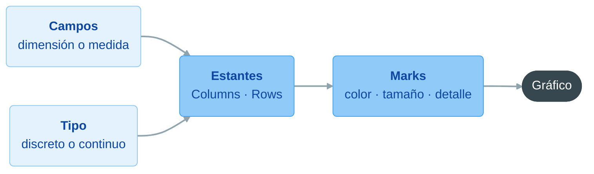

# Tableau: creación de visualizaciones, gráficos fundamentales

**Bloque 8 -- Tableau | Sesión 3 de 11**

[← Volver al índice del curso](../../README.md#bloque-8---tableau)

---

## 1. Introducción

En la 8.1.2 dejamos `vuelos_aeroconecta` limpio: `Fecha Vuelo`, `Ciudad Origen`, `Ciudad Destino`, `Causa Retraso`, `Tipo Aeronave` y `Es Cancelado` sustituyen a los campos sucios, los 62 vuelos con asientos negativos están excluidos y todo trabaja sobre un extracto `.hyper`. El avance quedó en `AeroConecta_8.1.2.twbx`.

Hoy entramos en el corazón visual de Tableau. Primero entenderemos cómo "piensa" una hoja: qué hace cada estante, qué significa que un campo sea **discreto** o **continuo** y cómo esa combinación decide el gráfico. Después construiremos cuatro hojas que responden a cuatro preguntas de AeroConecta, con los cuatro gráficos más habituales de cualquier analista: **barras, líneas, mapa y tabla**. En la 8.1.4 añadiremos gráficos más elaborados y lo combinaremos todo en el primer dashboard.

### Objetivos de la sesión
- Conocer la función de cada estante y de la tarjeta Marks.
- Distinguir dimensión y medida, discreto y continuo, y prever su efecto en el gráfico.
- Usar Show Me y, sobre todo, construir los gráficos a mano.
- Construir cuatro hojas: barras por causa de retraso, evolución mensual, mapa de destinos y tabla de KPIs.
- Escribir los primeros KPIs como campos calculados: `Ocupación %` y `Yield Medio`.

### Prerequisitos
- `AeroConecta_8.1.2.twbx` con los campos limpios y el extracto `.hyper` activo.

> **Sobre el modelo.** Seguimos trabajando solo con la tabla de vuelos y sus campos limpios. Las dimensiones `dim_*.csv` se unen en la 8.2.1; en cada hoja señalaremos qué aportaría la dimensión correspondiente.

---

## 2. Anatomía de una hoja de trabajo

| Zona | Qué hace | Equivalente en Power BI |
|---|---|---|
| **Columns** y **Rows** | Definen los ejes. Un campo discreto crea cabeceras; uno continuo, un eje con escala | Los ejes X e Y del visual |
| **Filters** | Decide qué filas entran en la hoja | Panel de filtros "de este objeto visual" |
| **Pages** | Divide la vista en páginas por los valores de un campo, con controles para animarla | Eje de reproducción del gráfico de dispersión |
| **Marks** | Elige el tipo de marca (barra, línea, círculo, texto, mapa...) y sus propiedades: **Color**, **Size**, **Label**, **Detail**, **Tooltip** | Las casillas de formato y leyenda del visual |
| **Show Me** | Sugiere gráficos compatibles con los campos seleccionados | El catálogo de objetos visuales |

La regla básica: **los estantes Columns y Rows deciden la estructura del gráfico; la tarjeta Marks decide cómo se ve cada marca**. Un campo en Color o Size cambia la apariencia sin tocar los ejes. Un campo en **Detail** no cambia la apariencia, pero **divide la vista en más marcas**: lo usaremos en el mapa.

### Show Me

El botón **Show Me** (arriba a la derecha) muestra miniaturas de tipos de gráfico. Si seleccionamos campos en el panel Data (con `Ctrl + clic`), resalta los compatibles y, al elegir uno, coloca los campos por nosotros. Es útil para descubrir gráficos, pero no conviene depender de él: entender dónde va cada campo es lo que permite corregir un gráfico que no sale como esperábamos. Hoy lo usaremos solo para la tabla de KPIs, y veremos qué ha hecho por debajo.

---

## 3. Dimensiones y medidas, discreto y continuo

Es el concepto que más sorprende al llegar de Power BI, porque añade un segundo eje de clasificación.

### Dimensión o medida

Igual que en Power BI: una **dimensión** es un campo por el que se agrupa o se corta (`Ciudad Destino`, `Causa Retraso`); una **medida** es un campo que se agrega (`seats_sold`, `delay_minutes`). En el panel Data aparecen separadas por una línea: dimensiones arriba, medidas abajo.

### Discreto o continuo

Además, cada campo es **discreto** (valores separados, se muestra en **azul**) o **continuo** (una escala sin cortes, se muestra en **verde**). Casi siempre las dimensiones son discretas y las medidas continuas, pero **no es una regla fija**: se puede cambiar desde el menú de la píldora, y el gráfico cambia por completo.

| | Discreto (azul) | Continuo (verde) |
|---|---|---|
| En un eje | Crea cabeceras, una por valor | Crea un eje con escala |
| Uso típico | Comparar categorías | Mostrar tendencias y magnitudes |
| Con una fecha | Un "cajón" por año, mes... (los periodos sin datos desaparecen) | Una línea de tiempo real (los huecos se ven) |
| Con un número | Una cabecera por cada valor exacto (raro, salvo en códigos) | Un eje de magnitud (lo habitual) |

### El caso de las fechas

Las fechas son donde más se nota. En el menú de una píldora de fecha hay **dos bloques** con los mismos nombres (Year, Quarter, Month...):

- El **bloque de arriba** es discreto. `MONTH(Fecha Vuelo)` discreto agrupa todos los eneros juntos, todos los febreros juntos...: 12 cajones, sumando los tres años.
- El **bloque de abajo** es continuo. `MONTH(Fecha Vuelo)` continuo es cada mes de cada año en su sitio: 33 puntos, de enero de 2023 a septiembre de 2025.

> **[CAPTURA 3.1]** `0.Capturas/8.1.3/3.1_Menu_Fecha.png`: menú de la píldora `Fecha Vuelo` desplegado, con el bloque discreto arriba y el continuo abajo, y la opción *Month* del bloque continuo resaltada.

Volveremos sobre esto en el ejercicio 1.

---

## 4. Qué gráfico para qué pregunta

Retomamos la guía de selección de gráficos de la 7.1.5, traducida a estantes:

| Pregunta de negocio | Estantes | Marca |
|---|---|---|
| Comparar una medida entre categorías | Dimensión discreta en Rows, medida continua en Columns (o al revés) | Bar |
| Ver la evolución en el tiempo | Fecha **continua** en Columns, medida en Rows | Line |
| Ver la distribución geográfica | Latitud y longitud en los ejes, dimensión en Detail, medida en Size o Color | Circle o Map |
| Ver valores exactos | Dimensión en Rows, medidas en Text | Text |
| Ver la relación entre dos medidas | Una medida en cada eje | Circle |
| Ver la composición de un total | Dimensión en Color, medida en Angle | Pie (con las mismas reservas que en Power BI) |

Hoy construimos las cuatro primeras. El resto, en la 8.1.4.

---

## 5. Práctica: Hoja 1, Vuelos por Causa de Retraso

**Pregunta:** ¿cuántos vuelos sufre cada causa de retraso?

Creamos una hoja nueva (icono de nueva hoja junto a las pestañas inferiores) y la llamamos **Vuelos por Causa de Retraso**.

### Paso 1: los estantes

Arrastramos `Causa Retraso` a **Rows** y `flight_id` a **Columns**, con la agregación **Measure > Count (Distinct)**. Ponemos la dimensión en Rows para que los nombres de las causas se lean en horizontal: con etiquetas largas, las barras horizontales siempre se leen mejor.

### Paso 2: ordenar

En la barra de herramientas, botón **Sort Descending**. Las causas quedan de mayor a menor.

### Paso 3: etiquetas y color

Con `Ctrl` pulsado, arrastramos la píldora `CNTD(flight_id)` desde Columns al recuadro **Label** de la tarjeta Marks (`Ctrl` la copia en lugar de moverla). Cada barra muestra su valor. En **Color** dejamos un único color: las causas ya se identifican por su posición, y colorearlas sería ruido.

### Paso 4: formato del número

Clic derecho sobre la píldora `CNTD(flight_id)` → **Format** → **Numbers > Number (Custom)**, con cero decimales y separador de miles.

**Resultado esperado:** cinco barras. `Sin retraso` (14.987) domina; las cuatro causas reales quedan muy igualadas, entre 2.200 y 2.275 vuelos cada una. Es la versión limpia del gráfico de 16 barras de la 8.1.1.

---

## 6. Práctica: Hoja 2, Evolución Mensual

**Pregunta:** ¿cómo evoluciona el número de vuelos y cuánto pesa el verano?

Nueva hoja: **Evolución Mensual**.

### Paso 1: la fecha continua en Columns

Arrastramos `Fecha Vuelo` a **Columns**. Llega como `YEAR(Fecha Vuelo)` discreto, en azul. Desde el menú de la píldora, en el **bloque continuo**, elegimos **Month**. La píldora se vuelve verde y el eje pasa a ser una línea de tiempo de enero de 2023 a septiembre de 2025.

### Paso 2: los vuelos en Rows

Arrastramos `flight_id` a **Rows** con **Count (Distinct)**. La marca cambia sola a **Line**: una medida continua sobre una fecha continua es, para Tableau, una tendencia.

### Paso 3: una línea por avión

Arrastramos `Tipo Aeronave` al recuadro **Color**. La línea se divide en dos, una por modelo, con su leyenda.

### Paso 4: línea de referencia

En la pestaña **Analytics** (junto a Data, en el panel izquierdo), arrastramos **Average Line** al lienzo y la soltamos sobre **Pane**: cada línea tendrá su propia media. Es el equivalente a la línea de promedio del panel Análisis de Power BI.

> **[CAPTURA 6.1]** `0.Capturas/8.1.3/6.1_Evolucion_Mensual.png`: hoja *Evolución Mensual* con las dos líneas por modelo, sus líneas de media y los picos de junio a septiembre de cada año.

**Resultado esperado:** una estacionalidad muy marcada. De octubre a mayo, AeroConecta opera unos 550 a 640 vuelos al mes; de junio a septiembre, alrededor de 1.000 (con un máximo de 1.068 en julio de 2024). El verano de 2025 se queda algo por debajo, en torno a 900: una pregunta interesante para negocio. Las dos líneas por modelo siguen el mismo patrón con volúmenes muy parecidos.

> **Qué aportaría `dim_calendario`.** Tras el join de la 8.2.1 tendremos `temporada` (Alta, Media, Baja) servida por la dimensión: podríamos colorear por temporada o filtrar la temporada alta sin escribir ningún `IF` con meses.

---

## 7. Práctica: Hoja 3, Mapa de Destinos

**Pregunta:** ¿adónde vuela AeroConecta y con qué intensidad?

Nueva hoja: **Mapa de Rutas**. (Mantenemos este nombre porque es la hoja que evolucionará hasta el mapa de rutas con líneas de la 8.4.2.)

### Por qué usamos las coordenadas de destino

Todos los vuelos salen de una de las **tres bases**, así que un mapa con `origin_lat` y `origin_lon` solo dibujaría tres puntos. Para ver la red completa, los **16 aeropuertos**, usamos las coordenadas de **destino** (las bases también aparecen como destino de los vuelos de vuelta).

### Paso 1: el rol geográfico

Clic derecho sobre `destination_lat` en el panel Data → **Geographic Role > Latitude**. Lo mismo con `destination_lon` → **Longitude**. El icono pasa a ser un globo. (Si no aparece la opción, revisa que los campos sean numéricos: 8.1.2, sección 5.)

### Paso 2: el mapa

Arrastramos `destination_lon` a **Columns** y `destination_lat` a **Rows**. Tableau dibuja un mapa base con **un único punto**: ha calculado la media de todas las latitudes y longitudes de la tabla. Es la regla que vimos en la 8.1.1: sin una dimensión que divida la vista, todo se agrega en una sola marca.

Arrastramos `Ciudad Destino` a **Detail**. Ahora sí: **16 puntos**, uno por destino. Cambiamos la marca a **Circle**.

### Paso 3: tamaño y tooltip

- `flight_id` con **Count (Distinct)** a **Size**: más vuelos, círculo más grande.
- `AVG(delay_minutes)` a **Tooltip**, y en el botón **Tooltip** de la tarjeta Marks redactamos el texto: *"`<Ciudad Destino>`: `<CNTD(flight_id)>` vuelos, retraso medio de `<AVG(delay_minutes)>` minutos"*.

> **[CAPTURA 7.1]** `0.Capturas/8.1.3/7.1_Mapa_Destinos.png`: mapa de Europa con los 16 círculos de destino, los tres de las bases visiblemente más pequeños, y el tooltip abierto sobre uno de ellos.

**Resultado esperado:** los 13 destinos que no son base reciben entre 1.530 y 1.630 vuelos cada uno; Londres y Sevilla, los que más. Las tres bases reciben menos (entre 1.040 y 1.140), porque solo llegan a ellas los vuelos entre bases. Un mapa equilibrado, con la red muy repartida.

> **Qué aportaría `dim_aeropuertos`.** Tras el join de la 8.2.1, las coordenadas vendrían una sola vez desde la dimensión (no repetidas en cada vuelo), junto con `es_hub` y `tipo_base` para distinguir en el mapa las bases del resto sin cálculos adicionales.

---

## 8. Práctica: Hoja 4, Tabla de KPIs

**Pregunta:** ¿cambian la ocupación, el precio o el retraso según la causa del retraso?

Nueva hoja: **Tabla KPIs**. Antes, necesitamos los dos primeros KPIs del bloque como campos calculados.

### Campo calculado: Ocupación %

Clic derecho en el panel Data → **Create Calculated Field**. Nombre: `Ocupación %`.

```
SUM([seats_sold]) / SUM([seats_total])
```

Es la Ocupación de HotelesMediterraneum aplicada a un avión. Clic derecho sobre el campo → **Default Properties > Number Format > Percentage**, con un decimal.

> **Por qué `SUM / SUM` y no la media de los porcentajes.** Igual que en DAX, una ratio se calcula dividiendo los totales, no promediando las ratios de cada fila. Así un A321 de 220 plazas pesa más que un A320 de 180, como debe ser. En Tableau, poner `SUM()` dentro de la fórmula hace que el campo sea un **cálculo agregado**: se calcula siempre al nivel de la vista, como una medida de DAX.

### Campo calculado: Yield Medio

Nombre: `Yield Medio`.

```
SUM([ingreso_vuelo]) / SUM([seats_sold])
```

Es el ingreso por asiento vendido: el ADR del sector aéreo. Formato **Currency (Custom)** en euros, con un decimal.

### Paso 1: construir la tabla con Show Me

Con `Ctrl + clic`, seleccionamos en el panel Data: `Causa Retraso`, `flight_id`, `Ocupación %`, `Yield Medio` y `delay_minutes`. Abrimos **Show Me** y elegimos **text tables**.

### Paso 2: entender lo que ha hecho Show Me

Tableau ha creado una tabla con una fila por causa y una columna por medida. Para conseguirlo, ha usado dos campos especiales que aparecen siempre al final del panel Data:

- **Measure Names**, en **Columns**: una cabecera por cada medida.
- **Measure Values**, en **Text**: el valor de cada medida en su celda.
- Debajo de la tarjeta Marks, la tarjeta **Measure Values** lista qué medidas entran en la tabla.

Ajustamos las medidas en esa tarjeta: cambiamos la agregación de `flight_id` a **Count (Distinct)** y la de `delay_minutes` a **Average** (clic derecho sobre cada píldora → **Measure**). Arrastramos las píldoras dentro de la tarjeta para ordenarlas: vuelos, ocupación, yield y retraso.

> **[CAPTURA 8.1]** `0.Capturas/8.1.3/8.1_Tabla_KPIs.png`: hoja *Tabla KPIs* con *Measure Names* en Columns, la tarjeta *Measure Values* con las cuatro medidas y la tabla de cinco filas.

> **Por qué no basta con arrastrar las cuatro medidas a Columns.** Cada medida continua en Columns crea **su propio eje**: saldrían cuatro gráficos de barras uno junto a otro, no una tabla. Measure Names y Measure Values son el truco de Tableau para poner varias medidas en la misma "columna" de una tabla.

### Paso 3: legibilidad

Filas en bandas: **Format > Shading**, con un gris muy claro en **Row Banding**. Es el equivalente a las "filas con bandas" de las tablas de Power BI.

**Resultado esperado:**

| Causa Retraso | Vuelos | Ocupación % | Yield Medio | Retraso medio |
|---|--:|--:|--:|--:|
| Sin retraso | 14.987 | 75,9 % | 110,0 € | 5,4 min |
| Operativa | 2.275 | 76,6 % | 109,0 € | 44,8 min |
| Meteorologia | 2.260 | 75,8 % | 107,8 € | 45,0 min |
| Tecnica | 2.216 | 76,3 % | 111,3 € | 43,0 min |
| Trafico Aereo | 2.200 | 75,9 % | 109,1 € | 44,8 min |

La lectura es interesante precisamente porque **no hay diferencias**: la ocupación y el yield son prácticamente iguales en todas las causas. Tiene sentido: los billetes se venden semanas antes y el retraso no cambia lo que ya se vendió. Lo que sí cambia es el retraso medio: unos 44 minutos cuando hay causa frente a 5 cuando no. Una tabla que confirma que dos variables **no** están relacionadas también es un hallazgo.

### Paso 4: guardar

**File > Save As**, como `AeroConecta_8.1.3.twbx`.

---

## 9. Lo que Tableau ha hecho por debajo

### Estantes como gramática, no como catálogo

En toda la sesión no hemos elegido un tipo de gráfico de una lista (salvo con Show Me): el gráfico **ha salido** de dónde colocamos los campos y de si eran discretos o continuos.



Es la diferencia de fondo con Power BI: allí partimos de un catálogo de visuales y rellenamos sus casillas; aquí partimos de una gramática y el gráfico es la consecuencia. Tableau da más control y más velocidad para explorar; Power BI, más previsibilidad al empezar.

### Cada marca es una fila de una consulta

En todas las hojas, el número de marcas lo deciden las dimensiones presentes en la vista (en ejes, Color o Detail). El mapa de 16 círculos equivale a:

```sql
SELECT ciudad_destino,
       AVG(destination_lat)      AS lat,
       AVG(destination_lon)      AS lon,
       COUNT(DISTINCT flight_id) AS vuelos
FROM vuelos_aeroconecta
GROUP BY ciudad_destino;
```

Sin `Ciudad Destino` en Detail, desaparece el `GROUP BY` y queda una sola fila: el punto único del paso 2. Cuando un gráfico de Tableau no sale como esperamos, la pregunta casi siempre es la misma: **¿qué dimensiones hay en la vista?**

---

## 10. Ejercicios

**Ejercicio 1: discreto o continuo.** En una hoja nueva, coloca `Fecha Vuelo` en Columns como `MONTH` **discreto** y `CNTD(flight_id)` en Rows.

1. ¿Cuántas marcas salen y qué representa cada una?
2. ¿Cuántos vuelos tiene la marca de julio?
3. ¿Qué pregunta de negocio responde mejor esta versión que la de la Hoja 2?

<details>
<summary>Ver la solución</summary>

1. **12 marcas**, una por mes del año, sumando los tres años. La marca cambia a barras, porque la dimensión es discreta.
2. Julio: 1.051 (2023) + 1.068 (2024) + 928 (2025) = **3.047 vuelos**.
3. "¿Qué meses del año tienen más actividad?", es decir, el **patrón estacional**. La Hoja 2 responde mejor "¿cómo ha evolucionado el negocio?". Ojo: como 2025 solo llega a septiembre, los meses de octubre a diciembre suman dos años y no tres; para comparar meses de forma justa habría que usar la media mensual o filtrar años completos.

</details>

**Ejercicio 2: el mapa de las bases.** Duplica la hoja *Mapa de Rutas* (clic derecho en la pestaña → **Duplicate**) y sustituye las coordenadas y la ciudad de destino por las de **origen**. ¿Cuántos círculos aparecen y por qué? ¿Qué pregunta responde este mapa?

<details>
<summary>Ver la solución</summary>

**3 círculos**: Madrid, Barcelona y Lisboa, porque todos los vuelos salen de una base. Responde a "¿cómo se reparte la operación entre las bases?": unos 8.000 vuelos cada una, un reparto casi a partes iguales. Para un mapa de origen así, una tabla de tres filas comunicaría lo mismo con más precisión.

</details>

**Ejercicio 3: dos KPIs más.** Crea los campos calculados del tercer y quinto KPI de la 8.1.1 y añádelos a la *Tabla KPIs*:

- `Ingreso por Asiento Disponible`: ingreso entre asientos disponibles.
- `Tasa Cancelación %`: vuelos cancelados entre vuelos totales, usando `Es Cancelado`.

<details>
<summary>Ver la solución</summary>

```
SUM([ingreso_vuelo]) / SUM([seats_total])
```

```
SUM(IIF([Es Cancelado], 1, 0)) / COUNTD([flight_id])
```

Para añadirlos, se arrastran a la tarjeta **Measure Values**. En el total de la compañía salen unos **83,4 €** por asiento disponible y un **6,9 %** de cancelaciones. Se puede comprobar la relación de la 8.1.1: 76,0 % de ocupación × 109,7 € de yield ≈ 83,4 €.

</details>

**Ejercicio 4: el efecto de los atípicos.** En la *Tabla KPIs*, arrastra el campo `Revisar Ingreso` (8.1.2) a **Filters** y deja solo `False`. ¿Cuánto cambia el yield medio de la compañía? ¿Qué conclusión sacas para el informe de ingresos?

Pista: para ver el total de la compañía, quita `Causa Retraso` de Rows.

<details>
<summary>Ver la solución</summary>

El yield baja de **109,7 €** a **107,6 €**: unos 2 € por asiento, casi un 2 %. Solo 29 vuelos de 23.938 (el 0,1 %) mueven el KPI de toda la compañía. Conclusión: hasta que finanzas confirme esos 29 ingresos, el informe debería dar el yield sin ellos, o dar las dos cifras y explicar la diferencia. Es un buen ejemplo de por qué marcamos los atípicos en lugar de ignorarlos.

</details>

---

## 11. Errores comunes y troubleshooting

**1. "No encuentro la versión continua (verde) de la fecha."** En el menú de la píldora hay dos bloques con los mismos nombres, separados por una línea fina. El de abajo es el continuo.

**2. "El mapa muestra un solo punto."** Falta una dimensión que divida la vista: arrastra `Ciudad Destino` a **Detail**.

**3. "No aparece la opción Geographic Role en las coordenadas."** El campo se está leyendo como texto. Revisa la configuración regional del archivo (8.1.2, sección 5).

**4. "El mapa aparece sin fondo."** Tableau descarga el mapa base de internet. Sin conexión, los puntos se dibujan sobre fondo blanco. También puede ocurrir si alguien ha desactivado las capas en **Map > Background Maps**.

**5. "Las dos líneas de modelo salen del mismo color."** `Tipo Aeronave` está en **Detail** en lugar de **Color**. Detail divide la vista, pero no colorea.

**6. "Mi tabla de KPIs son cuatro gráficos de barras."** Las medidas están en Columns como ejes independientes. Hay que usar **Measure Names** en Columns y **Measure Values** en Text (sección 8, paso 2).

**7. "Ocupación % sale como 0,76 en lugar de 76,0 %."** Falta el formato: clic derecho sobre el campo en el panel Data → **Default Properties > Number Format > Percentage**. Al hacerlo en el campo y no en la píldora, el formato se aplica en todas las hojas.

---

## 12. Conclusión

En esta sesión hemos recorrido la anatomía de una hoja (estantes, tarjeta Marks y Show Me) y hemos visto el concepto que más sorprende al llegar de Power BI: discreto frente a continuo, que cambia por completo un gráfico de fechas. Con esa base hemos construido cuatro hojas sobre AeroConecta: barras de vuelos por causa de retraso, la evolución mensual con su fuerte estacionalidad de verano, el mapa de los 16 destinos y una tabla de KPIs con Measure Names y Measure Values, para la que hemos escrito los primeros campos calculados del bloque, `Ocupación %` y `Yield Medio`. Por el camino hemos visto que el número de marcas lo deciden las dimensiones presentes en la vista. El avance está en `AeroConecta_8.1.3.twbx`. En la 8.1.4 subiremos un peldaño con el doble eje, el treemap y la tabla de calor, y montaremos el primer dashboard interactivo.

---

## 13. Para profundizar

### La gramática de los gráficos

La forma de trabajar de Tableau tiene una base teórica: *The Grammar of Graphics*, de Leland Wilkinson (1999), que describe cualquier gráfico como la combinación de datos, transformaciones, escalas, coordenadas y marcas. La misma idea inspiró `ggplot2` en R y, más tarde, librerías de Python como `plotnine`. Quien entienda la gramática de Tableau entenderá enseguida esas librerías, y al revés.

### Campos agregados y no agregados

Un campo calculado como `[seats_sold] / [seats_total]` (sin `SUM`) se calcula **fila a fila** y después Tableau lo agrega como cualquier medida (por defecto, con una suma, lo que daría un disparate). Uno como `SUM([seats_sold]) / SUM([seats_total])` se calcula **al nivel de la vista**. Tableau no deja mezclar las dos cosas en la misma fórmula: el error *"Cannot mix aggregate and non-aggregate arguments"* es uno de los más frecuentes del principio, y su causa es siempre esta. Es la misma diferencia que hay en DAX entre una columna calculada y una medida.

### Medidas generadas

Al final del panel Data aparecen campos que no están en el CSV: **Latitude (generated)** y **Longitude (generated)**, que Tableau crea cuando reconoce campos geográficos por su nombre; **Measure Names** y **Measure Values**, que hemos usado en la tabla; y el **recuento de registros** de la tabla (`vuelos_aeroconecta.csv (Count)`), que cuenta filas sin necesidad de un identificador.

---

## 14. Recursos

- **Dimensiones y medidas, azul y verde** (ayuda oficial): <https://help.tableau.com/current/pro/desktop/es-es/datafields_typesandroles.htm>
- **Construir con Measure Names y Measure Values**: <https://help.tableau.com/current/pro/desktop/es-es/datafields_understanddatawindow_meavalues.htm>
- **Mapas de símbolos con latitud y longitud**: <https://help.tableau.com/current/pro/desktop/es-es/maps_howto_symbol.htm>
- **Hadley Wickham, *A Layered Grammar of Graphics*** (2010), la versión de la gramática de los gráficos que dio lugar a `ggplot2`: <https://vita.had.co.nz/papers/layered-grammar.html>

---

*Guía del alumno · Sesión 3 · Bloque 8 - Tableau · AeroConecta*
