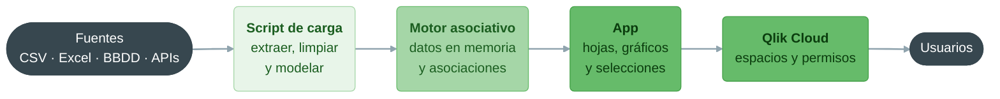
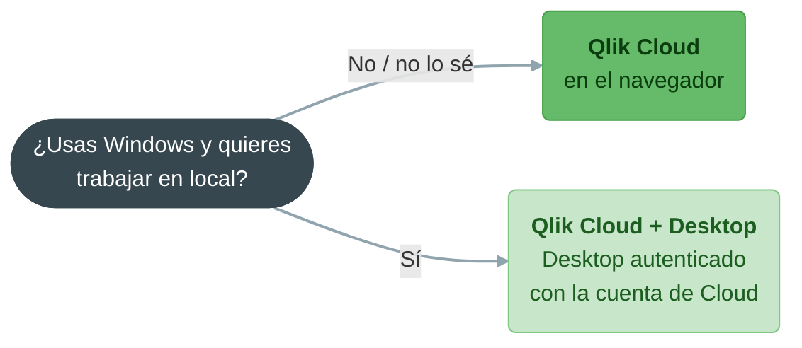
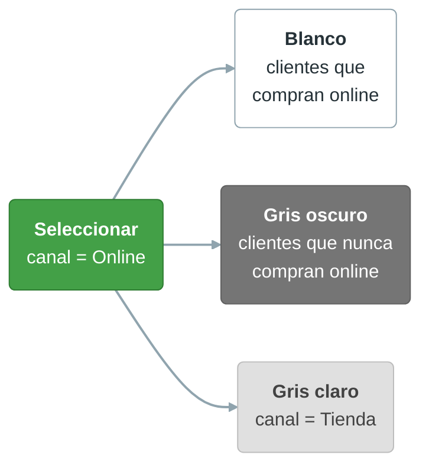
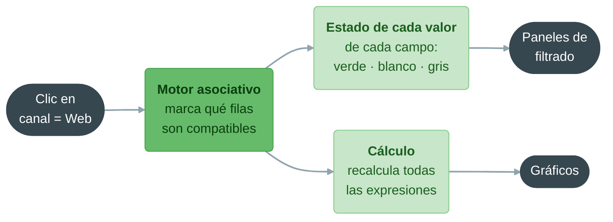

# Qlik Sense: instalación y entorno de trabajo

**Bloque 9 -- Qlik | Sesión 1 de 11**

[← Volver al índice del curso](../../README.md#bloque-9---qlik)

---

## 1. Introducción

Durante las próximas **11 sesiones** vamos a aprender Qlik Sense, la tercera herramienta de Business Intelligence del curso después de Power BI y Tableau. Al terminar el bloque sabremos cargar y modelar datos con el script de carga de Qlik, construir visualizaciones con elementos maestros, escribir expresiones con Set Analysis, trabajar con QVDs y cargas incrementales, proteger los datos con Section Access y publicar en Qlik Cloud.

El bloque está organizado en cinco áreas:

**9.1 · Fundamentos (9.1.1 a 9.1.4).** Instalación y entorno, carga de datos con el script, modelado y calidad del dato, visualizaciones con elementos maestros e integración con Python, con un caso práctico que cierra la primera parte.

**9.2 · Script y modelo de datos (9.2.1 y 9.2.2).** Las piezas del script que transforman tablas (`JOIN`, `CONCATENATE`, `RESIDENT`) y el corazón conceptual del bloque: el modelo asociativo, las claves sintéticas y las referencias circulares.

**9.3 · Análisis avanzado (9.3.1).** Set Analysis, la sintaxis con la que una expresión ignora o fija selecciones. Es lo más parecido que tiene Qlik a `CALCULATE` en DAX y a las expresiones LOD de Tableau.

**9.4 · Datos en producción (9.4.1 a 9.4.3).** QVDs y cargas incrementales, seguridad a nivel de fila con Section Access, y publicación y espacios en Qlik Cloud.

**9.5 · Cierre (9.5.1).** Proyecto: una app analítica de negocio completa, de principio a fin.

Venir de Power BI y Tableau es una gran ventaja: dimensiones, medidas, modelos en estrella, limpieza de datos y diseño de dashboards se transfieren casi sin cambios. Pero Qlik tiene **dos rasgos propios** que lo hacen distinto de las otras dos herramientas y que conviene tener presentes desde hoy:

1. **El motor asociativo.** En Qlik no se "filtra" un gráfico: se **selecciona** un valor y toda la aplicación responde, mostrando a la vez lo que está relacionado con esa selección y lo que **no** lo está. Ver lo que falta (clientes que no compran, productos que no se venden en una tienda) es la especialidad de Qlik.
2. **El script de carga.** La preparación de datos no se hace con un editor de pasos aplicados, como Power Query, ni con un flujo visual, como Tableau Prep, sino con un **script** que se escribe y se ejecuta de arriba abajo. Para quien ha pasado por los bloques de SQL y Python, es la forma de trabajar más cercana a lo que ya conoce.

### Objetivos de la sesión
- Conocer la estructura del bloque y el caso conductor, Mercadia.
- Entender qué productos forman la familia Qlik y para qué sirve cada uno.
- Elegir con criterio entre Qlik Cloud y Qlik Sense Desktop, y dejar la herramienta instalada.
- Recorrer la interfaz: centro de actividades, app, Preparar (gestor de datos, editor de carga, visor del modelo), Analizar (hojas) y Narrar.
- Entender la lógica de colores de la selección asociativa: verde, blanco y gris.
- Tener a mano una tabla de equivalencias Qlik ↔ Power BI ↔ Tableau para todo el bloque.
- Cargar `ventas_mercadia.csv`, diagnosticar sus problemas de calidad y construir una primera visualización.

### Prerequisitos
- Bloques 7 (Power BI) y 8 (Tableau) completados: dimensiones y medidas, modelo en estrella, limpieza de datos y diseño de dashboards.
- Bloque 1 (SQL): lo usaremos como referencia para entender el script de carga.
- Navegador moderno y conexión a internet. Para la versión de escritorio, Windows (sección 4).

---

## 2. El caso conductor: Mercadia

Después de un hotel (HotelesMediterraneum) y una aerolínea (AeroConecta), en el bloque de Qlik trabajamos con un sector distinto: el **comercio minorista**. La elección tampoco es casual. La distribución alimentaria es el terreno clásico de Qlik, porque sus preguntas típicas mezclan muchas tablas (tickets, productos, tiendas, clientes, objetivos) y muchas de ellas tratan de **lo que no ocurre**: qué clientes dejaron de comprar, qué productos no rotan, qué tiendas no venden una categoría.

### La empresa

**Mercadia** es una cadena ficticia de supermercados de proximidad, con sede en Valencia, que opera **18 tiendas** en cinco comunidades autónomas y una **tienda nueva en Almería**, abierta en marzo de 2026. Tiene tres formatos de tienda: **Express** (menos de 350 m², en barrios céntricos), **Urbana** (500 a 650 m²) y **Supermercado** (más de 1.000 m², con aparcamiento). Desde 2023 vende también **online**: los pedidos se preparan en la tienda más cercana al cliente y se entregan a domicilio.

| Comunidad | Tiendas |
|---|---|
| Comunidad de Madrid | Madrid Centro, Madrid Chamberí, Alcobendas, Getafe |
| Castilla-La Mancha | Toledo |
| Comunitat Valenciana | Valencia Ruzafa, Valencia Benimaclet, Alicante, Benidorm, Castellón |
| Región de Murcia | Murcia, Cartagena |
| Andalucía | Sevilla Triana, Sevilla Nervión, Málaga Centro, Marbella, Granada, Cádiz |

Además de las marcas de fabricante, Mercadia vende productos con su **marca propia** (marca blanca), más baratos para el cliente y con más margen para la empresa. Y tiene un **programa de fidelización**: el cliente que se da de alta recibe una tarjeta y descuentos, y a cambio Mercadia sabe quién compra qué.

### El encargo

El comité de dirección trabaja hoy con un informe mensual en Excel por tienda. Las preguntas que de verdad le preocupan no caben en ese informe: ¿qué clientes de la tarjeta han dejado de venir?, ¿qué tiendas venden poca marca propia?, ¿está el canal online quitando ventas a las tiendas o atrayendo clientes nuevos?, ¿qué categorías no se venden en las tiendas Express? Quiere una aplicación que cualquier responsable de tienda o de compras pueda explorar por su cuenta, **seleccionando** y viendo al instante qué está relacionado con su selección y qué no.

El equipo de sistemas nos entrega una **muestra de 23.009 tickets** (65.670 líneas de venta) entre enero de 2024 y septiembre de 2026, junto con los maestros de productos, tiendas y clientes. Los archivos están en la carpeta [`9.0 - Dataset/`](../9.0%20-%20Dataset/):

| Archivo | Contenido | Filas | Sesión en que lo usamos |
|---|---|---|---|
| `ventas_mercadia.csv` | Líneas de ticket: qué se vendió, cuándo, dónde, a quién y por cuánto | 65.670 | Desde hoy |
| `productos.csv` | Maestro de productos: categoría, subcategoría, marca, precio y coste | 153 | 9.1.2 |
| `tiendas.xlsx` | Maestro de tiendas (en Excel): formato, ubicación, superficie y coordenadas | 18 | 9.1.2 |
| `clientes.csv` | Clientes del programa de fidelización | 4.031 | 9.1.2 |
| `objetivos_mensuales.csv` | Objetivo de ventas por tienda y mes | 601 | 9.2.1 |

Hoy trabajamos solo con la tabla de ventas. En la 9.1.2 cargaremos el resto con el script y construiremos el modelo.

### Los seis KPIs de referencia

Igual que en los bloques anteriores, fijamos desde el principio los indicadores que la dirección quiere ver. Las cifras son las del dataset **una vez limpio** (9.1.2):

1. **Ventas netas.** Suma del importe de todas las líneas, descontadas las devoluciones. Es el equivalente al Ingreso Total de AeroConecta. En la muestra suma unos **323.800 €**.

2. **Margen bruto %.** Ventas netas menos el coste de los productos vendidos, dividido entre las ventas netas. Es el indicador que más vigila un supermercado, porque trabaja con márgenes estrechos. Hoy ronda el **31,7 %**.

3. **Ticket medio.** Ventas netas divididas entre el número de tickets distintos. Es el "precio medio por visita", el primo hermano del ADR hotelero y del yield aéreo. Hoy está en torno a **14 €**: compras de proximidad, pequeñas y frecuentes.

4. **Unidades por ticket.** Unidades vendidas divididas entre tickets. Mide el tamaño de la cesta; hoy ronda las **4,6 unidades**.

5. **% ventas de marca propia.** Ventas de productos con `marca_propia = "Si"` sobre el total. Es la palanca de margen de la cadena; hoy está en torno al **36,6 %**.

6. **% ventas fidelizadas.** Ventas de tickets con tarjeta de cliente sobre el total. Mide hasta dónde llega el programa de fidelización; hoy ronda el **65 %**.

Los calcularemos en la 9.1.3 como **medidas maestras**, la forma de Qlik de definir un KPI una sola vez y reutilizarlo en toda la app.

---

## 3. ¿Qué es Qlik y qué no?

**Qlik Sense es una plataforma de analítica basada en un motor asociativo**: carga los datos en memoria, mantiene todas las relaciones entre todos los valores de todos los campos y, cada vez que el usuario selecciona algo, recalcula al instante qué es compatible con esa selección y qué no. Igual que Power BI y Tableau, no es un único programa, sino una **familia de productos**:

| Producto | Qué es | Equivalente en Power BI | En el bloque |
|---|---|---|---|
| **Qlik Cloud Analytics** | La versión en la nube (SaaS) de Qlik Sense: se crea, se carga, se diseña y se publica desde el navegador | Power BI Service, con capacidad de crear informes | Todo el bloque |
| **Qlik Sense Desktop** | Aplicación de escritorio para Windows, con la misma interfaz que la nube, para trabajar en local | Power BI Desktop | Alternativa local (sección 4) |
| **Qlik Sense Enterprise on Windows** | Servidor que una empresa instala en sus propias máquinas (*client-managed*) | Power BI Report Server | Solo como referencia |
| **QlikView** | El producto original de Qlik (1996), con otra interfaz y orientado a desarrolladores. Sigue en uso en muchas empresas | Sin equivalente | Solo como referencia |
| **Qlik Talend Cloud** | Integración y calidad de datos (ETL/ELT, replicación de bases de datos) | Data Factory / Dataflows | Fuera del bloque |



En Qlik, la unidad de trabajo es la **app** (aplicación): un único archivo que contiene **a la vez** el script de carga, los datos ya cargados en memoria y las hojas con sus gráficos. Es como si un `.pbix` guardara también, en el mismo sitio y como texto, todo el código de Power Query.

### Un poco de historia: de dónde viene Qlik

Qlik nace en **1993 en Lund (Suecia)**, con el nombre de *QuikTech*. Sus fundadores querían una herramienta que permitiera a un directivo **explorar** los datos de la empresa sin depender de informes predefinidos: si el informe no contestaba la pregunta, había que pedir otro al departamento de sistemas y esperar semanas. Su respuesta fue cargar todos los datos en memoria (algo audaz con el hardware de los noventa) y mantener **asociadas** todas las tablas, de modo que cualquier selección se propagara a todo el modelo sin escribir consultas.

El producto se llamó **QlikView** y durante dos décadas fue el líder de lo que se llamó *BI de descubrimiento de datos* (*data discovery*). En **2014** llegó **Qlik Sense**, la versión moderna: interfaz web, diseño adaptable a cualquier pantalla y autoservicio para usuarios de negocio. Hoy el desarrollo de Qlik se centra en Qlik Cloud. (Más detalles en *Para profundizar*.)

### Comparación con lo que ya conocemos

| Frente a... | Qlik gana en... | Pierde en... |
|---|---|---|
| **Power BI** | Exploración asociativa (ver lo que **no** está relacionado), control total de la carga con el script, rendimiento con modelos con muchas tablas | Integración con Microsoft 365, comunidad y oferta de formación, precio para empresas que ya pagan Microsoft |
| **Tableau** | Modelado de datos (varias tablas asociadas sin joins), interactividad global sin configurar acciones, preparación de datos integrada en la propia app | Libertad visual y pulido del diseño, cartografía, galería pública y comunidad |
| **SQL / pandas** | Entregar la exploración a usuarios que no programan | Transformaciones complejas, estadística y machine learning (lo combinaremos con Python en la 9.1.4) |

### La frase clave

> Power BI pregunta "¿qué medida quieres calcular?"; Tableau pregunta "¿qué quieres ver?"; Qlik pregunta "¿qué quieres **seleccionar**?". Los conceptos de fondo son los mismos que ya dominamos. Lo nuevo es que en Qlik cada clic redefine el contexto de **toda** la aplicación, y que la preparación del dato se escribe como código.

---

## 4. Instalación paso a paso

### Qué opciones existen

> **Información actualizada el 20 de octubre de 2026.** Qlik cambia sus productos, planes y condiciones con frecuencia: verifícalo en <https://www.qlik.com>.

| Opción | Coste | Dónde funciona | Qué permite | Limitaciones |
|---|---|---|---|---|
| **Prueba de Qlik Cloud Analytics** | Gratis 30 días, sin tarjeta | Navegador (Windows, macOS, Linux) | Todo: crear apps, cargar datos, publicar en espacios, compartir | Caduca a los 30 días. Si después se contrata, las apps se conservan |
| **Qlik Sense Desktop** | Gratis, pero exige iniciar sesión con una cuenta de Qlik Cloud o de un servidor Qlik Sense Enterprise | Solo Windows | Crear y usar apps en local (`.qvf`), sin límite de filas propio | Hay que **reautenticarse cada 30 días**. No publica: para compartir, se sube la app a Qlik Cloud |
| **Qlik Sense Desktop con archivo de desbloqueo** | Gratis | Solo Windows | Lo mismo que Desktop, **sin cuenta** y sin conexión | El archivo `.unlock` **caduca** (el actual, el 9 de noviembre de 2026) y hay que sustituirlo por uno nuevo cuando Qlik lo publique |
| **Licencia de empresa** | De pago (por usuario o por capacidad) | Navegador y escritorio | Todo, sin caducidad | Normalmente la gestiona el departamento de sistemas |

Al contrario que Tableau, Qlik **no tiene hoy una edición gratuita permanente** equivalente a Tableau Public o Tableau Desktop Free. Las dos primeras vías dependen de una cuenta de Qlik Cloud. La tercera, el **archivo de desbloqueo**, es un mecanismo que Qlik mantiene desde 2020, cuando Desktop dejó de ser gratuito, para que los desarrolladores de extensiones (*Qlik Dev*) puedan seguir usándolo. Es oficial, porque Qlik lo publica junto al instalador, pero es **temporal**: cada archivo dura unos meses y Qlik no se compromete a publicar el siguiente en una fecha concreta. En años anteriores ha habido semanas sin archivo vigente.

### La decisión: Cloud o Desktop



- **Qlik Cloud (recomendado).** Funciona en cualquier sistema operativo, no instala nada y es donde publicaremos en la 9.4.3. Es la opción por defecto del bloque.
- **Qlik Sense Desktop.** Interesante si preferimos trabajar en local o con mala conexión. Se activa con la cuenta de Cloud o con el archivo de desbloqueo (paso 3). Aun así, **siempre empezamos creando la cuenta de Cloud**: la necesitaremos para publicar en la 9.4.3, y es el plan B si el archivo de desbloqueo caduca a mitad del bloque.

> **Ojo con el calendario.** La prueba de Qlik Cloud dura 30 días. Conviene **activarla el mismo día de esta sesión**, no antes, y **descargar una copia de cada app** (`.qvf`) al terminar cada sesión (sección 11). Si la prueba caduca antes de terminar el bloque, podremos seguir con una cuenta nueva importando esas copias. Si Desktop deja de autenticarse al caducar la prueba, la solución es la misma: autenticarlo con la cuenta nueva.

### Paso 1: crear la cuenta de Qlik Cloud

1. Entramos en la página de la prueba: <https://www.qlik.com/es-es/trial/qlik-cloud-analytics>.
2. Rellenamos el formulario y confirmamos el correo.
3. Elegimos la **región** del *tenant* (el espacio de Qlik Cloud de nuestra cuenta). Escogemos una región europea: los datos se alojarán en Europa.
4. Al terminar, el navegador abre el **centro de actividades de análisis** (*Analytics activity center*), la página de inicio de Qlik Cloud.

La dirección del navegador tiene la forma `https://<nombre>.<región>.qlikcloud.com`. Es la dirección de nuestro *tenant*: la guardamos en marcadores.

### Paso 2 (opcional, solo Windows): instalar Qlik Sense Desktop

1. En Qlik Cloud, abrimos el menú de nuestro perfil (arriba a la derecha) → **Configuración del perfil** → **Herramientas** → **Descargar** Qlik Sense Desktop.
2. Ejecutamos el instalador y aceptamos las opciones por defecto.
3. En la misma página de **Herramientas**, generamos un **enlace de autenticación**, y al abrir Qlik Sense Desktop lo usamos para iniciar sesión.

Después de la primera autenticación, Desktop funciona sin conexión hasta que pasan 30 días desde el último inicio de sesión.

El instalador también se puede descargar sin cuenta desde el repositorio público de descargas de Qlik: <https://github.com/qlik-download/qlik-sense-desktop/releases>.

### Paso 3 (alternativa al enlace de autenticación): el archivo de desbloqueo

1. En el mismo repositorio, buscamos la versión que incluye los archivos `Qlik_Sense_Desktop.unlock` y `Qlik_Sense_Desktop_Unlock_Instructions.txt`. No siempre es la última: suele estar en la versión inicial (*Initial Release*) de cada edición. En octubre de 2026 están en **May 2026 Initial Release** (`v15.13.8`).
2. Leemos el archivo de instrucciones: indica la **fecha de caducidad** del archivo de desbloqueo.
3. Creamos la carpeta `trial` dentro de la carpeta de Qlik Sense, `Documentos\Qlik\Sense\trial`, y copiamos dentro `Qlik_Sense_Desktop.unlock`. Según las instrucciones, la carpeta no existe por defecto. Si no funciona ahí, hay que crearla dentro de la carpeta `Qlik` de `Documentos`.
4. Abrimos Qlik Sense Desktop: arranca sin pedir autenticación.

> **Descárgalo solo del repositorio oficial de Qlik** (`github.com/qlik-download`) o de la sección *Product Downloads* de Qlik Community. Los archivos de desbloqueo que circulan en foros o en otras webs pueden estar caducados o, peor, ser malware. Cuando el archivo caduque, Desktop volverá a pedir autenticación: sustituimos el archivo por el nuevo, si Qlik ya lo ha publicado, o lo autenticamos con la cuenta de Cloud.

### macOS y Linux

Qlik Sense Desktop solo existe para Windows. En macOS y Linux usamos **Qlik Cloud en el navegador**, que tiene exactamente la misma interfaz. Es la situación opuesta a Power BI, donde el escritorio era imprescindible, y más cómoda incluso que Tableau, porque no hay que instalar nada.

### Primer arranque

Tanto en Cloud como en Desktop, la primera pantalla es la página de inicio, desde la que se crean y se abren las apps. En Cloud se llama **centro de actividades de análisis**; en Desktop, **hub**.

<!-- Captura pendiente: 0.Capturas/9.1.1/4.1_Centro_actividades.png (página de inicio de Qlik Cloud) -->

---

## 5. Recorrido por la interfaz

### La página de inicio

Desde la página de inicio podemos **crear** una app (botón **Crear** → **Análisis** → **App**), **abrir** las apps existentes, organizarlas en **espacios** (en Cloud: espacio personal, espacios compartidos y espacios gestionados; los veremos en la 9.4.3) y gestionar los **archivos de datos** que hemos subido.

### Las tres áreas de una app

Al abrir una app, la barra superior muestra tres áreas de trabajo. Es la primera diferencia estructural con Power BI y Tableau: en Qlik, la preparación del dato, el análisis y la narración viven **dentro de la misma app**, en pestañas.

| Área | Pantallas | Qué se hace en ella | Equivalente en Power BI | Equivalente en Tableau |
|---|---|---|---|---|
| **Preparar** | **Gestor de datos** (*Data manager*) | Añadir datos con asistentes visuales, sin escribir código | Obtener datos + Power Query básico | Data Source page |
| | **Editor de carga de datos** (*Data load editor*) | Escribir y ejecutar el **script de carga** | Editor avanzado de Power Query (código M) | Sin equivalente directo |
| | **Visor del modelo de datos** (*Data model viewer*) | Ver las tablas cargadas y cómo se asocian | Vista Model | Capa lógica de la Data Source page |
| **Analizar** | **Hojas** (*Sheets*) | Diseñar y usar los gráficos | Report view | Worksheets y Dashboards |
| **Narrar** | **Storytelling** | Encadenar instantáneas de gráficos como una presentación | Marcadores | Story |

<!-- Captura pendiente: 0.Capturas/9.1.1/5.1_Areas_app.png (barra superior con Preparar, Analizar y Narrar) -->

### Una hoja por dentro

Una **hoja** (*sheet*) de Qlik es el equivalente a una página de Power BI o a un dashboard de Tableau: un lienzo con varios gráficos. Tiene dos modos:

- **Modo análisis**: el que ve el usuario final. Se selecciona, se explora, se exporta.
- **Modo edición**: se activa con el botón **Editar hoja**. Aparecen tres zonas:
  - **Panel de recursos** (izquierda): **Campos** del modelo, **Elementos maestros** (dimensiones, medidas y visualizaciones reutilizables; 9.1.3), **Gráficos** y **Objetos personalizados**.
  - **Lienzo** (centro): una **cuadrícula** donde se colocan los objetos. En Qlik los objetos se ajustan siempre a la cuadrícula; no hay objetos flotantes.
  - **Panel de propiedades** (derecha): datos, ordenación y aspecto del objeto seleccionado.

Al contrario que en Tableau, aquí **sí** se elige primero el tipo de gráfico y después se rellenan sus dimensiones y medidas, como en Power BI. Aunque también podemos arrastrar un campo directamente al lienzo y dejar que Qlik proponga un gráfico.

### La barra de selecciones

Encima de cada hoja hay una franja que muestra **todas las selecciones activas** de la app, campo a campo. Tiene botones para **retroceder** y **avanzar** por el historial de selecciones y para **borrar** todas las selecciones. Es la pieza de interfaz más importante de Qlik, porque las selecciones son **globales**: lo que seleccionamos en una hoja sigue seleccionado al cambiar de hoja.

<!-- Captura pendiente: 0.Capturas/9.1.1/5.2_Barra_selecciones.png -->

### El motor que hay por debajo

Por debajo trabaja el **motor asociativo de Qlik** (en la documentación técnica, *QIX Engine*). Como VertiPaq en Power BI y Hyper en Tableau, es un motor en memoria y columnar que comprime los datos. Su diferencia está en **qué calcula** con cada clic, y es el tema de la próxima sección y de la sección 12.

---

## 6. La experiencia asociativa: verde, blanco y gris

Esta es la idea más importante de la sesión. Cuando seleccionamos un valor en Qlik, cada valor de **cada campo** de la app pasa a uno de estos estados, que se muestran con colores en los paneles de filtrado:

| Color | Estado | Significado | Ejemplo con Mercadia |
|---|---|---|---|
| **Verde** | Seleccionado | Lo que hemos elegido | Seleccionamos el canal `Online` |
| **Blanco** | Posible | Valores **relacionados** con la selección | Las tiendas que han preparado pedidos online |
| **Gris claro** | Alternativo | Otros valores del **mismo campo** que el seleccionado; podrían seleccionarse en su lugar | El canal `Tienda` |
| **Gris oscuro** | Excluido | Valores **no relacionados** con la selección | Los clientes que **nunca** han comprado online |



El gris oscuro es lo que diferencia a Qlik. En un segmentador de Power BI o un filtro de Tableau, los valores que no tienen datos simplemente **desaparecen** (o ni siquiera se muestran). En Qlik **siguen ahí, en gris**, y se pueden seleccionar con un clic derecho → **Seleccionar excluidos**. Esa es la respuesta inmediata a preguntas como "¿qué clientes de la tarjeta **no** han comprado nunca online?", que en Power BI exigiría una medida DAX específica y en Tableau un cálculo de conjunto.

Además, las selecciones son **acumulativas** entre campos: si después seleccionamos la categoría `Congelados`, Qlik muestra lo compatible con *online **y** congelados*, y la barra de selecciones lo refleja.

---

## 7. Mapa conceptual: Qlik ↔ Power BI ↔ Tableau

Esta tabla es la referencia rápida de todo el bloque. Cuando dudemos de cómo se llama algo en Qlik, volvemos aquí.

| Concepto | Power BI | Tableau | Qlik Sense |
|---|---|---|---|
| Motor de consulta en memoria | VertiPaq | Hyper | Motor asociativo (QIX) |
| Preparación de datos | Power Query (lenguaje M) | Tableau Prep / Data Source page | **Script de carga** (editor de carga de datos) y gestor de datos |
| Relaciones entre tablas | Se dibujan en la vista Model | Relaciones y joins en la Data Source page | **Automáticas**: dos tablas se asocian si tienen un campo con el **mismo nombre** |
| Lenguaje de cálculo | DAX | Fórmulas de Tableau y LOD | Expresiones de gráfico (sintaxis parecida a Excel) |
| Cambiar el contexto de un cálculo | `CALCULATE` | Expresiones LOD | **Set Analysis** (9.3.1) |
| KPI reutilizable | Medida del modelo | Campo calculado | **Medida maestra** (9.1.3) |
| Lienzo con varios gráficos | Página de Report view | Dashboard | **Hoja** |
| Un gráfico | Visual | Worksheet | **Objeto** o visualización |
| Filtro para el usuario | Segmentador | Filtro o parámetro | **Panel de filtrado**, más cualquier clic en cualquier gráfico |
| Alcance de un filtro | Visual, página o informe | Hoja o dashboard (acciones) | **Toda la app**, siempre |
| Interacción entre gráficos | Filtrado cruzado, configurable | Dashboard Actions, a configurar | Por defecto: toda selección afecta a todo |
| Narración | Marcadores | Story | Storytelling |
| Seguridad por filas | RLS | Filtros de usuario | **Section Access** (9.4.2) |
| Publicación en la nube | Power BI Service | Tableau Cloud / Public | Qlik Cloud (espacios) |
| Archivo de trabajo | `.pbix` | `.twbx` | `.qvf` (app con script, datos y hojas) |
| Datos intermedios en disco | Dataflows | Extracto `.hyper` | **QVD** (9.4.1) |

---

## 8. El dataset ventas_mercadia.csv

### Diccionario de datos

| Columna | Tipo esperado | Descripción |
|---|---|---|
| `id_linea` | Texto | Identificador único de la línea de ticket, de `L0000001` a `L0065670` |
| `id_ticket` | Texto | Identificador del ticket (una compra). Un ticket tiene una o varias líneas |
| `fecha` | Fecha | Fecha de la compra |
| `id_tienda` | Texto | Código de la tienda (`M01` a `M19`). En las compras online, la tienda que prepara el pedido |
| `id_cliente` | Texto | Cliente del programa de fidelización (`C00001`...). **Vacío** si el cliente no usó la tarjeta |
| `canal` | Texto | Canal de venta: `Tienda` u `Online` |
| `id_producto` | Texto | Código del producto (`P0001` a `P0153`) |
| `categoria` | Texto | Categoría del producto, tal como la registra el terminal de caja |
| `unidades` | Entero | Unidades vendidas. **Negativo** en las devoluciones |
| `precio_unitario` | Decimal | Precio de venta por unidad, en euros |
| `descuento_pct` | Decimal | Descuento aplicado (0, 0,10, 0,20 o 0,30) |
| `importe_neto` | Decimal | Importe de la línea, en euros: `unidades × precio_unitario × (1 − descuento_pct)` |

La granularidad es **una línea de ticket por fila**: si un cliente compra leche y pan, su ticket genera dos filas con el mismo `id_ticket`. Por eso el número de tickets no es el número de filas, y el ticket medio se calcula con un **recuento distinto** de `id_ticket`, como hicimos con `flight_id` en Tableau.

> Como en los bloques 7 y 8, el dataset **tiene problemas de calidad intencionados**. Hoy los **detectamos**; en la 9.1.2 los **resolvemos** con el script de carga.

---

## 9. Práctica: crear la app y cargar el dataset

En esta primera práctica usamos el **gestor de datos**, el asistente visual de Qlik. Es la forma más rápida de ver datos en pantalla. A partir de la 9.1.2 trabajaremos con el **editor de carga**, que es la forma profesional de cargar datos en Qlik.

### Paso 1: crear la app

En la página de inicio, **Crear** → **Análisis** → **App** (en Desktop: **Crear nueva app**). La llamamos **Mercadia_9.1.1** y la abrimos.

### Paso 2: añadir el archivo

Qlik nos ofrece dos caminos: **Añadir datos desde archivos y otras fuentes** (gestor de datos) o **Script editor** (editor de carga). Elegimos el primero.

- **En Qlik Cloud**: arrastramos `ventas_mercadia.csv` a la ventana o lo buscamos con **Cargar archivo**. El archivo se sube a nuestro espacio personal, en la carpeta de archivos de datos (**DataFiles**).
- **En Desktop**: elegimos **Adjuntar archivos** y seleccionamos `ventas_mercadia.csv` en la carpeta del dataset.

### Paso 3: revisar la vista previa

Qlik detecta solo que el archivo es un **texto delimitado por comas**, con **nombres de campo en la primera fila** y codificación **UTF-8**. Muestra una vista previa con las primeras filas. Dedicamos dos minutos a observar **sin tocar nada**: ¿la categoría se escribe siempre igual?, ¿y el canal?, ¿y el código de tienda? ¿Hay celdas vacías?

Pulsamos **Añadir datos**. Qlik carga el archivo y abre el gestor de datos con una tarjeta para la tabla `ventas_mercadia`.

<!-- Captura pendiente: 0.Capturas/9.1.1/9.1_Gestor_datos.png -->

### Paso 4: ver el script que Qlik ha escrito por nosotros

Abrimos **Preparar** → **Editor de carga de datos**. En la columna de la izquierda hay una sección llamada **Sección generada automáticamente** (*Auto-generated section*). Si la abrimos, veremos un código parecido a este:

```
[ventas_mercadia]:
LOAD
    [id_linea],
    [id_ticket],
    [fecha],
    [id_tienda],
    ...
    [importe_neto]
FROM [lib://DataFiles/ventas_mercadia.csv]
(txt, utf8, embedded labels, delimiter is ',', msq);
```

El gestor de datos **no es más que un generador de script**. Todo lo que hagamos con asistentes visuales acaba convertido en una sentencia `LOAD` como esta. La leeremos línea a línea en la 9.1.2.

### Paso 5: ver el modelo

Abrimos **Preparar** → **Visor del modelo de datos**. Aparece una sola tabla, `ventas_mercadia`, con sus 12 campos. Al seleccionarla, el panel inferior muestra la **vista previa** de los datos y, al seleccionar un campo, sus estadísticas: número de valores distintos, densidad (porcentaje de filas no nulas) y ejemplos de valores.

<!-- Captura pendiente: 0.Capturas/9.1.1/9.2_Visor_modelo.png -->

---

## 10. Diagnóstico del dataset

Qlik no tiene un panel de calidad como *Column quality* de Power Query, pero tiene tres herramientas de diagnóstico muy rápidas: el **visor del modelo** (valores distintos y densidad de cada campo), los **paneles de filtrado** (que muestran todos los valores distintos de un campo y cuántos hay) y las **tablas** con recuentos. Los usaremos en el ejercicio 4.

Esta es la lista completa de hallazgos, con las cifras exactas del archivo:

| Tipo de problema | Columna | Qué encontramos | Se resuelve en |
|---|---|---|---|
| **Tipado** | `fecha` | Texto con tres formatos: `2025-03-10` (42.938 filas), `10/03/2025` (16.334) y `10-3-25` (6.398) | 9.1.2 |
| **Tipado** | `precio_unitario`, `descuento_pct`, `importe_neto` | El CSV usa **punto decimal** (`2.35`). Con una configuración regional española, Qlik espera coma y puede leerlos como **texto** | 9.1.2 |
| **Claves inconsistentes** | `id_tienda` | 19 tiendas escritas de **66** formas: en minúsculas (`m05`, 1.368 filas), con un espacio al final (`M05 `, 972) y sin el cero (`M5`, 275) | 9.1.2 |
| **Clave huérfana** | `id_tienda` | La tienda `M19` (Almería, 1.713 filas) tiene ventas, pero **no existe** en el maestro `tiendas.xlsx` | 9.1.2 (detectar) y 9.2.1 (resolver) |
| **Valores inconsistentes** | `categoria` | 8 categorías escritas de **32** formas: mayúsculas, minúsculas y espacios al final | 9.1.2 |
| **Valores inconsistentes** | `canal` | 2 canales escritos de **7** formas: `Tienda`, `tienda`, `TIENDA`, `Online`, `ONLINE`, `Web` y `App` | 9.1.2 |
| **Valores imposibles** | `unidades` | 44 líneas con **0 unidades** e importe 0 | 9.1.2 |
| **Coherencia entre columnas** | `importe_neto` | 18 líneas en las que el importe no cuadra con `unidades × precio × (1 − descuento)`: es **100 veces mayor** (se perdió la coma decimal). Suman 4.965 € de ventas que no existen | 9.1.2 |
| **Vacíos legítimos** | `id_cliente` | 22.677 líneas (34,5 %) sin cliente: compras sin tarjeta. **No es un error**, pero hay que tratarlo bien | 9.1.2 |
| **Negativos legítimos** | `unidades` | 588 líneas con unidades negativas: son **devoluciones** (−1.781 €). Tampoco es un error | 9.1.2 |

Las dos últimas filas son importantes: **no todo lo raro es un error**. Un analista que borra las devoluciones o los tickets sin cliente "porque estorban" está falseando las ventas. La regla es la de siempre: antes de limpiar, preguntar qué significa el dato.

---

## 11. Práctica: la primera visualización

Vamos a construir una hoja con dos objetos: un panel de filtrado por canal y un gráfico de barras con el número de tickets por categoría.

### Paso 1: abrir la hoja en modo edición

**Analizar** → **Hoja**. Qlik ha creado una hoja vacía (si no, **Crear nueva hoja**). Pulsamos **Editar hoja**.

### Paso 2: el panel de filtrado

Desde el panel de recursos, **Gráficos** → **Panel de filtrado**, lo arrastramos a la parte izquierda del lienzo y elegimos el campo `canal` como dimensión. Aparecen los 7 valores, sucios.

### Paso 3: el gráfico de barras

**Gráficos** → **Gráfico de barras**, lo arrastramos al centro del lienzo.

- **Dimensión**: `categoria`.
- **Medida**: pulsamos **Añadir**, elegimos el campo `id_ticket` y la agregación **Count(distinct)**. Qlik escribe la expresión `Count(distinct id_ticket)`.

Aparecen **32 barras** en lugar de 8. Qlik distingue `Frescos`, `FRESCOS`, `frescos` y `Frescos ` (con espacio) como cuatro categorías distintas: el motor de Qlik, como Hyper en Tableau, **distingue mayúsculas y minúsculas**.

<!-- Captura pendiente: 0.Capturas/9.1.1/11.1_Barras_sucias.png -->

### Paso 4: la primera selección

Pulsamos **Listo** para salir del modo edición. En el panel de filtrado, hacemos clic en `Web`:

- `Web` se pone **verde**.
- Los otros seis canales se ponen en **gris claro** (alternativos).
- El gráfico de barras se recalcula: ahora muestra solo los tickets del canal `Web`.
- La barra de selecciones muestra `canal: Web`.

Ahora hacemos clic en una barra del gráfico, por ejemplo `Bebidas`. **Seleccionar en un gráfico es igual que seleccionar en un panel de filtrado**: la barra de selecciones añade `categoria: Bebidas`. Para volver atrás, usamos el botón de retroceso de la barra de selecciones o **Borrar todas las selecciones**.

### Paso 5: guardar y hacer copia

En Qlik Cloud la app **se guarda sola** con cada cambio. En Desktop, se guarda con **Guardar** (o `Ctrl + S`) en la carpeta `Documentos\Qlik\Sense\Apps`.

Para la copia de seguridad que recomendábamos en la sección 4: desde la página de inicio, menú de la app (los tres puntos) → **Descargar** (en Desktop basta con copiar el archivo). Se obtiene un archivo **`.qvf`**:

| Formato | Qué contiene | Equivalente |
|---|---|---|
| **`.qvf`** con datos | Script, modelo de datos ya cargado y hojas | `.pbix` / `.twbx` |
| **`.qvf`** sin datos | Script y hojas; al abrirlo hay que **recargar** para traer los datos | `.twb` |
| **`.qvd`** | Una tabla de datos en el formato nativo de Qlik, muy rápida de leer | Extracto `.hyper` (lo veremos en la 9.4.1) |

**En el curso entregaremos siempre el `.qvf` con datos**, para que cada entrega se abra sin depender de rutas ni conexiones.

---

## 12. Lo que Qlik ha hecho por debajo

Al cargar el CSV, Qlik no guarda la tabla tal cual. Guarda cada campo **por separado**, en dos estructuras:

1. Una **tabla de símbolos** por campo: la lista de sus **valores distintos**, cada uno una sola vez. Para `canal`, 7 valores; para `categoria`, 32.
2. Una **tabla de datos** con punteros: cada fila guarda, en lugar del texto, la **posición** de su valor en la tabla de símbolos, con los bits justos.

Por eso Qlik comprime tanto: un texto como `Alimentacion` aparece una vez en memoria, no 11.180 veces. Y por eso cada valor sucio cuesta memoria y, sobre todo, **rompe la asociación**: `m05` y `M05` son dos símbolos distintos.

Cuando seleccionamos un valor, el motor hace dos cosas:



La parte **lógica** (qué valores son compatibles con la selección, en todos los campos de todas las tablas) se resuelve antes de calcular nada. Después, la parte de **cálculo** evalúa cada expresión de cada gráfico solo sobre las filas compatibles. Nuestro gráfico de barras, con `canal = Web` seleccionado, equivale a esta consulta SQL:

```sql
SELECT categoria, COUNT(DISTINCT id_ticket) AS tickets
FROM ventas_mercadia
WHERE canal = 'Web'
GROUP BY categoria;
```

La diferencia con Power BI y Tableau no está en esta consulta, que las tres herramientas resuelven igual, sino en lo que viene a la vez: el estado verde, blanco o gris de **todos los demás valores de la app**. Eso es lo que Qlik llama **experiencia asociativa**.

---

## 13. Ejercicios

**Ejercicio 1: de Power BI y Tableau a Qlik.** Sin mirar la sección 7, escribe cómo se llama en Qlik cada uno de estos elementos:

1. Una página de informe de Power BI.
2. Power Query.
3. Una relación de la vista Model de Power BI.
4. Un segmentador de Power BI o un filtro de Tableau.
5. El archivo `.pbix` o `.twbx`.
6. VertiPaq o Hyper.

<details>
<summary>Ver la solución</summary>

1. **Hoja**. 2. **Script de carga** (en el editor de carga de datos); para cargas sencillas, el **gestor de datos**. 3. No hay relaciones explícitas: Qlik **asocia automáticamente** las tablas que tienen un campo con el mismo nombre. 4. **Panel de filtrado** (aunque en Qlik cualquier gráfico sirve para seleccionar). 5. **`.qvf`**. 6. El **motor asociativo** (QIX).

</details>

**Ejercicio 2: ¿Cloud o Desktop?** Elige la opción en cada caso y justifícalo en una frase:

- **A.** Una alumna trabaja con un MacBook.
- **B.** Un alumno con Windows va a trabajar varios días en un tren sin conexión estable.
- **C.** Queremos compartir la app con el profesor para que la explore en el navegador.

<details>
<summary>Ver la solución</summary>

**A: Qlik Cloud.** Qlik Sense Desktop solo existe para Windows. **B: Desktop, autenticado antes de salir o con un archivo de desbloqueo vigente.** Tras la autenticación funciona sin conexión hasta 30 días; con el archivo de desbloqueo, hasta su fecha de caducidad. **C: Qlik Cloud.** Desktop no publica; para compartir hay que subir la app a un espacio de Cloud (9.4.3) o enviar el `.qvf`.

</details>

**Ejercicio 3: predecir los colores.** Con la app de la práctica, añade a la hoja un segundo panel de filtrado con el campo `id_tienda`. Antes de probarlo, anticipa qué pasará en cada caso. Después compruébalo.

1. Seleccionamos el canal `TIENDA`. ¿De qué color se ponen los demás canales?
2. Con esa selección activa, ¿habrá algún valor de `id_tienda` en gris oscuro?
3. Borramos las selecciones y seleccionamos el valor de tienda `M19`. ¿Qué pasa con los canales?

<details>
<summary>Ver la solución</summary>

1. **Gris claro** (alternativos): son otros valores del mismo campo que el seleccionado.
2. **Sí: 22 de los 66 códigos quedan en gris oscuro.** `TIENDA` es una variante sucia que solo aparece en 2.104 líneas, y muchos códigos de tienda también sucios y poco frecuentes (por ejemplo `M2`, con solo 6 líneas) no coinciden nunca con ella. Es una pista de que el dato sucio no solo fragmenta los gráficos: también fabrica "ausencias" que no existen.
3. Los **7** canales quedan en **blanco**: la tienda `M19` tiene líneas con todas las variantes de `canal`. Pero ojo: si en lugar de `M19` seleccionamos `m19` o `M19 ` (con espacio), el resultado cambia, porque para Qlik son tres tiendas distintas.

</details>

**Ejercicio 4: medir la suciedad.** Usando paneles de filtrado y una tabla con la medida `Count(id_linea)`:

1. ¿Cuántos valores distintos tienen `categoria`, `canal` e `id_tienda`? ¿Cuántos deberían tener?
2. ¿Cuántas líneas hay de cada variante de `canal`?
3. En el visor del modelo, ¿qué densidad tiene `id_cliente`? ¿Es un problema?

Pista: el título de un panel de filtrado no muestra el número de valores, pero el **visor del modelo** sí, al seleccionar el campo.

<details>
<summary>Ver la solución</summary>

1. `categoria`: **32** valores para 8 categorías reales. `canal`: **7** para 2. `id_tienda`: **66** para 19.
2. `Tienda` 47.916, `TIENDA` 2.104, `tienda` 2.034, `Online` 9.250, `ONLINE` 1.484, `App` 1.515 y `Web` 1.367. Las cuatro últimas son, todas, ventas online.
3. Sorprendentemente, del **100 %**: Qlik lee las celdas vacías de un CSV como **texto vacío**, que es un valor, no como nulo. Si fueran nulos de verdad, la densidad sería del **65,5 %**, el porcentaje real de líneas con tarjeta. En cualquier caso, **no es un error**: son las compras sin tarjeta. En la 9.1.2 las convertiremos en nulos de verdad y crearemos un campo `es_fidelizado` para analizarlas.

</details>

---

## 14. Errores comunes y troubleshooting

**1. "No encuentro dónde está mi archivo subido."** En Qlik Cloud, los archivos subidos viven en el espacio personal, en **DataFiles**. Se gestionan desde la página de inicio → **Datos** o desde el propio gestor de datos. En el script se referencian como `lib://DataFiles/nombre.csv`.

**2. "Al seleccionar un valor, desaparecen datos de otra hoja."** Es lo esperado: las selecciones en Qlik son **globales** a toda la app. Basta con mirar la barra de selecciones y borrar las que sobren.

**3. "Las sumas de `importe_neto` salen a 0 o el campo aparece alineado a la izquierda."** Qlik lo ha leído como **texto**, porque el CSV usa punto decimal y la app espera coma. Es uno de los problemas que resolvemos en la 9.1.2. Mientras tanto, usamos recuentos (`Count`) en lugar de sumas.

**4. "Aparecen caracteres raros, como `é`."** Es un problema de codificación. El archivo está en UTF-8: en el gestor de datos, en la vista previa, revisamos la opción **Juego de caracteres** (en el script, la palabra `utf8` del formato).

**5. "He añadido datos con el gestor de datos y ahora el editor de carga no me deja tocar el script."** La sección generada automáticamente está **bloqueada** para que el gestor de datos pueda seguir manteniéndola. Se puede desbloquear, pero entonces el gestor de datos deja de gestionarla. Por eso, a partir de la 9.1.2, crearemos las apps directamente desde el editor de carga.

**6. "Desktop me pide autenticarme otra vez."** Si lo autenticamos con la cuenta de Cloud, han pasado 30 días desde la última autenticación: volvemos a generar el enlace en Qlik Cloud (**Configuración del perfil** → **Herramientas**). Si usábamos el archivo de desbloqueo, ha caducado o no está en la carpeta correcta: comprobamos la fecha en el archivo de instrucciones y buscamos uno nuevo en el repositorio de Qlik.

**7. "He hecho clic en un gráfico y ya no veo el resto de categorías."** Al hacer clic en una barra, Qlik la **selecciona**. Para deshacerlo, botón de **retroceso** de la barra de selecciones o la **X** del campo `categoria` en esa barra.

---

## 15. Conclusión

En esta sesión hemos conocido la estructura del bloque y a Mercadia, la cadena de supermercados que nos acompañará hasta la 9.5.1, con sus seis KPIs y su relación con los indicadores de los bloques anteriores. Hemos visto qué productos forman la familia Qlik, de dónde viene su motor asociativo y en qué se diferencia de Power BI y Tableau. Hemos activado Qlik Cloud (y, opcionalmente, Qlik Sense Desktop), hemos recorrido las tres áreas de una app (Preparar, Analizar y Narrar) y hemos aprendido el código de colores de la selección: verde, blanco, gris claro y gris oscuro. Por último, hemos cargado `ventas_mercadia.csv` con el gestor de datos, hemos descubierto que detrás de cada asistente hay un script, hemos diagnosticado diez problemas de calidad con cifras exactas y hemos hecho nuestras primeras selecciones. El resultado es `Mercadia_9.1.1.qvf`. En la 9.1.2 escribiremos nuestro propio script de carga: limpiaremos las ventas, cargaremos los maestros y construiremos el modelo asociativo de Mercadia.

---

## 16. Para profundizar

### Tablas de símbolos y el motor asociativo

La idea de guardar cada campo como una lista de valores distintos más una tabla de punteros es la base de casi todos los motores analíticos modernos (VertiPaq y Hyper incluidos). Lo que hace Qlik distinto es que, además, mantiene en todo momento el **estado lógico** de cada valor de cada campo (seleccionado, posible, alternativo o excluido) y lo propaga a través de las tablas por los campos comunes. Qlik lo llama *Associative Engine* y lo presenta como alternativa a las herramientas *query-based*, que solo calculan lo que pide cada gráfico. La documentación de Qlik y su blog técnico (*Qlik Design Blog*) tienen varios artículos sobre el "poder del gris".

### QlikView y Qlik Sense

QlikView y Qlik Sense comparten el motor y el lenguaje de script: un script escrito en QlikView funciona casi sin cambios en Qlik Sense. Lo que cambia es todo lo demás. QlikView se diseñó para que un desarrollador construyera aplicaciones con un diseño muy controlado, píxel a píxel; Qlik Sense, para que el usuario de negocio construya sus propias hojas y para que todo se adapte a cualquier pantalla. Muchas empresas mantienen todavía aplicaciones QlikView en producción, y es habitual encontrar ofertas de empleo que piden "QlikView/Qlik Sense": quien domina el script de Qlik Sense tiene recorrido el 80 % del camino.

### El asistente de IA

Qlik Cloud incluye un asistente que genera gráficos y análisis a partir de preguntas en lenguaje natural y de los campos del modelo (**Insight Advisor**). Funciona mucho mejor cuando el modelo está bien construido y las medidas están definidas como elementos maestros, por lo que lo probaremos al final de la 9.1.3.

### Algunas fechas de la historia de Qlik

| Año | Hito |
|---|---|
| 1993 | Fundación de QuikTech en Lund (Suecia) |
| 1996 | La primera versión del producto adopta el nombre **QlikView** |
| 2005 | La sede de la compañía se traslada a Estados Unidos (Pensilvania) |
| 2010 | Salida a bolsa en el NASDAQ |
| 2014 | Lanzamiento de **Qlik Sense** |
| 2016 | El fondo de inversión Thoma Bravo compra Qlik y la retira de bolsa |
| 2023 | Compra de **Talend**, especialista en integración de datos |

---

## 17. Recursos

- **Ayuda oficial de Qlik Cloud Analytics** (en español): <https://help.qlik.com/es-ES/cloud-services/>
- **Prueba gratuita de Qlik Cloud Analytics**: <https://www.qlik.com/es-es/trial/qlik-cloud-analytics>
- **Qlik Community**, foro oficial de usuarios: <https://community.qlik.com/>
- **Qlik Learning**, cursos gratuitos oficiales: <https://learning.qlik.com/>
- **Qlik Design Blog**: <https://community.qlik.com/t5/Design/bg-p/qlik-design-blog>

---

*Guía del alumno · Sesión 1 · Bloque 9 - Qlik · Mercadia*
