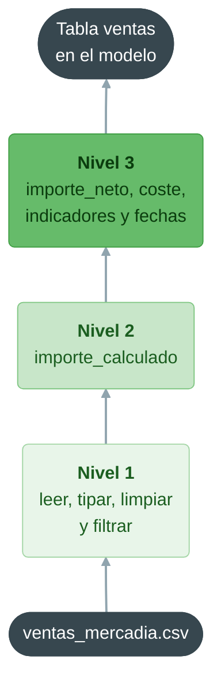
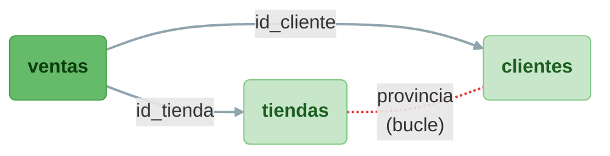

# Qlik Sense: carga de datos, modelado y calidad del dato

**Bloque 9 -- Qlik | Sesión 2 de 11**

[← Volver al índice del curso](../../README.md#bloque-9---qlik)

---

## 1. Introducción

En la sesión anterior cargamos `ventas_mercadia.csv` con el gestor de datos y descubrimos dos cosas: que detrás de cada asistente de Qlik hay un **script**, y que el dataset tiene diez problemas de calidad que fragmentan los gráficos y rompen las asociaciones. Hoy escribimos ese script nosotros mismos.

El **script de carga** es la pieza central de Qlik. Es el equivalente a Power Query en Power BI y a Tableau Prep en Tableau, pero con una diferencia de enfoque: no se construye con clics que generan pasos aplicados, sino que se **escribe** como código, se ejecuta de arriba abajo y su resultado es el modelo de datos de la app. Quien ha escrito consultas SQL en el bloque 1 y transformaciones con pandas en el bloque 3 va a reconocer enseguida la lógica: `LOAD` se parece mucho a `SELECT`.

Al terminar la sesión tendremos `Mercadia_9.1.2.qvf` con un modelo en estrella limpio: la tabla de ventas en el centro y los maestros de productos, tiendas y clientes alrededor, asociados entre sí sin dibujar una sola relación.

### Objetivos de la sesión
- Conocer el editor de carga de datos: secciones, conexiones, ejecución y registro.
- Entender la anatomía de una sentencia `LOAD` y compararla con `SELECT`.
- Comprender las variables de sistema (`DecimalSep`, `DateFormat`...) y por qué afectan a la lectura de los CSV.
- Limpiar el dataset en el script: fechas con varios formatos, números con punto decimal, claves inconsistentes, valores sucios, filas imposibles e importes erróneos.
- Usar tres herramientas fundamentales del script: **preceding load**, **`MAPPING LOAD` + `ApplyMap`** y **`LOAD DISTINCT`**.
- Cargar un archivo Excel y varios CSV en el mismo modelo.
- Entender cómo asocia Qlik las tablas y reconocer dos problemas clásicos: la **clave sintética** y la **referencia circular**.
- Verificar la calidad del modelo cargado con recuentos y totales de control.

### Prerequisitos
- Sesión 9.1.1 completada: cuenta de Qlik Cloud (o Desktop autenticado) y diagnóstico del dataset.
- Los cinco archivos de [`9.0 - Dataset/`](../9.0%20-%20Dataset/).
- Bloque 1 (SQL): `SELECT`, `WHERE`, alias con `AS` y `DISTINCT`.

---

## 2. El editor de carga de datos

Creamos una app nueva, **Mercadia_9.1.2**, y esta vez, en lugar de añadir datos con el gestor, elegimos **Script editor** (o, desde una app vacía, **Preparar** → **Editor de carga de datos**).

> **¿Por qué una app nueva?** Mezclar el gestor de datos y el editor de carga en la misma app funciona, pero genera confusión: el gestor mantiene su propia sección bloqueada y puede volver a cargar tablas que creíamos haber sustituido. Elegimos una herramienta por app y, a partir de hoy, esa herramienta es el editor.

El editor tiene cuatro zonas:

| Zona | Qué contiene |
|---|---|
| **Secciones** (izquierda) | El script se divide en pestañas que se ejecutan **en orden, de arriba abajo**. Se crean con **+**, se renombran y se reordenan arrastrando |
| **Editor** (centro) | El código. Tiene autocompletado, ayuda contextual de cada función y comentarios con `//` (una línea) o `/* ... */` (varias) |
| **Fuentes de datos** (derecha) | Las **conexiones** a carpetas, bases de datos y servicios. Desde aquí se puede generar el código `LOAD` de un archivo con el botón **Seleccionar datos** |
| **Barra superior** | **Cargar datos** (ejecuta el script completo y recarga la app), **Depurar** (ejecución paso a paso) y el registro de la última carga |

<!-- Captura pendiente: 0.Capturas/9.1.2/2.1_Editor_carga.png -->

### La sección Main y las variables de sistema

Toda app nueva empieza con una sección, **Main**, que contiene una lista de instrucciones `SET` generadas automáticamente a partir de la configuración regional. Con una configuración en español, las primeras son estas:

```
SET ThousandSep='.';
SET DecimalSep=',';
SET MoneyThousandSep='.';
SET MoneyDecimalSep=',';
SET MoneyFormat='#.##0,00 €;-#.##0,00 €';
SET TimeFormat='h:mm:ss';
SET DateFormat='DD/MM/YYYY';
SET TimestampFormat='DD/MM/YYYY h:mm:ss[.fff]';
SET MonthNames='ene;feb;mar;abr;may;jun;jul;ago;sept;oct;nov;dic';
SET DayNames='lun;mar;mié;jue;vie;sáb;dom';
...
```

Estas variables le dicen a Qlik **cómo interpretar** los textos que lee y **cómo mostrar** los números y fechas. `DecimalSep=','` significa: "un número tiene coma decimal". Por eso, en la 9.1.1, un `2.35` del CSV podía acabar leído como texto: con estas reglas, no parece un número.

Tenemos dos opciones: cambiar `DecimalSep` a `'.'` (y entonces todos los números de la app se mostrarían con punto) o **dejar las variables como están** e indicar el separador explícitamente al leer cada campo, con la función `Num#`. Elegimos la segunda: la app se ve en formato español y la lectura no depende de la configuración de quien recargue.

> **No borres la sección Main.** Si se borran esas instrucciones, Qlik usa los valores por defecto del sistema, que pueden cambiar de un equipo a otro. Es el equivalente a la configuración regional de Power Query que nos dio problemas con los decimales en el bloque 7.

---

## 3. Anatomía de una sentencia LOAD

Esta es la sentencia que generó el gestor de datos en la 9.1.1, simplificada:

```
ventas:
LOAD
    id_linea,
    id_ticket,
    fecha,
    importe_neto AS importe
FROM [lib://DataFiles/ventas_mercadia.csv]
(txt, utf8, embedded labels, delimiter is ',', msq)
WHERE unidades <> 0;
```

| Parte | Qué hace | En SQL |
|---|---|---|
| `ventas:` | **Etiqueta**: el nombre que tendrá la tabla en el modelo. Sin ella, la tabla se llama como el archivo | `CREATE TABLE ventas AS` |
| `LOAD` | Empieza la lista de campos | `SELECT` |
| `importe_neto AS importe` | Renombrar un campo. **En Qlik, el nombre es la relación**, así que renombrar es una decisión de modelado | `AS` |
| `FROM [...]` | El origen: un archivo dentro de una conexión (`lib://...`) | `FROM` |
| `(txt, utf8, embedded labels, ...)` | **Especificación de formato**: texto delimitado, codificación UTF-8, nombres en la primera fila, separador coma y comillas estándar (`msq`) | Sin equivalente |
| `WHERE` | Filtrar filas al cargar | `WHERE` |
| `;` | Fin de la sentencia. **Obligatorio**. Olvidarlo es el error más frecuente del script | `;` |

Tres diferencias con SQL que conviene fijar desde ya:

1. **`LOAD` lee archivos y tablas ya cargadas; `SQL SELECT` habla con bases de datos.** Cuando conectemos a PostgreSQL, el script usará `SQL SELECT ...` (la consulta la ejecuta la base de datos) y, encima, opcionalmente un `LOAD` (la transformación la ejecuta Qlik).
2. **Las funciones son de Qlik**, no de SQL: `Upper`, `Trim`, `Date#`, `ApplyMap`... Hay más de 300 y la ayuda contextual del editor las documenta todas.
3. **Los nombres de campo distinguen mayúsculas**: `Fecha` y `fecha` son dos campos distintos. Y si contienen espacios o caracteres especiales, van entre corchetes: `[Ventas netas]`.

### Las conexiones

Los archivos no se referencian con una ruta del disco (`C:\...`), sino a través de una **conexión** con el prefijo `lib://`:

- **En Qlik Cloud**: los archivos que subimos a nuestro espacio personal se leen desde `lib://DataFiles/`. Subimos los cinco archivos del dataset desde **Fuentes de datos** → **DataFiles** → **Cargar** (o desde la página de inicio).
- **En Desktop**: en **Fuentes de datos** → **Crear nueva conexión** → **Carpeta**, seleccionamos la carpeta `9.0 - Dataset` y la llamamos `Mercadia`. Los archivos se leen desde `lib://Mercadia/`.

Para que el script funcione igual en los dos entornos, guardaremos la ruta en una **variable** y la usaremos con la sintaxis `$(nombre)`, que Qlik sustituye por su valor antes de ejecutar cada línea.

---

## 4. Práctica: el plan de limpieza

Antes de escribir, convertimos la tabla de diagnóstico de la 9.1.1 en un plan. Cada problema tiene una técnica de script:

| Problema | Columna | Técnica en el script |
|---|---|---|
| Tres formatos de fecha | `fecha` | `Date#` con cada formato, combinados con `Alt` |
| Punto decimal | `precio_unitario`, `descuento_pct`, `importe_neto` | `Num#` indicando el separador |
| Claves de tienda inconsistentes | `id_tienda` | Normalizar con `Upper`, `Trim`, `PurgeChar` y `Right` |
| Tienda huérfana `M19` | `id_tienda` | **Detectar** con una comprobación; la resolveremos en la 9.2.1 |
| 32 variantes de categoría | `categoria` | **No cargar** el campo de la tabla de ventas: la categoría buena está en el maestro de productos |
| 7 variantes de canal | `canal` | Tabla de correspondencias con `MAPPING LOAD` + `ApplyMap` |
| 0 unidades | `unidades` | Excluir con `WHERE` |
| Importes ×100 | `importe_neto` | Recalcular y comparar en un **preceding load** |
| Ticket sin cliente | `id_cliente` | Convertir el texto vacío en nulo y crear el indicador `es_fidelizado` |
| Devoluciones | `unidades` | **Conservarlas** y crear el indicador `es_devolucion` |
| Clientes duplicados | `clientes.csv` | `LOAD DISTINCT` |

Organizamos el script en cinco secciones, que creamos ahora con **+** y en este orden: **Main** (ya existe), **Configuracion**, **Mapas**, **Ventas** y **Maestros**.

---

## 5. Sección Configuracion: la ruta de los datos

```
// Ruta de los archivos del dataset.
// Qlik Cloud: 'lib://DataFiles/'   ·   Qlik Sense Desktop: 'lib://Mercadia/'
SET vRuta = 'lib://DataFiles/';
```

`SET` asigna el texto tal cual a la variable. Desde aquí, `$(vRuta)ventas_mercadia.csv` equivale a `lib://DataFiles/ventas_mercadia.csv`. Si cambiamos de entorno, solo tocamos esta línea.

---

## 6. Sección Mapas: tablas de correspondencias

Una **tabla de mapeo** es una tabla de dos columnas (valor original y valor nuevo) que Qlik usa como diccionario durante la carga y que **desaparece** al terminar el script: no llega al modelo. Se crea con `MAPPING LOAD` y se consulta con `ApplyMap`. Es el equivalente a un `BUSCARV` de Excel, o a una combinación de consultas en Power Query para traer una sola columna.

```
// 1. Canal: 7 variantes -> 2 canales
map_canal:
MAPPING LOAD * INLINE [
valor_original, canal_normalizado
TIENDA, Tienda
ONLINE, Online
WEB, Online
APP, Online
];

// 2. Coste unitario de cada producto, para calcular el coste de cada línea
map_coste:
MAPPING LOAD
    id_producto,
    Num#(coste_unitario, '#,##0.##', '.', ',') AS coste_unitario
FROM [$(vRuta)productos.csv]
(txt, utf8, embedded labels, delimiter is ',', msq);
```

Detalles que importan:

- **`INLINE`** permite escribir una tabla pequeña dentro del propio script, como en un CSV. La primera fila son los nombres de campo.
- Solo hemos escrito las variantes **en mayúsculas**. Al aplicar el mapa pasaremos el canal por `Upper(Trim(...))`, así que `tienda`, `Tienda` y `TIENDA ` llegarán todos como `TIENDA`. Menos filas en el mapa, menos errores.
- Una tabla de mapeo debe tener **exactamente dos columnas**: la primera es la que se busca y la segunda, la que se devuelve.
- `Num#(texto, formato, separador_decimal, separador_miles)` **interpreta** un texto como número usando los separadores que le indicamos, sin importar lo que diga `DecimalSep`. Es la solución al problema del punto decimal.

---

## 7. Sección Ventas: la tabla de hechos

Esta es la sección más importante de la sesión. La escribimos completa y después la leemos por partes.

```
ventas:
// Nivel 3: campos derivados de los anteriores
LOAD
    *,
    If(Fabs(importe_original - importe_calculado) > 0.05,
       importe_calculado, importe_original)                      AS importe_neto,
    If(Fabs(importe_original - importe_calculado) > 0.05,
       'Si', 'No')                                               AS importe_corregido,
    If(unidades < 0, 'Si', 'No')                                 AS es_devolucion,
    unidades * ApplyMap('map_coste', id_producto, 0)             AS coste_linea,
    Year(fecha)                                                  AS anio,
    Month(fecha)                                                 AS mes,
    'T' & Ceil(Month(fecha) / 3)                                 AS trimestre,
    Date(MonthStart(fecha), 'YYYY-MM')                           AS anio_mes,
    WeekDay(fecha)                                               AS dia_semana;
// Nivel 2: importe recalculado a partir de los campos ya tipados
LOAD
    *,
    Round(unidades * precio_unitario * (1 - descuento_pct), 0.01) AS importe_calculado;
// Nivel 1: lectura, tipado y limpieza del archivo
LOAD
    id_linea,
    id_ticket,
    Date(Alt(Date#(fecha, 'YYYY-MM-DD'),
             Date#(fecha, 'DD/MM/YYYY'),
             Date#(fecha, 'D-M-YY')))                            AS fecha,
    'M' & Right('0' & PurgeChar(Upper(Trim(id_tienda)), 'M'), 2) AS id_tienda,
    If(Len(Trim(id_cliente)) > 0, Trim(id_cliente))              AS id_cliente,
    If(Len(Trim(id_cliente)) > 0, 'Si', 'No')                    AS es_fidelizado,
    ApplyMap('map_canal', Upper(Trim(canal)), 'Revisar')         AS canal,
    id_producto,
    unidades,
    Num#(precio_unitario, '#,##0.##', '.', ',')                  AS precio_unitario,
    Num#(descuento_pct,   '#,##0.##', '.', ',')                  AS descuento_pct,
    Num#(importe_neto,    '#,##0.##', '.', ',')                  AS importe_original
FROM [$(vRuta)ventas_mercadia.csv]
(txt, utf8, embedded labels, delimiter is ',', msq)
WHERE unidades <> 0;

// Los campos auxiliares ya no hacen falta en el modelo
DROP FIELDS importe_original, importe_calculado FROM ventas;
```

### El preceding load: leer de abajo arriba

Lo primero que llama la atención es que hay **tres `LOAD` encadenados** y solo un `FROM`. Es un **preceding load** (carga precedente): cada `LOAD` sin `FROM` toma como entrada el resultado del `LOAD` que tiene **debajo**. Se lee de abajo arriba:



¿Para qué sirve? Para **reutilizar un campo recién calculado** sin repetir su fórmula. En el nivel 1, `precio_unitario` pasa de texto a número; en el nivel 2 ya podemos multiplicarlo; en el nivel 3 ya podemos comparar el importe original con el calculado. Sin preceding load, tendríamos que repetir los `Num#` dentro de cada fórmula. Es el equivalente a encadenar pasos en Power Query o a usar una CTE en SQL (bloque 1). `LOAD *` significa "todos los campos del nivel inferior, más los que añado".

### Nivel 1, campo a campo

**`fecha`.** `Date#(texto, formato)` interpreta un texto como fecha **si encaja** con el formato; si no, devuelve nulo. `Alt(a, b, c)` devuelve el **primer** argumento que sea un número válido. Así, cada fecha se intenta leer con los tres formatos y se queda con el que funciona. `Date(...)` le da el formato de visualización de `DateFormat` (`DD/MM/YYYY`). Es el mismo reto de `booking_date` del bloque 7 y de `flight_date` del bloque 8, resuelto ahora en una línea.

**`id_tienda`.** Leemos la expresión de dentro afuera con el valor `m5 `:

| Paso | Función | Resultado |
|---|---|---|
| Quitar espacios | `Trim('m5 ')` | `m5` |
| Pasar a mayúsculas | `Upper('m5')` | `M5` |
| Quitar la letra M | `PurgeChar('M5', 'M')` | `5` |
| Añadir un cero delante | `'0' & '5'` | `05` |
| Quedarse con dos caracteres | `Right('05', 2)` | `05` |
| Volver a poner la M | `'M' & '05'` | `M05` |

El operador `&` concatena textos. Con `M19 ` el resultado es `M19`, porque `Right('019', 2)` devuelve `19`. Las 66 variantes se convierten en 19 códigos.

**`id_cliente` y `es_fidelizado`.** Una celda vacía de un CSV llega a Qlik como un **texto vacío**, no como un nulo. Es una diferencia sutil pero importante: un texto vacío es un valor (se puede seleccionar, cuenta en un `Count`) y un nulo no. `If(condición, valor)` sin tercer argumento devuelve **nulo** cuando la condición es falsa: así convertimos los vacíos en nulos de verdad. Y en lugar de perder la información, la guardamos en un indicador `es_fidelizado`, que podremos usar como dimensión o como filtro.

**`canal`.** `ApplyMap('mapa', valor, por_defecto)` busca el valor en el mapa. Si lo encuentra, devuelve la correspondencia; si no, devuelve el tercer argumento. Hemos puesto `'Revisar'` en lugar de dejar el valor sin cambiar: si mañana aparece una variante nueva (`MOVIL`, por ejemplo), la veremos en la app como `Revisar` en lugar de colarse en silencio como un tercer canal.

**`WHERE unidades <> 0`.** Descarta las 44 líneas imposibles. Fíjate en que las **devoluciones** (unidades negativas) pasan el filtro: no son errores.

**¿Y `categoria`?** No está. La tabla de ventas trae una categoría escrita por el terminal de caja, con 32 variantes; el maestro de productos trae la categoría oficial, con 8. Cargar las dos sería un error de modelado (lo comprobaremos en la sección 10). **El mejor campo para limpiar es el que no se carga.**

### Niveles 2 y 3

`Round(x, 0.01)` redondea a céntimos. `Fabs` es el valor absoluto. Si el importe original se aleja más de 5 céntimos del calculado, nos quedamos con el calculado y lo marcamos en `importe_corregido`. Así arreglamos las 18 líneas con la coma perdida y, a la vez, **dejamos rastro**: cualquiera podrá ver qué líneas se corrigieron. Es la misma idea de auditoría que aplicamos en el bloque 6 de gobierno del dato.

`coste_linea` usa el segundo mapa: busca el coste unitario del producto y lo multiplica por las unidades. Traer el coste a la tabla de ventas con `ApplyMap` en lugar de dejarlo en el maestro de productos simplifica la medida del margen y la hace más rápida (lo veremos en la 9.1.3).

Las funciones de fecha (`Year`, `Month`, `MonthStart`, `WeekDay`) crean campos de calendario directamente en la tabla de ventas. `Month` y `WeekDay` devuelven un valor **dual**: se ve como texto (`ene`, `lun`) pero se ordena como número (1, 2...). En la 9.2.1 sustituiremos estos campos por un **calendario maestro**, una tabla de fechas independiente, como la tabla de calendario que construimos en el bloque 7.

### DROP FIELDS

`DROP FIELDS ... FROM tabla` elimina campos que ya no necesitamos. Los dos importes auxiliares solo servían para decidir el importe bueno; si los dejáramos, alguien acabaría sumando el que no es.

---

## 8. Sección Maestros: productos, tiendas y clientes

```
productos:
LOAD
    id_producto,
    producto,
    categoria,
    subcategoria,
    marca,
    marca_propia,
    Num#(precio_tarifa, '#,##0.##', '.', ',') AS precio_tarifa
FROM [$(vRuta)productos.csv]
(txt, utf8, embedded labels, delimiter is ',', msq);

tiendas:
LOAD
    id_tienda,
    tienda,
    formato,
    ciudad,
    provincia,
    comunidad,
    superficie_m2,
    Date(fecha_apertura) AS fecha_apertura,
    latitud,
    longitud,
    zona
FROM [$(vRuta)tiendas.xlsx]
(ooxml, embedded labels, table is Tiendas);

clientes:
LOAD DISTINCT
    id_cliente,
    Date(Date#(fecha_alta, 'DD/MM/YYYY'))                     AS fecha_alta,
    genero,
    If(Len(Trim(tramo_edad)) = 0, 'Sin dato', tramo_edad)     AS tramo_edad,
    provincia                                                 AS provincia_cliente,
    canal_alta,
    acepta_comunicaciones
FROM [$(vRuta)clientes.csv]
(txt, utf8, embedded labels, delimiter is ',', msq);
```

**Excel frente a CSV.** La especificación de formato cambia: `ooxml` (el formato de los `.xlsx`) y `table is Tiendas` (el nombre de la **hoja**). Y no hace falta `Num#`: en un Excel, los números y las fechas ya están guardados como números, no como texto, así que no hay separadores que interpretar. Solo aplicamos `Date()` para que la fecha de apertura se **muestre** como fecha en lugar de como número de serie.

**`LOAD DISTINCT`** elimina las filas repetidas **completas**, como `SELECT DISTINCT`. Las 4.031 filas de `clientes.csv` se quedan en 4.000. Es una solución válida porque las 31 filas sobrantes son copias exactas. Si dos filas del mismo cliente tuvieran datos distintos (dos provincias, por ejemplo), `DISTINCT` no las eliminaría y habría que decidir cuál es la buena.

**`tramo_edad`.** En lugar de dejar 242 clientes con el tramo vacío, les asignamos un valor explícito, `Sin dato`. En un gráfico por tramo de edad aparecerán como una barra más, visible y seleccionable, en lugar de esconderse.

**`provincia AS provincia_cliente`.** Este renombrado no es estético. Lo explicamos en la sección 10.

---

## 9. Cargar y leer el registro

Pulsamos **Cargar datos**. Qlik ejecuta las secciones en orden y muestra un registro con cada tabla y el número de filas obtenidas. Si todo va bien, termina con un mensaje de éxito y estos recuentos:

| Tabla | Filas | Comentario |
|---|---|---|
| `map_canal` y `map_coste` | 4 y 153 | No llegan al modelo |
| `ventas` | 65.626 | 65.670 menos las 44 líneas con 0 unidades |
| `productos` | 153 | |
| `tiendas` | 18 | Falta `M19` |
| `clientes` | 4.000 | 4.031 menos los 31 duplicados |

Si algo falla, el registro indica la sección y la línea del error. Los errores más habituales están en la sección 15.

---

## 10. El modelo asociativo

Abrimos **Preparar** → **Visor del modelo de datos**. Vemos cuatro tablas y tres líneas que las unen: `ventas` en el centro, unida a `productos` por `id_producto`, a `tiendas` por `id_tienda` y a `clientes` por `id_cliente`. Un **modelo en estrella**, como el de HotelesMediterraneum en el bloque 7.

<!-- Captura pendiente: 0.Capturas/9.1.2/10.1_Modelo_estrella.png -->

No hemos dibujado ninguna relación. **Qlik asocia automáticamente dos tablas cuando tienen un campo con exactamente el mismo nombre.** Es una regla muy cómoda y muy peligrosa a la vez: Qlik no pregunta, y asociará también campos que se llaman igual por casualidad. Para verlo, hacemos un experimento.

### Experimento: lo que habría pasado sin nuestras decisiones

Hacemos dos cambios temporales en el script:

1. En la sección **Ventas**, nivel 1, añadimos el campo `categoria` después de `id_producto`.
2. En la sección **Maestros**, cambiamos `provincia AS provincia_cliente` por `provincia`.

Cargamos de nuevo y abrimos el visor del modelo. Han aparecido dos problemas:

**Problema 1: una clave sintética.** Entre `ventas` y `productos` aparece una tabla nueva llamada `$Syn 1`. Ocurre porque las dos tablas comparten **dos** campos (`id_producto` y `categoria`), y Qlik solo sabe asociar tablas por un único campo. Para resolverlo, crea por su cuenta una tabla con todas las combinaciones de los dos campos: una **clave sintética**. Y el resultado es peor que una tabla de más: como la categoría de ventas está sucia, una línea con `P0045` y `FRESCOS` no encuentra en productos la combinación `P0045` + `Frescos`, y **pierde la asociación con su producto**. Unas 13.100 líneas, el 20 % de las ventas, se quedan sin marca, sin subcategoría y sin nombre de producto.

**Problema 2: una referencia circular.** Qlik muestra una advertencia de **referencias circulares** y dibuja una de las líneas del modelo **en rojo y discontinua**. Ahora `tiendas` y `clientes` comparten el campo `provincia`, así que hay dos caminos para ir de ventas a clientes: el directo (`id_cliente`) y el que da la vuelta por la tienda y la provincia. Cuando hay dos caminos, Qlik no sabe cuál usar para propagar una selección, así que rompe el bucle **desacoplando** una tabla (*loosely coupled*). Y la pregunta "ventas por provincia" pasa a ser ambigua: ¿la provincia de la tienda o la del cliente?



Las dos soluciones son las que ya teníamos en el script: **no cargar** el campo que sobra (`categoria` en ventas) y **renombrar** el campo que significa otra cosa (`provincia_cliente`). Deshacemos los cambios temporales y volvemos a cargar.

> **La regla de oro del modelado en Qlik:** dos campos deben llamarse igual **si y solo si** son la misma cosa y queremos que asocien sus tablas. En Power BI una relación se crea a propósito; en Qlik se crea **por accidente** si no tenemos cuidado con los nombres. Las claves sintéticas y las referencias circulares son el tema central de la 9.2.2.

---

## 11. Comprobación de calidad

Un script limpio no se da por bueno hasta que se **comprueba**. Creamos una hoja llamada **Control de calidad** con estos objetos y verificamos los valores:

| Comprobación | Cómo | Valor esperado |
|---|---|---|
| Categorías | Panel de filtrado con `categoria` | 8 valores |
| Canales | Panel de filtrado con `canal` | 2 valores (`Online` y `Tienda`), ningún `Revisar` |
| Tiendas en ventas | Panel de filtrado con `id_tienda` | 19 valores (`M01` a `M19`) |
| Fechas | KPI con `Min(fecha)` y otro con `Max(fecha)` | 01/01/2024 y 30/09/2026 |
| Fechas no interpretadas | KPI con `NullCount(fecha)` | 0 |
| Ventas netas | KPI con `Sum(importe_neto)` | 323.808,28 € |
| Tickets | KPI con `Count(distinct id_ticket)` | 23.007 |
| Importes corregidos | Tabla con `importe_corregido` y `Count(id_linea)` | 18 líneas `Si` |
| Devoluciones | Tabla con `es_devolucion` y `Count(id_linea)` | 588 líneas `Si` |
| Ventas sin tarjeta | Tabla con `es_fidelizado` y `Count(id_linea)` | 22.663 líneas `No` |

### La tienda huérfana

Añadimos una última tabla con la dimensión `tienda` y la medida `Sum(importe_neto)`. Aparecen las 18 tiendas del maestro **y una fila más** con un guion (`-`) como nombre y **8.687,41 €** de ventas. Son las ventas de `M19`, que no encuentran su fila en `tiendas`: el valor nulo de la dimensión.

<!-- Captura pendiente: 0.Capturas/9.1.2/11.1_Tienda_huerfana.png -->

No es un problema del script, sino del **dato maestro**: alguien abrió una tienda y no la dio de alta en el Excel. Lo correcto no es inventarse los datos de la tienda, sino **avisar** al responsable del maestro. Nos contesta que es **Almería**, formato Urbana, abierta el 2 de marzo de 2026. En la 9.2.1 aprenderemos a añadir esa fila con `CONCATENATE` mientras el maestro se corrige en origen.

Guardamos la app y descargamos la copia `Mercadia_9.1.2.qvf`.

---

## 12. Lo que Qlik ha hecho por debajo

Al pulsar **Cargar datos**, Qlik ejecuta el script **de arriba abajo, una sentencia detrás de otra**, como un programa:


El **orden importa**: un mapa tiene que existir antes de que lo use un `ApplyMap`, y una variable antes de que la use un `$(...)`. Al terminar, Qlik elimina las tablas de mapeo, construye las tablas de símbolos de cada campo y asocia las tablas por los nombres de campo comunes.

Comparemos dónde vive la limpieza en cada herramienta:

| | Power BI | Tableau | Qlik |
|---|---|---|---|
| Dónde se limpia | Power Query (pasos aplicados) | Campos calculados en Desktop o flujo de Prep | Script de carga |
| Cuándo se ejecuta | Al actualizar | Campos calculados: **en cada consulta**. Prep: al ejecutar el flujo | Al recargar |
| Cómo se ve | Lista de pasos | Campos derivados / nodos | Código |
| Cómo se documenta | Nombres de los pasos | Comentarios en los cálculos | Comentarios y secciones del script |

La consecuencia más importante: en Qlik, como en Power Query, el dato limpio **se materializa al recargar**. Los gráficos trabajan siempre sobre el campo ya limpio, sin recalcular la limpieza en cada clic. Y la versión limpia de un campo **sustituye** a la sucia: en la app no hay un `id_tienda` sucio al lado del limpio, como sí pasaba con los campos calculados de Tableau en la 8.1.2.

---

## 13. Ejercicios

**Ejercicio 1: leer una sentencia LOAD.** Sin ejecutarlo, explica qué hace este script y qué tabla deja en el modelo:

```
resumen:
LOAD DISTINCT
    id_ticket,
    Upper(canal) AS canal_mayus
FROM [$(vRuta)ventas_mercadia.csv]
(txt, utf8, embedded labels, delimiter is ',', msq)
WHERE Len(Trim(id_cliente)) = 0;
```

<details>
<summary>Ver la solución</summary>

Crea una tabla `resumen` con una fila por cada combinación distinta de ticket y canal en mayúsculas, solo para los tickets **sin cliente**. Como cada ticket tiene un único canal, queda una fila por ticket sin tarjeta: **9.200 filas**. `canal_mayus` tendría solo `TIENDA`, porque las compras online siempre llevan cliente. **Cuidado:** si la añadimos al script de la app, el campo `id_ticket` la asociaría con `ventas`. No pasa nada grave aquí (solo comparten un campo), pero es la forma en que suelen nacer los problemas de la sección 10.

</details>

**Ejercicio 2: interpretar fechas.** ¿Qué devuelve cada expresión? Supón `DateFormat='DD/MM/YYYY'`.

1. `Date#('2025-03-10', 'DD/MM/YYYY')`
2. `Alt(Date#('10/03/2025', 'YYYY-MM-DD'), Date#('10/03/2025', 'DD/MM/YYYY'))`
3. `Date(Date#('7-1-26', 'D-M-YY'))`
4. `Month(Date#('7-1-26', 'D-M-YY'))`

<details>
<summary>Ver la solución</summary>

1. **Nulo**: el texto no encaja con el formato.
2. **10/03/2025** (como número de fecha): el primer `Date#` falla y `Alt` devuelve el segundo.
3. **07/01/2026**: 7 de enero de 2026, mostrado con el `DateFormat` de la app.
4. **`ene`**, que internamente vale 1.

</details>

**Ejercicio 3: ampliar el mapa de canales.** El equipo de sistemas avisa de que, a partir del mes que viene, el terminal de caja registrará el canal de las ventas con la app de pago en tienda como `MOVIL`, y las compras por teléfono como `Telefono`. Ambas son ventas **online**.

1. Modifica `map_canal` para incluirlas.
2. ¿Qué habría pasado si no lo hubiéramos hecho?

<details>
<summary>Ver la solución</summary>

1. Añadimos dos filas al `INLINE`, en mayúsculas porque comparamos con `Upper(Trim(canal))`:

```
MOVIL, Online
TELEFONO, Online
```

2. Esas ventas habrían aparecido como un tercer canal llamado **`Revisar`**, gracias al valor por defecto de `ApplyMap`. Es justo lo que queríamos: un aviso visible en lugar de un error silencioso. Si hubiéramos escrito `ApplyMap('map_canal', Upper(Trim(canal)), canal)`, se habrían colado como `MOVIL` y `Telefono` sin que nadie lo notara.

</details>

**Ejercicio 4: margen por línea.** Añade al nivel 3 del preceding load un campo `margen_linea` con el margen bruto de cada línea, y comprueba en la hoja **Control de calidad** que `Sum(margen_linea) / Sum(importe_neto)` da el margen bruto % de referencia.

<details>
<summary>Ver la solución</summary>

No podemos escribir `importe_neto - coste_linea` en el nivel 3, porque ninguno de los dos existe todavía en el nivel inferior: se crean en ese mismo `LOAD`. Hay dos soluciones. La más limpia es añadir un **cuarto nivel** encima de todos:

```
ventas:
LOAD
    *,
    importe_neto - coste_linea AS margen_linea;
LOAD
    *,
    If(Fabs(importe_original - importe_calculado) > 0.05, ...
```

(La etiqueta `ventas:` va siempre encima del `LOAD` superior.) La otra es calcularlo en la medida, sin tocar el script: `Sum(importe_neto - coste_linea)`. El resultado es el mismo: **31,72 %** (323.808,28 € de ventas y 221.099,82 € de coste).

</details>

**Ejercicio 5: ¿error o dato legítimo?** Para cada caso, decide si hay que **corregir**, **excluir**, **conservar** o **avisar al responsable del dato**, y justifícalo:

1. Las 588 líneas con unidades negativas.
2. Las 22.663 líneas sin cliente.
3. Las 44 líneas con 0 unidades.
4. Las 1.713 líneas de la tienda `M19`.
5. Las 18 líneas con importes multiplicados por 100.

<details>
<summary>Ver la solución</summary>

1. **Conservar**: son devoluciones y restan de las ventas, como debe ser. Marcamos con `es_devolucion` para poder analizarlas.
2. **Conservar**: son compras sin tarjeta. Las convertimos en nulos y creamos `es_fidelizado`.
3. **Excluir**: una línea de ticket con 0 unidades no representa ninguna venta.
4. **Conservar y avisar**: las ventas son reales; lo que falla es el maestro de tiendas.
5. **Corregir y marcar**: sabemos cuál es el importe correcto, porque se puede recalcular con las otras columnas. Dejamos el rastro en `importe_corregido`.

</details>

---

## 14. Errores comunes y troubleshooting

**1. "El script falla con *Unexpected token* o *Field not found*."** Casi siempre es un `;` olvidado al final de la sentencia anterior o una coma de más (o de menos) en la lista de campos. El registro indica la línea; el error suele estar en la **anterior**.

**2. "*Cannot open file* o *Path not found*."** La ruta no coincide con la conexión. En Cloud, comprobamos que el archivo está subido a **DataFiles**; en Desktop, que la conexión de carpeta se llama exactamente igual que en `vRuta` (también en mayúsculas y minúsculas).

**3. "Los importes salen a 0 o alineados a la izquierda."** El campo sigue siendo texto: falta el `Num#`, o se ha aplicado a otro campo. Una forma rápida de comprobarlo: en el visor del modelo, los campos numéricos muestran una etiqueta `$numeric` y los de texto, `$text`.

**4. "`ApplyMap` falla con *Mapping table not found*."** La sección **Mapas** está **después** de la sección que lo usa, o el nombre del mapa está mal escrito (distingue mayúsculas). Las secciones se ejecutan en el orden en que aparecen en la lista, de **arriba abajo**: basta con arrastrar **Mapas** por encima de **Ventas**.

**5. "El preceding load da *Field not found* con un campo que sí existe."** Estamos usando un campo en el mismo `LOAD` en el que se crea. Un campo nuevo solo existe para el `LOAD` que está **encima**.

**6. "Aparece `$Syn 1` en el modelo."** Dos tablas comparten más de un campo. Buscamos qué campos tienen en común y decidimos si sobra uno (no cargarlo) o si significa otra cosa (renombrarlo).

**7. "La recarga ha ido bien pero los gráficos de la hoja están vacíos."** Probablemente hay **selecciones activas** de una sesión anterior que ya no encuentran datos. Borramos todas las selecciones.

**8. "La fecha de apertura de las tiendas se ve como `43905`."** Es el número de serie de Excel. Falta envolverla en `Date()`.

---

## 15. Conclusión

En esta sesión hemos escrito nuestro primer script de carga en Qlik. Hemos conocido el editor y sus secciones, las variables de sistema que controlan cómo se interpretan números y fechas, y la anatomía de una sentencia `LOAD` frente a un `SELECT` de SQL. Hemos limpiado los diez problemas del dataset con herramientas que usaremos en todo el bloque: `Date#` y `Alt` para las fechas, `Num#` para los decimales, funciones de texto para normalizar claves, `MAPPING LOAD` y `ApplyMap` como diccionarios, `LOAD DISTINCT` para los duplicados y el preceding load para encadenar transformaciones. Hemos cargado tres CSV y un Excel en un modelo en estrella sin dibujar ninguna relación, y hemos provocado a propósito una clave sintética y una referencia circular para entender por qué, en Qlik, **el nombre de un campo es una decisión de modelado**. La app `Mercadia_9.1.2.qvf` tiene ya un modelo limpio, verificado con totales de control y con una tienda huérfana detectada y documentada. En la 9.1.3 construiremos encima los elementos maestros y las primeras hojas de análisis.

---

## 16. Para profundizar

### Script completo

El script de esta sesión, entero y en orden, es la suma de las secciones 5 a 8. Es buena práctica que cada sección empiece con un comentario que explique **qué** hace y **por qué**, y que los nombres de las secciones sigan el flujo del dato: configuración, mapas, hechos, dimensiones.

### ApplyMap frente a JOIN

Para traer `coste_unitario` a la tabla de ventas podríamos haber usado un `LEFT JOIN` (9.2.1). `ApplyMap` tiene dos ventajas: es más rápido y **nunca duplica filas**. Un `JOIN` contra una tabla con claves repetidas multiplica las filas de ventas sin avisar; `ApplyMap` siempre devuelve **un** valor (el de la primera coincidencia). Por eso la recomendación habitual de la comunidad Qlik es: "si solo necesitas un campo de otra tabla, usa `ApplyMap`".

### Nulos y textos vacíos

Qlik trata de forma distinta un nulo (ausencia de valor: no se puede seleccionar, no se cuenta) y un texto vacío (un valor como cualquier otro). Además de la técnica `If(Len(Trim(x)) > 0, x)`, existen las instrucciones `NullAsValue` y `SET NullValue`, que hacen lo contrario: convierten los nulos en un valor seleccionable, por ejemplo `'(sin dato)'`. Las veremos cuando las necesitemos.

### El modo depuración

El botón **Depurar** del editor ejecuta el script paso a paso, con puntos de interrupción y la posibilidad de **limitar la carga** a unas pocas filas de cada tabla. Es la forma más rápida de probar un script largo sin esperar a la carga completa, y de ver el valor de las variables en cada momento.

### Archivos de script externos

Un script puede incluir código de un archivo de texto externo con `$(Must_Include=lib://.../archivo.qvs)`. Se usa para compartir piezas comunes (la configuración, los mapas, el calendario) entre varias apps de la misma empresa. Es el primer paso hacia una arquitectura de datos en capas que veremos con los QVDs en la 9.4.1.

---

## 17. Recursos

- **Ayuda oficial de Qlik Cloud Analytics** (en español): <https://help.qlik.com/es-ES/cloud-services/>. En el buscador, las páginas de referencia de esta sesión son *Sintaxis de script*, *Carga precedente*, *ApplyMap*, *Num#*, *Date#* y *Claves sintéticas*.
- **Ayuda contextual del editor**: con el cursor sobre una función del script, el editor muestra su sintaxis y un enlace a su página de ayuda.
- **Qlik Community**, foro oficial, con miles de preguntas resueltas sobre scripting: <https://community.qlik.com/>

---

*Guía del alumno · Sesión 2 · Bloque 9 - Qlik · Mercadia*
