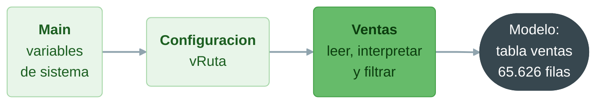

# Qlik Sense: primer script, leer y tipar los datos

**Bloque 9 -- Qlik | Sesión 2 de 11**

[← Volver al índice del curso](../../README.md#bloque-9---qlik)

---

## 1. Introducción

En la sesión anterior cargamos `ventas_mercadia.csv` con el gestor de datos y descubrimos dos cosas: que detrás de cada asistente de Qlik hay un **script**, y que el dataset tiene diez problemas de calidad que fragmentan los gráficos y rompen las asociaciones. Hoy empezamos a escribir ese script nosotros mismos.

El **script de carga** es la pieza central de Qlik. Es el equivalente a Power Query en Power BI y a Tableau Prep en Tableau, pero con una diferencia de enfoque, se **escribe** como código, se ejecuta de arriba abajo (secuencial) y su resultado es el modelo de datos de la app. Quien ha escrito consultas SQL en el bloque 1 va a reconocer enseguida la lógica: `LOAD` se parece mucho a `SELECT`.

Como el script es lo que más diferencia a Qlik de las otras herramientas, le dedicamos tres sesiones en las que trabajamos **paso a paso**: escribimos unas pocas líneas, recargamos, comprobamos el resultado y solo entonces seguimos.

| Sesión | Qué hacemos con el script | Problemas del diagnóstico que resolvemos |
|---|---|---|
| **9.1.2** | Leer el archivo de ventas, dar a cada campo su tipo y filtrar filas | Fechas en tres formatos, punto decimal, líneas con 0 unidades |
| **9.1.3** | Transformar campos: normalizar textos, tablas de correspondencias y campos calculados | Claves de tienda, canal, importes ×100, tickets sin cliente, devoluciones |
| **9.1.4** | Cargar los maestros y construir el modelo | Categoría, clientes duplicados y tienda huérfana |

Al terminar hoy tendremos `Mercadia_9.1.2.qvf` con una sola tabla, `ventas`, pero bien leída: fechas que son fechas, importes que son números y ninguna línea vacía.

### Objetivos de la sesión
- Crear una app desde el editor de carga de datos y conocer sus zonas: secciones, editor, fuentes de datos y registro.
- Crear una conexión de carpeta y referenciar archivos con `lib://`.
- Entender la anatomía de una sentencia `LOAD` y compararla con `SELECT`.
- Comprender las variables de sistema (`DecimalSep`, `DateFormat`...) y por qué afectan a la lectura de un CSV.
- Usar variables propias con `SET` y `$(...)`.
- Convertir textos en números con `Num#` y en fechas con `Date#` y `Alt`.
- Filtrar filas al cargar con `WHERE`.
- Comprobar cada paso con el registro de carga, el visor del modelo y una hoja de comprobaciones.

### Prerequisitos
- Sesión 9.1.1 completada: Qlik Sense Desktop instalado y diagnóstico del dataset.
- Los cinco archivos de [`9.0 - Dataset/`](../9.0%20-%20Dataset/) copiados en una carpeta de nuestro equipo.
- Bloque 1 (SQL): `SELECT`, `WHERE` y alias con `AS`.

---

## 2. Crear la app desde el editor de carga

En el hub de Qlik Sense Desktop pulsamos **Crear nueva app**, la llamamos **Mercadia_9.1.2** y la abrimos. Esta vez, en lugar de **Añadir datos desde archivos y otras fuentes** (el gestor de datos), elegimos **Editor de carga de datos** (*Data load editor*).

> **¿Por qué una app nueva en lugar de seguir con la de la 9.1.1?** Mezclar el gestor de datos y el editor de carga en la misma app funciona, pero genera confusión: el gestor mantiene su propia sección bloqueada y puede volver a cargar tablas que creíamos haber sustituido. Elegimos una herramienta por app y, a partir de hoy, esa herramienta es el editor.

---

## 3. El editor de carga de datos

El editor tiene cuatro zonas:

| Zona | Qué contiene |
|---|---|
| **Secciones** (izquierda) | El script se divide en pestañas que se ejecutan **en orden, de arriba abajo**. Se crean con **+**, se renombran y se reordenan arrastrando |
| **Editor** (centro) | El código. Tiene autocompletado, ayuda contextual de cada función y comentarios con `//` (una línea) o `/* ... */` (varias) |
| **Fuentes de datos** (derecha) | Las **conexiones** a carpetas y bases de datos. Desde aquí se puede generar el código `LOAD` de un archivo con el botón **Seleccionar datos** |
| **Barra superior** | **Cargar datos** (ejecuta el script completo, recarga la app y la guarda), **Depurar** (ejecución paso a paso) y el acceso al registro de la última carga |

<!-- Captura pendiente: 0.Capturas/9.1.2/3.1_Editor_carga.png -->

### La sección Main y las variables de sistema

Toda app nueva empieza con una sección, **Main**, que contiene una lista de instrucciones `SET` generadas automáticamente a partir de la configuración regional de Windows. Con una configuración en español, las primeras son estas:

```
SET ThousandSep='.';
SET DecimalSep=',';
SET MoneyThousandSep='.';
SET MoneyDecimalSep=',';
SET MoneyFormat='#.##0,00 €;-#.##0,00 €';
SET TimeFormat='hh:mm:ss';
SET DateFormat='DD/MM/YYYY';
SET TimestampFormat='DD/MM/YYYY hh:mm:ss[.fff]';
SET FirstWeekDay=0;
SET BrokenWeeks=0;
SET ReferenceDay=4;
SET FirstMonthOfYear=1;
SET CollationLocale='es-ES';
SET CreateSearchIndexOnReload=1;
SET MonthNames='ene;feb;mar;abr;may;jun;jul;ago;sept;oct;nov;dic';
SET LongMonthNames='enero;febrero;marzo;abril;mayo;junio;julio;agosto;septiembre;octubre;noviembre;diciembre';
SET DayNames='lun;mar;mié;jue;vie;sáb;dom';
SET LongDayNames='lunes;martes;miércoles;jueves;viernes;sábado;domingo';
SET NumericalAbbreviation='3:k;6:M;9:G;12:T;15:P;18:E;21:Z;24:Y;-3:m;-6:μ;-9:n;-12:p;-15:f;-18:a;-21:z;-24:y';

...
```

Estas variables le dicen a Qlik **cómo interpretar** los textos que lee y **cómo mostrar** los números y las fechas. `DecimalSep=','` significa: "un número tiene coma decimal". Lo vamos a necesitar en el paso 3.

> **No borres la sección Main.** Si se borran esas instrucciones, Qlik usa los valores por defecto del equipo, que pueden cambiar de un ordenador a otro. Es el equivalente a la configuración regional de Power Query que nos dio problemas con los decimales en el bloque 7.

---

## 4. La conexión de carpeta

En un script de Qlik, los archivos no se referencian con una ruta del disco (`C:\...`), sino a través de una **conexión** con el prefijo `lib://`. Así, si mañana movemos los datos a otra carpeta, solo hay que cambiar la conexión, no el script.

Creamos la conexión una sola vez:

1. En el panel **Fuentes de datos** (derecha), pulsamos **Crear nueva conexión** → **Carpeta**.
2. Navegamos hasta la carpeta donde hemos copiado el dataset (`9.0 - Dataset`).
3. La llamamos **Mercadia** y pulsamos **Crear**.

Desde ahora, cualquier archivo de esa carpeta se lee como `lib://Mercadia/nombre_del_archivo`. La conexión queda guardada en Qlik Sense Desktop, no en la app: la podremos usar en todas las apps del bloque.

> **El nombre de la conexión distingue mayúsculas.** `lib://mercadia/` no encuentra la conexión `Mercadia`. Si un compañero nos pasa una app y no le funciona, lo primero es comprobar que su conexión se llama exactamente igual.

---

## 5. Paso 1: la primera sentencia LOAD

Creamos una sección nueva con **+** y la llamamos **Ventas**. No escribimos el código a mano: en la conexión **Mercadia** pulsamos el icono **Seleccionar datos**, elegimos `ventas_mercadia.csv` y, en la ventana de vista previa, comprobamos que Qlik ha detectado **Delimitado**, **Coma**, **Nombres de campo incluidos** y **UTF-8**. Pulsamos **Insertar script**.

Qlik escribe en la sección algo como esto (lo hemos ordenado un poco):

```
LOAD
    id_linea,
    id_ticket,
    fecha,
    id_tienda,
    id_cliente,
    canal,
    id_producto,
    categoria,
    unidades,
    precio_unitario,
    descuento_pct,
    importe_neto
FROM [lib://Mercadia/ventas_mercadia.csv]
(txt, utf8, embedded labels, delimiter is ',', msq);
```

Añadimos encima una línea con la **etiqueta** de la tabla, `ventas:`, y pulsamos **Cargar datos**.

### Leer el registro de carga

Durante la carga, Qlik abre una ventana con el **registro** (*log*). Al terminar debe decir algo así:

```
ventas << ventas_mercadia
Líneas recuperadas: 65.670
La carga de datos ha finalizado correctamente.
```

Es la primera comprobación, y la haremos **siempre**: ¿cuántas filas esperábamos?, ¿cuántas ha cargado? 65.670 es exactamente el número de líneas de venta del archivo. Si un día el registro dice otra cosa, algo ha cambiado en el origen o en el script.

### Anatomía de la sentencia

| Parte | Qué hace | En SQL |
|---|---|---|
| `ventas:` | **Etiqueta**: el nombre que tendrá la tabla en el modelo. Sin ella, la tabla se llama como el archivo (`ventas_mercadia`) | `CREATE TABLE ventas AS` |
| `LOAD` | Empieza la lista de campos | `SELECT` |
| `id_linea, id_ticket, ...` | Los campos que se cargan, separados por comas. **Sin coma después del último** | Lista de columnas |
| `FROM [...]` | El origen: un archivo dentro de una conexión. Los corchetes son obligatorios si la ruta tiene espacios | `FROM` |
| `(txt, utf8, embedded labels, ...)` | **Especificación de formato**: texto delimitado, codificación UTF-8, nombres en la primera fila (`embedded labels`), separador coma y comillas estándar (`msq`) | Sin equivalente |
| `;` | Fin de la sentencia. **Obligatorio**. Olvidarlo es el error más frecuente del script | `;` |

Tres diferencias con SQL que conviene fijar desde ya:

1. **`LOAD` lee archivos y tablas ya cargadas; `SQL SELECT` habla con bases de datos.** Cuando un script se conecta a una base de datos, la consulta se escribe con `SQL SELECT ...` (la ejecuta la base de datos) y, encima, opcionalmente un `LOAD` (la transformación la ejecuta Qlik). En este bloque trabajamos con archivos, así que todo será `LOAD`.
2. **Las funciones son de Qlik**, no de SQL: `Upper`, `Trim`, `Date#`, `ApplyMap`... Hay más de 300, y con el cursor sobre cualquiera de ellas el editor muestra su sintaxis.
3. **Los nombres de campo distinguen mayúsculas**: `Fecha` y `fecha` son dos campos distintos. Y si contienen espacios o caracteres especiales, van entre corchetes: `[Ventas netas]`.

---

## 6. Paso 2: la sección Configuracion y la variable vRuta

Vamos a escribir la ruta `lib://Mercadia/` en muchas sentencias (hoy una, en la 9.1.4 cinco). Si la conexión cambia de nombre, tendríamos que buscarla y cambiarla en todas. Para evitarlo, la guardamos en una **variable**.

Creamos una sección nueva, **Configuracion** (sin tilde, una costumbre habitual en los nombres técnicos), y la **arrastramos entre Main y Ventas**: tiene que ejecutarse antes de que se use la variable.

```
// Ruta de la carpeta del dataset (conexión de carpeta "Mercadia")
SET vRuta = 'lib://Mercadia/';
```

Y en la sección **Ventas** cambiamos la línea del `FROM`:

```
FROM [$(vRuta)ventas_mercadia.csv]
```

`SET` asigna un **texto** a una variable, tal cual. `$(vRuta)` es una **expansión**: antes de ejecutar cada línea, Qlik sustituye `$(vRuta)` por su valor, como un "buscar y reemplazar". La línea que llega a ejecutarse es exactamente la misma que antes: `FROM [lib://Mercadia/ventas_mercadia.csv]`.

Pulsamos **Cargar datos**. El registro debe decir lo mismo que en el paso 1: 65.670 líneas. **Un cambio que no debe alterar el resultado también se comprueba.**

> **Convención de nombres.** Las variables se nombran con una `v` delante (`vRuta`, `vAnio`...) para distinguirlas a simple vista de los campos. En la 9.2.2 veremos las variables con detalle, también `LET`, que calcula el valor en lugar de copiarlo.

---

## 7. Paso 3: los números

### El problema

Salimos del editor y vamos a **Analizar** → **Hoja**. Creamos una hoja llamada **Comprobaciones** y añadimos un **KPI** con la medida `Sum(importe_neto)`. El resultado no tiene sentido: sale **0**. ¿Por qué?

El CSV escribe los importes con **punto decimal** (`2.22`). Pero la sección Main dice `DecimalSep=','` y `ThousandSep='.'`: para Qlik, un número "correcto" se escribe `2,22`, y el punto separa miles. Ante `2.22`, Qlik no sabe qué hacer y lo guarda como **texto**. Y un texto no se puede sumar.

Lo comprobamos en **Preparar** → **Visor del modelo de datos**: seleccionamos la tabla `ventas` y, en el panel inferior, el campo `importe_neto`. Le falta la etiqueta **`$numeric`** que sí tienen, por ejemplo, `unidades`.

### La solución: Num#

Tenemos dos opciones: cambiar `DecimalSep` a `'.'` (y entonces todos los números de la app se mostrarían con punto, a la inglesa) o **dejar la sección Main como está** e indicar el separador al leer cada campo. Elegimos la segunda: la app se ve en formato español y la lectura no depende de la configuración del ordenador de quien recargue.

En la sección **Ventas** cambiamos las tres líneas de los campos decimales:

```
    Num#(precio_unitario, '#,##0.##', '.', ',') AS precio_unitario,
    Num#(descuento_pct,   '#,##0.##', '.', ',') AS descuento_pct,
    Num#(importe_neto,    '#,##0.##', '.', ',') AS importe_neto
```

`Num#(texto, formato, separador_decimal, separador_miles)` **interpreta** un texto como número usando los separadores que le indicamos, sin importar lo que diga la sección Main. El formato `'#,##0.##'` describe el aspecto del texto de origen.

Fíjate en el `AS`: al transformar un campo **hay que darle nombre**. Sin `AS`, Qlik lo llamaría literalmente `Num#(precio_unitario, '#,##0.##', '.', ',')`. Al repetir el nombre original, el campo transformado **sustituye** al original: en el modelo solo habrá un `importe_neto`, el bueno.

Pulsamos **Cargar datos** y volvemos a la hoja **Comprobaciones**. Ahora el KPI marca **328.723,63**. En el visor del modelo, `importe_neto` ya tiene la etiqueta `$numeric`.

> **Ojo: 328.723,63 todavía no es la cifra de ventas buena.** Incluye las 18 líneas con el importe multiplicado por 100 que vimos en la 9.1.1. Las corregiremos en la 9.1.3. Hoy solo nos aseguramos de que **todos** los importes se leen como números.

> **`Num#` frente a `Num`.** Las funciones de Qlik que terminan en `#` (`Num#`, `Date#`, `Time#`...) son **de interpretación**: leen un texto y lo convierten en valor. Las mismas funciones sin `#` (`Num`, `Date`...) son **de formato**: deciden cómo se **muestra** un valor que ya existe. Es la confusión número uno de quien empieza con Qlik.

---

## 8. Paso 4: las fechas

### El problema

Añadimos a la hoja **Comprobaciones** dos KPI más: `Min(fecha)` y `Max(fecha)`. Esta vez no salen vacíos, sino algo peor: **24/01/0001** y **25/12/2031**. Unas ventas del año 1 y otras de dentro de cinco años.

Al leer un archivo de texto, Qlik intenta **interpretar** cada valor por su cuenta: si un texto se parece a una fecha según el `DateFormat` de la sección Main o a uno de los formatos habituales, lo guarda como fecha. Con los importes no pudo (el punto decimal no encajaba con nada); con las fechas sí, pero no siempre acierta. Y, como vimos en la 9.1.1, el texto viene en **tres formatos**:

| Formato | Ejemplo | Líneas | Interpretación automática |
|---|---|---|---|
| `YYYY-MM-DD` | `2025-03-10` | 42.938 | Correcta |
| `DD/MM/YYYY` | `10/03/2025` | 16.334 | Correcta |
| `D-M-YY` | `10-3-25` | 6.398 | **Equivocada** en casi todas: `1-1-24` se lee como el 24/01 del año 1 |

Es el peor tipo de error: no hay ningún aviso, ningún nulo y ningún campo en texto. Solo unas fechas imposibles que se descubren mirando el mínimo y el máximo. **Nunca hay que fiarse de la interpretación automática de las fechas**: se le dice a Qlik qué formato tiene cada una.

### Paso 4a: un solo formato

Empezamos con lo más sencillo. En la sección **Ventas** cambiamos la línea de `fecha` por:

```
    Date(Date#(fecha, 'YYYY-MM-DD')) AS fecha,
```

`Date#(texto, formato)` interpreta un texto como fecha **si encaja** con el formato indicado. Si no encaja, **no** devuelve nulo: devuelve el texto tal cual, sin valor numérico. Por eso lo envolvemos en `Date(...)`, una función de formato que veremos en el paso 4b: aplicada a un texto que no es fecha, devuelve **nulo**, y así podemos contar los fallos.

Cargamos y añadimos un KPI más: `NullCount(fecha)`, que cuenta las filas con la fecha nula. Marca **16.334**: son las fechas con barras, que no encajan con `YYYY-MM-DD`. Pero `Min(fecha)` y `Max(fecha)` siguen en 24/01/0001 y 25/12/2031. ¿Por qué?

Porque `Date#` es **tolerante con el número de dígitos**: para `'YYYY-MM-DD'`, el texto `1-1-24` tiene tres números separados por guiones, y lo acepta como año 1, mes 1, día 24. Las 6.398 fechas con guiones encajan con el formato ISO, pero mal leídas. El paso no está terminado, y ya sabemos que hay que mirar las dos cosas: los nulos y el rango de fechas.

### Paso 4b: los tres formatos con Alt

Cambiamos la línea otra vez:

```
    // Tres formatos de fecha en el origen. El orden importa: Date# es
    // tolerante con los dígitos y 'YYYY-MM-DD' aceptaría 1-1-24 como año 1
    Date(Alt(Date#(fecha, 'D-M-YY'),
             Date#(fecha, 'DD/MM/YYYY'),
             Date#(fecha, 'YYYY-MM-DD')))             AS fecha,
```

Leemos la expresión **de dentro afuera**:

1. Cada `Date#` intenta leer el texto con un formato. Si encaja, devuelve una fecha (un número por dentro); si no, devuelve el texto sin valor numérico.
2. `Alt(a, b, c)` devuelve el **primer** argumento que tenga un valor numérico válido. Como una fecha en Qlik es un número por dentro, `Alt` se queda con el primer `Date#` que ha funcionado.
3. `Date(...)` le da el **formato de visualización** de la sección Main (`DD/MM/YYYY`). Es una función de formato, sin `#`: no cambia el valor, solo cómo se ve.

| Texto original | `Date#` D-M-YY | `Date#` DD/MM/YYYY | `Date#` YYYY-MM-DD | `Alt` + `Date` |
|---|---|---|---|---|
| `2025-03-10` | no encaja | no encaja | 10/03/2025 | 10/03/2025 |
| `10/03/2025` | no encaja | 10/03/2025 | no encaja | 10/03/2025 |
| `10-3-25` | 10/03/2025 | no encaja | **25/03/2010** | 10/03/2025 |

La última fila explica el **orden**. `10-3-25` encaja con dos formatos: con el bueno, `D-M-YY`, y con el ISO, que lo lee como 25 de marzo de 2010. Como `Alt` se queda con el primero que funciona, `D-M-YY` tiene que ir **antes** que `YYYY-MM-DD`. Con el orden contrario, la carga terminaría sin un solo nulo y con más de 6.000 fechas equivocadas.

Cargamos y comprobamos en la hoja: `NullCount(fecha)` vale **0**, `Min(fecha)` es **01/01/2024** y `Max(fecha)` es **30/09/2026**. Es el mismo reto de `booking_date` del bloque 7 y de `flight_date` del bloque 8, resuelto ahora en una sola expresión.

> **Antes de escribir un `Alt`, hay que saber de dónde viene cada formato.** Si dos formatos pueden encajar con el mismo texto, `Alt` se quedará con el primero, aunque no sea el correcto. Pasa con `D-M-YY` frente a `YYYY-MM-DD` y pasaría con `DD/MM/YYYY` frente a `MM/DD/YYYY` (`03/04/2025`). La regla práctica: los formatos más **estrictos** o más **raros** van primero, y después, siempre, se comprueban el mínimo y el máximo.

---

## 9. Paso 5: filtrar filas con WHERE

El diagnóstico de la 9.1.1 encontró 44 líneas con **0 unidades** e importe 0: no representan ninguna venta. Las excluimos al cargar, añadiendo una cláusula `WHERE` **después** de la especificación de formato:

```
FROM [$(vRuta)ventas_mercadia.csv]
(txt, utf8, embedded labels, delimiter is ',', msq)
WHERE unidades <> 0;
```

Fíjate en que el `;` se ha movido: ahora va al final del `WHERE`, porque la sentencia termina ahí.

Cargamos. El registro dice ahora **65.626** líneas recuperadas: 65.670 menos las 44. En la hoja, el KPI de `Sum(importe_neto)` sigue en 328.723,63, porque las líneas eliminadas tenían importe 0. Y añadimos un último KPI, `Count(id_linea)`, que debe marcar también 65.626.

Las **devoluciones** (unidades negativas) pasan el filtro, y es lo que queremos: no son errores, son ventas que restan.

> **¿Por qué `unidades` sí se puede comparar con 0 y no necesitaba `Num#`?** Porque en el CSV las unidades son números enteros, sin separador decimal (`3`, `-1`), y Qlik los interpreta bien sin ayuda. El problema de los separadores solo afecta a los campos con decimales.

---

## 10. El script completo de la sesión

Así queda el script después de los cinco pasos. Las secciones, en este orden:

**Main**: sin cambios, las variables de sistema.

**Configuracion**:

```
// Ruta de la carpeta del dataset (conexión de carpeta "Mercadia")
SET vRuta = 'lib://Mercadia/';
```

**Ventas**:

```
// Tabla de hechos: una fila por línea de ticket
ventas:
LOAD
    id_linea,
    id_ticket,
    // Tres formatos de fecha en el origen. El orden importa: Date# es
    // tolerante con los dígitos y 'YYYY-MM-DD' aceptaría 1-1-24 como año 1
    Date(Alt(Date#(fecha, 'D-M-YY'),
             Date#(fecha, 'DD/MM/YYYY'),
             Date#(fecha, 'YYYY-MM-DD')))             AS fecha,
    id_tienda,
    id_cliente,
    canal,
    id_producto,
    categoria,
    unidades,
    // El CSV usa punto decimal: lo indicamos al leer
    Num#(precio_unitario, '#,##0.##', '.', ',')       AS precio_unitario,
    Num#(descuento_pct,   '#,##0.##', '.', ',')       AS descuento_pct,
    Num#(importe_neto,    '#,##0.##', '.', ',')       AS importe_neto
FROM [$(vRuta)ventas_mercadia.csv]
(txt, utf8, embedded labels, delimiter is ',', msq)
// Las líneas con 0 unidades no representan ninguna venta
WHERE unidades <> 0;
```

Y la hoja **Comprobaciones**, que conservaremos y ampliaremos en las dos próximas sesiones:

| KPI | Expresión | Valor esperado hoy |
|---|---|---|
| Líneas | `Count(id_linea)` | 65.626 |
| Importe (sin corregir) | `Sum(importe_neto)` | 328.723,63 |
| Primera fecha | `Min(fecha)` | 01/01/2024 |
| Última fecha | `Max(fecha)` | 30/09/2026 |
| Fechas no interpretadas | `NullCount(fecha)` | 0 |

Guardamos la app. En Desktop, la carga ya la guarda, y para cualquier otro cambio usamos **Guardar** (o `Ctrl + S`). El archivo queda en `Documentos\Qlik\Sense\Apps\Mercadia_9.1.2.qvf`.

---

## 11. Lo que Qlik ha hecho por debajo

Al pulsar **Cargar datos**, Qlik ejecuta el script **de arriba abajo, una sentencia detrás de otra**, como un programa:



Dentro de la sentencia `LOAD`, para **cada fila** del archivo, Qlik hace tres cosas en este orden:

1. **Lee** la fila y la parte en campos con el separador indicado.
2. **Evalúa el `WHERE`**. Si no se cumple, descarta la fila y pasa a la siguiente.
3. **Calcula** cada expresión de la lista (`Num#`, `Date#`...) y añade la fila a la tabla.

Dos consecuencias prácticas:

- El **orden de las secciones importa**: una variable tiene que existir antes de que se use un `$(...)`. Si arrastráramos **Configuracion** por debajo de **Ventas**, la carga fallaría con un error de ruta.
- **El `WHERE` trabaja con los campos del archivo, tal como vienen**, no con los transformados de la lista. Por eso funciona `WHERE unidades <> 0`: `unidades` existe en el CSV. Si quisiéramos filtrar por un campo calculado en el mismo `LOAD`, no podríamos. En la 9.1.3 veremos cómo encadenar varios `LOAD` para conseguirlo.

Comparemos dónde vive la preparación del dato en cada herramienta:

| | Power BI | Tableau | Qlik |
|---|---|---|---|
| Dónde se prepara | Power Query (pasos aplicados) | Campos calculados en Desktop o flujo de Prep | Script de carga |
| Cuándo se ejecuta | Al actualizar | Campos calculados: **en cada consulta**. Prep: al ejecutar el flujo | Al recargar |
| Cómo se ve | Lista de pasos | Campos derivados / nodos | Código |
| Cómo se documenta | Nombres de los pasos | Comentarios en los cálculos | Comentarios y secciones del script |

En Qlik, como en Power Query, el dato preparado **se materializa al recargar**: los gráficos trabajan siempre sobre el campo ya interpretado, sin repetir el trabajo en cada clic.

---

## 12. Ejercicios

**Ejercicio 1: leer una sentencia LOAD.** Sin ejecutarlo, explica qué hace este script y qué tabla deja en el modelo:

```
resumen:
LOAD DISTINCT
    id_ticket,
    Upper(canal) AS canal_mayus
FROM [$(vRuta)ventas_mercadia.csv]
(txt, utf8, embedded labels, delimiter is ',', msq)
WHERE Len(Trim(id_cliente)) = 0;
```

Pista: `DISTINCT` funciona como en SQL, `Len` devuelve el número de caracteres de un texto y `Trim` le quita los espacios de los extremos.

<details>
<summary>Ver la solución</summary>

Crea una tabla `resumen` con una fila por cada combinación distinta de ticket y canal en mayúsculas, solo para las líneas **sin cliente** (`id_cliente` vacío). Como cada ticket tiene un único canal, queda una fila por ticket sin tarjeta: **9.200 filas**. `canal_mayus` solo tendría el valor `TIENDA`, porque las compras online siempre llevan cliente. **Cuidado:** si añadimos esta tabla al script de la app, el campo `id_ticket` la asociaría con `ventas`. En la 9.1.4 veremos por qué eso importa.

</details>

**Ejercicio 2: interpretar fechas.** ¿Qué devuelve cada expresión? Supón `DateFormat='DD/MM/YYYY'`.

1. `Date#('2025-03-10', 'DD/MM/YYYY')`
2. `Alt(Date#('10/03/2025', 'YYYY-MM-DD'), Date#('10/03/2025', 'DD/MM/YYYY'))`
3. `Date(Date#('7-1-26', 'D-M-YY'))`
4. `Month(Date#('7-1-26', 'D-M-YY'))`

<details>
<summary>Ver la solución</summary>

1. **El texto `2025-03-10`, sin valor numérico**: no encaja con el formato, y `Date#` devuelve el texto tal cual. No es un nulo: si lo envolvemos en `Date(...)`, entonces sí da nulo.
2. **10/03/2025** (como número de fecha): el primer `Date#` falla y `Alt` devuelve el segundo.
3. **07/01/2026**: 7 de enero de 2026, mostrado con el `DateFormat` de la app.
4. **`ene`**, que internamente vale 1. Lo veremos en la 9.1.3.

</details>

**Ejercicio 3: encontrar el error.** Este script falla al cargar. Encuentra los **tres** errores sin ejecutarlo:

```
ventas
LOAD
    id_linea,
    Num#(importe_neto, '#,##0.##', '.', ','),
    unidades,
FROM [$(vRuta)ventas_mercadia.csv]
(txt, utf8, embedded labels, delimiter is ',', msq);
```

<details>
<summary>Ver la solución</summary>

1. Falta el **`:`** después de la etiqueta: `ventas:`.
2. Sobra la **coma** después de `unidades`, el último campo antes del `FROM`.
3. El `Num#` **no tiene `AS`**. Este no hace fallar la carga, pero el campo se llamaría `Num#(importe_neto, '#,##0.##', '.', ',')`, y cualquier medida con `importe_neto` dejaría de funcionar. Es un error aunque Qlik no lo detecte.

</details>

**Ejercicio 4: medir los formatos de fecha.** Queremos comprobar en la app cuántas líneas venían en cada formato. Añade al `LOAD` de ventas un campo nuevo, `formato_fecha`, que valga `ISO`, `Barras` o `Guiones` según el formato original, y comprueba los recuentos con una tabla en la hoja **Comprobaciones**.

Pista: `If(condición, valor_si, valor_no)` funciona como en Excel, e `IsNum(x)` devuelve verdadero si `x` tiene valor numérico. Recuerda lo que devuelve `Date#` cuando el formato no encaja y en qué orden hay que probar los formatos.

<details>
<summary>Ver la solución</summary>

```
    If(IsNum(Date#(fecha, 'D-M-YY')), 'Guiones',
       If(IsNum(Date#(fecha, 'DD/MM/YYYY')), 'Barras', 'ISO'))  AS formato_fecha,
```

La línea se puede añadir en cualquier posición, incluso antes de la de `fecha`: dentro de un mismo `LOAD`, todas las expresiones leen el campo `fecha` **original** del archivo, aunque otra línea cree un campo transformado con el mismo nombre. Con una tabla con la dimensión `formato_fecha` y la medida `Count(id_linea)`: **ISO 42.909**, **Barras 16.322** y **Guiones 6.395**, que suman 65.626. (En la 9.1.1 eran algo más, porque contábamos también las 44 líneas con 0 unidades.)

Dos trampas que este ejercicio pone a prueba. La primera: `Not IsNull(Date#(...))` no sirve, porque un `Date#` que no encaja devuelve el texto, no un nulo, y todas las líneas acabarían en `ISO`. La segunda: el formato con guiones se prueba **primero**, por la misma razón que en el `Alt` del paso 4b.

Después de comprobarlo, borramos el campo: era solo para el control.

</details>

---

## 13. Errores comunes y troubleshooting

**1. "El script falla con *Unexpected token* o *Field not found*."** Casi siempre es un `;` olvidado al final de la sentencia anterior o una coma de más (o de menos) en la lista de campos. El registro indica la línea, pero el error suele estar en la **anterior**.

**2. "*Cannot open file* o *Path not found*."** La ruta no coincide con la conexión. Comprobamos que la conexión se llama exactamente igual que en `vRuta` (también en mayúsculas y minúsculas), que apunta a la carpeta correcta (botón de edición de la conexión) y que la sección **Configuracion** está **por encima** de **Ventas**.

**3. "Los importes siguen saliendo a 0 o alineados a la izquierda."** El campo sigue siendo texto: falta el `Num#`, se ha aplicado a otro campo o no tiene `AS` y el campo bueno se llama de otra forma. En el visor del modelo, un campo numérico muestra la etiqueta `$numeric`.

**4. "`NullCount(fecha)` no baja a 0" o "`Min(fecha)` y `Max(fecha)` dan fechas imposibles".** Si hay nulos, hay un formato que no hemos contemplado o hay una errata en uno de los formatos de `Date#` (por ejemplo, `mm` en minúsculas, que en Qlik significa **minutos**, no meses). Para encontrar los casos, una tabla provisional con la dimensión `fecha` y la selección de los valores nulos no ayuda, porque los nulos no se pueden seleccionar: es mejor cargar temporalmente el texto original con otro nombre (`Text(fecha) AS fecha_texto`) y mirar sus valores. Si no hay nulos pero el mínimo o el máximo se salen del periodo esperado, el problema es el **orden** de los formatos en el `Alt`: un formato tolerante, como `YYYY-MM-DD`, está leyendo mal las fechas de otro formato.

**5. "He creado una variable y `$(vRuta)` no se sustituye."** El nombre de la variable distingue mayúsculas (`$(vruta)` no es `$(vRuta)`) y la sección que la crea tiene que ejecutarse antes. El menú **Variables** de una hoja (en modo edición) muestra todas las variables de la app y su valor tras la última carga.

**6. "La carga ha ido bien pero los gráficos de la hoja están vacíos."** Probablemente hay **selecciones activas** de antes de la recarga que ya no encuentran datos. Borramos todas las selecciones.

---

## 14. Conclusión

En esta sesión hemos escrito nuestras primeras líneas de script en Qlik. Hemos creado una app desde el editor de carga, una conexión de carpeta y una variable con la ruta de los datos. Hemos leído la sentencia `LOAD` parte por parte y la hemos comparado con un `SELECT` de SQL. Hemos visto por qué las variables de sistema de la sección Main hacen que un CSV con punto decimal se lea como texto, y lo hemos resuelto con `Num#`. Hemos convertido tres formatos de fecha en una sola fecha con `Date#`, `Alt` y `Date`, y hemos filtrado las líneas imposibles con `WHERE`. Y, sobre todo, hemos adquirido una costumbre: **después de cada cambio, recargar y comprobar**, con el registro, el visor del modelo y una hoja de comprobaciones. El resultado es `Mercadia_9.1.2.qvf`, con la tabla de ventas bien tipada. En la 9.1.3 transformaremos sus campos: normalizaremos las claves de tienda y el canal, corregiremos los importes erróneos y crearemos campos calculados.

---

## 15. Para profundizar

### Las funciones de interpretación y de formato

| Interpretación (texto → valor) | Formato (valor → cómo se ve) |
|---|---|
| `Num#(texto, formato)` | `Num(valor, formato)` |
| `Date#(texto, formato)` | `Date(valor, formato)` |
| `Time#(texto, formato)` | `Time(valor, formato)` |
| `Timestamp#(texto, formato)` | `Timestamp(valor, formato)` |
| `Money#(texto, formato)` | `Money(valor, formato)` |

Por dentro, todos los valores de Qlik son **duales**: tienen a la vez un número y un texto. Las funciones de interpretación construyen el número a partir del texto; las de formato cambian el texto que se muestra sin tocar el número. Una fecha como `10/03/2025` es, por dentro, el número 45.726 (los días transcurridos desde el 30/12/1899, como en Excel).

### El modo depuración

El botón **Depurar** del editor ejecuta el script paso a paso, con puntos de interrupción y la posibilidad de **limitar la carga** a unas pocas filas de cada tabla. Es la forma más rápida de probar un cambio en un script largo sin esperar a la carga completa, y de ver el valor de las variables en cada momento. Lo usaremos a fondo en la 9.2.2.

### Generar el código frente a escribirlo

El botón **Seleccionar datos** de la conexión es una gran ayuda para no equivocarse con la especificación de formato. Lo habitual entre desarrolladores de Qlik es usarlo para generar la primera versión de cada `LOAD` y, a partir de ahí, editar el código a mano. Lo que no conviene es volver a generarlo encima de un `LOAD` ya trabajado: se pierden las transformaciones.

---

## 16. Recursos

- **Ayuda oficial de Qlik Sense para Windows** (en español, versión May 2026): <https://help.qlik.com/es-ES/sense/May2026/Content/Sense_Helpsites/Home.htm>
- **Ayuda contextual del editor**: con el cursor sobre una función del script, el editor muestra su sintaxis y un enlace a su página de ayuda.
- **Qlik Community**, foro oficial, con miles de preguntas resueltas sobre scripting: <https://community.qlik.com/>

### Documentación oficial de esta sesión

| Tema | Página de la ayuda |
|---|---|
| El editor de carga | [Utilizar el editor de carga de datos][doc-editor] · [Organizar el código de script][doc-secciones] · [Ejecutar el script para cargar los datos][doc-ejecutar] · [Depurar el script de carga de datos][doc-depurar] |
| Conexiones | [Conectar con fuentes de datos en scripts de carga][doc-conexiones] |
| La sentencia LOAD | [Load][doc-load] · [Etiquetas de tabla][doc-etiquetas] |
| Variables | [Set][doc-set] · [Expansiones de signo dólar][doc-dolar] · [Trabajar con variables en el editor de carga de datos][doc-variables] |
| Variables de sistema | [Variables de interpretación numérica][doc-var-num] · [DecimalSep][doc-decimalsep] |
| Interpretación y formato | [Funciones de interpretación][doc-interpretacion] · [Num#][doc-num-hash] · [Date#][doc-date-hash] · [Funciones de formato][doc-formato] · [Num][doc-num] · [Date][doc-date] |
| Otras funciones | [Alt][doc-alt] · [NullCount][doc-nullcount] |
| Valores duales | [Tipos de datos][doc-tipos] · [Dual][doc-dual] |

---

*Guía del alumno · Sesión 2 · Bloque 9 - Qlik · Mercadia*

[doc-editor]: https://help.qlik.com/es-ES/sense/May2026/Subsystems/Hub/Content/Sense_Hub/LoadData/use-data-load-editor.htm
[doc-secciones]: https://help.qlik.com/es-ES/sense/May2026/Subsystems/Hub/Content/Sense_Hub/LoadData/organize-script-code.htm
[doc-ejecutar]: https://help.qlik.com/es-ES/sense/May2026/Subsystems/Hub/Content/Sense_Hub/LoadData/run-script-load-data.htm
[doc-depurar]: https://help.qlik.com/es-ES/sense/May2026/Subsystems/Hub/Content/Sense_Hub/LoadData/debug-data-load-script.htm
[doc-conexiones]: https://help.qlik.com/es-ES/sense/May2026/Subsystems/Hub/Content/Sense_Hub/LoadData/connect-data-sources-data-load-editor.htm
[doc-load]: https://help.qlik.com/es-ES/sense/May2026/Subsystems/Hub/Content/Sense_Hub/Scripting/ScriptRegularStatements/Load.htm
[doc-etiquetas]: https://help.qlik.com/es-ES/sense/May2026/Subsystems/Hub/Content/Sense_Hub/Scripting/table-labels.htm
[doc-set]: https://help.qlik.com/es-ES/sense/May2026/Subsystems/Hub/Content/Sense_Hub/Scripting/ScriptRegularStatements/Set.htm
[doc-dolar]: https://help.qlik.com/es-ES/sense/May2026/Subsystems/Hub/Content/Sense_Hub/Scripting/dollar-sign-expansions.htm
[doc-variables]: https://help.qlik.com/es-ES/sense/May2026/Subsystems/Hub/Content/Sense_Hub/Scripting/work-with-variables-in-data-load-editor.htm
[doc-var-num]: https://help.qlik.com/es-ES/sense/May2026/Subsystems/Hub/Content/Sense_Hub/Scripting/NumberInterpretationVariables/number-interpretation-variables.htm
[doc-decimalsep]: https://help.qlik.com/es-ES/sense/May2026/Subsystems/Hub/Content/Sense_Hub/Scripting/NumberInterpretationVariables/DecimalSep.htm
[doc-interpretacion]: https://help.qlik.com/es-ES/sense/May2026/Subsystems/Hub/Content/Sense_Hub/Scripting/InterpretationFunctions/interpretation-functions.htm
[doc-num-hash]: https://help.qlik.com/es-ES/sense/May2026/Subsystems/Hub/Content/Sense_Hub/Scripting/InterpretationFunctions/num_hash.htm
[doc-date-hash]: https://help.qlik.com/es-ES/sense/May2026/Subsystems/Hub/Content/Sense_Hub/Scripting/InterpretationFunctions/date_hash.htm
[doc-formato]: https://help.qlik.com/es-ES/sense/May2026/Subsystems/Hub/Content/Sense_Hub/Scripting/FormattingFunctions/formatting-functions.htm
[doc-num]: https://help.qlik.com/es-ES/sense/May2026/Subsystems/Hub/Content/Sense_Hub/Scripting/FormattingFunctions/Num.htm
[doc-date]: https://help.qlik.com/es-ES/sense/May2026/Subsystems/Hub/Content/Sense_Hub/Scripting/FormattingFunctions/Date.htm
[doc-alt]: https://help.qlik.com/es-ES/sense/May2026/Subsystems/Hub/Content/Sense_Hub/Scripting/ConditionalFunctions/alt.htm
[doc-nullcount]: https://help.qlik.com/es-ES/sense/May2026/Subsystems/Hub/Content/Sense_Hub/ChartFunctions/CounterAggregationFunctions/nullcount.htm
[doc-tipos]: https://help.qlik.com/es-ES/sense/May2026/Subsystems/Hub/Content/Sense_Hub/Scripting/data-types.htm
[doc-dual]: https://help.qlik.com/es-ES/sense/May2026/Subsystems/Hub/Content/Sense_Hub/Scripting/FormattingFunctions/Dual.htm
