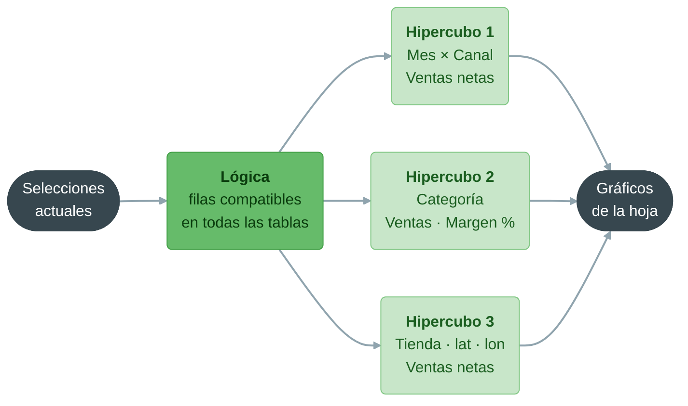

# Qlik Sense: creación de visualizaciones y uso de elementos maestros

**Bloque 9 -- Qlik | Sesión 3 de 11**

[← Volver al índice del curso](../../README.md#bloque-9---qlik)

---

## 1. Introducción

En la sesión anterior dejamos el modelo de Mercadia limpio y verificado: la tabla `ventas` en el centro y los maestros de productos, tiendas y clientes alrededor. Hoy construimos encima la capa que verá el usuario: los **elementos maestros** y la primera hoja de análisis completa.

Los **elementos maestros** son la respuesta de Qlik a un problema que ya conocemos: si cada analista escribe su propia fórmula del margen o del ticket medio, cada hoja acaba enseñando una cifra distinta. En Power BI lo resolvíamos con **medidas explícitas** en el modelo; en Tableau, con **campos calculados** guardados en el workbook. En Qlik, con dimensiones, medidas y visualizaciones **maestras**: se definen una vez, con nombre, descripción, formato y color, y se reutilizan en toda la app. Si mañana cambia la definición del margen, se cambia en un solo sitio.

Al terminar la sesión tendremos `Mercadia_9.1.3.qvf` con una biblioteca de elementos maestros y una hoja **Resumen comercial** con los seis KPIs, la evolución mensual, las ventas por categoría, un mapa de tiendas y una tabla de detalle, todo conectado por la selección asociativa.

### Objetivos de la sesión
- Escribir expresiones de gráfico: agregaciones, recuento distinto, condiciones y agregaciones entre tablas.
- Crear dimensiones maestras, incluidas dimensiones de desglose (*drill-down*), y asignar colores fijos a sus valores.
- Crear las seis medidas maestras de Mercadia con su formato numérico.
- Conocer el catálogo de visualizaciones de Qlik y elegir el gráfico adecuado.
- Construir la hoja **Resumen comercial** sobre la cuadrícula de Qlik.
- Guardar una visualización como visualización maestra.
- Explorar la hoja con selecciones para responder preguntas de negocio.

### Prerequisitos
- `Mercadia_9.1.2.qvf` con el modelo limpio y la hoja **Control de calidad** cuadrada.
- Bloques 7 y 8: principios de visualización y diseño de dashboards (regla de los tres segundos, jerarquía visual).

Empezamos duplicando la app: en la página de inicio, menú de la app → **Duplicar**, y renombramos la copia como **Mercadia_9.1.3**. Trabajar sobre una copia nos deja la versión de la 9.1.2 intacta.

---

## 2. Expresiones de gráfico

Una **medida** en Qlik es una **expresión** que se evalúa sobre las filas compatibles con las selecciones y con la dimensión del gráfico. La sintaxis se parece a la de una fórmula de Excel:

| Expresión | Qué calcula | En DAX | En Tableau |
|---|---|---|---|
| `Sum(importe_neto)` | Suma | `SUM(ventas[importe_neto])` | `SUM([importe_neto])` |
| `Count(distinct id_ticket)` | Recuento distinto | `DISTINCTCOUNT(ventas[id_ticket])` | `COUNTD([id_ticket])` |
| `Avg(unidades)` | Media | `AVERAGE(...)` | `AVG(...)` |
| `Sum(importe_neto) / Count(distinct id_ticket)` | Cociente de agregados | `DIVIDE(SUM(...), DISTINCTCOUNT(...))` | `SUM(...) / COUNTD(...)` |
| `Sum(If(es_fidelizado = 'Si', importe_neto))` | Suma condicionada | `CALCULATE(SUM(...), ventas[es_fidelizado] = "Si")` | `SUM(IF [es_fidelizado] = "Si" THEN [importe_neto] END)` |

Tres reglas que conviene interiorizar:

1. **Toda medida debe agregar.** `importe_neto` a secas no tiene sentido en un gráfico con varias filas por barra: hay que decir **cómo** se combinan (`Sum`, `Avg`, `Max`...). Sin función de agregación, Qlik usa `Only()`, que solo devuelve algo si hay un único valor posible.
2. **Las expresiones respetan siempre las selecciones.** No hace falta escribir ningún filtro: si el usuario selecciona `Online`, `Sum(importe_neto)` ya suma solo las ventas online. (Para **ignorar** una selección hará falta Set Analysis, en la 9.3.1.)
3. **Una expresión puede usar campos de varias tablas.** `Sum(If(marca_propia = 'Si', importe_neto))` mezcla un campo de `productos` con uno de `ventas`. Qlik resuelve la asociación por `id_producto` sin que escribamos ningún join. Funciona, pero es más lento que una expresión sobre una sola tabla; por eso en la 9.1.2 llevamos el coste a la tabla de ventas con `ApplyMap`.

Los comentarios se escriben con `//` o `/* ... */`, igual que en el script, y los nombres de campo con espacios van entre corchetes: `Sum([Importe Neto])`.

---

## 3. Los elementos maestros

Los elementos maestros viven en el panel de recursos (modo edición), en la pestaña **Elementos maestros**. Hay tres tipos:

| Tipo | Qué guarda | Equivalente en Power BI | Equivalente en Tableau |
|---|---|---|---|
| **Dimensión maestra** | Un campo (o una expresión) con nombre, descripción, etiquetas y colores fijos por valor. Puede ser **única** o **de desglose** (varios campos en jerarquía) | Columna con nombre amigable, jerarquía | Dimensión renombrada, jerarquía |
| **Medida maestra** | Una expresión con nombre, descripción, formato numérico y color | Medida explícita del modelo | Campo calculado agregado |
| **Visualización maestra** | Un gráfico completo, listo para arrastrar a cualquier hoja | Sin equivalente directo (copiar un visual) | Sin equivalente directo (duplicar una hoja) |

Lo potente es que los elementos maestros están **enlazados**: si editamos una medida maestra, cambian a la vez todos los gráficos que la usan, en todas las hojas. Y los usuarios de negocio que creen sus propias hojas en Qlik Cloud verán **primero** los elementos maestros, con nombres comprensibles, en lugar de los campos técnicos (`importe_neto`, `id_tienda`). Es la capa semántica de la app, la misma idea que la capa de medidas y nombres amigables que construimos en el bloque 7.

---

## 4. Práctica: dimensiones maestras

Entramos en modo edición en cualquier hoja (**Editar hoja**) y abrimos **Elementos maestros** → **Dimensiones** → **Crear nuevo**.

### Paso 1: dimensiones únicas

Para cada fila de la tabla, elegimos el campo, escribimos el nombre y una descripción breve, y pulsamos **Crear**:

| Nombre | Campo | Descripción |
|---|---|---|
| Categoría | `categoria` | Categoría oficial del producto, según el maestro de productos |
| Marca propia | `marca_propia` | `Si` si el producto es de la marca Mercadia |
| Tienda | `tienda` | Nombre comercial de la tienda |
| Formato de tienda | `formato` | Express, Urbana o Supermercado |
| Canal | `canal` | Tienda u Online |
| Fidelizado | `es_fidelizado` | `Si` si el ticket se hizo con la tarjeta de cliente |
| Tramo de edad | `tramo_edad` | Tramo de edad del cliente fidelizado |
| Mes | `anio_mes` | Año y mes de la venta (`AAAA-MM`) |

### Paso 2: dimensiones de desglose

Una **dimensión de desglose** (*drill-down*) encadena varios campos de lo general a lo particular. En un gráfico, empieza mostrando el primer nivel; al **seleccionar** un valor, el gráfico baja al siguiente nivel automáticamente. Es la jerarquía de Power BI y de Tableau, pero guiada por la selección.

**Crear nuevo** → tipo **Desglose** (*Drill-down*) y añadimos los campos en orden:

| Nombre | Niveles |
|---|---|
| Geografía | `comunidad` → `provincia` → `tienda` |
| Producto | `categoria` → `subcategoria` → `producto` |
| Calendario | `anio` → `trimestre` → `anio_mes` |

### Paso 3: colores fijos por valor

Editamos la dimensión maestra **Canal** → **Colores de valores** (*Value colors*) y asignamos un color a cada valor: `Tienda` en verde oscuro y `Online` en naranja. Hacemos lo mismo con **Marca propia** (`Si` en el color corporativo, `No` en gris).

Desde ahora, **cualquier** gráfico que use la dimensión maestra Canal pintará cada canal siempre del mismo color, en todas las hojas. Es lo que en Tableau conseguimos con **Edit Colors** en la 8.1.5, pero definido una sola vez para toda la app.

<!-- Captura pendiente: 0.Capturas/9.1.3/4.1_Colores_dimension.png -->

---

## 5. Práctica: medidas maestras

**Elementos maestros** → **Medidas** → **Crear nuevo**. Para cada medida escribimos la expresión (con el editor de expresiones, botón **fx**), el nombre, la descripción y, en **Formato numérico**, el formato indicado.

| Nombre | Expresión | Formato | Valor sin selecciones |
|---|---|---|---|
| Ventas netas | `Sum(importe_neto)` | Moneda, `#.##0 €` | 323.808 € |
| Margen bruto % | `Sum(importe_neto - coste_linea) / Sum(importe_neto)` | Número, `0,0%` | 31,7 % |
| Ticket medio | `Sum(importe_neto) / Count(distinct id_ticket)` | Moneda, `#.##0,00 €` | 14,07 € |
| Unidades por ticket | `Sum(unidades) / Count(distinct id_ticket)` | Número, `0,00` | 4,65 |
| % Marca propia | `Sum(If(marca_propia = 'Si', importe_neto)) / Sum(importe_neto)` | Número, `0,0%` | 36,6 % |
| % Ventas fidelizadas | `Sum(If(es_fidelizado = 'Si', importe_neto)) / Sum(importe_neto)` | Número, `0,0%` | 65,2 % |

Y dos medidas auxiliares que usaremos a menudo:

| Nombre | Expresión | Formato | Valor sin selecciones |
|---|---|---|---|
| Tickets | `Count(distinct id_ticket)` | Número, `#.##0` | 23.007 |
| Clientes activos | `Count(distinct If(es_fidelizado = 'Si', id_cliente))` | Número, `#.##0` | 3.531 |

Comprobamos los valores en un objeto **KPI** provisional. Coinciden con los de referencia de la 9.1.1 porque el modelo está limpio. Si no coinciden, el problema está en el script de la 9.1.2, no en la medida.

Detalles que importan:

- **`Clientes activos` y los campos clave.** ¿Por qué no basta con `Count(distinct id_cliente)`? Porque `id_cliente` es un **campo clave**: está a la vez en `ventas` y en `clientes`, y en Qlik un campo es **uno solo** aunque aparezca en varias tablas. Sin selecciones, `Count(distinct id_cliente)` cuenta todos sus valores posibles: los **4.000** clientes del maestro, también los que nunca han comprado. Al añadir `es_fidelizado`, un campo que solo existe en `ventas`, obligamos a Qlik a evaluar la expresión **sobre las filas de ventas**, y el resultado son los **3.531** clientes que han comprado alguna vez. La diferencia, **469** clientes que se dieron de alta y nunca han comprado, la exploraremos con la selección asociativa en la sección 8. La regla práctica: **desconfía de cualquier agregación sobre un campo clave** y comprueba siempre en qué tabla se está evaluando. Lo retomaremos en la 9.2.2.
- **`% Marca propia`** mezcla `marca_propia` (tabla `productos`) e `importe_neto` (tabla `ventas`). En la 9.3.1 la reescribiremos con Set Analysis, `Sum({<marca_propia = {'Si'}>} importe_neto) / Sum(importe_neto)`, que es más rápida y más legible.
- **Las medidas devuelven nulo**, no cero, cuando no hay datos que agregar. Un KPI vacío con un guion significa "nada que calcular con esta selección".

> **Etiquetas.** Cada elemento maestro admite **etiquetas** (*tags*). Etiquetamos los seis KPIs con `KPI` y las auxiliares con `Auxiliar`: cuando la biblioteca crezca, podremos filtrarla por etiqueta.

---

## 6. El catálogo de visualizaciones

Qlik incluye una colección de gráficos nativos y, en el panel de recursos, una sección de **Objetos personalizados** con paquetes adicionales (*Dashboard bundle*, *Visualization bundle*) y extensiones. Los más usados:

| Gráfico | Cuándo usarlo | Equivalente en Power BI / Tableau |
|---|---|---|
| **KPI** | Una cifra destacada (hasta dos medidas: valor y comparación) | Tarjeta / *Big Ass Number* |
| **Barras** | Comparar categorías; admite agrupadas y apiladas | Barras |
| **Líneas** | Evolución en el tiempo | Líneas |
| **Combinado** | Barras y líneas con dos ejes (volumen y ratio) | Columnas y líneas / Doble eje |
| **Tabla** | Detalle con varias medidas | Tabla |
| **Tabla dinámica** | Dimensiones en filas y columnas, con subtotales | Matriz / *Crosstab* |
| **Mapa** | Datos geográficos por capas (puntos, áreas, líneas, densidad) | Mapa / Mapa de símbolos |
| **Gráfico de dispersión** | Relación entre dos medidas | Dispersión |
| **Mapa de árbol** (*treemap*) | Proporciones dentro de una jerarquía | *Treemap* |
| **Cascada** | Cómo se pasa de un valor a otro sumando y restando componentes | Cascada |
| **Panel de filtrado** | Selecciones; varios campos en el mismo panel | Segmentador / Filtro |

La guía de selección de gráficos de los bloques 7 y 8 sigue siendo válida: barras para comparar, líneas para evolucionar, KPI para la cifra que hay que ver en tres segundos y sectores casi nunca.

---

## 7. Práctica: la hoja Resumen comercial

Creamos una hoja nueva, **Resumen comercial**, y entramos en modo edición. La hoja de Qlik es una **cuadrícula**: los objetos se colocan y se redimensionan por celdas. Planificamos el diseño en tres bandas, como en los bloques anteriores:

```
┌────────────────────────────────────────────────────────────────────┐
│  KPI      KPI      KPI      KPI      KPI      KPI                  │  Banda 1: los seis KPIs
├────────────────────────────────────────────────┬───────────────────┤
│  Evolución mensual de ventas por canal         │  Filtros:         │  Banda 2: tendencia
│  (líneas)                                      │  Comunidad        │  y filtros
│                                                │  Formato · Año    │
├──────────────────────────┬─────────────────────┼───────────────────┤
│  Ventas y margen por     │  Mapa de tiendas    │  Tabla de         │  Banda 3: detalle
│  categoría (combinado)   │  (puntos)           │  tiendas          │
└──────────────────────────┴─────────────────────┴───────────────────┘
```

### Paso 1: la fila de KPIs

Arrastramos al lienzo la medida maestra **Ventas netas**. Qlik crea un objeto **KPI** automáticamente. Repetimos con las otras cinco medidas y las colocamos en una fila en la parte superior. En las propiedades de cada KPI, en **Presentación**, ajustamos el tamaño de la fuente y, si queremos, un color condicional (por ejemplo, el margen en rojo por debajo del 30 %).

### Paso 2: la evolución mensual

Arrastramos un **Gráfico de líneas** a la banda central:

- **Dimensión**: la dimensión maestra **Mes**.
- **Medida**: la medida maestra **Ventas netas**.
- **Segunda dimensión** (para tener una línea por canal): la dimensión maestra **Canal**. Las líneas toman automáticamente los colores de la sección 4.

Título: *Ventas netas por mes y canal*.

### Paso 3: los filtros

En la columna de la derecha, un **Panel de filtrado** con los campos `comunidad`, `formato` y `anio`. Un solo objeto con tres campos ocupa menos espacio que tres objetos.

### Paso 4: ventas y margen por categoría

Un **Gráfico combinado** en la banda inferior izquierda:

- **Dimensión**: la dimensión de desglose **Producto** (empezará por categoría).
- **Medida 1**: **Ventas netas**, como **barras**, eje principal.
- **Medida 2**: **Margen bruto %**, como **línea** (o marcadores), **eje secundario**.
- **Ordenación**: por Ventas netas, descendente.

Así vemos de un vistazo el volumen y la rentabilidad de cada categoría, la misma idea que el combinado de doble eje de AeroConecta en la 8.1.4.

### Paso 5: el mapa de tiendas

Un **Mapa** en la banda inferior central. Añadimos una **Capa de puntos**:

- **Dimensión**: `tienda`.
- **Ubicación**: activamos la opción de **latitud y longitud en campos separados** y elegimos `latitud` y `longitud`.
- **Tamaño**: por la medida maestra **Ventas netas**.
- **Color**: por la dimensión `formato`.

Cada tienda aparece como un círculo proporcional a sus ventas. La tienda de Almería **no** aparece: no tiene fila en el maestro de tiendas y, por tanto, no tiene coordenadas. Es el mismo problema de la 9.1.2, visto ahora en un mapa.

<!-- Captura pendiente: 0.Capturas/9.1.3/7.1_Mapa_tiendas.png -->

### Paso 6: la tabla de tiendas

Una **Tabla** en la banda inferior derecha, con la dimensión maestra **Tienda** y las medidas **Ventas netas**, **Ticket medio** y **% Marca propia**, ordenada por ventas. Activamos **Totales** en la parte superior.

### Paso 7: la visualización maestra

El gráfico de evolución mensual nos va a servir en otras hojas. Clic derecho sobre él → **Añadir a elementos maestros**, y lo llamamos *Evolución de ventas por canal*. Desde ahora aparece en **Elementos maestros** → **Visualizaciones** y se puede arrastrar a cualquier hoja. Si lo modificamos en la biblioteca, cambia en todas las hojas donde se use.

Pulsamos **Listo**. Guardamos y descargamos la copia `Mercadia_9.1.3.qvf`.

<!-- Captura pendiente: 0.Capturas/9.1.3/7.2_Resumen_comercial.png -->

---

## 8. Explorar con la selección asociativa

Una hoja de Qlik no está terminada hasta que se **usa**. Respondemos a las preguntas del comité de dirección solo con selecciones, sin crear gráficos nuevos:

**¿En qué meses vende más Mercadia?** En el gráfico de líneas, los picos están en **julio y agosto**, no en diciembre. Los meses más altos de la muestra son julio y agosto de 2026 (unos 17.250 € cada uno). Si seleccionamos `zona = Costa` en un panel de filtrado provisional, el pico de verano se dispara; con `Interior`, casi desaparece. Las tiendas de costa (Benidorm, Marbella, Cartagena, Cádiz...) multiplican sus ventas en verano.

**¿Qué tienda vende más en verano?** Seleccionamos en el panel `anio = 2025` y, en el gráfico de líneas, hacemos una **selección de lazo** sobre julio y agosto. La tabla de tiendas se reordena: **Cartagena** encabeza las ventas de julio y agosto de 2025, seguida de **Benidorm**. Sin selecciones, la primera tienda de todo el periodo es Granada.

**¿Está creciendo el online?** Seleccionamos cada año por separado y observamos la línea de `Online`: su peso en las ventas pasa del **14,6 %** en 2024 al **21,2 %** en 2025 y al **25,2 %** en 2026.

**¿Qué clientes de la tarjeta no han comprado nunca?** Añadimos temporalmente un panel de filtrado con `id_cliente` y seleccionamos los tres valores de `anio`. Los clientes que han comprado quedan en **blanco**; los que **nunca** han comprado quedan en **gris oscuro**: **469** clientes. Clic derecho en el panel → **Seleccionar excluidos**, y ya tenemos seleccionada exactamente esa lista, lista para analizar su tramo de edad o su canal de alta. Esta pregunta, que en Power BI exigiría una medida específica, en Qlik se contesta con dos clics.

<!-- Captura pendiente: 0.Capturas/9.1.3/8.1_Clientes_excluidos.png -->

### El asistente de IA

Para terminar, probamos **Insight Advisor**: en la hoja, en modo análisis, abrimos el asistente (según la versión, desde el botón **Insight Advisor** o desde **Analizar** → **Insights**) y escribimos una pregunta, por ejemplo *ventas netas por formato de tienda*. Qlik propone gráficos construidos con nuestras **medidas y dimensiones maestras**: por eso merece la pena darles nombres y descripciones claros. El asistente ayuda a explorar, pero no sustituye al diseño: el gráfico que propone se puede añadir a una hoja, y hay que revisarlo como cualquier otro.

---

## 9. Lo que Qlik ha hecho por debajo

Cada gráfico de la hoja pide al motor un **hipercubo** (*hypercube*): una tabla virtual con una fila por cada combinación de valores de sus dimensiones y una columna por cada medida. El gráfico de líneas, por ejemplo, pide un hipercubo con `anio_mes` × `canal` y la columna `Sum(importe_neto)`. El motor lo calcula sobre las filas que son compatibles con las selecciones actuales y el gráfico lo dibuja.



Cuando la expresión mezcla campos de varias tablas (`% Marca propia`), el motor tiene que combinar temporalmente `ventas` y `productos` para cada celda del hipercubo. Por eso esas expresiones son más caras, y por eso conviene llevar a la tabla de hechos, en el script, los campos que se usan constantemente en los cálculos.

Las medidas maestras no cambian nada de esto: son solo **expresiones con nombre**. Su valor está en la organización y la coherencia, no en el rendimiento.

---

## 10. Ejercicios

**Ejercicio 1: escribir medidas.** Escribe la expresión de cada medida y créala como medida maestra:

1. **Unidades devueltas**: unidades de las líneas de devolución, en positivo.
2. **% Ventas online**: peso de las ventas online sobre el total.
3. **Ventas por cliente activo**: ventas fidelizadas divididas entre clientes activos.

<details>
<summary>Ver la solución</summary>

1. `-Sum(If(es_devolucion = 'Si', unidades))`. El signo menos convierte las unidades negativas en positivas.
2. `Sum(If(canal = 'Online', importe_neto)) / Sum(importe_neto)`, con formato `0,0%`. Sin selecciones, **20,7 %**.
3. `Sum(If(es_fidelizado = 'Si', importe_neto)) / Count(distinct If(es_fidelizado = 'Si', id_cliente))`. El denominador es la expresión de **Clientes activos**, no un `Count(distinct id_cliente)` a secas, que contaría los 4.000 clientes del maestro (sección 5). Sin selecciones, unos **59,8 €** por cliente (211.059 € de ventas fidelizadas entre 3.531 clientes).

</details>

**Ejercicio 2: ¿maestro o no?** Decide si cada elemento debería ser un elemento maestro y de qué tipo:

1. La expresión del margen bruto %, que aparece en cuatro hojas.
2. Un gráfico de barras temporal que hemos creado para comprobar un dato.
3. La jerarquía comunidad → provincia → tienda.
4. El gráfico de evolución de ventas, que queremos idéntico en tres hojas.

<details>
<summary>Ver la solución</summary>

1. **Medida maestra**: una definición, un formato, un nombre.
2. **No**: los elementos maestros son la capa semántica de la app; llenarla de objetos de usar y tirar la hace inútil.
3. **Dimensión maestra de desglose**.
4. **Visualización maestra**: si cambia, cambia en las tres hojas a la vez.

</details>

**Ejercicio 3: explorar.** Responde usando solo selecciones en la hoja **Resumen comercial**:

1. ¿Qué formato de tienda tiene el ticket medio más alto?
2. ¿Qué categoría tiene más peso de marca propia? ¿Coincide con la de más margen?
3. ¿Qué día de la semana se vende más? (Pista: añade temporalmente `dia_semana` a un panel de filtrado y selecciona día a día, mirando el KPI de Ventas netas.)

<details>
<summary>Ver la solución</summary>

1. **Urbana** (unos 14,55 €), por delante de Supermercado (14,02 €) y Express (13,50 €). La tienda de Almería no entra en ningún formato, porque no está en el maestro.
2. **Panadería**: casi la mitad de sus ventas (49,6 %) son de marca propia, y es también la categoría con más margen (33,8 %). No es casualidad: la marca propia deja más margen, como vimos al construir `coste_linea`.
3. El **sábado** (unos 65.100 €), seguido del viernes. El domingo es, con diferencia, el día más flojo.

</details>

**Ejercicio 4: una segunda hoja.** Crea una hoja **Producto** con: un panel de filtrado con `categoria` y `marca`, un **treemap** con la dimensión de desglose **Producto** y la medida **Ventas netas**, y una tabla con los 10 productos más vendidos. (Pista: en la tabla, propiedades de la dimensión → **Limitación** → **Fijo**, 10 primeros por Ventas netas.)

<details>
<summary>Ver la solución</summary>

El producto más vendido es la **Merluza 1 kg** de la marca Mercadia (unos 11.100 €), y las tres versiones de merluza ocupan los tres primeros puestos: es un producto caro que se vende mucho. En el treemap, Frescos es con diferencia la categoría más grande (34 % de las ventas). Al **seleccionar** Frescos en el treemap, este baja al nivel de subcategoría: **Pescado** supone la mitad de las ventas de frescos, seguido de lejos por Carne.

</details>

---

## 11. Errores comunes y troubleshooting

**1. "La medida muestra un valor, pero no es el que espero."** Revisamos primero la **barra de selecciones**: casi siempre hay una selección olvidada. Después, el **formato numérico**: un `0,317` sin formato de porcentaje parece un error.

**2. "He editado una medida en un gráfico y no ha cambiado en los demás."** Al editar la expresión **dentro** de un gráfico, Qlik desenlaza esa medida del elemento maestro. Para cambiarla en todas partes, hay que editarla en **Elementos maestros**.

**3. "No puedo borrar una medida maestra."** Se puede, pero Qlik avisa si está en uso: los gráficos que la usen se quedarán sin medida. Antes de borrar, comprobamos dónde se usa.

**4. "El mapa no muestra ningún punto."** La capa de puntos no encuentra las coordenadas. Comprobamos que hemos activado la opción de **latitud y longitud en campos separados** y que `latitud` y `longitud` son números (en el visor del modelo, etiqueta `$numeric`).

**5. "El gráfico de líneas muestra los meses desordenados."** `anio_mes` debe ser una fecha con formato `YYYY-MM` (lo es si usamos `Date(MonthStart(fecha), 'YYYY-MM')`) y la ordenación, **numérica ascendente**. Si lo hubiéramos creado como texto, el orden alfabético funcionaría por casualidad con este formato, pero no con `ene-2024`.

**6. "Al hacer clic en una barra, el gráfico cambia de nivel y no sé volver."** Es la dimensión de desglose. Para subir de nivel, usamos la ruta de navegación que aparece sobre el eje (por ejemplo, *Categoría > Subcategoría*) o borramos la selección en la barra de selecciones.

**7. "El número de clientes no cuadra: me salen 4.000 en lugar de 3.531."** Estamos contando un **campo clave** (`id_cliente`) sin anclarlo a una tabla, y Qlik cuenta todos sus valores, incluidos los clientes del maestro sin ventas. Usamos la medida maestra **Clientes activos** (sección 5).

**8. "Los colores de la dimensión maestra no se aplican."** En las propiedades del gráfico, en **Aspecto** → **Colores y leyenda**, el color tiene que estar en **Automático** o en **Por dimensión** con la opción **Usar colores de biblioteca** activada.

---

## 12. Conclusión

En esta sesión hemos construido la capa que ve el usuario de la app de Mercadia. Hemos aprendido a escribir expresiones de gráfico y a reconocer cuándo una expresión mezcla tablas. Hemos creado una biblioteca de elementos maestros: dimensiones únicas y de desglose con colores fijos, las seis medidas de referencia más dos auxiliares, y una visualización maestra. Con ellos hemos montado la hoja **Resumen comercial** en tres bandas: KPIs, evolución mensual por canal y detalle por categoría, mapa y tabla de tiendas. Y, sobre todo, la hemos usado: con selecciones hemos descubierto el pico de verano de las tiendas de costa, el crecimiento del canal online y los 469 clientes de la tarjeta que nunca han comprado. El resultado es `Mercadia_9.1.3.qvf`. En la 9.1.4 llevaremos los datos de Qlik a Python para segmentar a los clientes y traeremos el resultado de vuelta a la app.

---

## 13. Para profundizar

### El calificador TOTAL

`Sum(importe_neto) / Sum(TOTAL importe_neto)` calcula el **peso** de cada fila del gráfico sobre el total del gráfico: `TOTAL` hace que la segunda suma ignore las dimensiones del gráfico (pero no las selecciones). Es el equivalente al *Percent of Total* de Tableau y a `DIVIDE(..., CALCULATE(..., ALLSELECTED(...)))` en DAX.

### Aggr: agregar sobre agregados

`Avg(Aggr(Sum(importe_neto), id_ticket))` calcula primero la suma por ticket y después la media de esas sumas: el ticket medio calculado "a la manera de Tableau LOD". `Aggr` crea un hipercubo virtual dentro de la expresión. Es una de las funciones más potentes (y más malinterpretadas) de Qlik; la retomaremos junto a Set Analysis en la 9.3.1.

### Estados alternos

Normalmente todas las selecciones de la app comparten un único estado. Los **estados alternos** permiten tener dos (o más) conjuntos de selecciones independientes en la misma hoja, por ejemplo para comparar dos tiendas o dos periodos lado a lado. Se configuran en **Elementos maestros** y en las propiedades de cada objeto.

### Temas y diseño

El aspecto general de la app (colores, fuentes, fondo) se controla con un **tema**. Qlik incluye varios y permite crear temas propios con un archivo JSON, que es la forma de aplicar la identidad corporativa de una empresa a todas sus apps. En la 9.5.1 aplicaremos un tema a la app final de Mercadia.

---

## 14. Recursos

- **Ayuda oficial de Qlik Cloud Analytics** (en español): <https://help.qlik.com/es-ES/cloud-services/>. Páginas de referencia: *Elementos maestros*, *Visualizaciones*, *Mapas* y *Expresiones de gráfico*.
- **Qlik Design Blog**, artículos sobre diseño de apps y uso de las funciones de gráfico: <https://community.qlik.com/t5/Design/bg-p/qlik-design-blog>
- **Qlik Learning**, cursos gratuitos de creación de visualizaciones: <https://learning.qlik.com/>

---

*Guía del alumno · Sesión 3 · Bloque 9 - Qlik · Mercadia*
