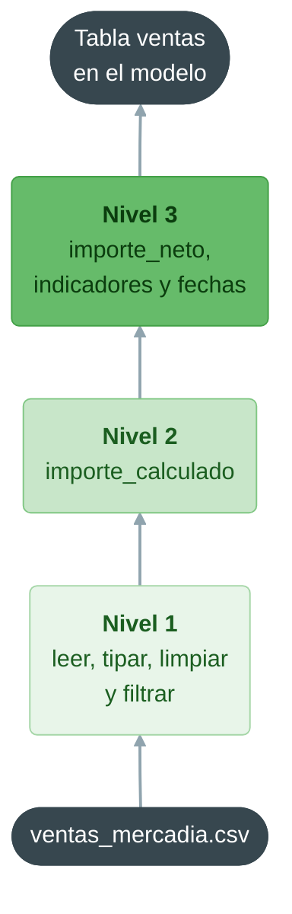
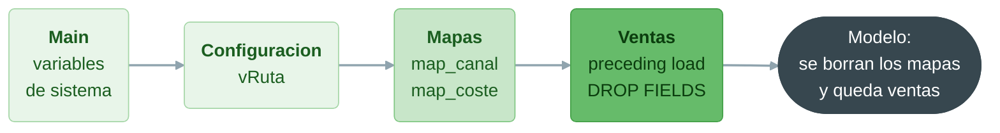

# Qlik Sense: transformar en el script, limpieza y campos calculados

**Bloque 9 -- Qlik | Sesión 3 de 11**

[← Volver al índice del curso](../../README.md#bloque-9---qlik)

---

## 1. Introducción

En la 9.1.2 aprendimos a **leer** bien el archivo de ventas: cada campo con su tipo, las fechas convertidas en fechas y sin líneas imposibles. Pero los valores siguen sucios. La tienda `M05` aparece escrita de tres formas, el canal online se llama de cuatro maneras distintas, hay 18 importes multiplicados por 100 y las compras sin tarjeta tienen un cliente "vacío" que Qlik cuenta como un valor más.

Hoy **transformamos** los campos. Seguimos con la misma forma de trabajar: un cambio cada vez, recargar, comprobar en la hoja **Comprobaciones** y seguir. Y aprendemos las dos herramientas de script que más se usan en cualquier app de Qlik: la **tabla de mapeo** con `ApplyMap` y la **carga precedente** (*preceding load*).

Al terminar tendremos `Mercadia_9.1.3.qvf` con la tabla de ventas limpia y enriquecida: claves normalizadas, canales unificados, importes corregidos con rastro de auditoría, coste por línea, indicadores y campos de calendario.

### Objetivos de la sesión
- Normalizar textos con `Upper`, `Trim`, `PurgeChar`, `Right` y el operador `&`, leyendo las expresiones de dentro afuera.
- Distinguir un **nulo** de un **texto vacío** y convertir uno en otro.
- Crear indicadores con `If`.
- Crear tablas de mapeo con `MAPPING LOAD` (desde un `INLINE` y desde un archivo) y usarlas con `ApplyMap`.
- Encadenar transformaciones con la **carga precedente**, nivel a nivel.
- Corregir un dato erróneo dejando rastro de la corrección.
- Crear campos de calendario con `Year`, `Month`, `MonthStart` y `WeekDay`.
- Eliminar campos auxiliares con `DROP FIELDS`.

### Prerequisitos
- `Mercadia_9.1.2.qvf` con la tabla de ventas tipada y la hoja **Comprobaciones** con los valores de la 9.1.2.
- La tabla de diagnóstico de la sección 10 de la 9.1.1.

Empezamos con una copia de la app. Con Qlik Sense Desktop cerrado, en `Documentos\Qlik\Sense\Apps` copiamos `Mercadia_9.1.2.qvf` y renombramos la copia como `Mercadia_9.1.3.qvf`. Al abrir Desktop, la copia aparece en el hub, pero **con el mismo título que la original**: `Mercadia_9.1.2`. El hub no muestra el nombre del archivo, sino el **título** que la app guarda dentro, y al copiar el archivo el título se copia con él. Las distinguimos por la fecha de modificación (la copia es la más reciente), la abrimos y le ponemos su título:

1. Hacemos clic en el nombre de la app, arriba a la izquierda, para abrir el área de detalles.
2. Pulsamos el icono de más acciones (**···**) → **Editar detalles**.
3. Cambiamos el **Título** por `Mercadia_9.1.3`, pulsamos **Hecho** y después la marca de verificación.

Así lo haremos cada vez que empecemos una sesión con una copia ([Cambiar el título y la descripción de una aplicación][doc-titulo-app]). Después vamos al **Editor de carga de datos**.

---

## 2. El plan de la sesión

| Paso | Problema | Campo | Técnica |
|---|---|---|---|
| 1 | Claves de tienda con 47 variantes | `id_tienda` | Funciones de texto |
| 2 | Clientes vacíos que cuentan como valor | `id_cliente` | Convertir en nulo con `If` y crear `es_fidelizado` |
| 3 | 7 variantes de canal | `canal` | Tabla de mapeo `INLINE` + `ApplyMap` |
| 4 | El coste está en otro archivo | `coste_linea` (nuevo) | Tabla de mapeo desde `productos.csv` |
| 5 | Importes ×100 | `importe_neto` | Carga precedente: recalcular, comparar y corregir |
| 6 | Faltan indicadores y campos de calendario | `es_devolucion`, `anio`, `mes`... (nuevos) | Funciones de fecha en la carga precedente |
| 7 | Campos auxiliares que sobran | `importe_original`, `importe_calculado` | `DROP FIELDS` |

Antes de empezar, añadimos a la hoja **Comprobaciones** tres **paneles de filtrado**, con los campos `id_tienda`, `canal` e `id_cliente`. Nos dirán cuántos valores distintos tiene cada campo después de cada paso.

---

## 3. Paso 1: normalizar la clave de tienda

### El problema

El panel de filtrado de `id_tienda` muestra **47 valores** para 19 tiendas. Hay dos tipos de suciedad: minúsculas (`m05`) y el número sin el cero (`M5`).

En el archivo hay un tercero: 972 líneas con un espacio al final (`M05 `). No aparece en la app porque Qlik **quita los espacios de los extremos** al leer un archivo de texto (lo controla la variable de sistema `Verbatim`, que por defecto vale 0). Aun así, en la expresión de limpieza escribiremos `Trim`: no cuesta nada, deja claro qué hacemos y el script sigue funcionando aunque alguien active `Verbatim`.

### Paso 1a: mayúsculas y espacios

En la sección **Ventas** cambiamos la línea de `id_tienda`:

```
    Upper(Trim(id_tienda))                            AS id_tienda,
```

`Trim` quita los espacios del principio y del final; `Upper` pasa a mayúsculas. Se leen **de dentro afuera**: primero se aplica `Trim` y al resultado se le aplica `Upper`.

Cargamos. El panel baja de 47 a **28 valores**: las 19 tiendas bien escritas más 9 sin el cero (`M1` a `M9`). Hemos resuelto las minúsculas; falta el cero.

### Paso 1b: el cero que falta

Para `M5` necesitamos una idea un poco más elaborada: quitar la `M`, poner un cero delante, quedarnos con los **dos últimos** caracteres y volver a poner la `M`. Cambiamos la línea otra vez:

```
    'M' & Right('0' & PurgeChar(Upper(Trim(id_tienda)), 'M'), 2) AS id_tienda,
```

La leemos de dentro afuera con el valor `m5 `:

| Paso | Función | Resultado |
|---|---|---|
| Quitar espacios | `Trim('m5 ')` | `m5` |
| Pasar a mayúsculas | `Upper('m5')` | `M5` |
| Quitar la letra M | `PurgeChar('M5', 'M')` | `5` |
| Añadir un cero delante | `'0' & '5'` | `05` |
| Quedarse con dos caracteres | `Right('05', 2)` | `05` |
| Volver a poner la M | `'M' & '05'` | `M05` |

El operador `&` **concatena** textos. Y la expresión funciona también con los códigos que ya estaban bien: con `M19`, `Right('019', 2)` devuelve `19` y el resultado es `M19`.

Cargamos. El panel muestra **19 valores**, de `M01` a `M19`.

> **Construir una expresión larga por capas.** No hace falta escribir la expresión completa de una vez. Lo que hemos hecho (aplicar una función, recargar, ver qué queda y añadir la siguiente) es la forma más segura de escribir expresiones de limpieza. Y la tabla "de dentro afuera" es la mejor forma de leer una expresión ajena.

---

## 4. Paso 2: nulos y textos vacíos

### El problema

En la 9.1.1 vimos que el visor del modelo daba a `id_cliente` una densidad del **100 %**, aunque un tercio de las líneas no tiene cliente. La razón es que una celda vacía de un CSV llega a Qlik como un **texto vacío**, no como un **nulo**. La diferencia es sutil pero importante:

| | Texto vacío (`''`) | Nulo |
|---|---|---|
| ¿Es un valor? | Sí, como cualquier otro | No: es ausencia de valor |
| ¿Aparece en un panel de filtrado? | Sí, como una fila en blanco | No |
| ¿Se puede seleccionar? | Sí | No |
| ¿Cuenta en `Count(id_cliente)`? | Sí | No |
| ¿Asocia con otras tablas? | Sí: todas las líneas sin cliente quedarían "asociadas" a un cliente vacío | No |

Lo comprobamos en el panel de filtrado de `id_cliente`: el primer valor de la lista es una fila en blanco.

### La solución

Cambiamos la línea de `id_cliente` y añadimos un campo nuevo justo debajo:

```
    If(Len(Trim(id_cliente)) > 0, Trim(id_cliente))   AS id_cliente,
    If(Len(Trim(id_cliente)) > 0, 'Si', 'No')         AS es_fidelizado,
```

- `Len` devuelve el número de caracteres. Después de un `Trim`, un texto vacío (o hecho solo de espacios) tiene longitud 0.
- `If(condición, valor)` **sin tercer argumento** devuelve **nulo** cuando la condición es falsa. Así convertimos los vacíos en nulos de verdad.
- En lugar de perder la información de que la compra fue sin tarjeta, la guardamos en un **indicador**, `es_fidelizado`, que podremos usar como dimensión o como filtro.

Fíjate en que la segunda línea usa `id_cliente`, y ese `id_cliente` es el **original del archivo**, no el que acabamos de transformar en la línea anterior. Dentro de un mismo `LOAD`, todas las expresiones leen los campos tal como vienen del origen.

Cargamos y comprobamos:

- En el panel de `id_cliente`, la fila en blanco ha desaparecido.
- En el visor del modelo, la densidad de `id_cliente` baja al **65,5 %**: el porcentaje real de líneas con tarjeta.
- Añadimos a la hoja una tabla con la dimensión `es_fidelizado` y la medida `Count(id_linea)`: **22.663** líneas `No` y 42.963 `Si`.

---

## 5. Paso 3: la tabla de mapeo del canal

### El problema

El panel de `canal` tiene **7 valores** para 2 canales: `Tienda`, `tienda`, `TIENDA`, `Online`, `ONLINE`, `Web` y `App`. `Upper(Trim(...))` resolvería las mayúsculas, pero no que `WEB` y `APP` signifiquen `Online`. Necesitamos un **diccionario**: "si pone esto, quiero esto otro".

### Las tablas de mapeo

Una **tabla de mapeo** es una tabla de dos columnas (valor original y valor nuevo) que Qlik usa como diccionario durante la carga y que **desaparece** al terminar el script: no llega al modelo. Se crea con `MAPPING LOAD` y se consulta con `ApplyMap`. Es el equivalente a un `BUSCARV` de Excel, o a combinar consultas en Power Query para traer una sola columna.

Creamos una sección nueva, **Mapas**, y la arrastramos **entre Configuracion y Ventas**: un mapa tiene que existir antes de que se use.

```
// Canal: 7 variantes -> 2 canales
// Las variantes van en mayúsculas porque al aplicar el mapa
// pasamos el canal por Upper(Trim(...))
map_canal:
MAPPING LOAD * INLINE [
valor_original, canal_normalizado
TIENDA, Tienda
ONLINE, Online
WEB, Online
APP, Online
];
```

- **`INLINE`** permite escribir una tabla pequeña dentro del propio script, como si fuera un CSV. La primera fila son los nombres de los campos.
- Una tabla de mapeo debe tener **exactamente dos columnas**: la primera es la que se busca y la segunda, la que se devuelve. Los nombres de las columnas dan igual; los ponemos para que el script se entienda.
- Solo hemos escrito las variantes **en mayúsculas**. Al aplicar el mapa pasaremos el canal por `Upper(Trim(...))`, así que `tienda`, `Tienda` y `TIENDA ` llegarán todas como `TIENDA`. Menos filas en el mapa, menos errores.

Y en la sección **Ventas** cambiamos la línea de `canal`:

```
    ApplyMap('map_canal', Upper(Trim(canal)), 'Revisar') AS canal,
```

`ApplyMap('mapa', valor, por_defecto)` busca el valor en la primera columna del mapa. Si lo encuentra, devuelve la segunda columna; si no, devuelve el tercer argumento. Hemos puesto `'Revisar'` en lugar de dejar el valor sin cambiar: si mañana aparece una variante nueva (`MOVIL`, por ejemplo), la veremos en la app como `Revisar` en lugar de colarse en silencio como un tercer canal.

Cargamos. El registro muestra ahora una línea más, `map_canal`, con 4 filas. El panel de `canal` muestra **2 valores**, `Online` y `Tienda`, y ningún `Revisar`. Con la tabla de la hoja (dimensión `canal`, medida `Count(id_linea)`): **Tienda 52.024** y **Online 13.602**.

> **¿Por qué no un `If`?** Podríamos escribir `If(Upper(Trim(canal)) = 'TIENDA', 'Tienda', 'Online')`. Funcionaría hoy, pero cualquier variante nueva se convertiría en `Online` sin que nadie lo notara. Y con más de dos o tres casos, los `If` anidados se vuelven ilegibles. Un mapa es una **lista** que cualquiera puede leer y ampliar.

---

## 6. Paso 4: traer el coste desde otro archivo

La dirección quiere el **margen bruto**, y para eso necesitamos el coste de cada línea. El coste unitario no está en las ventas: está en `productos.csv`. Una tabla de mapeo también puede leerse de un archivo.

En la sección **Mapas**, debajo de `map_canal`, añadimos:

```
// Coste unitario de cada producto, para calcular el coste de cada línea
map_coste:
MAPPING LOAD
    id_producto,
    Num#(coste_unitario, '#,##0.##', '.', ',') AS coste_unitario
FROM [$(vRuta)productos.csv]
(txt, utf8, embedded labels, delimiter is ',', msq);
```

Es un `LOAD` normal con dos campos y la palabra `MAPPING` delante. Como `productos.csv` también usa punto decimal, el coste se lee con `Num#`, igual que en la 9.1.2.

Y en la sección **Ventas**, debajo de `unidades`, añadimos un campo nuevo:

```
    unidades * ApplyMap('map_coste', id_producto, 0)  AS coste_linea,
```

Para cada línea, busca el coste unitario de su producto y lo multiplica por las unidades. Si un producto no estuviera en el maestro, el coste sería 0 (el tercer argumento).

Cargamos. El registro muestra `map_coste` con 153 filas, una por producto. En la hoja añadimos un KPI con `Sum(coste_linea)`: **221.099,82**.

> **¿Por qué traer el coste a la tabla de ventas?** Podríamos cargar `productos.csv` como tabla y dejar que Qlik asocie las dos por `id_producto` (lo haremos en la 9.1.4 con el resto de campos del producto). Pero entonces el margen sería una expresión que mezcla dos tablas, más lenta y más difícil de escribir. Con `ApplyMap`, el coste queda en la misma fila que el importe y la medida del margen es una simple resta. Lo veremos en la 9.1.5.

---

## 7. Paso 5: la carga precedente

### El problema

Las 18 líneas con el importe multiplicado por 100 se pueden detectar: el importe correcto se puede **recalcular** con las otras columnas, `unidades × precio_unitario × (1 − descuento_pct)`. Si el importe del archivo se aleja del recalculado, está mal.

### Un primer intento que no funciona

Lo natural sería añadir al `LOAD` una línea así:

```
    Round(unidades * precio_unitario * (1 - descuento_pct), 0.01) AS importe_calculado,
```

Si lo probamos, `importe_calculado` sale **vacío** en todas las filas. ¿Por qué? Por la regla del paso 2: dentro de un `LOAD`, `precio_unitario` y `descuento_pct` son los campos **originales** del archivo, todavía en texto con punto decimal. El `Num#` que escribimos en la 9.1.2 solo afecta al campo que sale del `LOAD`, no a lo que leen las demás líneas. Multiplicar textos da nulo.

Podríamos repetir los `Num#` dentro de la fórmula, pero la expresión se volvería ilegible. La solución es **encadenar dos `LOAD`**.

### Paso 5a: dos niveles

Borramos la línea que acabamos de probar. Y **encima** del `LOAD` que ya teníamos (entre la etiqueta `ventas:` y la palabra `LOAD`), escribimos otro `LOAD` sin `FROM`:

```
ventas:
// Nivel 2: importe recalculado a partir de los campos ya tipados
LOAD
    *,
    Round(unidades * precio_unitario * (1 - descuento_pct), 0.01) AS importe_calculado;
// Nivel 1: lectura, tipado y limpieza del archivo
LOAD
    id_linea,
    ...
FROM [$(vRuta)ventas_mercadia.csv]
(txt, utf8, embedded labels, delimiter is ',', msq)
WHERE unidades <> 0;
```

Esto es una **carga precedente** (*preceding load*): un `LOAD` sin `FROM` toma como entrada el resultado del `LOAD` que tiene **debajo**. El nivel 1 lee el archivo y convierte los textos en números; el nivel 2 recibe esos campos **ya convertidos** y puede multiplicarlos. `LOAD *` significa "todos los campos que llegan del nivel inferior, más los que añado".

Tres detalles de sintaxis:

- La **etiqueta** `ventas:` va siempre encima del `LOAD` **superior**.
- El nivel 2 termina en `;` y el nivel 1 también. Cada `LOAD` es una sentencia.
- Los comentarios entre niveles son opcionales, pero muy recomendables: dicen qué hace cada nivel.

Cargamos. El registro sigue mostrando **65.626** líneas para `ventas`: la carga precedente no añade filas, añade **campos**. Para comprobarlo, añadimos a la hoja una tabla con `id_linea`, `importe_neto` e `importe_calculado` (los tres como dimensiones). En casi todas las filas coinciden.

### Paso 5b: tres niveles, corregir y dejar rastro

Ahora necesitamos **comparar** `importe_neto` con `importe_calculado`. Pero `importe_calculado` se crea en el nivel 2, así que no podemos usarlo en el nivel 2: necesitamos un **tercer nivel**. Y como el campo final se va a llamar `importe_neto`, renombramos el del archivo para no confundirlos.

En el nivel 1, cambiamos la línea del importe:

```
    Num#(importe_neto,    '#,##0.##', '.', ',')       AS importe_original
```

Y encima del nivel 2 escribimos el nivel 3 (la etiqueta `ventas:` sube con él):

```
ventas:
// Nivel 3: importe corregido y rastro de la corrección
LOAD
    *,
    If(Fabs(importe_original - importe_calculado) > 0.05,
       importe_calculado, importe_original)                      AS importe_neto,
    If(Fabs(importe_original - importe_calculado) > 0.05,
       'Si', 'No')                                               AS importe_corregido;
// Nivel 2: ...
```

`Fabs` es el valor absoluto y `Round(x, 0.01)` del nivel 2 redondea a céntimos. Si el importe original se aleja más de 5 céntimos del calculado, nos quedamos con el calculado y lo marcamos en `importe_corregido`. Así arreglamos las 18 líneas con la coma perdida y, a la vez, **dejamos rastro**: cualquiera podrá ver qué líneas se corrigieron. Es la misma idea de auditoría que aplicamos en el bloque 6 de gobierno del dato.

Cargamos y comprobamos en la hoja:

- El KPI de `Sum(importe_neto)` baja de 328.723,63 a **323.808,28**. La diferencia, **4.915,35 €**, son las ventas que no existían.
- Una tabla con la dimensión `importe_corregido` y la medida `Count(id_linea)`: **18** líneas `Si`.



> **La carga precedente se lee de abajo arriba.** Es lo que más cuesta al principio: el código se escribe de arriba abajo, pero los datos **suben**. Al leer un script ajeno, empieza siempre por el `LOAD` que tiene el `FROM`. Es el equivalente a encadenar pasos en Power Query, o a una CTE en SQL (bloque 1) en la que cada consulta lee de la anterior.

---

## 8. Paso 6: indicadores y campos de calendario

El nivel 3 es el sitio natural para los campos que se calculan a partir de campos ya limpios. Añadimos, después de `importe_corregido` (y cambiando su `;` final por una coma):

```
    If(unidades < 0, 'Si', 'No')                                 AS es_devolucion,
    Year(fecha)                                                  AS anio,
    Month(fecha)                                                 AS mes,
    'T' & Ceil(Month(fecha) / 3)                                 AS trimestre,
    Date(MonthStart(fecha), 'YYYY-MM')                           AS anio_mes,
    WeekDay(fecha)                                               AS dia_semana;
```

| Campo | Función | Ejemplo con 10/03/2025 |
|---|---|---|
| `es_devolucion` | Indicador: las unidades negativas son devoluciones | `No` |
| `anio` | `Year`: el año | 2025 |
| `mes` | `Month`: el mes | `mar` |
| `trimestre` | `Ceil` redondea hacia arriba: el mes 3 da `3/3 = 1` y el mes 4 da `Ceil(1,33) = 2` | `T1` |
| `anio_mes` | `MonthStart` devuelve el primer día del mes; `Date(..., 'YYYY-MM')` lo muestra como año-mes | `2025-03` |
| `dia_semana` | `WeekDay`: el día de la semana | `lun` |

`Month` y `WeekDay` devuelven un valor **dual**: se ve como texto (`mar`, `lun`), con los nombres de `MonthNames` y `DayNames` de la sección Main, pero se ordena como número (3, 1...). Por eso un gráfico por mes se ordena de enero a diciembre y no alfabéticamente. Lo mismo pasa con `anio_mes`: se ve `2025-03`, pero por dentro es la fecha 01/03/2025.

Cargamos y comprobamos:

- Una tabla con `es_devolucion` y `Count(id_linea)`: **588** líneas `Si`.
- Una tabla con `anio` y `Count(id_linea)`: **19.449** líneas en 2024, **24.065** en 2025 y **22.112** en 2026 (hasta septiembre).

> **¿Por qué no un calendario completo?** Estos campos de fecha dentro de la tabla de ventas son prácticos, pero tienen límites: no hay fechas sin ventas, y si otra tabla tuviera fechas, cada una tendría su propio "calendario". En la 9.2.2 los sustituiremos por un **calendario maestro**, una tabla de fechas independiente, como la tabla de calendario del bloque 7.

---

## 9. Paso 7: DROP FIELDS

Los campos `importe_original` e `importe_calculado` solo servían para decidir cuál era el importe bueno. Si los dejamos en el modelo, alguien acabará sumando el que no es. Al final de la sección **Ventas**, después del `;` del nivel 1, añadimos:

```
// Los campos auxiliares ya no hacen falta en el modelo
DROP FIELDS importe_original, importe_calculado FROM ventas;
```

`DROP FIELDS ... FROM tabla` elimina campos de una tabla ya cargada. Es una sentencia aparte, que se ejecuta **después** de que la tabla `ventas` esté completa.

Cargamos. En el visor del modelo, los dos campos ya no aparecen. La tabla provisional de la hoja que los usaba muestra un error de campo no encontrado: la borramos.

---

## 10. El script completo de la sesión

**Main** y **Configuracion**: sin cambios desde la 9.1.2.

**Mapas**:

```
// Canal: 7 variantes -> 2 canales
// Las variantes van en mayúsculas porque al aplicar el mapa
// pasamos el canal por Upper(Trim(...))
map_canal:
MAPPING LOAD * INLINE [
valor_original, canal_normalizado
TIENDA, Tienda
ONLINE, Online
WEB, Online
APP, Online
];

// Coste unitario de cada producto, para calcular el coste de cada línea
map_coste:
MAPPING LOAD
    id_producto,
    Num#(coste_unitario, '#,##0.##', '.', ',') AS coste_unitario
FROM [$(vRuta)productos.csv]
(txt, utf8, embedded labels, delimiter is ',', msq);
```

**Ventas**:

```
// Tabla de hechos: una fila por línea de ticket
ventas:
// Nivel 3: campos derivados de los anteriores
LOAD
    *,
    If(Fabs(importe_original - importe_calculado) > 0.05,
       importe_calculado, importe_original)                      AS importe_neto,
    If(Fabs(importe_original - importe_calculado) > 0.05,
       'Si', 'No')                                               AS importe_corregido,
    If(unidades < 0, 'Si', 'No')                                 AS es_devolucion,
    Year(fecha)                                                  AS anio,
    Month(fecha)                                                 AS mes,
    'T' & Ceil(Month(fecha) / 3)                                 AS trimestre,
    Date(MonthStart(fecha), 'YYYY-MM')                           AS anio_mes,
    WeekDay(fecha)                                               AS dia_semana;
// Nivel 2: importe recalculado a partir de los campos ya tipados
LOAD
    *,
    Round(unidades * precio_unitario * (1 - descuento_pct), 0.01) AS importe_calculado;
// Nivel 1: lectura, tipado y limpieza del archivo
LOAD
    id_linea,
    id_ticket,
    // Tres formatos de fecha en el origen. El orden importa: Date# es
    // tolerante con los dígitos y 'YYYY-MM-DD' aceptaría 1-1-24 como año 1
    Date(Alt(Date#(fecha, 'D-M-YY'),
             Date#(fecha, 'DD/MM/YYYY'),
             Date#(fecha, 'YYYY-MM-DD')))                        AS fecha,
    'M' & Right('0' & PurgeChar(Upper(Trim(id_tienda)), 'M'), 2) AS id_tienda,
    If(Len(Trim(id_cliente)) > 0, Trim(id_cliente))              AS id_cliente,
    If(Len(Trim(id_cliente)) > 0, 'Si', 'No')                    AS es_fidelizado,
    ApplyMap('map_canal', Upper(Trim(canal)), 'Revisar')         AS canal,
    id_producto,
    categoria,
    unidades,
    unidades * ApplyMap('map_coste', id_producto, 0)             AS coste_linea,
    Num#(precio_unitario, '#,##0.##', '.', ',')                  AS precio_unitario,
    Num#(descuento_pct,   '#,##0.##', '.', ',')                  AS descuento_pct,
    Num#(importe_neto,    '#,##0.##', '.', ',')                  AS importe_original
FROM [$(vRuta)ventas_mercadia.csv]
(txt, utf8, embedded labels, delimiter is ',', msq)
WHERE unidades <> 0;

// Los campos auxiliares ya no hacen falta en el modelo
DROP FIELDS importe_original, importe_calculado FROM ventas;
```

`categoria` sigue en el script tal como viene del archivo, con sus 24 variantes. No lo hemos olvidado: en la 9.1.4, al cargar el maestro de productos, veremos qué hacer con ella.

La hoja **Comprobaciones** queda así:

| Comprobación | Cómo | Valor esperado hoy |
|---|---|---|
| Líneas | KPI `Count(id_linea)` | 65.626 |
| Ventas netas | KPI `Sum(importe_neto)` | 323.808,28 |
| Coste | KPI `Sum(coste_linea)` | 221.099,82 |
| Fechas | KPI `Min(fecha)`, `Max(fecha)` y `NullCount(fecha)` | 01/01/2024, 30/09/2026 y 0 |
| Tiendas | Panel de filtrado `id_tienda` | 19 valores |
| Canales | Panel de filtrado `canal` | 2 valores, ningún `Revisar` |
| Importes corregidos | Tabla `importe_corregido` × `Count(id_linea)` | 18 `Si` |
| Devoluciones | Tabla `es_devolucion` × `Count(id_linea)` | 588 `Si` |
| Ventas sin tarjeta | Tabla `es_fidelizado` × `Count(id_linea)` | 22.663 `No` |

Guardamos la app (`Ctrl + S`).

---

## 11. Lo que Qlik ha hecho por debajo

Ahora el script tiene cuatro secciones y Qlik las ejecuta en este orden:



Tres ideas que conviene fijar:

1. **Las tablas de mapeo viven solo durante la carga.** Qlik las guarda en memoria mientras se ejecuta el script y las borra al terminar. Por eso no aparecen en el visor del modelo, aunque el registro sí las mencione.
2. **La carga precedente no lee el archivo tres veces.** Qlik lee cada fila una sola vez y la hace "subir" por los tres niveles antes de pasar a la siguiente. Es tan rápida como un único `LOAD`.
3. **`ApplyMap` nunca duplica filas.** Si en el mapa hubiera dos filas con el mismo producto, `ApplyMap` devolvería el valor de la primera. Es una diferencia importante con un `JOIN`, que veremos en la 9.2.1.

---

## 12. Ejercicios

**Ejercicio 1: ampliar el mapa de canales.** El equipo de sistemas avisa de que, a partir del mes que viene, el terminal de caja registrará el canal de las ventas con la app de pago en tienda como `MOVIL`, y las compras por teléfono como `Telefono`. Ambas son ventas **online**.

1. Modifica `map_canal` para incluirlas.
2. ¿Qué habría pasado si no lo hubiéramos hecho?

<details>
<summary>Ver la solución</summary>

1. Añadimos dos filas al `INLINE`, en mayúsculas porque comparamos con `Upper(Trim(canal))`:

```
MOVIL, Online
TELEFONO, Online
```

2. Esas ventas habrían aparecido como un tercer canal llamado **`Revisar`**, gracias al valor por defecto de `ApplyMap`. Es justo lo que queríamos: un aviso visible en lugar de un error silencioso. Si hubiéramos escrito `ApplyMap('map_canal', Upper(Trim(canal)), canal)`, se habrían colado como `MOVIL` y `Telefono` sin que nadie lo notara.

</details>

**Ejercicio 2: normalizar la categoría.** Sin cambiar el script de la app (hazlo en una copia o deshazlo después), normaliza `categoria` para que se vea con la primera letra en mayúscula: `Frescos`, no `FRESCOS` ni `frescos`. ¿Cuántos valores quedan?

Pista: la función `Capitalize` pone en mayúscula la primera letra de cada palabra y el resto en minúscula.

<details>
<summary>Ver la solución</summary>

```
    Capitalize(Trim(categoria))                       AS categoria,
```

Quedan **8 valores**: Alimentacion, Bebidas, Congelados, Drogueria, Frescos, Higiene, Lacteos y Panaderia. Funciona, pero en la 9.1.4 veremos que la mejor decisión con este campo no es limpiarlo, sino **no cargarlo**.

</details>

**Ejercicio 3: margen por línea.** Añade a la carga precedente un campo `margen_linea` con el margen bruto de cada línea, y comprueba en la hoja **Comprobaciones** que `Sum(margen_linea) / Sum(importe_neto)` da el margen bruto % de referencia.

<details>
<summary>Ver la solución</summary>

No podemos escribir `importe_neto - coste_linea` en el nivel 3, porque `importe_neto` se crea en ese mismo `LOAD`. Hay dos soluciones. La más limpia es añadir un **cuarto nivel** encima de todos:

```
ventas:
LOAD
    *,
    importe_neto - coste_linea AS margen_linea;
LOAD
    *,
    If(Fabs(importe_original - importe_calculado) > 0.05, ...
```

(La etiqueta `ventas:` va siempre encima del `LOAD` superior.) La otra es calcularlo en la medida, sin tocar el script: `Sum(importe_neto - coste_linea)`. El resultado es el mismo: **31,72 %** (323.808,28 € de ventas y 221.099,82 € de coste).

</details>

**Ejercicio 4: ¿error o dato legítimo?** Para cada caso, decide si hay que **corregir**, **excluir** o **conservar**, y justifícalo:

1. Las 588 líneas con unidades negativas.
2. Las 22.663 líneas sin cliente.
3. Las 44 líneas con 0 unidades.
4. Las 18 líneas con importes multiplicados por 100.

<details>
<summary>Ver la solución</summary>

1. **Conservar**: son devoluciones y restan de las ventas, como debe ser. Las marcamos con `es_devolucion` para poder analizarlas.
2. **Conservar**: son compras sin tarjeta. Convertimos los vacíos en nulos y creamos `es_fidelizado`.
3. **Excluir**: una línea de ticket con 0 unidades no representa ninguna venta (9.1.2).
4. **Corregir y marcar**: sabemos cuál es el importe correcto, porque se puede recalcular con las otras columnas. Dejamos el rastro en `importe_corregido`.

</details>

---

## 13. Errores comunes y troubleshooting

**1. "`ApplyMap` falla con *Mapping table not found*."** La sección **Mapas** está **después** de la sección que lo usa, o el nombre del mapa está mal escrito (distingue mayúsculas). Las secciones se ejecutan en el orden en que aparecen en la lista, de **arriba abajo**: basta con arrastrar **Mapas** por encima de **Ventas**.

**2. "Todo el canal sale como `Revisar`."** Las variantes del `INLINE` no coinciden con lo que le pasamos a `ApplyMap`: por ejemplo, el mapa tiene `Tienda` y le pasamos `Upper(Trim(canal))`, que da `TIENDA`. O hay una errata en el `INLINE`, por ejemplo `ONILNE`. El mapa y la búsqueda tienen que normalizarse **igual**.

**3. "La carga precedente da *Field not found* con un campo que sí existe."** Estamos usando un campo en el mismo `LOAD` en el que se crea. Un campo nuevo solo existe para el `LOAD` que está **encima**.

**4. "Después de añadir un nivel, la carga falla con un error de sintaxis."** Lo más habitual es que la etiqueta `ventas:` se haya quedado entre dos niveles, encima del que antes estaba en lo alto. La etiqueta tiene que ir siempre sobre el `LOAD` superior. La otra causa frecuente es que falte el `;` al final del nuevo nivel.

**5. "`importe_calculado` sale vacío."** Lo estamos calculando en el nivel 1, donde `precio_unitario` y `descuento_pct` todavía son texto. Tiene que ir en un nivel superior (sección 7).

**6. "La densidad de `id_cliente` sigue en el 100 %."** Falta el `If` sin tercer argumento, o se ha escrito con tercer argumento (`If(..., Trim(id_cliente), '')`), que vuelve a crear textos vacíos.

**7. "Los meses se ordenan alfabéticamente (abr, ago, dic...)."** El campo `mes` se ha creado con una función que devuelve texto, por ejemplo `Text(Month(fecha))`, o con un `If`. `Month(fecha)` a secas devuelve un valor dual que se ordena como número.

---

## 14. Conclusión

En esta sesión hemos transformado la tabla de ventas en el script. Hemos normalizado las claves de tienda con funciones de texto, construyendo la expresión por capas y leyéndola de dentro afuera. Hemos aprendido la diferencia entre un nulo y un texto vacío, y la hemos usado para crear el indicador `es_fidelizado`. Hemos creado dos tablas de mapeo, una escrita en el script y otra leída de un archivo, y las hemos consultado con `ApplyMap` para unificar el canal y traer el coste. Y hemos encadenado tres niveles de carga precedente para corregir los importes erróneos dejando rastro, y para crear indicadores y campos de calendario. Las ventas netas cuadran ya con la cifra de referencia: **323.808,28 €**. El resultado es `Mercadia_9.1.3.qvf`. En la 9.1.4 cargaremos los maestros de productos, tiendas y clientes, y construiremos el modelo asociativo de Mercadia.

---

## 15. Para profundizar

### Funciones de texto más habituales

| Función | Qué hace | Ejemplo |
|---|---|---|
| `Upper`, `Lower`, `Capitalize` | Mayúsculas, minúsculas, primera letra de cada palabra | `Capitalize('fRESCOS')` → `Frescos` |
| `Trim`, `LTrim`, `RTrim` | Quitar espacios (extremos, izquierda, derecha) | `Trim(' M05 ')` → `M05` |
| `Left`, `Right`, `Mid` | Extraer caracteres | `Mid('TK000123', 3, 3)` → `000` |
| `Len` | Longitud | `Len('M05')` → 3 |
| `PurgeChar`, `KeepChar` | Quitar o conservar ciertos caracteres | `KeepChar('M-05', '0123456789')` → `05` |
| `Replace` | Sustituir un texto por otro | `Replace('M-05', '-', '')` → `M05` |
| `SubField` | Partir por un separador | `SubField('Madrid Centro', ' ', 1)` → `Madrid` |
| `Index` | Posición de un texto dentro de otro | `Index('Madrid Centro', ' ')` → 7 |

### Nulos con valor: NullAsValue

Además de la técnica `If(Len(Trim(x)) > 0, x)`, que convierte vacíos en nulos, existen las instrucciones `NullAsValue` y `SET NullValue`, que hacen lo contrario: convierten los nulos en un valor seleccionable, por ejemplo `'(sin dato)'`. Son útiles cuando el usuario necesita **seleccionar** "los que no tienen dato".

### MapSubString

`MapSubString('mapa', texto)` aplica un mapa a **trozos** de un texto, no al texto completo. Por ejemplo, con un mapa que convierta `á` en `a`, `é` en `e`..., quita todas las tildes de un nombre. Es la forma habitual de normalizar textos con muchas variantes de escritura.

---

## 16. Recursos

- **Ayuda oficial de Qlik Sense para Windows** (en español, versión May 2026): <https://help.qlik.com/es-ES/sense/May2026/Content/Sense_Helpsites/Home.htm>
- **Qlik Community**, con muchos hilos sobre carga precedente y `ApplyMap` frente a `JOIN`: <https://community.qlik.com/>

### Documentación oficial de esta sesión

| Tema | Página de la ayuda |
|---|---|
| Funciones de texto | [Funciones de cadena][doc-cadena] · [Trim][doc-trim] · [Upper][doc-upper] · [PurgeChar][doc-purgechar] · [Right][doc-right] · [Len][doc-len] · [Capitalize][doc-capitalize] |
| Nulos y condiciones | [Manejo de valores NULL][doc-nulos] · [if][doc-if] · [NullAsValue][doc-nullasvalue] |
| Tablas de mapeo | [Correspondencias (MAPPING)][doc-mapping] · [ApplyMap][doc-applymap] · [MapSubstring][doc-mapsubstring] · [Usar mapping como alternativa a join][doc-mapping-join] · [Usar cargas inline para cargar datos][doc-inline] |
| Carga precedente | [Load precedente][doc-precedente] |
| Funciones numéricas | [Round][doc-round] · [Fabs][doc-fabs] · [Ceil][doc-ceil] |
| Fechas | [Funciones de fecha y hora][doc-fechas] · [year][doc-year] · [month][doc-month] · [monthstart][doc-monthstart] · [weekday][doc-weekday] |
| Eliminar campos | [Drop field][doc-drop-field] |
| Copias de la app | [Cambiar el título y la descripción de una aplicación][doc-titulo-app] |

---

*Guía del alumno · Sesión 3 · Bloque 9 - Qlik · Mercadia*

[doc-cadena]: https://help.qlik.com/es-ES/sense/May2026/Subsystems/Hub/Content/Sense_Hub/Scripting/StringFunctions/string-functions.htm
[doc-trim]: https://help.qlik.com/es-ES/sense/May2026/Subsystems/Hub/Content/Sense_Hub/Scripting/StringFunctions/Trim.htm
[doc-upper]: https://help.qlik.com/es-ES/sense/May2026/Subsystems/Hub/Content/Sense_Hub/Scripting/StringFunctions/Upper.htm
[doc-purgechar]: https://help.qlik.com/es-ES/sense/May2026/Subsystems/Hub/Content/Sense_Hub/Scripting/StringFunctions/PurgeChar.htm
[doc-right]: https://help.qlik.com/es-ES/sense/May2026/Subsystems/Hub/Content/Sense_Hub/Scripting/StringFunctions/Right.htm
[doc-len]: https://help.qlik.com/es-ES/sense/May2026/Subsystems/Hub/Content/Sense_Hub/Scripting/StringFunctions/Len.htm
[doc-capitalize]: https://help.qlik.com/es-ES/sense/May2026/Subsystems/Hub/Content/Sense_Hub/Scripting/StringFunctions/Capitalize.htm
[doc-nulos]: https://help.qlik.com/es-ES/sense/May2026/Subsystems/Hub/Content/Sense_Hub/Scripting/null-value-handling.htm
[doc-if]: https://help.qlik.com/es-ES/sense/May2026/Subsystems/Hub/Content/Sense_Hub/Scripting/ConditionalFunctions/if.htm
[doc-nullasvalue]: https://help.qlik.com/es-ES/sense/May2026/Subsystems/Hub/Content/Sense_Hub/Scripting/ScriptRegularStatements/NullAsValue.htm
[doc-mapping]: https://help.qlik.com/es-ES/sense/May2026/Subsystems/Hub/Content/Sense_Hub/Scripting/ScriptPrefixes/Mapping.htm
[doc-applymap]: https://help.qlik.com/es-ES/sense/May2026/Subsystems/Hub/Content/Sense_Hub/Scripting/MappingFunctions/ApplyMap.htm
[doc-mapsubstring]: https://help.qlik.com/es-ES/sense/May2026/Subsystems/Hub/Content/Sense_Hub/Scripting/MappingFunctions/MapSubstring.htm
[doc-mapping-join]: https://help.qlik.com/es-ES/sense/May2026/Subsystems/Hub/Content/Sense_Hub/Scripting/use-mapping-as-alternative-join.htm
[doc-inline]: https://help.qlik.com/es-ES/sense/May2026/Subsystems/Hub/Content/Sense_Hub/Scripting/inline-loads-qs.htm
[doc-precedente]: https://help.qlik.com/es-ES/sense/May2026/Subsystems/Hub/Content/Sense_Hub/Scripting/load-data-from-previously-loaded-table.htm#anchor-3
[doc-round]: https://help.qlik.com/es-ES/sense/May2026/Subsystems/Hub/Content/Sense_Hub/Scripting/GeneralNumericFunctions/round.htm
[doc-fabs]: https://help.qlik.com/es-ES/sense/May2026/Subsystems/Hub/Content/Sense_Hub/Scripting/GeneralNumericFunctions/fabs.htm
[doc-ceil]: https://help.qlik.com/es-ES/sense/May2026/Subsystems/Hub/Content/Sense_Hub/Scripting/GeneralNumericFunctions/ceil.htm
[doc-fechas]: https://help.qlik.com/es-ES/sense/May2026/Subsystems/Hub/Content/Sense_Hub/Scripting/DateAndTimeFunctions/date-time-functions.htm
[doc-year]: https://help.qlik.com/es-ES/sense/May2026/Subsystems/Hub/Content/Sense_Hub/Scripting/DateAndTimeFunctions/year.htm
[doc-month]: https://help.qlik.com/es-ES/sense/May2026/Subsystems/Hub/Content/Sense_Hub/Scripting/DateAndTimeFunctions/month.htm
[doc-monthstart]: https://help.qlik.com/es-ES/sense/May2026/Subsystems/Hub/Content/Sense_Hub/Scripting/DateAndTimeFunctions/monthstart.htm
[doc-weekday]: https://help.qlik.com/es-ES/sense/May2026/Subsystems/Hub/Content/Sense_Hub/Scripting/DateAndTimeFunctions/weekday.htm
[doc-drop-field]: https://help.qlik.com/es-ES/sense/May2026/Subsystems/Hub/Content/Sense_Hub/Scripting/ScriptRegularStatements/drop-field.htm
[doc-titulo-app]: https://help.qlik.com/es-ES/sense/May2026/Subsystems/Hub/Content/Sense_Hub/Apps/change-title-description-of-app.htm
