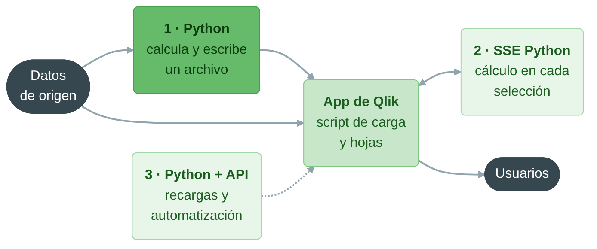
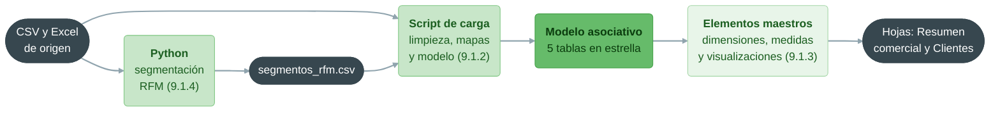

# Qlik Sense: integración con Python y caso práctico final

**Bloque 9 -- Qlik | Sesión 4 de 11**

[← Volver al índice del curso](../../README.md#bloque-9---qlik)

---

## 1. Introducción

Con esta sesión cerramos los Fundamentos del bloque. En las tres anteriores hemos cargado, limpiado y modelado los datos de Mercadia con el script, y hemos construido encima elementos maestros y una primera hoja de análisis. Hoy añadimos una pieza que Qlik no resuelve bien por sí solo y que ya sabemos hacer desde los bloques 3 y 5: **análisis con Python**.

Qlik es excelente para explorar datos con selecciones, pero no es una herramienta estadística ni de machine learning. Python, al contrario, es excelente para calcular segmentaciones, previsiones o modelos predictivos, pero no para que un director comercial los explore con clics. La combinación natural es **calcular en Python y explorar en Qlik**.

El caso de hoy es una petición concreta del comité de dirección: **segmentar a los clientes de la tarjeta** según su comportamiento de compra, con el método **RFM** (Recencia, Frecuencia, valor Monetario). Calcularemos los segmentos con pandas, los cargaremos en la app y construiremos con ellos una hoja **Clientes**. Y con esa hoja resolveremos el caso práctico que cierra la parte de Fundamentos.

### Objetivos de la sesión
- Conocer las tres formas de integrar Python con Qlik y cuándo usar cada una.
- Entender el análisis RFM y sus reglas de segmentación.
- Ejecutar un script de pandas que reproduce la limpieza de la 9.1.2 y calcula los segmentos.
- Cargar el resultado en Qlik y asociarlo al modelo sin crear problemas.
- Crear una dimensión maestra con un orden personalizado.
- Construir la hoja **Clientes** y responder con ella a las preguntas del comité.
- Repasar todo lo aprendido en 9.1 con un caso práctico completo.

### Prerequisitos
- `Mercadia_9.1.3.qvf` con los elementos maestros y la hoja **Resumen comercial**.
- Python 3 con **pandas** instalado (bloques 2 y 3). Si no lo tenemos: `pip install pandas`.
- El script [`9.1.4 - segmentacion_rfm.py`](9.1.4%20-%20segmentacion_rfm.py), en esta misma carpeta.

---

## 2. Tres formas de integrar Python con Qlik

| Forma | Cómo funciona | Cuándo usarla | Equivalente en Power BI |
|---|---|---|---|
| **1. Python antes de Qlik** (por lotes) | Python lee los datos, calcula y escribe un archivo (CSV, Parquet...). El script de carga de Qlik lo lee como cualquier otra fuente | Segmentaciones, previsiones o modelos que se recalculan cada día, semana o mes. Es la forma más habitual y la más robusta | Script de Python como origen de datos o en Power Query |
| **2. Python dentro de Qlik** (en tiempo real) | Las **Server-Side Extensions** (SSE) conectan el motor de Qlik con un servicio Python. Una expresión de gráfico llama a una función de Python, que recibe los datos **ya filtrados por las selecciones** y devuelve el resultado | Cálculos que deben responder a cada selección: una previsión que se recalcula al seleccionar una tienda, un *clustering* sobre los clientes seleccionados | Objetos visuales de Python |
| **3. Python que controla Qlik** (automatización) | Python usa las **APIs** de Qlik (REST, o el SDK oficial `qlik-sdk`) para recargar apps, crear o copiar apps, gestionar espacios o extraer datos | Operaciones: recargas encadenadas a un proceso ETL, despliegues, auditoría de apps | API REST de Power BI |



En esta sesión practicamos la **forma 1**, que es la que usaremos en el 90 % de los proyectos reales: no necesita configurar servidores, funciona igual en Qlik Cloud y en Desktop, y separa con claridad las responsabilidades (Python calcula, Qlik explora). Las formas 2 y 3 se describen en *Para profundizar*.

> **¿Y el machine learning de Qlik?** Qlik Cloud incluye su propio módulo de machine learning automático, que entrena modelos predictivos sin escribir código. Es una alternativa interesante para casos estándar (predecir una baja, una venta), pero no sustituye a Python cuando queremos controlar el método, como en el RFM de hoy.

---

## 3. El análisis RFM

El análisis **RFM** es una técnica clásica de marketing para segmentar clientes según **tres preguntas** sobre su historial de compras:

| Letra | Pregunta | Métrica en Mercadia | Mejor cuanto... |
|---|---|---|---|
| **R** · Recencia | ¿Cuándo compró por última vez? | Días desde la última compra hasta el 30/09/2026 | **Menor** |
| **F** · Frecuencia | ¿Cuántas veces compra? | Número de tickets distintos | Mayor |
| **M** · Monetario | ¿Cuánto gasta? | Suma de `importe_neto` | Mayor |

Cada métrica se convierte en una **puntuación de 1 a 5** por **quintiles**: el 20 % de clientes con peor valor recibe un 1 y el 20 % con mejor valor, un 5. Con las puntuaciones de recencia y frecuencia se asigna un **segmento**, cada uno con una acción comercial distinta:

| Segmento | Regla | Quiénes son | Acción comercial |
|---|---|---|---|
| **Campeones** | R ≥ 4 y F ≥ 4 | Compran a menudo y lo han hecho hace poco | Cuidarlos: ventajas exclusivas, novedades |
| **Leales** | R ≥ 3 y F ≥ 3 | Compran con regularidad | Programas de puntos, venta cruzada |
| **Nuevos** | R ≥ 4 y F ≤ 2 | Han comprado hace poco, pero pocas veces | Bienvenida, segunda compra |
| **Necesitan atención** | El resto (R = 3, F ≤ 2) | Clientes tibios, a medio camino | Ofertas personalizadas |
| **En riesgo** | R ≤ 2 y F ≥ 3 | Compraban a menudo, pero hace tiempo que no vienen | **Recuperarlos** antes de perderlos |
| **Perdidos** | R ≤ 2 y F ≤ 2 | Compraron poco y hace mucho | Campañas de bajo coste o ninguna |
| **Sin compras** | Sin tickets | Se dieron de alta y nunca han comprado | Activación |

Las reglas se aplican **en orden**: un cliente con R = 4 y F = 3 no es Campeón (F < 4), pero sí Leal (R ≥ 3 y F ≥ 3), y ya no llega a evaluarse como Nuevo. Hay muchas variantes de estas reglas en la literatura; lo importante es que sean **explícitas** y que negocio las entienda y las acepte.

---

## 4. Práctica, parte 1: el script de Python

Abrimos [`9.1.4 - segmentacion_rfm.py`](9.1.4%20-%20segmentacion_rfm.py) y lo leemos antes de ejecutarlo. Tiene cuatro funciones.

### leer_ventas: la misma limpieza que en Qlik

```python
texto = ventas["fecha"]
fecha = pd.to_datetime(texto, format="%Y-%m-%d", errors="coerce")
fecha = fecha.fillna(pd.to_datetime(texto, format="%d/%m/%Y", errors="coerce"))
fecha = fecha.fillna(pd.to_datetime(texto, format="%d-%m-%y", errors="coerce"))
```

Es la traducción exacta de `Alt(Date#(...), Date#(...), Date#(...))`: cada formato que no encaja devuelve `NaT` (el nulo de las fechas en pandas) y `fillna` lo rellena con el siguiente intento. El resto de la función repite las reglas de la 9.1.2: fuera las líneas con 0 unidades, importes recalculados cuando se alejan más de 5 céntimos, y solo las ventas con tarjeta.

> **¿Por qué repetir la limpieza?** Porque el script de Python lee el CSV **original**, no la app de Qlik. Si las reglas fueran distintas, los segmentos se calcularían sobre otros datos y las cifras de Python no cuadrarían con las de Qlik. En un proyecto real, lo correcto es limpiar **una sola vez**, en la primera capa, y que Qlik y Python lean el dato ya limpio. Es la arquitectura de QVDs por capas que veremos en la 9.4.1.

### calcular_rfm: métricas y puntuaciones

```python
rfm = ventas.groupby("id_cliente").agg(
    ultima_compra=("fecha", "max"),
    rfm_frecuencia=("id_ticket", "nunique"),
    rfm_valor=("importe_neto", "sum"),
)
rfm["rfm_recencia_dias"] = (FECHA_CORTE - rfm["ultima_compra"]).dt.days
```

Un `groupby` con tres agregaciones: la fecha máxima, el número de tickets distintos y la suma del importe. Es el `GROUP BY` del bloque 1 escrito en pandas.

```python
rfm["r_score"] = pd.qcut(
    rfm["rfm_recencia_dias"].rank(method="first"), 5, labels=[5, 4, 3, 2, 1]
).astype(int)
```

`pd.qcut(x, 5)` reparte los valores en cinco grupos del mismo tamaño. El `rank(method="first")` previo es necesario porque hay **muchos empates**: la mitad de los clientes tiene 2 tickets o menos, y `qcut` no puede partir en cinco grupos iguales un montón de valores idénticos. Al convertir los valores en posiciones (1, 2, 3...), los empates se deshacen por orden de aparición. En la recencia, las etiquetas van al revés (`[5, 4, 3, 2, 1]`) porque **menos días es mejor**.

### asignar_segmento y main

`asignar_segmento` aplica las reglas de la sección 3, en orden. `main` une el resultado con el maestro de clientes (sin duplicados) con un `merge` de tipo `left`, para que los clientes sin compras también aparezcan, con el segmento `Sin compras` y las métricas vacías. Por último, escribe `segmentos_rfm.csv` en la carpeta `9.0 - Dataset` e imprime un resumen.

### Ejecutar

Desde una terminal, en la carpeta `9. Qlik`:

```bash
python "9.1 - Fundamentos/9.1.4 - segmentacion_rfm.py"
```

La salida debe ser esta (las cifras de ventas son las de cada segmento en todo el periodo):

| Segmento | Clientes | Ventas |
|---|---|---|
| Campeones | 774 | 113.064,74 € |
| Leales | 652 | 34.887,51 € |
| Nuevos | 423 | 9.750,59 € |
| Necesitan atención | 270 | 6.426,76 € |
| En riesgo | 692 | 32.793,53 € |
| Perdidos | 720 | 14.142,54 € |
| Sin compras | 469 | 0,00 € |

Los clientes con compras son **3.531**, los mismos que la medida **Clientes activos** de la 9.1.3, y los 469 sin compras son los que encontramos en gris oscuro. Las cifras de Python y de Qlik cuadran porque las reglas de limpieza son las mismas.

---

## 5. Práctica, parte 2: cargar los segmentos en Qlik

Duplicamos la app de la 9.1.3 como **Mercadia_9.1.4**. En Qlik Cloud, subimos `segmentos_rfm.csv` a **DataFiles** (en Desktop ya está en la carpeta de la conexión).

### Paso 1: una sección nueva en el script

En el editor de carga, añadimos una sección **Segmentos** al final:

```
// Segmentación RFM calculada en Python (9.1.4 - segmentacion_rfm.py).
// Una fila por cliente del maestro. Se recalcula fuera de Qlik.
segmentos_rfm:
LOAD
    id_cliente,
    segmento_rfm,
    rfm_recencia_dias,
    rfm_frecuencia,
    Num#(rfm_valor, '#,##0.##', '.', ',') AS rfm_valor,
    r_score,
    f_score,
    m_score
FROM [$(vRuta)segmentos_rfm.csv]
(txt, utf8, embedded labels, delimiter is ',', msq);
```

Pandas escribe los decimales con punto, así que volvemos a usar `Num#`. Cargamos los datos.

### Paso 2: comprobar el modelo

En el visor del modelo aparece una quinta tabla, `segmentos_rfm`, unida por `id_cliente`. Ahora `id_cliente` está en **tres** tablas (`ventas`, `clientes` y `segmentos_rfm`). ¿Es una referencia circular? **No**: las tres comparten un **único** campo, y un mismo campo que une varias tablas no crea caminos alternativos. Habría bucle si dos tablas estuvieran unidas por **campos distintos** por dos caminos, como pasó con `provincia` en la 9.1.2. Tampoco hay clave sintética, porque `segmentos_rfm` solo comparte un campo con cada tabla.

> **Una tabla de más.** `segmentos_rfm` tiene una fila por cliente, igual que `clientes`. Lo natural sería que sus columnas formaran parte de la propia tabla `clientes`. Lo haremos en la 9.2.1 con un `LEFT JOIN`; por ahora, la asociación funciona y el modelo es correcto.

### Paso 3: una dimensión maestra con orden propio

Creamos la dimensión maestra **Segmento RFM** con el campo `segmento_rfm` y asignamos colores por valor: Campeones y Leales en verdes, Nuevos en azul, Necesitan atención en amarillo, En riesgo en naranja, Perdidos en rojo y Sin compras en gris.

El orden alfabético (Campeones, En riesgo, Leales...) no tiene sentido para negocio. En cada gráfico que use la dimensión, en **Ordenación**, desactivamos la ordenación automática y elegimos **Ordenar por expresión**, ascendente, con:

```
Match(segmento_rfm, 'Campeones', 'Leales', 'Nuevos', 'Necesitan atención',
      'En riesgo', 'Perdidos', 'Sin compras')
```

`Match` devuelve la **posición** del valor en la lista (Campeones = 1, Leales = 2...), y Qlik ordena por ese número.

### Paso 4: dos medidas maestras nuevas

| Nombre | Expresión | Formato | Para qué |
|---|---|---|---|
| Clientes | `Count(distinct id_cliente)` | `#.##0` | Clientes **del maestro**, hayan comprado o no |
| Ventas por cliente activo | `Sum(If(es_fidelizado = 'Si', importe_neto)) / Count(distinct If(es_fidelizado = 'Si', id_cliente))` | `#.##0,00 €` | Valor medio de un cliente activo |

Ahora tenemos dos medidas de clientes con nombres que dicen claramente qué cuentan. **Clientes** cuenta todos los valores de `id_cliente`, incluidos los que no tienen ventas: es la medida adecuada para contar clientes por segmento, también en `Sin compras`. **Clientes activos** (9.1.3) solo cuenta los que han comprado.

---

## 6. Caso práctico final: la hoja Clientes

Este caso cierra la parte de Fundamentos. Lo planteamos como lo haría el comité: un encargo con preguntas de negocio y un entregable. Primero intenta resolverlo por tu cuenta con lo aprendido en 9.1.1 a 9.1.4; la solución guiada está después.

### El encargo

> El equipo de marketing va a lanzar tres campañas el mes que viene: una de **fidelización** para los mejores clientes, una de **recuperación** para los que se están yendo y una de **activación** para los que se dieron de alta y nunca han comprado. Necesita una hoja en la app de Mercadia que le permita, con selecciones, saber cuántos clientes hay en cada grupo, cuánto valen, en qué tiendas y canales compran y qué perfil tienen. Y quiere que respondamos ya a cinco preguntas.

**Entregable:** `Mercadia_9.1.4.qvf` con una hoja **Clientes** y las respuestas a las cinco preguntas de la sección 7.

### Solución guiada: el diseño de la hoja

```
┌────────────────────────────────────────────────────────────────────┐
│  KPI Clientes   KPI Clientes activos   KPI Ventas por cliente      │  Banda 1
│                                        activo   KPI % fidelizadas  │
├──────────────────────────────────┬─────────────────────────────────┤
│  Clientes y ventas por segmento  │  Frecuencia y valor por         │  Banda 2
│  (combinado)                     │  cliente (dispersión)           │
├──────────────────────────────────┴───────────────┬─────────────────┤
│  Segmento × tramo de edad (tabla dinámica)       │  Filtros:       │  Banda 3
│                                                  │  Segmento,      │
│                                                  │  Tienda, Canal  │
│                                                  │  de alta        │
└──────────────────────────────────────────────────┴─────────────────┘
```

1. **Banda 1.** Cuatro KPIs arrastrando las medidas maestras **Clientes**, **Clientes activos**, **Ventas por cliente activo** y **% Ventas fidelizadas**.
2. **Combinado por segmento.** Dimensión maestra **Segmento RFM** (con el orden por `Match`); barras con **Clientes** en el eje principal y línea con **Ventas netas** en el secundario.
3. **Dispersión.** Dimensión `id_cliente`; eje X `Count(distinct id_ticket)` (frecuencia), eje Y **Ventas netas**; color por la dimensión maestra **Segmento RFM**. Cada punto es un cliente. Los clientes sin compras no aparecen, porque no tienen tickets.
4. **Tabla dinámica.** Filas: **Segmento RFM**; columnas: **Tramo de edad**; medida: **Clientes**.
5. **Panel de filtrado** con **Segmento RFM**, **Tienda** y `canal_alta`.

<!-- Captura pendiente: 0.Capturas/9.1.4/6.1_Hoja_clientes.png -->

---

## 7. Las cinco preguntas del comité

**Pregunta 1. ¿Cuánto pesan los Campeones?** Seleccionamos `Campeones` en el panel de filtrado y miramos los KPIs.

<details>
<summary>Ver la respuesta</summary>

Son **774** clientes, el **22 %** de los clientes activos (774 de 3.531), y generan **113.065 €**: el **53,6 %** de las ventas fidelizadas y más de un tercio (34,9 %) de las ventas totales de Mercadia. Es el principio de Pareto que vimos en el bloque 4: pocos clientes concentran buena parte del negocio. La campaña de fidelización debe ir dirigida a ellos.

</details>

**Pregunta 2. ¿Qué segmento es la prioridad de la campaña de recuperación y cuánto vale?**

<details>
<summary>Ver la respuesta</summary>

**En riesgo**: 692 clientes que compraban a menudo (F ≥ 3) pero hace tiempo que no vienen (R ≤ 2). Han generado **32.794 €** en el periodo, casi lo mismo que los Leales (34.888 €) con un número de clientes parecido. Recuperar aunque sea una parte tiene más valor que intentarlo con los **Perdidos** (720 clientes, pero solo 14.143 €).

</details>

**Pregunta 3. ¿Los clientes sin compras tienen algún perfil común?** Seleccionamos `Sin compras` y miramos la tabla dinámica y el panel de `canal_alta`.

<details>
<summary>Ver la respuesta</summary>

Son **469** clientes. Al seleccionarlos, los valores de `canal_alta`, `tramo_edad` y `provincia_cliente` que quedan en blanco muestran su perfil. Fíjate en que, al seleccionar `Sin compras`, los paneles de **Tienda** y de **canal** (campos de la tabla de ventas) quedan **enteramente en gris oscuro**: estos clientes no están asociados a ninguna venta. Es la selección asociativa diciéndonos, sin una sola fórmula, que la campaña de activación no puede segmentarse por tienda de compra, sino por provincia de residencia (`provincia_cliente`).

</details>

**Pregunta 4. ¿Dónde está el límite entre Campeones y el resto en el gráfico de dispersión?** Seleccionamos `Campeones` y después `Leales`.

<details>
<summary>Ver la respuesta</summary>

Los Campeones ocupan la parte derecha y alta de la nube: muchos tickets y mucho gasto. Pero hay puntos de otros segmentos **muy cerca** de ellos, y algunos En riesgo con frecuencias altas. Es la consecuencia de dos decisiones del método: los segmentos usan **R y F**, no M, y los cortes son **quintiles**, no umbrales de negocio. Un cliente con 30 tickets cuya última compra fue hace cinco meses puede quedar como En riesgo. Es exactamente el tipo de cliente al que la campaña de recuperación debe llamar primero.

</details>

**Pregunta 5. ¿Qué tiendas tienen más clientes En riesgo?** Seleccionamos `En riesgo` y añadimos temporalmente una tabla con la dimensión **Tienda** y la medida **Clientes activos**, ordenada de mayor a menor.

<details>
<summary>Ver la respuesta</summary>

La tabla muestra, para cada tienda, cuántos clientes En riesgo han comprado **alguna vez** en ella. Un cliente que ha comprado en dos tiendas cuenta en las dos, así que la suma de la columna es mayor que 692: la tabla no reparte clientes entre tiendas, sino que dice **dónde** se les puede encontrar. Las tiendas con más clientes En riesgo son candidatas a reforzar la campaña de recuperación en punto de venta. Para asignar cada cliente a **una** tienda (su tienda habitual) habría que calcularla, en Python o en el script; es una buena ampliación del ejercicio 3.

</details>

Guardamos la app y descargamos `Mercadia_9.1.4.qvf`: es el entregable de la parte de Fundamentos.

---

## 8. Lo que hemos construido en 9.1



Los segmentos son una **foto**: reflejan los datos del día en que se ejecutó el script de Python. Si mañana llegan ventas nuevas y recargamos la app sin volver a ejecutar Python, las ventas estarán al día y los segmentos, no. En producción, los dos procesos se encadenan: primero Python, después la recarga de Qlik. Es exactamente lo que automatiza la forma 3 de la sección 2, y lo que organizaremos con QVDs en la 9.4.1.

---

## 9. Ejercicios

**Ejercicio 1: cambiar la fecha de corte.** Cambia `FECHA_CORTE` a `2026-06-30` y vuelve a ejecutar el script sin cambiar nada más. ¿Por qué el resultado es incorrecto? ¿Qué habría que cambiar también?

<details>
<summary>Ver la solución</summary>

La recencia de las compras posteriores al 30/06/2026 saldría **negativa**, y la frecuencia y el valor incluirían compras "del futuro". Para analizar la situación a 30 de junio, habría que **filtrar también las ventas** hasta esa fecha antes de agrupar: `ventas = ventas[ventas["fecha"] <= FECHA_CORTE]`. Es un error clásico en análisis de clientes y en machine learning: usar información que no estaba disponible en la fecha del análisis (*data leakage*).

</details>

**Ejercicio 2: ¿Python o Qlik?** Decide dónde calcularías cada cosa y justifícalo:

1. El ticket medio por tienda.
2. Una previsión de ventas por tienda para los próximos tres meses.
3. El segmento RFM de cada cliente.
4. El porcentaje de clientes Campeones de cada tienda.

<details>
<summary>Ver la solución</summary>

1. **Qlik**: es una agregación que debe responder a las selecciones (por periodo, por canal...). Ya la tenemos como medida maestra.
2. **Python**: necesita un modelo estadístico (por ejemplo, estacionalidad y tendencia) que Qlik no ofrece de forma nativa. El resultado se carga en Qlik como una tabla más.
3. **Python**, por lotes: el cálculo con quintiles y reglas es más claro y más fácil de probar en pandas. Ojo: si el segmento tuviera que **recalcularse con cada selección** (por ejemplo, el RFM de los clientes de la tienda seleccionada), habría que usar una SSE o reescribirlo con expresiones de Qlik.
4. **Qlik**: una vez cargado el segmento, es una medida más. Con Set Analysis (9.3.1) será todavía más sencilla.

</details>

**Ejercicio 3: la tienda habitual.** Amplía el script de Python para calcular la **tienda habitual** de cada cliente (la tienda donde tiene más tickets) y exportarla como una columna más, `tienda_habitual`. Cárgala en Qlik y repite la pregunta 5. (Pista: necesitarás normalizar `id_tienda` como en la 9.1.2, con `.str.strip().str.upper()` y un relleno de ceros.)

<details>
<summary>Ver la solución</summary>

La primera instrucción va al final de `leer_ventas`, antes del `return`; el resto, en `main`, justo después de `rfm = calcular_rfm(ventas)`. Y no olvides añadir `"tienda_habitual"` a la lista `columnas`, o no llegará al CSV:

```python
ventas["id_tienda"] = "M" + (
    ventas["id_tienda"].str.strip().str.upper().str.replace("M", "").str.zfill(2)
)
habitual = (
    ventas.groupby(["id_cliente", "id_tienda"])["id_ticket"].nunique()
    .reset_index()
    .sort_values(["id_cliente", "id_ticket"], ascending=[True, False])
    .drop_duplicates("id_cliente")
    .rename(columns={"id_tienda": "tienda_habitual"})[["id_cliente", "tienda_habitual"]]
)
rfm = rfm.merge(habitual, on="id_cliente", how="left")
```

En Qlik, **no** debemos cargar el campo como `id_tienda`: crearía una segunda asociación entre `segmentos_rfm` y `tiendas` y, con ella, una **referencia circular** (ventas → tiendas → segmentos → ventas). Lo cargamos como `tienda_habitual`, un campo independiente. Ahora la tabla por tienda habitual suma exactamente 692 clientes En riesgo, uno por cliente.

</details>

---

## 10. Errores comunes y troubleshooting

**1. "`ModuleNotFoundError: No module named 'pandas'`."** pandas no está instalado en el Python que estamos usando: `pip install pandas` (o `python -m pip install pandas`). Si usamos un entorno virtual o Anaconda, hay que activarlo antes.

**2. "`FileNotFoundError` al ejecutar el script."** El script busca el dataset en `../9.0 - Dataset` respecto a su propia ubicación. Si lo hemos movido, ajustamos `RUTA_DATASET`.

**3. "En Qlik, `rfm_valor` sale como texto o a 0."** Falta el `Num#` con punto decimal, igual que en la 9.1.2.

**4. "El segmento `Sin compras` no aparece en Qlik."** O no hemos hecho el `merge` con el maestro de clientes en Python, o no hemos vuelto a ejecutar el script después de cambiarlo. Abrimos `segmentos_rfm.csv` y comprobamos que tiene 4.000 filas (más la cabecera).

**5. "Aparece una referencia circular al cargar los segmentos."** El CSV tiene alguna columna que se llama igual que un campo de otra tabla (`id_tienda`, `provincia`...). La renombramos en el `LOAD` o en Python.

**6. "Los recuentos por segmento no coinciden con los de la tabla de la sección 4."** Revisamos que el script de Python no se haya modificado (las reglas de limpieza y la fecha de corte) y que en Qlik estemos usando la medida **Clientes**, no **Clientes activos**, para contar a los `Sin compras`.

**7. "El gráfico de dispersión tarda en dibujarse o muestra un aviso de demasiados puntos."** Son 3.531 puntos, un volumen que Qlik maneja bien, pero en equipos lentos se puede limitar en las propiedades del gráfico. No uses `id_linea` como dimensión: serían 65.000 puntos sin sentido.

---

## 11. Conclusión

En esta sesión hemos cerrado los Fundamentos del bloque uniendo dos herramientas que se complementan: Python para calcular y Qlik para explorar. Hemos visto las tres formas de integrarlas (por lotes, en tiempo real con SSE y por API), hemos aprendido el análisis RFM y hemos escrito con pandas una segmentación que reproduce la limpieza del script de Qlik para que las cifras cuadren. Hemos cargado el resultado en la app sin romper el modelo, hemos creado una dimensión maestra con orden personalizado y hemos construido la hoja **Clientes**, con la que hemos respondido a las preguntas de marketing: los Campeones son el 22 % de los clientes activos y la mitad de las ventas fidelizadas, los En riesgo son la prioridad de la campaña de recuperación y los Sin compras solo se pueden segmentar por su provincia de residencia.

Con `Mercadia_9.1.4.qvf` termina la parte 9.1. Tenemos una app completa, pero también una lista de deberes pendientes: la tienda de Almería sin dar de alta, una tabla de segmentos que debería formar parte de clientes, unos campos de calendario que deberían vivir en su propia tabla y unos objetivos de ventas que todavía no hemos cargado. Todo eso es el script avanzado de la **9.2.1**: `JOIN`, `CONCATENATE` y `RESIDENT`.

---

## 12. Para profundizar

### Server-Side Extensions (SSE)

Las SSE son un protocolo abierto de Qlik (basado en gRPC) para conectar el motor con un servicio externo escrito en Python, R u otro lenguaje. Una vez configurada la conexión (en Qlik Sense Desktop y en Qlik Sense Enterprise, con una línea en el archivo de configuración del motor o en la consola de administración), las funciones del servicio se llaman desde cualquier expresión de gráfico o del script, con un prefijo propio, por ejemplo `PyTools.Cluster(...)`. El repositorio oficial `qlik-oss/server-side-extension` incluye ejemplos completos en Python. En Qlik Cloud, la integración equivalente se hace con **conexiones analíticas**, que conectan con plataformas de machine learning en la nube o con un servicio propio a través de un conector genérico.

### El SDK de Qlik para Python

`qlik-sdk` es la librería oficial de Python para las APIs de Qlik Cloud. Permite, entre otras cosas, recargar una app cuando termina un proceso de datos, copiar apps entre espacios o extraer el contenido de un gráfico como tabla. Es la forma 3 de la sección 2 y la base de la automatización de despliegues que suelen hacer los equipos de datos.

### Parquet en lugar de CSV

Qlik lee archivos **Parquet**, un formato columnar que guarda los tipos de dato (números, fechas, textos). Si el script de Python escribiera `segmentos.to_parquet(...)` en lugar de un CSV, no haría falta el `Num#` en Qlik ni habría dudas sobre separadores decimales o codificación. Es una buena práctica cuando Python y Qlik se pasan datos de forma habitual.

### RFM y clustering

El RFM por quintiles es sencillo y explicable, pero sus cortes son arbitrarios. Una alternativa es segmentar con un algoritmo de **clustering** como *k-means* (bloque 5) sobre las tres métricas estandarizadas. Los grupos se ajustan mejor a los datos, a cambio de ser más difíciles de explicar al comité. Un buen ejercicio es comparar ambas segmentaciones en la propia hoja **Clientes**, cargando las dos.

---

## 13. Recursos

- **pandas**, documentación de `groupby` y `qcut`: <https://pandas.pydata.org/docs/>
- **Server-Side Extensions** (repositorio oficial con ejemplos en Python): <https://github.com/qlik-oss/server-side-extension>
- **Qlik SDK para Python**: <https://github.com/qlik-oss/qlik-sdk-python>
- **Ayuda oficial de Qlik Cloud Analytics** (en español): <https://help.qlik.com/es-ES/cloud-services/>. Páginas de referencia: *Conexiones analíticas*, *Formatos de archivo* y *Match*.

---

*Guía del alumno · Sesión 4 · Bloque 9 - Qlik · Mercadia*
