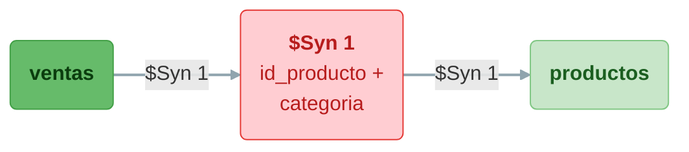
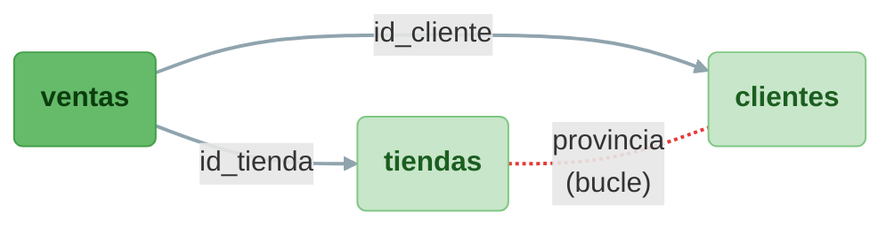
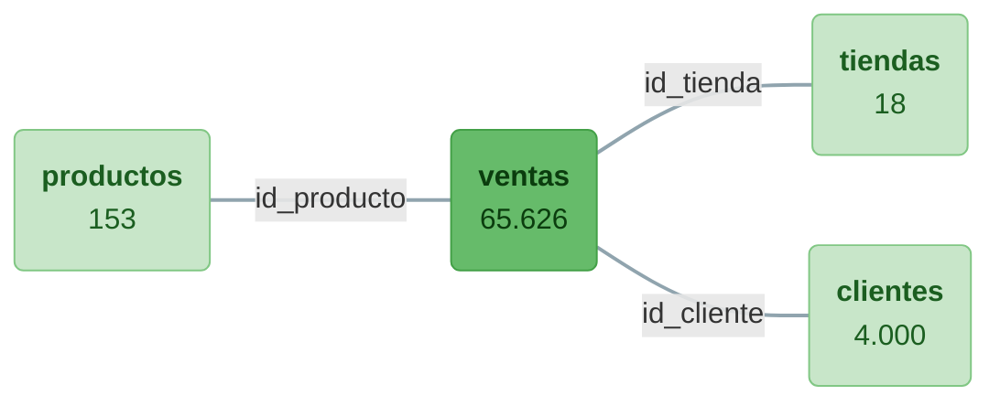
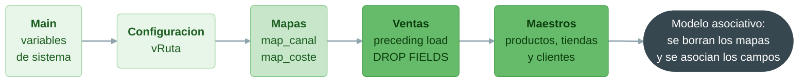

# Qlik Sense: varias tablas, maestros, modelo asociativo y calidad

**Bloque 9 -- Qlik | Sesión 4 de 11**

[← Volver al índice del curso](../../README.md#bloque-9---qlik)

---

## 1. Introducción

Después de dos sesiones, la tabla de ventas está limpia y cuadra con las cifras de referencia. Pero una tabla de hechos sola no contesta casi nada: no sabe a qué categoría pertenece un producto, en qué ciudad está una tienda ni de qué tramo de edad es un cliente. Hoy cargamos los tres **maestros** (productos, tiendas y clientes) y construimos el **modelo de datos** de Mercadia.

Aquí aparece la diferencia más importante entre Qlik y las otras dos herramientas del curso. En Power BI dibujábamos las relaciones en la vista Model; en Tableau, en la Data Source page. En Qlik **no se dibuja nada**: dos tablas se asocian automáticamente cuando tienen un campo con **exactamente el mismo nombre**. Es una regla muy cómoda y muy peligrosa a la vez, porque Qlik no pregunta. Hoy vamos a ver las dos caras de la regla, y a provocar (y resolver) los dos problemas clásicos que produce: la **clave sintética** y la **referencia circular**.

Al terminar tendremos `Mercadia_9.1.4.qvf` con un modelo en estrella limpio y verificado: la tabla de ventas en el centro y los maestros alrededor.

### Objetivos de la sesión
- Entender cómo asocia Qlik las tablas: por el nombre de los campos.
- Cargar un CSV y un Excel en el mismo modelo, y conocer las diferencias en la especificación de formato.
- Eliminar filas duplicadas con `LOAD DISTINCT`.
- Reconocer una **clave sintética** en el visor del modelo, entender por qué aparece y resolverla.
- Reconocer una **referencia circular**, entender por qué aparece y resolverla.
- Aplicar la regla de oro del modelado en Qlik: dos campos se llaman igual **si y solo si** son la misma cosa.
- Verificar la calidad del modelo y detectar claves huérfanas.

### Prerequisitos
- `Mercadia_9.1.3.qvf` con la tabla de ventas limpia y la hoja **Comprobaciones** cuadrada.
- Bloque 7: modelo en estrella, tablas de hechos y de dimensiones.

Como siempre, empezamos con una copia: en `Documentos\Qlik\Sense\Apps`, con Desktop cerrado, copiamos `Mercadia_9.1.3.qvf` como `Mercadia_9.1.4.qvf`. Abrimos la copia, le cambiamos el título a `Mercadia_9.1.4` (**Editar detalles**, como en la 9.1.3) y vamos al **Editor de carga de datos**.

---

## 2. La regla de la asociación

Antes de cargar nada, la regla que lo explica todo:

> **Qlik asocia dos tablas cuando comparten un campo con el mismo nombre.** Ese campo se convierte en un **campo clave**, y a través de él se propagan las selecciones de una tabla a la otra.

Mirando los archivos, ya podemos prever qué va a pasar:

| Archivo | Campos que comparte con `ventas` |
|---|---|
| `productos.csv` | `id_producto` y... `categoria` |
| `tiendas.xlsx` | `id_tienda` |
| `clientes.csv` | `id_cliente` |

Y hay un campo más que se repite entre dos maestros: `provincia` está en `tiendas.xlsx` y en `clientes.csv`. Vamos a cargar las tablas una a una, **sin corregir nada de antemano**, para ver qué hace Qlik con cada una.

Creamos una sección nueva, **Maestros**, **debajo** de **Ventas**.

---

## 3. Paso 1: el maestro de productos

En la sección **Maestros** escribimos (o generamos con **Seleccionar datos** y retocamos):

```
productos:
LOAD
    id_producto,
    producto,
    categoria,
    subcategoria,
    marca,
    marca_propia,
    Num#(precio_tarifa, '#,##0.##', '.', ',') AS precio_tarifa
FROM [$(vRuta)productos.csv]
(txt, utf8, embedded labels, delimiter is ',', msq);
```

No cargamos `coste_unitario`: ya lo llevamos a la tabla de ventas con `map_coste` en la 9.1.3. Y `precio_tarifa` necesita `Num#` por el mismo motivo que los importes.

Cargamos. El registro muestra `productos` con **153** filas. Pero al terminar, abrimos **Preparar** → **Visor del modelo de datos** y vemos algo inesperado.

### Una clave sintética

Entre `ventas` y `productos` hay una tabla que no hemos cargado: **`$Syn 1`**, y en las dos tablas aparece un campo **`$Syn 1`** nuevo.

<!-- Captura pendiente: 0.Capturas/9.1.4/3.1_Clave_sintetica.png -->

Ocurre porque las dos tablas comparten **dos** campos: `id_producto` y `categoria`. Qlik solo sabe asociar dos tablas a través de un único campo. Cuando encuentra varios, crea por su cuenta una tabla con todas las combinaciones de esos campos y la usa como puente: una **clave sintética**.



Y el resultado es peor que una tabla de más. Ahora una línea de venta solo encuentra su producto si coinciden **a la vez** el código y la categoría. Pero la categoría de ventas está sucia: una línea con `P0045` y `FRESCOS` no encuentra en productos la combinación `P0045` + `Frescos`, y **pierde la asociación con su producto**.

Lo comprobamos. En la hoja **Comprobaciones** añadimos una tabla con la dimensión `marca` y la medida `Count(id_linea)`. Aparece una fila con un guion (`-`) como marca: **9.133 líneas, casi el 14 % de las ventas**, se han quedado sin marca, sin subcategoría y sin nombre de producto.

### La solución: no cargar el campo que sobra

Hay dos categorías en el modelo: la que escribe el terminal de caja, con 24 variantes, y la **oficial** del maestro de productos, con 8. Aunque limpiáramos la primera (como en el ejercicio 2 de la 9.1.3), seguiríamos teniendo el mismo dato en dos sitios, con el riesgo de que algún día no coincidan. La decisión correcta es quedarnos solo con la del maestro.

En la sección **Ventas**, nivel 1, **borramos** la línea `categoria,`. Cargamos de nuevo.

- En el visor del modelo, `$Syn 1` ha desaparecido: `ventas` y `productos` se unen por una sola línea, `id_producto`.
- En la tabla de marcas, la fila del guion ha desaparecido.
- Un panel de filtrado con `categoria` muestra **8 valores**, los del maestro.

> **El mejor campo para limpiar es el que no se carga.** Antes de escribir una expresión de limpieza, conviene preguntarse si el dato no existe ya, limpio, en otra tabla.

---

## 4. Paso 2: el maestro de tiendas, desde Excel

Debajo de `productos`, en la misma sección:

```
tiendas:
LOAD
    id_tienda,
    tienda,
    formato,
    ciudad,
    provincia,
    comunidad,
    superficie_m2,
    Date(fecha_apertura) AS fecha_apertura,
    latitud,
    longitud,
    zona
FROM [$(vRuta)tiendas.xlsx]
(ooxml, embedded labels, table is Tiendas);
```

**Excel frente a CSV.** La especificación de formato cambia: `ooxml` es el formato de los archivos `.xlsx`, y `table is Tiendas` indica el nombre de la **hoja** del libro. Lo más cómodo es generar el `LOAD` con **Seleccionar datos**, que muestra las hojas del libro y escribe la especificación por nosotros.

Y no hace falta `Num#`: en un Excel, los números y las fechas ya están guardados como números, no como texto, así que no hay separadores que interpretar. Solo aplicamos `Date()` (sin `#`, una función de formato) para que la fecha de apertura se **muestre** como fecha en lugar de como número de serie.

Cargamos. El registro muestra `tiendas` con **18** filas. En el visor del modelo, `tiendas` se une a `ventas` por `id_tienda`. Gracias a la normalización de la 9.1.3, los códigos de las dos tablas coinciden. Sin ella, las tiendas escritas como `m05` o `M5` no encontrarían su fila en el maestro.

---

## 5. Paso 3: el maestro de clientes

Debajo de `tiendas`:

```
clientes:
LOAD
    id_cliente,
    Date(Date#(fecha_alta, 'DD/MM/YYYY'))                     AS fecha_alta,
    genero,
    tramo_edad,
    provincia,
    canal_alta,
    acepta_comunicaciones
FROM [$(vRuta)clientes.csv]
(txt, utf8, embedded labels, delimiter is ',', msq);
```

`fecha_alta` viene como texto en un solo formato, así que basta con un `Date#` (sin `Alt`) y un `Date`.

Cargamos. Esta vez el registro termina con una **advertencia**: Qlik ha encontrado **referencias circulares**. Y en el visor del modelo, una de las líneas aparece **en rojo y discontinua**.

### Una referencia circular

Ahora `tiendas` y `clientes` comparten el campo `provincia`. Así que entre `ventas` y `clientes` hay **dos caminos**: el directo (`id_cliente`) y el que da la vuelta por la tienda y la provincia.



Cuando hay dos caminos, Qlik no sabe cuál usar para propagar una selección, así que rompe el bucle **desacoplando** una de las tablas (*loosely coupled*): la línea roja discontinua. Las selecciones dejan de propagarse bien por ese tramo. Y, sobre todo, el modelo dice algo falso: que la provincia de una tienda y la provincia de residencia de un cliente son **el mismo dato**. ¿Qué querría decir "ventas por provincia"? ¿La provincia de la tienda o la del cliente?

### La solución: renombrar el campo que significa otra cosa

Son dos datos distintos, así que deben tener **nombres distintos**. En el `LOAD` de clientes cambiamos la línea:

```
    provincia                                                 AS provincia_cliente,
```

Cargamos. La advertencia desaparece y el visor del modelo muestra una **estrella**: `ventas` en el centro, unida a `productos` por `id_producto`, a `tiendas` por `id_tienda` y a `clientes` por `id_cliente`. Como el modelo de HotelesMediterraneum en el bloque 7.

<!-- Captura pendiente: 0.Capturas/9.1.4/5.1_Modelo_estrella.png -->

### Los duplicados y los vacíos

El registro dice que `clientes` tiene **4.031** filas, pero el programa de fidelización tiene 4.000 clientes. En la hoja **Comprobaciones**, un KPI con `Count(id_cliente)`... no ayuda, porque `id_cliente` es ahora un campo clave (lo veremos en la 9.1.5). Lo comprobamos mejor con el campo propio de la tabla: un KPI con `Count(fecha_alta)` marca **4.031**.

Hay **31 filas repetidas**: el mismo cliente, con todos sus datos iguales, aparece dos veces. Cambiamos la primera línea del `LOAD`:

```
clientes:
LOAD DISTINCT
```

`LOAD DISTINCT`, que ya vimos de pasada en el ejercicio 1 de la 9.1.2, elimina las filas repetidas **completas**, como `SELECT DISTINCT` en SQL. Cargamos: el registro muestra **4.000** filas, y el KPI también.

Es una solución válida porque las 31 filas sobrantes son copias exactas. Si dos filas del mismo cliente tuvieran datos distintos (dos provincias, por ejemplo), `DISTINCT` no las eliminaría y habría que decidir cuál es la buena.

Por último, un panel de filtrado con `tramo_edad` muestra un valor en blanco: **242** clientes sin tramo de edad. Aquí no queremos convertir el vacío en nulo, como hicimos con `id_cliente` en la 9.1.3, sino lo contrario: que se vea. Cambiamos la línea:

```
    If(Len(Trim(tramo_edad)) = 0, 'Sin dato', tramo_edad)     AS tramo_edad,
```

En un gráfico por tramo de edad, esos clientes aparecerán como una barra más, `Sin dato`, visible y seleccionable, en lugar de esconderse.

> **¿Nulo o "Sin dato"?** Depende de la pregunta. `id_cliente` es una **clave**: un valor vacío asociaría todas las compras sin tarjeta con un "cliente fantasma". `tramo_edad` es un **atributo** que el usuario va a usar como dimensión: le interesa ver cuántos clientes no lo tienen.

---

## 6. Cargar y leer el registro

Con las cinco secciones (Main, Configuracion, Mapas, Ventas y Maestros), el registro de la carga completa debe mostrar estos recuentos:

| Tabla | Filas | Comentario |
|---|---|---|
| `map_canal` y `map_coste` | 4 y 153 | No llegan al modelo |
| `ventas` | 65.626 | 65.670 menos las 44 líneas con 0 unidades |
| `productos` | 153 | |
| `tiendas` | 18 | Falta `M19` (sección 8) |
| `clientes` | 4.000 | 4.031 menos los 31 duplicados |

Y ninguna advertencia de referencias circulares.

---

## 7. El modelo asociativo



Hemos construido el modelo **solo con los nombres de los campos**: dejando un campo fuera (`categoria` en ventas) y renombrando otro (`provincia_cliente`). No hemos dibujado ninguna relación, ni elegido cardinalidades o direcciones de filtro como en Power BI. En Qlik, las asociaciones son siempre en **las dos direcciones**: seleccionar una tienda filtra sus clientes, y seleccionar un cliente filtra las tiendas en las que ha comprado.

> **La regla de oro del modelado en Qlik:** dos campos deben llamarse igual **si y solo si** son la misma cosa y queremos que asocien sus tablas. En Power BI una relación se crea a propósito; en Qlik se crea **por accidente** si no tenemos cuidado con los nombres. Las claves sintéticas y las referencias circulares tienen soluciones más elaboradas (tablas de enlace, claves compuestas) que veremos en la 9.2.3.

Para saber qué campos son claves, en el visor del modelo pasamos el ratón por las líneas que unen las tablas, o seleccionamos una tabla y miramos los campos con el icono de llave. Una buena costumbre es revisar el visor **después de cada carga que añade una tabla**, como hemos hecho hoy.

---

## 8. Comprobación de calidad

Un modelo no se da por bueno hasta que se **comprueba**. Ampliamos la hoja **Comprobaciones** con estos objetos:

| Comprobación | Cómo | Valor esperado |
|---|---|---|
| Categorías | Panel de filtrado con `categoria` | 8 valores |
| Productos sin marca | Tabla `marca` × `Count(id_linea)` | Ninguna fila con `-` |
| Clientes | KPI `Count(fecha_alta)` | 4.000 |
| Tramos de edad | Panel de filtrado con `tramo_edad` | Incluye `Sin dato`, sin valor en blanco |
| Ventas netas | KPI `Sum(importe_neto)` | 323.808,28 € (no cambia al añadir maestros) |

La última comprobación es importante: **añadir dimensiones no debe cambiar los totales de la tabla de hechos**. Si las ventas netas cambiaran al cargar un maestro, algo estaría duplicando filas. Con asociaciones no ocurre (con un `JOIN` sí podría ocurrir, como veremos en la 9.2.1), pero se comprueba siempre.

### La tienda huérfana

Añadimos una última tabla con la dimensión `tienda` y la medida `Sum(importe_neto)`. Aparecen las 18 tiendas del maestro **y una fila más** con un guion (`-`) como nombre y **8.687,41 €** de ventas. Son las 1.713 líneas de `M19`, que no encuentran su fila en `tiendas`: el valor nulo de la dimensión.

<!-- Captura pendiente: 0.Capturas/9.1.4/8.1_Tienda_huerfana.png -->

No es un problema del script, sino del **dato maestro**: alguien abrió una tienda y no la dio de alta en el Excel. Lo correcto no es inventarse los datos de la tienda, sino **avisar** al responsable del maestro. Nos contesta que es **Almería**, formato Urbana, abierta el 2 de marzo de 2026. En la 9.2.1 aprenderemos a añadir esa fila con `CONCATENATE` mientras el maestro se corrige en origen.

Guardamos la app (`Ctrl + S`).

---

## 9. La sección Maestros completa

```
// Maestro de productos. La categoría buena es la de este maestro:
// por eso no se carga la categoría de la tabla de ventas.
productos:
LOAD
    id_producto,
    producto,
    categoria,
    subcategoria,
    marca,
    marca_propia,
    Num#(precio_tarifa, '#,##0.##', '.', ',') AS precio_tarifa
FROM [$(vRuta)productos.csv]
(txt, utf8, embedded labels, delimiter is ',', msq);

// Maestro de tiendas, mantenido en Excel. Falta M19 (ver 9.2.1).
tiendas:
LOAD
    id_tienda,
    tienda,
    formato,
    ciudad,
    provincia,
    comunidad,
    superficie_m2,
    Date(fecha_apertura) AS fecha_apertura,
    latitud,
    longitud,
    zona
FROM [$(vRuta)tiendas.xlsx]
(ooxml, embedded labels, table is Tiendas);

// Clientes del programa de fidelización.
// provincia_cliente: la provincia del cliente no es la de la tienda.
clientes:
LOAD DISTINCT
    id_cliente,
    Date(Date#(fecha_alta, 'DD/MM/YYYY'))                     AS fecha_alta,
    genero,
    If(Len(Trim(tramo_edad)) = 0, 'Sin dato', tramo_edad)     AS tramo_edad,
    provincia                                                 AS provincia_cliente,
    canal_alta,
    acepta_comunicaciones
FROM [$(vRuta)clientes.csv]
(txt, utf8, embedded labels, delimiter is ',', msq);
```

Y en la sección **Ventas**, el único cambio respecto a la 9.1.3: la línea `categoria,` del nivel 1 ya no está.

---

## 10. Lo que Qlik ha hecho por debajo



Al terminar el script, Qlik elimina las tablas de mapeo y construye la **tabla de símbolos** de cada campo (9.1.1). Aquí está la clave de todo lo que hemos visto hoy: en Qlik, un campo es **uno solo**, aunque aparezca en varias tablas. `id_tienda` tiene **una** tabla de símbolos, con los 19 códigos, que comparten `ventas` y `tiendas`. Por eso las tablas quedan asociadas: al seleccionar `M05`, el motor marca las filas de las dos tablas que apuntan a ese símbolo.

Desde ese punto de vista, los dos problemas de hoy se entienden mejor:

- **Clave sintética**: dos tablas comparten **varios** campos. Qlik necesita una única tabla de símbolos para unirlas, así que crea una nueva, con las combinaciones.
- **Referencia circular**: hay **varios caminos** de campos compartidos entre dos tablas. Una selección podría propagarse por cualquiera de ellos y dar resultados distintos, así que Qlik corta uno.

---

## 11. Ejercicios

**Ejercicio 1: predecir el modelo.** El archivo `objetivos_mensuales.csv` tiene tres columnas: `id_tienda`, `mes` (con valores como `2024-01`) y `objetivo_ventas`. Sin cargarlo, contesta:

1. Si lo cargamos tal cual, ¿con qué tabla o tablas se asociará?
2. ¿Aparecerá algún problema en el visor del modelo?
3. Aunque no apareciera ningún problema, ¿se asociarían bien los objetivos con las ventas de cada mes?

<details>
<summary>Ver la solución</summary>

1. Con `ventas` (por `id_tienda` y por `mes`) y con `tiendas` (por `id_tienda`).
2. Sí: una **clave sintética** entre `ventas` y la tabla de objetivos, que comparten dos campos. Qlik mueve `id_tienda` y `mes` a la tabla `$Syn 1`, y `tiendas` queda unida a esa tabla sintética por `id_tienda`.
3. **No.** En `ventas`, `mes` es el mes del año (`ene`, `feb`...), sin año; en los objetivos es un año y mes (`2024-01`). Se llaman igual pero **no son la misma cosa**. Es un caso de dos tablas de hechos con distinto detalle, y lo resolveremos en la 9.2.3.

</details>

**Ejercicio 2: ¿qué campos son claves?** Observando el modelo final, contesta:

1. ¿Cuántos campos clave tiene el modelo?
2. ¿En qué tabla está `marca_propia`? ¿Y `es_fidelizado`?
3. Un compañero propone renombrar `tienda` como `nombre` y `producto` como `nombre`, "para que sea más homogéneo". ¿Qué pasaría?

<details>
<summary>Ver la solución</summary>

1. **Tres**: `id_producto`, `id_tienda` e `id_cliente`.
2. `marca_propia` está en `productos`; `es_fidelizado`, en `ventas`. En la 9.1.5 veremos que esto importa al escribir medidas.
3. `productos` y `tiendas` se asociarían por el campo `nombre`, que no tiene ningún valor en común entre las dos tablas, y aparecería una referencia circular (ventas → productos → nombre → tiendas → ventas). Es exactamente lo que la regla de oro prohíbe: dos campos con el mismo nombre que no son la misma cosa.

</details>

**Ejercicio 3: los límites de DISTINCT.** Imagina que el maestro de clientes tuviera estas dos filas:

```
C00123,15/03/2024,Mujer,30-44,Valencia,Tienda,Si
C00123,15/03/2024,Mujer,30-44,Alicante,Tienda,Si
```

1. ¿Las eliminaría `LOAD DISTINCT`?
2. ¿Qué problema causarían en el modelo?
3. ¿Qué harías?

<details>
<summary>Ver la solución</summary>

1. **No**: las filas no son idénticas, porque cambia la provincia.
2. El cliente `C00123` tendría **dos filas** en `clientes`. En Qlik no se duplicarían las ventas (las asociaciones no multiplican filas de la tabla de hechos), pero el cliente aparecería con dos provincias, y cualquier análisis por provincia de cliente contaría sus compras en las dos.
3. No es una decisión técnica: hay que preguntar al responsable del maestro cuál es la buena. Mientras tanto, se puede detectar en el script con un recuento por cliente (lo veremos con `GROUP BY` en la 9.2.1) y avisar.

</details>

**Ejercicio 4: la tienda huérfana.** Sin tocar el script, ¿qué pasaría con las ventas de `M19` en cada uno de estos objetos de la hoja?

1. Un KPI con `Sum(importe_neto)`.
2. Un gráfico de barras de ventas por `comunidad`.
3. Un panel de filtrado con `id_tienda`.

<details>
<summary>Ver la solución</summary>

1. **Se incluyen**: el KPI suma todas las líneas de ventas, tengan o no tienda en el maestro. 323.808,28 €.
2. Aparecen como una barra con un guion (`-`), la comunidad nula, con 8.687,41 €. Si el gráfico tiene desactivada la opción **Incluir valores nulos**, la barra desaparece y el total del gráfico ya no coincide con el KPI: un error silencioso.
3. `M19` **aparece**: `id_tienda` es un campo clave, y su tabla de símbolos tiene los 19 códigos, aunque uno solo exista en `ventas`.

</details>

---

## 12. Errores comunes y troubleshooting

**1. "Aparece `$Syn 1` en el modelo."** Dos tablas comparten más de un campo. Buscamos qué campos tienen en común (en el visor, al pasar el ratón por la tabla sintética) y decidimos si sobra uno (no cargarlo) o si significa otra cosa (renombrarlo).

**2. "La carga termina con una advertencia de referencias circulares."** Hay dos caminos entre dos tablas. En el visor del modelo, la línea roja discontinua señala el bucle. Buscamos el campo que se llama igual en dos tablas sin ser la misma cosa y lo renombramos.

**3. "*Cannot open file* al cargar el Excel."** El archivo está abierto en Excel (Qlik no puede leerlo mientras Excel lo bloquea) o el nombre de la hoja de `table is` no coincide exactamente con el del libro.

**4. "La fecha de apertura de las tiendas se ve como `43905`."** Es el número de serie de Excel. Falta envolverla en `Date()`.

**5. "`LOAD DISTINCT` no elimina los duplicados."** Las filas no son idénticas: puede haber un espacio de más o una mayúscula distinta en algún campo. `DISTINCT` compara la fila completa **después** de aplicar las expresiones del `LOAD`.

**6. "Las ventas por marca tienen una fila con `-`."** Hay líneas de ventas cuyo `id_producto` no encuentra su fila en `productos`. Si acabamos de cargar el maestro, lo más probable es una clave sintética (sección 3). Si no, es un producto que falta en el maestro: lo tratamos como la tienda huérfana.

---

## 13. Conclusión

En esta sesión hemos completado el modelo de datos de Mercadia. Hemos cargado tres maestros, dos desde CSV y uno desde Excel, y hemos visto cómo Qlik los asocia con la tabla de ventas sin dibujar ninguna relación, solo por el nombre de los campos. Hemos provocado los dos problemas clásicos de esa regla y los hemos resuelto con las dos decisiones básicas del modelado en Qlik: **no cargar** el campo que sobra (`categoria` en ventas, que creaba una clave sintética) y **renombrar** el que significa otra cosa (`provincia_cliente`, que creaba una referencia circular). Hemos eliminado los clientes duplicados con `LOAD DISTINCT`, hemos hecho visibles los tramos de edad vacíos y hemos verificado que el modelo cuadra. Y hemos detectado una tienda huérfana, que no es un error del script sino del dato maestro. El resultado es `Mercadia_9.1.4.qvf`. En la 9.1.5 construiremos encima los elementos maestros y la primera hoja de análisis.

---

## 14. Para profundizar

### ApplyMap frente a asociar la tabla

Para el coste usamos `ApplyMap` (9.1.3) y para el resto de campos del producto, una tabla asociada. ¿Cuándo usar cada cosa? Si de otra tabla solo necesitamos **uno o dos campos** y los vamos a usar en cálculos con los campos de la tabla de hechos, `ApplyMap` los trae a la misma fila y simplifica las expresiones. Si necesitamos **muchos atributos** para usarlos como dimensiones (categoría, marca, subcategoría...), lo natural es una tabla de dimensión asociada, como en cualquier modelo en estrella.

### QUALIFY

La instrucción `QUALIFY *;` antepone a cada campo el nombre de su tabla (`tiendas.provincia`, `clientes.provincia`), de modo que ningún campo se llama igual y no se asocia nada. Se usa sobre todo para **explorar** un origen nuevo sin riesgo de asociaciones accidentales. Para el modelo final es mejor renombrar los campos uno a uno, con nombres pensados.

### Archivos de script externos

Un script puede incluir código de un archivo de texto externo con `$(Must_Include=lib://.../archivo.qvs)`. Se usa para compartir piezas comunes (la configuración, los mapas, el calendario) entre varias apps de la misma empresa. Lo veremos en la 9.4.1, junto con otras buenas prácticas de script.

---

## 15. Recursos

- **Ayuda oficial de Qlik Sense para Windows** (en español, versión May 2026): <https://help.qlik.com/es-ES/sense/May2026/Content/Sense_Helpsites/Home.htm>
- **Qlik Design Blog**, con artículos sobre buenas prácticas de modelado de datos: <https://community.qlik.com/t5/Design/bg-p/qlik-design-blog>
- **Qlik Community**: <https://community.qlik.com/>

### Documentación oficial de esta sesión

| Tema | Página de la ayuda |
|---|---|
| El modelo asociativo | [Asociaciones entre tablas lógicas][doc-asociaciones] · [Ver y transformar el modelo de datos][doc-visor] · [Mejores prácticas recomendadas en modelado de datos][doc-buenas-practicas] |
| Problemas del modelo | [Claves sintéticas][doc-sinteticas] · [Entender y resolver las referencias circulares][doc-circulares] |
| Cargar los maestros | [Cargar datos desde hojas de cálculo de Microsoft Excel][doc-excel] · [Load][doc-load] (apartado *distinct*) |
| Nulos | [Valores Null en las visualizaciones][doc-nulos-viz] |
| Para profundizar | [Usar mapping como alternativa a join][doc-mapping-join] · [Qualify][doc-qualify] · [Include][doc-include] |

---

*Guía del alumno · Sesión 4 · Bloque 9 - Qlik · Mercadia*

[doc-asociaciones]: https://help.qlik.com/es-ES/sense/May2026/Subsystems/Hub/Content/Sense_Hub/Scripting/associations-between-logical-tables.htm
[doc-visor]: https://help.qlik.com/es-ES/sense/May2026/Subsystems/Hub/Content/Sense_Hub/DataModeling/view-data-model.htm
[doc-buenas-practicas]: https://help.qlik.com/es-ES/sense/May2026/Subsystems/Hub/Content/Sense_Hub/DataModeling/best-practices-data-modeling.htm
[doc-sinteticas]: https://help.qlik.com/es-ES/sense/May2026/Subsystems/Hub/Content/Sense_Hub/Scripting/synthetic-keys.htm
[doc-circulares]: https://help.qlik.com/es-ES/sense/May2026/Subsystems/Hub/Content/Sense_Hub/LoadData/understand-circular-references.htm
[doc-excel]: https://help.qlik.com/es-ES/sense/May2026/Subsystems/Hub/Content/Sense_Hub/DataSource/load-data-from-Excel.htm
[doc-load]: https://help.qlik.com/es-ES/sense/May2026/Subsystems/Hub/Content/Sense_Hub/Scripting/ScriptRegularStatements/Load.htm
[doc-nulos-viz]: https://help.qlik.com/es-ES/sense/May2026/Subsystems/Hub/Content/Sense_Hub/Visualizations/null-values-in-visualizations.htm
[doc-mapping-join]: https://help.qlik.com/es-ES/sense/May2026/Subsystems/Hub/Content/Sense_Hub/Scripting/use-mapping-as-alternative-join.htm
[doc-qualify]: https://help.qlik.com/es-ES/sense/May2026/Subsystems/Hub/Content/Sense_Hub/Scripting/ScriptRegularStatements/Qualify.htm
[doc-include]: https://help.qlik.com/es-ES/sense/May2026/Subsystems/Hub/Content/Sense_Hub/Scripting/ScriptRegularStatements/Include.htm
