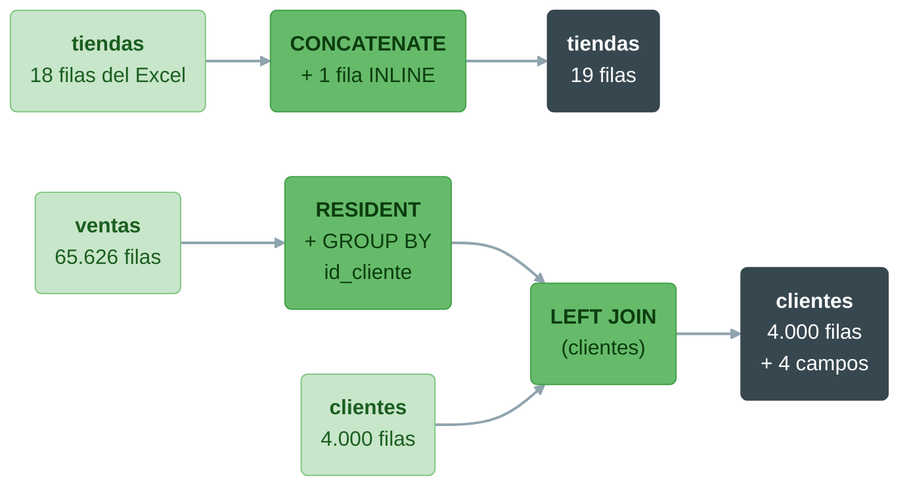

# Qlik Sense: combinar tablas con CONCATENATE, RESIDENT, GROUP BY y JOIN

**Bloque 9 -- Qlik | Sesión 6 de 11**

[← Volver al índice del curso](../../README.md#bloque-9---qlik)

---

## 1. Introducción

En los fundamentos construimos el modelo de Mercadia **asociando** tablas: cada tabla se carga por separado y Qlik las une por los campos que se llaman igual. Es la forma normal de trabajar en Qlik, pero no la única. A veces queremos **cambiar las tablas mismas**: añadir filas a una tabla que ya existe, leer otra vez una tabla que ya está en memoria, resumirla o llevarle columnas de otra tabla.

Hoy aprendemos las cuatro herramientas del script que hacen eso, y las usamos para resolver tres asuntos que dejamos pendientes en la 9.1.4:

- La tienda de **Almería** (`M19`) tiene ventas, pero no está en el maestro de tiendas. La daremos de alta con `CONCATENATE`.
- El maestro de clientes traía **31 clientes duplicados**. Los eliminamos con `LOAD DISTINCT`, pero no lo comprobamos en el script. Lo haremos con `GROUP BY`.
- Para cada cliente queremos saber **cuántas veces ha comprado**, cuánto ha gastado y cuándo fue su primera y su última compra. Lo calcularemos con `RESIDENT` y `GROUP BY` y lo llevaremos al maestro con `JOIN`.

Y provocaremos a propósito el error más peligroso de esta sesión: un `JOIN` que **duplica filas** y cambia las ventas sin que salte ningún aviso.

Al terminar tendremos `Mercadia_9.2.1.qvf` con el maestro de tiendas completo, el maestro de clientes enriquecido con su historial de compras y una sección de comprobaciones en el script.

### Objetivos de la sesión
- Distinguir **asociar** tablas (lógico) de **combinarlas** en el script (físico).
- Añadir filas a una tabla con `CONCATENATE` y entender la **concatenación automática**.
- Escribir datos en el script con `LOAD ... INLINE`, eligiendo el separador.
- Leer una tabla que ya está en memoria con `RESIDENT`, y evitar la concatenación automática con `NoConcatenate`.
- Resumir tablas con `GROUP BY` y las funciones de agregación del script.
- Añadir columnas a una tabla con `JOIN` y conocer sus variantes (`LEFT`, `RIGHT`, `INNER`, `OUTER`).
- Detectar un `JOIN` que duplica filas y saber cuándo usar `ApplyMap` en su lugar.

### Prerequisitos
- `Mercadia_9.1.5.qvf` con el modelo completo, la hoja **Comprobaciones** cuadrada y los elementos maestros.
- Bloque 1: `UNION ALL`, `GROUP BY` y los tipos de `JOIN` en SQL.

Como siempre, empezamos con una copia: en `Documentos\Qlik\Sense\Apps`, con Desktop cerrado, copiamos `Mercadia_9.1.5.qvf` como `Mercadia_9.2.1.qvf`. Abrimos la copia, le cambiamos el título a `Mercadia_9.2.1` (**Editar detalles**, como en la 9.1.3) y vamos al **Editor de carga de datos**.

---

## 2. Asociar frente a combinar

Hasta hoy, cada `LOAD` creaba una tabla y Qlik decidía cómo unirla con las demás. Las herramientas de hoy hacen algo distinto: **modifican** las tablas durante la carga. Cuando el script termina, la tabla combinada es una sola, y el modelo ni siquiera sabe que vino de dos sitios.

| Qué queremos hacer | Qlik (script) | SQL (bloque 1) | Power Query (bloque 7) | Tableau (bloque 8) |
|---|---|---|---|---|
| Añadir **filas** de otra tabla | `CONCATENATE` | `UNION ALL` | Anexar consultas | *Union* |
| Leer una tabla ya cargada | `RESIDENT` | Una subconsulta o CTE | Referenciar una consulta | Sin equivalente |
| Resumir filas | `GROUP BY` | `GROUP BY` | Agrupar por | Agregación del *extract* |
| Añadir **columnas** de otra tabla | `JOIN` | `JOIN` | Combinar consultas | *Join* |

La pregunta que nos haremos cada vez es la misma que en Power BI: **¿esto debe ser una tabla nueva asociada, o debe ir dentro de una tabla que ya existe?** Como regla general, en Qlik se asocia todo lo que se pueda y se combina solo cuando hay un motivo claro: completar un maestro, evitar una tabla con pocos campos que no aporta nada o preparar un cálculo.

---

## 3. Paso 1: CONCATENATE, el alta de la tienda de Almería

### Concatenación automática

Antes de escribir nada, una regla de Qlik que sorprende al principio:

> **Si cargamos una tabla con exactamente los mismos campos (mismos nombres y mismo número) que otra ya cargada, Qlik no crea una tabla nueva: añade las filas a la existente.** Es la **concatenación automática**.

Es muy cómodo cuando leemos varios archivos con la misma estructura, uno por mes por ejemplo: cada `LOAD` va sumando filas a la misma tabla. Pero también es una trampa, como veremos en el paso 2.

### CONCATENATE explícito

La tienda que falta tiene los mismos campos que el maestro, pero no viene de un archivo: nos la ha dictado el responsable de tiendas. Para escribir datos directamente en el script usamos `LOAD ... INLINE`, que ya conocemos de la tabla de mapeo de canales (9.1.3). En la sección **Maestros**, justo **debajo** del `LOAD` de `tiendas`, escribimos:

```
// Alta provisional de M19 (Almería), que aún no está en tiendas.xlsx.
// Quitar cuando el maestro se corrija en origen.
CONCATENATE (tiendas)
LOAD
    id_tienda, tienda, formato, ciudad, provincia, comunidad,
    superficie_m2,
    Date(Date#(fecha_apertura, 'DD/MM/YYYY')) AS fecha_apertura,
    latitud, longitud, zona
INLINE [
id_tienda; tienda; formato; ciudad; provincia; comunidad; superficie_m2; fecha_apertura; latitud; longitud; zona
M19; Almeria; Urbana; Almeria; Almeria; Andalucia; 550; 02/03/2026; 36,8381; -2,4597; Costa
] (delimiter is ';');
```

Tres detalles:

1. **`CONCATENATE (tiendas)`** dice a qué tabla se añaden las filas. Si no indicamos la tabla, se añaden a la última que se ha cargado. Es mejor escribirla siempre: el script se entiende mejor y no se rompe si alguien inserta otro `LOAD` en medio.
2. **El separador.** Un `INLINE` usa la coma como separador por defecto. Pero la latitud y la longitud tienen decimales, y en nuestra configuración regional el separador decimal también es la coma (`DecimalSep=','` en la sección Main). Por eso cambiamos el separador del `INLINE` a punto y coma con `(delimiter is ';')` y escribimos los decimales en formato español: `36,8381`.
3. **Mismos nombres de campo.** Para que las filas encajen, cada campo del `INLINE` debe llamarse exactamente como en `tiendas`. Si escribiéramos `Tienda` en lugar de `tienda`, `CONCATENATE` no fallaría: crearía un campo nuevo, `Tienda`, vacío en las 18 tiendas del Excel y con valor solo en la nueva.

> **`CONCATENATE` frente a la concatenación automática.** La automática solo ocurre si los campos coinciden **todos**. `CONCATENATE` explícito funciona aunque los campos no coincidan: los que falten en un lado quedan nulos. Por eso es la forma segura de añadir filas.

### Comprobar el alta

Cargamos. En la hoja **Comprobaciones**, la tabla de `tienda` con `Sum(importe_neto)` que creamos en la 9.1.4:

- La fila del guion (`-`) ha desaparecido.
- Aparece **Almeria** con **8.687,41 €**, las mismas ventas que antes estaban en el guion.
- Un panel de filtrado con `formato`, seleccionando **Urbana**, muestra ahora **7** tiendas.

<!-- Captura pendiente: 0.Capturas/9.2.1/3.1_Tiendas_con_Almeria.png -->

Si la hoja **Resumen comercial** de la 9.1.5 tiene el mapa de tiendas, ahora aparece un punto más en Almería.

> **Un parche, no una solución.** El dato bueno debe estar en el maestro de origen. Mientras tanto, el `INLINE` lleva un comentario que explica por qué está ahí y cuándo quitarlo. Sin ese comentario, dentro de un año alguien añadirá `M19` al Excel y la tienda aparecerá **dos veces**.

---

## 4. Paso 2: RESIDENT y NoConcatenate

Hasta ahora, cada `LOAD` leía de un archivo (`FROM`) o de datos escritos en el script (`INLINE`). Con **`RESIDENT`** leemos de una tabla que **ya está en memoria**, cargada antes en el mismo script:

```
LOAD campos
RESIDENT nombre_de_la_tabla;
```

Es la base de casi todo lo que haremos hoy: resumir una tabla, cruzarla con otra o preparar un cálculo en varios pasos sin volver a leer el archivo.

### La trampa de la copia

Vamos a hacer una prueba. Creamos una sección nueva, **Pruebas**, al final del script, y escribimos una "copia" de ventas con solo dos campos:

```
copia_1:
LOAD id_linea AS c_linea, id_tienda AS c_tienda
RESIDENT ventas;

copia_2:
LOAD id_linea AS c_linea, id_tienda AS c_tienda
RESIDENT ventas;
```

Antes de cargar, una pregunta: ¿cuántas tablas nuevas habrá y cuántas filas tendrá cada una? Cargamos y miramos el visor del modelo:

- No existe `copia_2`. Solo hay `copia_1`, con **131.252** filas, el doble de las 65.626 de ventas.
- El registro de la carga muestra que la segunda sentencia ha añadido sus filas a la primera.

Es la concatenación automática del paso 1: `copia_2` tiene exactamente los mismos campos que `copia_1`, así que Qlik las ha juntado. El nombre `copia_2:` se ignora.

La solución es el prefijo **`NoConcatenate`**, que obliga a Qlik a crear una tabla nueva aunque los campos coincidan:

```
copia_2:
NoConcatenate
LOAD id_linea AS c_linea, id_tienda AS c_tienda
RESIDENT ventas;
```

Cargamos de nuevo: ahora hay dos tablas de 65.626 filas. Y, como comparten los dos campos, Qlik las une con una **clave sintética** (9.1.4). Las dos copias no tenían ningún sentido en el modelo: eran solo una prueba.

> **Cuándo hace falta `NoConcatenate`.** Siempre que hagamos un `LOAD ... RESIDENT` que copia una tabla con **los mismos campos**, por ejemplo para ordenarla o filtrarla, y después borrar la original. Sin `NoConcatenate`, la copia se pega a la original y al borrar la original borramos también la copia. Es uno de los errores más frecuentes de Qlik.

### DROP TABLE

Para quitar las tablas de prueba, al final de la sección **Pruebas**:

```
DROP TABLE copia_1, copia_2;
```

`DROP TABLE` elimina tablas completas, igual que `DROP FIELDS` (9.1.3) elimina campos. Se usa constantemente con `RESIDENT`: cargamos una tabla auxiliar, la usamos y la borramos. Cargamos y comprobamos que el modelo vuelve a ser la estrella de la 9.1.4. Después, **borramos** el contenido de la sección **Pruebas**: la volveremos a usar en el paso 5.

---

## 5. Paso 3: GROUP BY, ¿hay clientes repetidos?

En la 9.1.4 eliminamos 31 clientes duplicados con `LOAD DISTINCT`. Pero lo vimos con un KPI en una hoja. Si mañana el maestro trae un cliente con dos filas **distintas** (dos provincias, por ejemplo), `DISTINCT` no lo eliminará y nadie se enterará. Vamos a comprobarlo en el script.

### Contar filas por cliente

Creamos una sección nueva, **Comprobaciones**, al final del script:

```
// ¿Cuántas filas tiene cada cliente en el archivo original?
_chk_csv:
LOAD
    id_cliente,
    Count(id_cliente) AS filas
FROM [$(vRuta)clientes.csv]
(txt, utf8, embedded labels, delimiter is ',', msq)
GROUP BY id_cliente;
```

`GROUP BY` funciona como en SQL: agrupa las filas que tienen el mismo `id_cliente` y calcula `Count` en cada grupo. El resultado es una tabla con **una fila por cliente**: 4.000 filas.

> **La regla del `GROUP BY`.** Todos los campos del `LOAD` que **no** estén dentro de una función de agregación (`Sum`, `Count`, `Min`, `Max`, `Avg`...) deben estar en el `GROUP BY`. Si añadiéramos `genero` al `LOAD` sin añadirlo al `GROUP BY`, la carga fallaría. Es la misma regla que en SQL.

El nombre empieza por guion bajo (`_chk_csv`) para indicar que es una tabla **auxiliar**, que no debe quedarse en el modelo. Es una convención muy extendida en Qlik.

### Quedarnos solo con los repetidos

No nos interesan los 4.000 clientes, solo los que tienen más de una fila. No podemos escribir `WHERE filas > 1` en el mismo `LOAD`, porque el `WHERE` se aplica **antes** de agrupar, cuando `filas` todavía no existe. La solución es una **carga precedente** (9.1.3) encima:

```
// ¿Cuántas filas tiene cada cliente en el archivo original?
_chk_csv:
LOAD * WHERE filas > 1;
LOAD
    id_cliente,
    Count(id_cliente) AS filas
FROM [$(vRuta)clientes.csv]
(txt, utf8, embedded labels, delimiter is ',', msq)
GROUP BY id_cliente;
```

Se lee de abajo arriba: el `LOAD` de abajo agrupa y el de arriba filtra los grupos. En SQL sería un `HAVING COUNT(*) > 1`. Cargamos: `_chk_csv` tiene **31** filas, una por cliente duplicado, cada una con `filas = 2`. En el visor del modelo, al seleccionar la tabla, la vista previa los muestra.

### La misma comprobación sobre el modelo

Lo importante no es el archivo, sino lo que ha quedado en el modelo. Añadimos debajo la misma comprobación, ahora con `RESIDENT clientes`:

```
// ¿Ha quedado algún cliente repetido en el modelo?
_chk_clientes:
LOAD * WHERE filas > 1;
LOAD
    id_cliente AS id_cliente_repetido,
    Count(id_cliente) AS filas
RESIDENT clientes
GROUP BY id_cliente;
```

Renombramos `id_cliente` como `id_cliente_repetido` para que la tabla de comprobación no se asocie con el modelo. Cargamos: el registro indica que `_chk_clientes` ha obtenido **0 líneas**. El `LOAD DISTINCT` funcionó.

Para terminar la sección, borramos las dos tablas auxiliares:

```
DROP TABLE _chk_csv, _chk_clientes;
```

Ahora mismo, para saber si hay duplicados tenemos que mirar el registro. En la 9.2.2 convertiremos esta comprobación en una **subrutina** que escribe un aviso claro, y la usaremos con todos los maestros.

---

## 6. Paso 4: JOIN, el historial de compras de cada cliente

### El resumen por cliente

Queremos añadir al maestro de clientes cuatro datos de su historial: cuántos tickets tiene, cuánto ha gastado, y cuándo fue su primera y su última compra. Todo eso está en `ventas`, así que lo calculamos con `RESIDENT` y `GROUP BY`:

```
LOAD
    id_cliente,
    Count(DISTINCT id_ticket) AS tickets_cliente,
    Sum(importe_neto)         AS ventas_cliente,
    Date(Min(fecha))          AS primera_compra,
    Date(Max(fecha))          AS ultima_compra
RESIDENT ventas
GROUP BY id_cliente;
```

`Min` y `Max` devuelven el número de la fecha, sin formato. Por eso los envolvemos en `Date()`, igual que la fecha de apertura del Excel en la 9.1.4.

Si cargáramos este resumen como una tabla más, se asociaría con `clientes` y con `ventas` por `id_cliente`, y tendríamos una tabla pequeña colgando del modelo con cuatro campos que en realidad **son atributos del cliente**. Su sitio es el maestro de clientes.

### LEFT JOIN

En la sección **Maestros**, al final, **debajo** del `LOAD` de `clientes`, escribimos el resumen con un prefijo delante:

```
// Historial de compras de cada cliente, calculado desde ventas.
// Los clientes que nunca han comprado quedan con estos campos a nulo.
LEFT JOIN (clientes)
LOAD
    id_cliente,
    Count(DISTINCT id_ticket) AS tickets_cliente,
    Sum(importe_neto)         AS ventas_cliente,
    Date(Min(fecha))          AS primera_compra,
    Date(Max(fecha))          AS ultima_compra
RESIDENT ventas
GROUP BY id_cliente;
```

`LEFT JOIN (clientes)` combina el resultado de este `LOAD` con la tabla `clientes`, **por los campos que se llaman igual** en las dos (aquí solo `id_cliente`), y conserva todas las filas de `clientes`. Después del `JOIN`, la tabla resumen no existe: sus columnas se han añadido a `clientes`.

Cargamos y comprobamos en la hoja **Comprobaciones**:

| Comprobación | Cómo | Valor esperado |
|---|---|---|
| Clientes | KPI `Count(fecha_alta)` | 4.000, no cambia |
| Clientes con compras | KPI `Count(tickets_cliente)` | 3.531 |
| Ventas de clientes con tarjeta | KPI `Sum(ventas_cliente)` | 211.065,67 € |
| Lo mismo, desde ventas | KPI `Sum(If(es_fidelizado = 'Si', importe_neto))` | 211.065,67 € |

Los dos últimos KPIs deben coincidir: es la prueba de que el resumen está bien hecho. Y la diferencia entre los dos primeros, **469 clientes**, son los que se dieron de alta en la tarjeta y nunca han comprado, los mismos que encontramos con la selección asociativa en la 9.1.5. Para ellos, `tickets_cliente` y el resto de campos del historial son **nulos**: el `LEFT JOIN` conserva su fila, pero no tiene nada que añadirle.

> **¿Y las compras sin tarjeta?** En `ventas`, las 22.663 líneas sin tarjeta tienen `id_cliente` nulo. El `GROUP BY` también crea un grupo para ellas, pero el `LEFT JOIN` lo descarta, porque en `clientes` no hay ninguna fila con `id_cliente` nulo con la que combinarlo.

### Los cuatro tipos de JOIN

| Prefijo | Qué filas conserva | En SQL |
|---|---|---|
| `JOIN` u `OUTER JOIN` | Todas, de las dos tablas | `FULL OUTER JOIN` |
| `LEFT JOIN` | Todas las de la tabla indicada entre paréntesis | `LEFT JOIN` |
| `RIGHT JOIN` | Todas las de la tabla que estamos cargando | `RIGHT JOIN` |
| `INNER JOIN` | Solo las que existen en las dos | `INNER JOIN` |

Ojo con la primera fila: en SQL, `JOIN` sin más significa `INNER JOIN`. **En Qlik, `JOIN` sin más es un `OUTER JOIN`**: conserva todas las filas de las dos tablas.

Y dos diferencias importantes con SQL:

1. **No hay cláusula `ON`.** Qlik combina por **todos** los campos que se llaman igual en las dos tablas. Si por descuido las dos tablas comparten dos campos, el `JOIN` usará los dos. Si no comparten ninguno, combinará **cada fila con todas las de la otra tabla** (un producto cartesiano). Antes de un `JOIN`, conviene revisar los nombres de los campos como revisábamos las asociaciones en la 9.1.4.
2. **El resultado sustituye a la tabla.** En SQL, un `JOIN` crea un resultado nuevo y las tablas siguen como estaban. En Qlik, `LEFT JOIN (clientes)` **modifica** `clientes`.

---

## 7. Paso 5: el JOIN que duplica filas

Ahora vamos a provocar el error. Imaginemos que alguien quiere el tramo de edad del cliente **dentro** de la tabla de ventas, y hace un `JOIN` contra el archivo de clientes **original**, el que tiene 31 clientes repetidos.

Para no estropear el modelo, lo probamos sobre una copia de ventas con los campos renombrados. En la sección **Pruebas**:

```
// Copia de ventas con nombres propios, para que no se asocie con nada
_ventas_prueba:
NoConcatenate
LOAD
    id_linea     AS p_linea,
    id_cliente   AS p_cliente,
    importe_neto AS p_importe
RESIDENT ventas;

// JOIN contra el archivo original de clientes (con duplicados)
LEFT JOIN (_ventas_prueba)
LOAD
    id_cliente AS p_cliente,
    tramo_edad AS p_tramo
FROM [$(vRuta)clientes.csv]
(txt, utf8, embedded labels, delimiter is ',', msq);
```

Cargamos y añadimos a la hoja tres KPIs:

| KPI | Valor | Debería ser |
|---|---|---|
| `Count(p_linea)` | **66.055** | 65.626 |
| `Count(DISTINCT p_linea)` | 65.626 | 65.626 |
| `Sum(p_importe)` | **325.897,96 €** | 323.808,28 € |

<!-- Captura pendiente: 0.Capturas/9.2.1/7.1_Join_duplica.png -->

La tabla tiene **429 filas más** que líneas de venta distintas, y las ventas han crecido en **2.089,68 €** que no existen. ¿Por qué? Cada línea de venta de uno de los 31 clientes repetidos ha encontrado **dos** filas en el archivo de clientes, y el `JOIN` ha hecho lo que hace siempre: combinar la línea con **todas** las filas que coinciden. Esas 429 líneas se han duplicado.

Lo peligroso es que **no ha saltado ningún aviso**. La carga termina bien, el modelo parece normal, y solo la comprobación de totales que hacemos desde la 9.1.2 lo delata.

> **La regla del JOIN.** Antes de hacer un `JOIN`, comprueba que la tabla que añades tiene **una sola fila por cada valor de la clave**. Es exactamente la comprobación del paso 3 con `GROUP BY`. Por eso nuestro `LEFT JOIN` del historial es seguro: el resumen viene de un `GROUP BY id_cliente`, que por construcción tiene una fila por cliente.

### ApplyMap frente a JOIN

Si de otra tabla solo necesitamos **un campo**, como el tramo de edad, hay una alternativa más segura que ya conocemos de la 9.1.3: `ApplyMap`. Ante una clave repetida en la tabla de mapeo, `ApplyMap` usa **la primera** fila que encuentra y nunca multiplica filas.

| | `JOIN` | `ApplyMap` |
|---|---|---|
| Campos que trae | Todos los que tenga la tabla | Uno |
| Si la clave está repetida | **Duplica** las filas | Usa la primera coincidencia |
| Si la clave no existe | Nulo (con `LEFT JOIN`) | El valor por defecto que le indiquemos |
| Uso típico | Añadir varios atributos o un resumen | Traer un dato a la tabla de hechos |

Terminada la prueba, **borramos** la sección **Pruebas** completa y cargamos. Las ventas vuelven a ser 65.626 líneas y 323.808,28 €.

---

## 8. El script completo de la sesión

**Main**, **Configuracion**, **Mapas** y **Ventas**: sin cambios desde la 9.1.4.

**Maestros**: dos añadidos respecto a la 9.1.4, el alta de `M19` debajo de `tiendas` y el historial de compras al final.

```
// Maestro de tiendas, mantenido en Excel.
tiendas:
LOAD
    id_tienda,
    tienda,
    formato,
    ciudad,
    provincia,
    comunidad,
    superficie_m2,
    Date(fecha_apertura) AS fecha_apertura,
    latitud,
    longitud,
    zona
FROM [$(vRuta)tiendas.xlsx]
(ooxml, embedded labels, table is Tiendas);

// Alta provisional de M19 (Almería), que aún no está en tiendas.xlsx.
// Quitar cuando el maestro se corrija en origen.
CONCATENATE (tiendas)
LOAD
    id_tienda, tienda, formato, ciudad, provincia, comunidad,
    superficie_m2,
    Date(Date#(fecha_apertura, 'DD/MM/YYYY')) AS fecha_apertura,
    latitud, longitud, zona
INLINE [
id_tienda; tienda; formato; ciudad; provincia; comunidad; superficie_m2; fecha_apertura; latitud; longitud; zona
M19; Almeria; Urbana; Almeria; Almeria; Andalucia; 550; 02/03/2026; 36,8381; -2,4597; Costa
] (delimiter is ';');

// Clientes del programa de fidelización.
// provincia_cliente: la provincia del cliente no es la de la tienda.
clientes:
LOAD DISTINCT
    id_cliente,
    Date(Date#(fecha_alta, 'DD/MM/YYYY'))                     AS fecha_alta,
    genero,
    If(Len(Trim(tramo_edad)) = 0, 'Sin dato', tramo_edad)     AS tramo_edad,
    provincia                                                 AS provincia_cliente,
    canal_alta,
    acepta_comunicaciones
FROM [$(vRuta)clientes.csv]
(txt, utf8, embedded labels, delimiter is ',', msq);

// Historial de compras de cada cliente, calculado desde ventas.
// Los clientes que nunca han comprado quedan con estos campos a nulo.
LEFT JOIN (clientes)
LOAD
    id_cliente,
    Count(DISTINCT id_ticket) AS tickets_cliente,
    Sum(importe_neto)         AS ventas_cliente,
    Date(Min(fecha))          AS primera_compra,
    Date(Max(fecha))          AS ultima_compra
RESIDENT ventas
GROUP BY id_cliente;
```

(El `LOAD` de `productos`, al principio de la sección, no cambia.)

**Comprobaciones** (sección nueva, al final):

```
// ¿Cuántas filas tiene cada cliente en el archivo original?
_chk_csv:
LOAD * WHERE filas > 1;
LOAD
    id_cliente,
    Count(id_cliente) AS filas
FROM [$(vRuta)clientes.csv]
(txt, utf8, embedded labels, delimiter is ',', msq)
GROUP BY id_cliente;

// ¿Ha quedado algún cliente repetido en el modelo?
_chk_clientes:
LOAD * WHERE filas > 1;
LOAD
    id_cliente AS id_cliente_repetido,
    Count(id_cliente) AS filas
RESIDENT clientes
GROUP BY id_cliente;

// Resultado esperado en el registro: 31 líneas en _chk_csv y 0 en _chk_clientes
DROP TABLE _chk_csv, _chk_clientes;
```

La hoja **Comprobaciones** queda así:

| Comprobación | Cómo | Valor esperado hoy |
|---|---|---|
| Líneas | KPI `Count(id_linea)` | 65.626 |
| Ventas netas | KPI `Sum(importe_neto)` | 323.808,28 € |
| Tiendas | Tabla `tienda` × `Sum(importe_neto)` | 19 tiendas, ninguna fila con `-` |
| Clientes | KPI `Count(fecha_alta)` | 4.000 |
| Clientes con compras | KPI `Count(tickets_cliente)` | 3.531 |
| Ventas con tarjeta | KPI `Sum(ventas_cliente)` | 211.065,67 € |

Guardamos la app (`Ctrl + S`).

---

## 9. Lo que Qlik ha hecho por debajo



Las tres operaciones de hoy ocurren **durante la carga**, en el orden del script. Cuando el script termina, Qlik no sabe que `tiendas` tuvo dos orígenes ni que cuatro campos de `clientes` vienen de `ventas`: solo ve dos tablas, que asocia con las demás por sus campos clave como siempre. El modelo sigue siendo la misma estrella de la 9.1.4.

Por eso el orden de las secciones importa más que nunca. El `LEFT JOIN` del historial lee `ventas` con `RESIDENT`, así que tiene que ir **después** de la sección **Ventas**. Si lo pusiéramos antes, la carga fallaría con un error de tabla no encontrada.

---

## 10. Ejercicios

**Ejercicio 1: predecir la concatenación.** Sin cargar nada, ¿cuántas tablas y cuántas filas crea cada uno de estos fragmentos?

```
// Fragmento A
a: LOAD id_tienda, tienda RESIDENT tiendas;
b: LOAD id_tienda, tienda RESIDENT tiendas;

// Fragmento B
a: LOAD id_tienda, tienda RESIDENT tiendas;
b: LOAD id_tienda, tienda, zona RESIDENT tiendas;

// Fragmento C
a: LOAD id_tienda, tienda RESIDENT tiendas;
b: NoConcatenate LOAD id_tienda, tienda RESIDENT tiendas;
```

<details>
<summary>Ver la solución</summary>

- **A:** una sola tabla, `a`, con **38** filas (19 + 19). Los campos coinciden, así que hay concatenación automática.
- **B:** dos tablas, `a` y `b`, de **19** filas cada una. Los campos no coinciden (`b` tiene `zona`), así que no se concatenan. Y como comparten `id_tienda` y `tienda` entre sí y con `tiendas`, aparecen claves sintéticas.
- **C:** dos tablas de **19** filas. `NoConcatenate` impide la concatenación automática. También aparece una clave sintética.

</details>

**Ejercicio 2: ventas por tienda y año.** Escribe en la sección **Pruebas** un `LOAD` que calcule las ventas de cada tienda en cada año a partir de `ventas`, con los campos `id_tienda`, `anio` y la suma del importe con el nombre `ventas_anio`. ¿Cuántas filas tendrá la tabla? ¿Por qué no son 19 × 3 = 57?

<details>
<summary>Ver la solución</summary>

```
_ventas_tienda_anio:
LOAD
    id_tienda,
    anio,
    Sum(importe_neto) AS ventas_anio
RESIDENT ventas
GROUP BY id_tienda, anio;
```

Tiene **55** filas: 18 tiendas × 3 años, más **una** fila de `M19`, que abrió en marzo de 2026 y no tiene ventas en 2024 ni en 2025. `GROUP BY` solo crea grupos para las combinaciones que existen en los datos. Recuerda las dos reglas: `id_tienda` y `anio` están en el `GROUP BY` porque no se agregan, y la tabla comparte `id_tienda` y `anio` con `ventas`, así que crearía una clave sintética si la dejáramos en el modelo. Bórrala con `DROP TABLE`.

</details>

**Ejercicio 3: cambiar el tipo de JOIN.** En el historial de compras, ¿qué pasaría si cambiáramos `LEFT JOIN (clientes)` por cada uno de estos prefijos? Di cuántas filas tendría `clientes`.

1. `INNER JOIN (clientes)`
2. `JOIN (clientes)`

<details>
<summary>Ver la solución</summary>

1. `clientes` tendría **3.531** filas: solo los clientes que existen en las dos tablas, es decir, los que han comprado. Perderíamos los 469 clientes sin compras, y con ellos su género, su tramo de edad y su provincia. Un `KPI` con `Count(fecha_alta)` bajaría de 4.000 a 3.531.
2. `clientes` tendría **4.001** filas: los 4.000 clientes y una fila más, la del grupo de `id_cliente` nulo (las compras sin tarjeta), que el `OUTER JOIN` conserva aunque no tenga cliente. Una fila con todos los datos del cliente vacíos y los tickets y las ventas de las compras sin tarjeta: un "cliente fantasma".

El `LEFT JOIN` es el adecuado porque queremos **todos los clientes del maestro y nada más**.

</details>

**Ejercicio 4: ¿JOIN o ApplyMap?** Para cada caso, ¿qué usarías y por qué?

1. Llevar a `ventas` el `formato` de la tienda, porque se usa en muchos cálculos.
2. Añadir a `tiendas` las ventas totales y el número de tickets de cada tienda.
3. Llevar a `ventas` todos los campos de `productos`, para tener una sola tabla.

<details>
<summary>Ver la solución</summary>

1. **`ApplyMap`**: es un solo campo, va a la tabla de hechos y no hay riesgo de duplicar líneas aunque el maestro tuviera una tienda repetida.
2. **`LEFT JOIN (tiendas)`** con un `RESIDENT ventas` y `GROUP BY id_tienda`, como el historial de clientes. Son varios campos y el `GROUP BY` garantiza una fila por tienda.
3. **Ninguno.** Es la tabla de dimensión de un modelo en estrella: se deja **asociada**. Meterla en `ventas` repetiría cada atributo del producto en miles de filas y no aportaría nada. Combinar tablas es para cuando hay un motivo claro.

</details>

---

## 11. Errores comunes y troubleshooting

**1. "Mi tabla nueva no aparece en el visor del modelo."** Tiene los mismos campos que otra tabla cargada antes y se ha concatenado con ella automáticamente. Añadimos `NoConcatenate` delante del `LOAD`.

**2. "Después de un `DROP TABLE` ha desaparecido una tabla que no he borrado."** La misma causa: la tabla que creíamos nueva se había concatenado con la que hemos borrado. Pasa sobre todo al copiar una tabla con `RESIDENT` para ordenarla o filtrarla.

**3. "*Table 'Ventas' not found*" en un `RESIDENT` o en un `JOIN`.** La tabla todavía no existe en ese punto del script (la sección está antes de donde se carga), ya se ha borrado con `DROP TABLE`, o el nombre no coincide exactamente. Los nombres de tabla distinguen mayúsculas: `RESIDENT Ventas` no encuentra la tabla `ventas`.

**4. "*Invalid expression*" en un `LOAD` con `GROUP BY`.** Hay un campo en el `LOAD` que no está agregado ni en el `GROUP BY`. Lo añadimos al `GROUP BY` o lo quitamos.

**5. "Después del `JOIN` han aumentado las ventas."** La tabla que hemos combinado tiene la clave repetida y el `JOIN` ha duplicado filas (sección 7). Comprobamos la clave con un `GROUP BY` y, si solo necesitamos un campo, usamos `ApplyMap`.

**6. "Después del `JOIN` aparecen campos vacíos en todas las filas."** Las dos tablas no tienen ningún campo con el mismo nombre, o la clave no coincide (`M5` frente a `M05`, mayúsculas, espacios). Si no comparten ningún campo, además, el `JOIN` ha hecho un producto cartesiano: el recuento de filas se habrá disparado.

**7. "La latitud de la tienda nueva no aparece en el mapa."** El `INLINE` tiene la coma como separador y los decimales se han partido en dos columnas, o se han escrito con punto (`36.8381`) y Qlik los ha leído como texto. Separador `;` y decimales con coma.

---

## 12. Conclusión

En esta sesión hemos pasado de asociar tablas a **combinarlas** en el script. Con `CONCATENATE` y un `INLINE` hemos dado de alta la tienda de Almería, y hemos descubierto la concatenación automática, que es cómoda y peligrosa a partes iguales. Con `RESIDENT` hemos leído tablas que ya estaban en memoria, y con `NoConcatenate` y `DROP TABLE` hemos aprendido a crear y borrar tablas auxiliares sin efectos secundarios. Con `GROUP BY` y una carga precedente hemos comprobado en el script que no quedan clientes repetidos. Y con `LEFT JOIN` hemos añadido a cada cliente su historial de compras. Por el camino hemos provocado un `JOIN` que duplica 429 filas y añade 2.089,68 € de ventas inexistentes sin ningún aviso, y hemos aprendido la regla que lo evita: comprobar la clave antes de combinar. El resultado es `Mercadia_9.2.1.qvf`. En la 9.2.2 aprenderemos las variables y las estructuras de control del script, y las usaremos para construir un calendario maestro y para convertir las comprobaciones de hoy en una subrutina reutilizable.

---

## 13. Para profundizar

### KEEP

`KEEP` es un pariente de `JOIN`: en lugar de juntar dos tablas en una, **filtra** las dos y las deja separadas. Por ejemplo, `LEFT KEEP (ventas) LOAD ... FROM clientes.csv` cargaría solo los clientes que tienen alguna venta, pero en una tabla aparte, asociada como siempre. Es útil para reducir maestros muy grandes a los valores que realmente se usan.

### Where Exists

Otra forma de filtrar un maestro a los valores que existen en la tabla de hechos es `WHERE Exists(campo)`, que comprueba si un valor ya se ha cargado en ese campo en algún momento del script. Por ejemplo, `WHERE Exists(id_cliente)` en el `LOAD` de clientes cargaría solo los clientes que aparecen en ventas. Es muy eficiente y lo retomaremos en la 9.4.1, al hablar de rendimiento y de QVDs.

### Concatenar tablas de hechos

`CONCATENATE` no sirve solo para completar maestros. También se usa para juntar en una sola tabla dos tablas de hechos distintas, por ejemplo las ventas y los objetivos de venta, cuando comparten dimensiones. Es una de las dos soluciones clásicas al problema de las dos tablas de hechos, y la compararemos con la otra, la tabla de enlace, en la 9.2.3.

---

## 14. Recursos

- **Ayuda oficial de Qlik Sense para Windows** (en español, versión May 2026): <https://help.qlik.com/es-ES/sense/May2026/Content/Sense_Helpsites/Home.htm>
- **Qlik Design Blog**, con artículos sobre `JOIN`, `KEEP` y concatenación: <https://community.qlik.com/t5/Design/bg-p/qlik-design-blog>
- **Qlik Community**: <https://community.qlik.com/>

### Documentación oficial de esta sesión

| Tema | Página de la ayuda |
|---|---|
| Concatenar | [Concatenar tablas][doc-concatenar-tablas] · [Concatenate][doc-concatenate] · [NoConcatenate][doc-noconcatenate] |
| Leer y resumir | [Load][doc-load] (apartados *resident*, *inline* y *group by*) · [Funciones de agregación][doc-agregacion] · [Drop table][doc-drop-table] |
| Combinar | [Combinar tablas con Join y Keep][doc-join-keep] · [Join][doc-join] · [Left][doc-left] · [Right][doc-right] · [Inner][doc-inner] · [Outer][doc-outer] · [Keep][doc-keep] |
| Alternativa a JOIN | [Usar mapping como alternativa a join][doc-mapping-join] |

---

*Guía del alumno · Sesión 6 · Bloque 9 - Qlik · Mercadia*

[doc-concatenar-tablas]: https://help.qlik.com/es-ES/sense/May2026/Subsystems/Hub/Content/Sense_Hub/LoadData/concatenate-tables.htm
[doc-concatenate]: https://help.qlik.com/es-ES/sense/May2026/Subsystems/Hub/Content/Sense_Hub/Scripting/ScriptPrefixes/concatenate.htm
[doc-noconcatenate]: https://help.qlik.com/es-ES/sense/May2026/Subsystems/Hub/Content/Sense_Hub/Scripting/ScriptPrefixes/NoConcatenate.htm
[doc-load]: https://help.qlik.com/es-ES/sense/May2026/Subsystems/Hub/Content/Sense_Hub/Scripting/ScriptRegularStatements/Load.htm
[doc-agregacion]: https://help.qlik.com/es-ES/sense/May2026/Subsystems/Hub/Content/Sense_Hub/Scripting/AggregationFunctions/aggregation-functions.htm
[doc-drop-table]: https://help.qlik.com/es-ES/sense/May2026/Subsystems/Hub/Content/Sense_Hub/Scripting/ScriptRegularStatements/drop-table.htm
[doc-join-keep]: https://help.qlik.com/es-ES/sense/May2026/Subsystems/Hub/Content/Sense_Hub/LoadData/combine-tables-join-keep.htm
[doc-join]: https://help.qlik.com/es-ES/sense/May2026/Subsystems/Hub/Content/Sense_Hub/Scripting/ScriptPrefixes/Join.htm
[doc-left]: https://help.qlik.com/es-ES/sense/May2026/Subsystems/Hub/Content/Sense_Hub/Scripting/ScriptPrefixes/Left.htm
[doc-right]: https://help.qlik.com/es-ES/sense/May2026/Subsystems/Hub/Content/Sense_Hub/Scripting/ScriptPrefixes/Right.htm
[doc-inner]: https://help.qlik.com/es-ES/sense/May2026/Subsystems/Hub/Content/Sense_Hub/Scripting/ScriptPrefixes/Inner.htm
[doc-outer]: https://help.qlik.com/es-ES/sense/May2026/Subsystems/Hub/Content/Sense_Hub/Scripting/ScriptPrefixes/Outer.htm
[doc-keep]: https://help.qlik.com/es-ES/sense/May2026/Subsystems/Hub/Content/Sense_Hub/Scripting/ScriptPrefixes/Keep.htm
[doc-mapping-join]: https://help.qlik.com/es-ES/sense/May2026/Subsystems/Hub/Content/Sense_Hub/Scripting/use-mapping-as-alternative-join.htm
