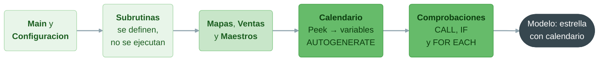
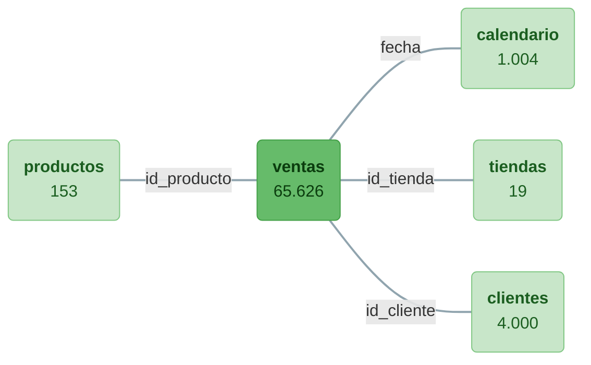

# Qlik Sense: variables, estructuras de control y calendario maestro

**Bloque 9 -- Qlik | Sesión 7 de 11**

[← Volver al índice del curso](../../README.md#bloque-9---qlik)

---

## 1. Introducción

Hasta ahora, nuestro script de carga ha sido una lista de sentencias que se ejecutan una detrás de otra, de arriba abajo, siempre igual. Hoy aprendemos a escribir scripts que **deciden** y que **repiten**: guardar un valor calculado durante la carga para usarlo después, ejecutar una parte del script solo si se cumple una condición, recorrer una lista de tablas o empaquetar unas líneas en una **subrutina** que se puede llamar tantas veces como haga falta.

Con esas herramientas construiremos una pieza que tienen casi todas las apps de Qlik: el **calendario maestro**. En la 9.1.3 creamos los campos `anio`, `mes`, `trimestre`, `anio_mes` y `dia_semana` dentro de la tabla de ventas, y ya avisamos de sus límites. Hoy los sustituimos por una tabla de fechas independiente, igual que la tabla de calendario del bloque 7. Y convertiremos las comprobaciones de la 9.2.1 en una subrutina que avisa por sí sola.

Por último, aprenderemos a usar a fondo el **depurador** del editor de carga, que ya presentamos en la 9.1.2: con variables y bucles, ver qué valor tiene cada variable en cada momento deja de ser opcional.

Al terminar tendremos `Mercadia_9.2.2.qvf` con un calendario maestro, una sección de subrutinas y unas comprobaciones automáticas al final de cada carga.

### Objetivos de la sesión
- Distinguir `SET` de `LET` y entender la **expansión de signo dólar** `$(...)`.
- Recuperar valores de una tabla cargada con `Peek` y guardarlos en variables.
- Escribir mensajes en el registro con `TRACE`.
- Usar las estructuras de control: `IF`, `FOR`, `FOR EACH` y `DO WHILE`.
- Generar filas con `AUTOGENERATE`, `WHILE` e `IterNo()`.
- Construir un **calendario maestro** y asociarlo con la tabla de ventas.
- Escribir y llamar **subrutinas** con `SUB` y `CALL`.
- Depurar el script con puntos de interrupción, ejecución paso a paso y el panel de variables.

### Prerequisitos
- `Mercadia_9.2.1.qvf` con el maestro de tiendas completo, el historial de compras de los clientes y la sección **Comprobaciones**.
- Bloque 7: la tabla de calendario y por qué un modelo necesita una.

Como siempre, empezamos con una copia: en `Documentos\Qlik\Sense\Apps`, con Desktop cerrado, copiamos `Mercadia_9.2.1.qvf` como `Mercadia_9.2.2.qvf`. Abrimos la copia, le cambiamos el título a `Mercadia_9.2.2` (**Editar detalles**, como en la 9.1.3) y vamos al **Editor de carga de datos**.

---

## 2. Las variables a fondo

### SET y LET

Ya usamos una variable desde la 9.1.2: `SET vRuta = 'lib://Mercadia/';`. Hay dos formas de crear una variable en el script, y la diferencia es esencial:

| Sentencia | Qué guarda | Ejemplo | Valor de la variable |
|---|---|---|---|
| `SET` | El **texto** que escribimos, tal cual | `SET vSet = Today();` | `Today()` |
| `LET` | El **resultado** de evaluar la expresión | `LET vLet = Today();` | `12/11/2026` |

`SET` no calcula nada: copia los caracteres. `LET` evalúa la expresión en ese momento y guarda el resultado. Lo comprobamos: en la sección **Configuracion**, debajo de `vRuta`, escribimos:

```
SET vSet = Today();
LET vLet = Today();
TRACE SET: $(vSet) / LET: $(vLet);
```

**`TRACE`** escribe un mensaje en el registro de la carga (y en la ventana de progreso). Cargamos y buscamos la línea en el registro: dice `SET: Today() / LET: 12/11/2026`, con la fecha del día en que carguemos.

> **¿Cuándo usar cada una?** `SET` para textos fijos: rutas, nombres, formatos. `LET` para todo lo que haya que calcular: fechas, recuentos, valores leídos de una tabla. Si dudamos, la pregunta es: ¿quiero guardar lo que he escrito o lo que vale?

### La expansión de signo dólar

`$(vLet)` es una **expansión de signo dólar**, que ya conocemos de `$(vRuta)`. Antes de ejecutar una línea, Qlik busca todos los `$(...)` y los sustituye por el valor de la variable, como un "buscar y reemplazar". La línea que se ejecuta es la que resulta **después** de la sustitución.

Eso tiene una consecuencia importante. `LET vLet = Today();` guarda el texto `12/11/2026`. Si escribiéramos `LET vAyer = $(vLet) - 1;`, Qlik ejecutaría `LET vAyer = 12/11/2026 - 1;`, que es **una división** (12 entre 11 entre 2026) menos 1. Ningún error, y un resultado absurdo.

La solución es guardar las fechas como **números**: `LET vHoy = Num(Today());` guarda `46338`, y `$(vHoy) - 1` es `46338 - 1`, el día anterior. Por eso, en el script, las fechas que vamos a usar en cálculos se guardan siempre como número.

> **Texto entre comillas.** Al expandir una variable de texto dentro de una expresión, hay que poner las comillas alrededor: `'$(vRuta)'`. Sin ellas, Qlik intentaría interpretar `lib://Mercadia/` como un nombre de campo.

Borramos las tres líneas de prueba de **Configuracion**.

### Las variables también llegan a la app

Las variables que crea el script no desaparecen al terminar la carga: quedan en la app. En el modo de edición de una hoja se ven en el diálogo **Variables**, y se pueden usar en cualquier expresión de gráfico con la misma expansión: un título de gráfico con `='Datos hasta el ' & Date($(vFechaMax))` mostraría la última fecha cargada. Lo haremos en la sección 4, en cuanto el script calcule esa variable.

---

## 3. Paso 1: leer valores de una tabla con Peek

Para construir un calendario necesitamos dos datos: la **primera** y la **última** fecha de las ventas. Las calculamos con `RESIDENT` (9.2.1) y una agregación sin `GROUP BY`, que resume **toda** la tabla en una sola fila.

Creamos una sección nueva, **Calendario**, **debajo** de **Maestros** (necesita que `ventas` ya esté cargada):

```
// Primera y última fecha de las ventas
_rango:
LOAD
    Min(fecha) AS fecha_min,
    Max(fecha) AS fecha_max
RESIDENT ventas;
```

`_rango` es una tabla de una fila y dos campos. Para usar esos valores fuera de un `LOAD`, los pasamos a variables con **`Peek`**:

```
LET vFechaMin = Peek('fecha_min', 0, '_rango');
LET vFechaMax = Peek('fecha_max', 0, '_rango');
DROP TABLE _rango;

TRACE Calendario del $(vFechaMin) al $(vFechaMax);
```

`Peek(campo, fila, tabla)` devuelve el valor de un campo en una fila concreta de una tabla ya cargada. Las filas se cuentan **desde 0**: la fila 0 es la primera, y la fila -1 es la última. Como `_rango` solo tiene una fila, pedimos la 0. Después borramos la tabla auxiliar: los valores ya están a salvo en las variables.

Cargamos. El registro muestra:

```
Calendario del 45292 al 46295
```

Son las fechas como **número**: 45292 es el 01/01/2024 y 46295 el 30/09/2026. `Min` y `Max` devuelven el número sin formato, y es justo lo que queremos, porque vamos a hacer cuentas con ellas (sección 2).

> **Comprueba estos dos números.** Si el registro muestra otros, el problema está en cómo se leyó `fecha` en la sección **Ventas** (9.1.2): una sola fecha mal interpretada, por ejemplo del año 0001, haría que el calendario empezara dos mil años antes.

---

## 4. Paso 2: el calendario maestro

### Generar una fila por día

Ahora necesitamos una tabla con **una fila por cada día** entre `vFechaMin` y `vFechaMax`. No hay ningún archivo que leer: las filas las genera el propio script. Debajo de lo anterior, en la sección **Calendario**:

```
// Una fila por cada día entre la primera y la última venta
calendario:
LOAD
    Date($(vFechaMin) + IterNo() - 1) AS fecha
AUTOGENERATE 1
WHILE $(vFechaMin) + IterNo() - 1 <= $(vFechaMax);
```

Se lee así:

- **`AUTOGENERATE 1`** genera una fila sin leer ningún origen. `AUTOGENERATE 5` generaría cinco filas iguales.
- **`WHILE`** repite esa fila **mientras** se cumpla la condición. Es un bucle dentro del propio `LOAD`.
- **`IterNo()`** es el contador de ese bucle: vale 1 en la primera repetición, 2 en la segunda, etc.

Después de la expansión, la línea que ejecuta Qlik es `WHILE 45292 + IterNo() - 1 <= 46295`. En la primera vuelta, `fecha` vale 45292 (01/01/2024); en la segunda, 45293; y así hasta 46295 (30/09/2026). `Date()` convierte cada número en una fecha. En total, **1.004 filas**.

### Los campos del calendario

Ahora añadimos los atributos de cada fecha con una **carga precedente** (9.1.3) encima del `LOAD` que acabamos de escribir. La sección **Calendario** completa queda así:

```
// Primera y última fecha de las ventas
_rango:
LOAD
    Min(fecha) AS fecha_min,
    Max(fecha) AS fecha_max
RESIDENT ventas;

LET vFechaMin = Peek('fecha_min', 0, '_rango');
LET vFechaMax = Peek('fecha_max', 0, '_rango');
DROP TABLE _rango;

TRACE Calendario del $(vFechaMin) al $(vFechaMax);

// Calendario maestro: una fila por día, asociado a ventas por fecha
calendario:
LOAD
    fecha,
    Year(fecha)                         AS anio,
    Month(fecha)                        AS mes,
    'T' & Ceil(Month(fecha) / 3)        AS trimestre,
    Date(MonthStart(fecha), 'YYYY-MM')  AS anio_mes,
    Day(fecha)                          AS dia,
    WeekDay(fecha)                      AS dia_semana,
    If(WeekDay(fecha) >= 5, 'Si', 'No') AS es_fin_de_semana;
LOAD
    Date($(vFechaMin) + IterNo() - 1)   AS fecha
AUTOGENERATE 1
WHILE $(vFechaMin) + IterNo() - 1 <= $(vFechaMax);
```

Los cinco primeros campos son **los mismos** que creamos en la 9.1.3, con los mismos nombres y las mismas expresiones. Añadimos dos nuevos: `dia`, el día del mes, y `es_fin_de_semana`. `WeekDay` devuelve 0 para el lunes y 6 para el domingo (por `FirstWeekDay=0` en la sección Main), así que el sábado y el domingo son los valores 5 y 6.

### Quitar los campos de calendario de ventas

Si cargáramos ahora, `ventas` y `calendario` compartirían seis campos (`fecha`, `anio`, `mes`, `trimestre`, `anio_mes` y `dia_semana`) y tendríamos una **clave sintética** (9.1.4). Los campos de calendario deben estar solo en el calendario. En la sección **Ventas**, nivel 3, borramos las cinco líneas de calendario y dejamos el nivel así:

```
// Nivel 3: campos derivados de los anteriores
LOAD
    *,
    If(Fabs(importe_original - importe_calculado) > 0.05,
       importe_calculado, importe_original)                      AS importe_neto,
    If(Fabs(importe_original - importe_calculado) > 0.05,
       'Si', 'No')                                               AS importe_corregido,
    If(unidades < 0, 'Si', 'No')                                 AS es_devolucion;
```

Cargamos y abrimos el visor del modelo: `calendario` aparece unida a `ventas` por **un solo campo**, `fecha`. La estrella tiene ahora cuatro dimensiones.

<!-- Captura pendiente: 0.Capturas/9.2.2/4.1_Modelo_con_calendario.png -->

### Comprobar que no se ha roto nada

Como los campos se llaman igual que antes, todo lo que construimos en la 9.1.5 sigue funcionando: la dimensión de desglose **Calendario** (`anio` → `trimestre` → `anio_mes`), el gráfico de evolución mensual y las tablas de la hoja **Comprobaciones**. Lo comprobamos:

| Comprobación | Cómo | Valor esperado |
|---|---|---|
| Días del calendario | KPI `Count(DISTINCT fecha)` | 1.004 |
| Líneas por año | Tabla `anio` × `Count(id_linea)` | 19.449 · 24.065 · 22.112, como en la 9.1.3 |
| Ventas netas | KPI `Sum(importe_neto)` | 323.808,28 €, no cambia |
| Fines de semana | Panel de filtrado `es_fin_de_semana` | `Si` y `No` |

Y una prueba de la diferencia que aporta el calendario. Seleccionamos la tienda `M19` (Almería) y miramos un panel de filtrado con `fecha`: quedan **200** fechas posibles. Almería abrió el 2 de marzo de 2026, y desde entonces hasta el 30 de septiembre hay 213 días: **13 días sin ninguna venta** en esa tienda. Con los campos de fecha dentro de ventas, esos días no existían en ningún sitio; con el calendario existen, y al seleccionar `M19` aparecen en gris.

### Una variable del script en una hoja

`vFechaMax` sigue existiendo cuando termina la carga, así que podemos usarla en la app (sección 2). En la hoja **Resumen comercial**, en el modo de edición, seleccionamos el gráfico **Ventas netas por mes y canal** y en **Presentación** → **General** escribimos como **Subtítulo**:

```
='Datos hasta el ' & Date($(vFechaMax))
```

El subtítulo muestra **Datos hasta el 30/09/2026**. `vFechaMax` guarda la fecha como número (46295), y `Date()` le da el formato de fecha. Cuando el script cargue un mes nuevo, el subtítulo cambiará solo, sin tocar el gráfico.

> **¿Por qué una tabla aparte?** Por lo mismo que en el bloque 7. Un calendario contiene **todos** los días, haya ventas o no. Y es **uno solo** para todo el modelo: cuando en la 9.2.3 carguemos los objetivos mensuales, sus meses se analizarán con este mismo calendario en lugar de tener el suyo.

---

## 5. Paso 3: estructuras de control

Las **estructuras de control** deciden qué partes del script se ejecutan y cuántas veces. No cargan datos: dirigen el orden en el que se ejecutan las sentencias que sí los cargan.

| Estructura | Para qué | Equivalente en Python |
|---|---|---|
| `IF ... THEN ... ELSEIF ... ELSE ... END IF` | Ejecutar un bloque solo si se cumple una condición | `if / elif / else` |
| `FOR i = 1 TO 10 ... NEXT i` | Repetir con un contador | `for i in range(1, 11)` |
| `FOR EACH v IN 'a', 'b' ... NEXT v` | Repetir para cada elemento de una lista | `for v in ['a', 'b']` |
| `DO WHILE condición ... LOOP` | Repetir mientras se cumpla una condición | `while` |
| `SUB nombre ... END SUB` y `CALL nombre` | Definir y llamar una subrutina | `def` y una llamada a la función |

Vamos a usar las tres primeras en la sección **Comprobaciones**. Antes, borramos todo lo que tenía desde la 9.2.1: lo sustituiremos por algo mejor en el paso 4.

### IF: avisar si falta una tienda en el maestro

En la 9.2.1 dimos de alta `M19` a mano. ¿Y si mañana aparece una tienda nueva en ventas que no está en el Excel? Podemos detectarlo en el script comparando dos números:

- **`NoOfRows('tiendas')`**: el número de filas de la tabla `tiendas`.
- **`FieldValueCount('id_tienda')`**: el número de valores distintos del campo `id_tienda` en **todo** el modelo, es decir, en `ventas` y en `tiendas` juntas.

Si el maestro tiene menos filas que códigos de tienda distintos, hay alguna tienda con ventas que no está en el maestro. En la sección **Comprobaciones**:

```
// ¿Hay tiendas con ventas que no están en el maestro?
IF NoOfRows('tiendas') < FieldValueCount('id_tienda') THEN
    TRACE ### AVISO: hay tiendas con ventas que no están en el maestro de tiendas;
END IF
```

Cargamos: no aparece ningún aviso, porque hay 19 filas y 19 códigos. Para comprobar que funciona, comentamos el `CONCATENATE` de `M19` en **Maestros** (seleccionamos las líneas y pulsamos `Ctrl + K`), cargamos y buscamos el aviso en el registro. Después quitamos el comentario.

> **Sin `$()` en las condiciones.** En un `IF`, las funciones y las variables se evalúan directamente, como en un `LET`: `IF vFilas > 0 THEN`. No hace falta (y, en los bucles, no conviene) escribir `$(vFilas)`. Lo veremos con `DO WHILE`.

### FOR EACH: un resumen de la carga

Al final de cada carga es útil ver de un vistazo cuántas filas tiene cada tabla. En lugar de escribir cinco `TRACE`, recorremos la lista:

```
// Resumen de la carga
FOR EACH vTabla IN 'ventas', 'productos', 'tiendas', 'clientes', 'calendario'
    LET vFilas = NoOfRows('$(vTabla)');
    TRACE $(vTabla): $(vFilas) filas;
NEXT vTabla
```

En cada vuelta, `vTabla` toma uno de los valores de la lista. Cargamos y el registro muestra:

```
ventas: 65626 filas
productos: 153 filas
tiendas: 19 filas
clientes: 4000 filas
calendario: 1004 filas
```

Fíjate en que hemos usado un `LET` antes del `TRACE`. **`TRACE` no evalúa funciones**: escribe el texto tal cual, después de expandir las variables. Si escribiéramos `TRACE $(vTabla): NoOfRows('$(vTabla)') filas;`, el registro mostraría literalmente `ventas: NoOfRows('ventas') filas`.

### FOR: recorrer todas las tablas del modelo

La lista anterior hay que mantenerla a mano: si mañana añadimos una tabla, tenemos que acordarnos de añadirla. Con `FOR` y dos funciones de tabla podemos recorrer **todas** las tablas del modelo sin nombrarlas:

```
FOR i = 0 TO NoOfTables() - 1
    LET vTabla = TableName($(i));
    LET vFilas = NoOfRows('$(vTabla)');
    TRACE $(vTabla): $(vFilas) filas;
NEXT i
```

`NoOfTables()` devuelve el número de tablas cargadas y `TableName(i)` el nombre de la tabla número `i`, contando desde 0. Es la versión que usaríamos en un proyecto real. En el curso nos quedamos con la de `FOR EACH`, que se lee mejor.

### DO WHILE, y por qué sin $()

`DO WHILE` repite un bloque mientras se cumple una condición. En el script de Mercadia no lo necesitamos (el `WHILE` del calendario es otra cosa: un bucle dentro de un `LOAD`), pero conviene conocer su trampa. Compara estos dos bucles:

```
LET k = 1;
DO WHILE k <= 3          // correcto: k se evalúa en cada vuelta
    LET k = k + 1;
LOOP

LET j = 1;
DO WHILE $(j) <= 3       // incorrecto: nunca termina
    LET j = j + 1;
LOOP
```

El primero da tres vueltas. El segundo **no termina nunca**: Qlik expande `$(j)` **una sola vez**, al leer la línea, y la condición se queda como `DO WHILE 1 <= 3`, que siempre es cierto. En las condiciones de `IF` y `DO WHILE`, las variables se escriben **sin** `$()`.

Si alguna vez una carga no termina, el botón para detenerla está en la ventana de progreso de la carga.

---

## 6. Paso 4: subrutinas

En la 9.2.1 comprobamos con `GROUP BY` que no quedaban clientes repetidos. Pero la misma comprobación tiene sentido para **todos** los maestros: un producto, una tienda o una fecha repetidos duplicarían filas en cualquier `JOIN` futuro. En lugar de copiar el mismo bloque cuatro veces, lo escribimos una vez como **subrutina**.

### SUB: definir la subrutina

Creamos una sección nueva, **Subrutinas**, justo **debajo** de **Configuracion** (antes de cualquier sección que la use):

```
// Comprueba que un campo no tiene valores repetidos en una tabla.
// Escribe un AVISO en el registro si los hay.
SUB ComprobarDuplicados(pTabla, pCampo)
    _duplicados:
    LOAD * WHERE filas > 1;
    LOAD
        [$(pCampo)]        AS valor_duplicado,
        Count([$(pCampo)]) AS filas
    RESIDENT [$(pTabla)]
    GROUP BY [$(pCampo)];

    LET vDuplicados = NoOfRows('_duplicados');
    IF vDuplicados > 0 THEN
        TRACE ### AVISO: $(vDuplicados) valores de $(pCampo) repetidos en $(pTabla);
    ELSE
        TRACE OK: $(pCampo) es único en $(pTabla);
    END IF

    DROP TABLE _duplicados;
END SUB
```

Es la comprobación de la 9.2.1, con tres cambios:

1. **Parámetros.** `pTabla` y `pCampo` son los **parámetros** de la subrutina: dentro de ella funcionan como variables, con el valor que les pasemos al llamarla. Por convención, empiezan por `p` para distinguirlos de las variables normales (`v`).
2. **Corchetes.** `[$(pCampo)]` y `[$(pTabla)]` funcionan con cualquier nombre, aunque tuviera espacios.
3. **El resultado se decide en el script.** `NoOfRows` cuenta las filas de `_duplicados` y el `IF` escribe un aviso o un OK. Ya no hay que mirar en el registro cuántas líneas obtuvo una tabla.

Cargamos. No pasa nada: una subrutina **no se ejecuta** al definirla, igual que una función de Python no se ejecuta con `def`. Por eso la sección **Subrutinas** puede ir al principio.

### CALL: usarla

En la sección **Comprobaciones**, al principio, antes del `IF` de las tiendas:

```
// Las claves de los maestros y del calendario no pueden repetirse
CALL ComprobarDuplicados('clientes', 'id_cliente');
CALL ComprobarDuplicados('productos', 'id_producto');
CALL ComprobarDuplicados('tiendas', 'id_tienda');
CALL ComprobarDuplicados('calendario', 'fecha');
```

Cargamos. El registro muestra cuatro líneas `OK: ... es único en ...`. Para ver un aviso, cambiamos temporalmente `LOAD DISTINCT` por `LOAD` en el maestro de clientes y cargamos: aparece `### AVISO: 31 valores de id_cliente repetidos en clientes`. Volvemos a poner `DISTINCT`.

> **Una tabla con 0 filas sí existe.** Cuando no hay duplicados, `_duplicados` se crea con 0 filas: `NoOfRows` devuelve 0 y el `DROP TABLE` funciona. Si la tabla no existiera, `NoOfRows` devolvería nulo y el `DROP TABLE` daría error.

### La sección Comprobaciones completa

```
// Las claves de los maestros y del calendario no pueden repetirse
CALL ComprobarDuplicados('clientes', 'id_cliente');
CALL ComprobarDuplicados('productos', 'id_producto');
CALL ComprobarDuplicados('tiendas', 'id_tienda');
CALL ComprobarDuplicados('calendario', 'fecha');

// ¿Hay tiendas con ventas que no están en el maestro?
IF NoOfRows('tiendas') < FieldValueCount('id_tienda') THEN
    TRACE ### AVISO: hay tiendas con ventas que no están en el maestro de tiendas;
END IF

// Resumen de la carga
FOR EACH vTabla IN 'ventas', 'productos', 'tiendas', 'clientes', 'calendario'
    LET vFilas = NoOfRows('$(vTabla)');
    TRACE $(vTabla): $(vFilas) filas;
NEXT vTabla
```

Al final de cada carga, en las últimas líneas del registro, tenemos ahora un informe del estado del modelo. Un `###` delante de los avisos los hace fáciles de buscar.

---

## 7. Paso 5: el depurador a fondo

Con variables y bucles, muchas veces no basta con leer el registro al final: queremos ver **qué valor tiene una variable en un momento concreto** o qué hace una subrutina línea a línea. Para eso está el **depurador**. Lo abrimos con el botón **Depurar** de la barra del editor de carga.

### Los controles

| Control | Para qué |
|---|---|
| **Reproducir** | Ejecuta el script hasta el final o hasta el siguiente punto de interrupción |
| **Paso** | Ejecuta **una** sentencia y se detiene en la siguiente |
| **Detener** | Detiene la ejecución en ese punto |
| **Carga limitada** (en los ajustes del depurador) | Carga solo las primeras filas de cada origen de datos, para probar rápido |

Y en la parte inferior, tres paneles:

- **Salida**: lo mismo que el registro de la carga, incluidos los `TRACE`.
- **Variables**: todas las variables del script, con su valor actual. Es el panel más útil de hoy.
- **Puntos de interrupción**: la lista de los puntos de interrupción del script.

### Un punto de interrupción en el calendario

1. Vamos a la sección **Calendario** y hacemos clic a la derecha del número de la línea `calendario:`. Aparece una marca: es un **punto de interrupción**.
2. Pulsamos **Reproducir**. El script se ejecuta hasta esa línea y se detiene **antes** de ejecutarla.
3. En el panel **Variables** buscamos `vFechaMin` y `vFechaMax`: valen 45292 y 46295.
4. Pulsamos **Paso** varias veces y vemos cómo avanza la ejecución.
5. Pulsamos **Reproducir** para terminar.

Hacemos lo mismo con un punto de interrupción dentro de la subrutina `ComprobarDuplicados`: el depurador se detiene **cada vez** que se llama, y en el panel **Variables** vemos cómo cambian `pTabla` y `pCampo` en cada llamada.

> **Lo que no se puede hacer en el depurador.** Mientras está abierto no se puede guardar el script, crear o editar conexiones ni cargar datos de forma normal. Y si detenemos la ejecución a medias, el modelo de datos queda cargado solo hasta esa línea. Al terminar de depurar, cerramos el depurador y hacemos una carga normal.

> **La carga limitada y los recuentos.** Con la carga limitada activada, los recuentos de las comprobaciones (filas, ventas, duplicados) no son los reales, porque solo se cargan unas pocas filas de cada archivo. Sirve para probar que el script **funciona**, no para comprobar que los datos **cuadran**. Las tablas generadas con `AUTOGENERATE` y los `INLINE` no se limitan.

Guardamos la app (`Ctrl + S`).

---

## 8. El script completo de la sesión

Las secciones quedan en este orden: **Main**, **Configuracion**, **Subrutinas**, **Mapas**, **Ventas**, **Maestros**, **Calendario** y **Comprobaciones**.

- **Main**, **Configuracion**, **Mapas** y **Maestros**: sin cambios desde la 9.2.1.
- **Subrutinas**: nueva, con `ComprobarDuplicados` (sección 6).
- **Ventas**: el nivel 3 pierde los cinco campos de calendario (sección 4).
- **Calendario**: nueva (sección 4).
- **Comprobaciones**: sustituida por la versión de la sección 6.

En la hoja **Resumen comercial**, el gráfico **Ventas netas por mes y canal** tiene un subtítulo nuevo con `vFechaMax` (sección 4).

La hoja **Comprobaciones** queda así:

| Comprobación | Cómo | Valor esperado hoy |
|---|---|---|
| Líneas | KPI `Count(id_linea)` | 65.626 |
| Ventas netas | KPI `Sum(importe_neto)` | 323.808,28 € |
| Días del calendario | KPI `Count(DISTINCT fecha)` | 1.004 |
| Líneas por año | Tabla `anio` × `Count(id_linea)` | 19.449 · 24.065 · 22.112 |
| Clientes con compras | KPI `Count(tickets_cliente)` | 3.531 |

Y en el registro, al final de la carga: cuatro líneas `OK`, ningún `### AVISO` y el resumen de filas de la sección 5.

---

## 9. Lo que Qlik ha hecho por debajo



El script de Qlik se ejecuta en dos "niveles" a la vez. Las sentencias de carga (`LOAD`, `DROP`, `JOIN`...) trabajan con **tablas**. Las variables y las estructuras de control (`LET`, `IF`, `FOR`, `CALL`...) trabajan con **el propio script**: deciden qué sentencias de carga se ejecutan y con qué texto. La expansión de signo dólar es el puente entre los dos: antes de ejecutar cada línea, Qlik sustituye las variables, y lo que se ejecuta es el texto resultante.

Por eso funciona el calendario: `Peek` lleva un valor de una **tabla** a una **variable**, y `$(vFechaMin)` lleva el valor de la variable de vuelta al texto de un `LOAD`.



---

## 10. Ejercicios

**Ejercicio 1: SET o LET.** ¿Qué escribe cada `TRACE`? Supón que hoy es el 12/11/2026.

```
SET vA = 1 + 1;
LET vB = 1 + 1;
SET vC = 'Mercadia';
LET vD = Num(Today());
LET vE = vD + 1;
TRACE $(vA) | $(vB) | $(vC) | $(vD) | $(vE);
```

<details>
<summary>Ver la solución</summary>

`1 + 1 | 2 | Mercadia | 46338 | 46339`

- `vA` guarda el texto `1 + 1`, sin calcular.
- `vB` guarda el resultado, `2`.
- `vC` guarda el texto `Mercadia`, sin las comillas.
- `vD` guarda la fecha de hoy como número.
- `vE`: en un `LET` las variables se pueden usar directamente por su nombre, sin `$()`, y `vD + 1` es el día siguiente.

</details>

**Ejercicio 2: medir el calendario.** Con la app de hoy, contesta usando paneles de filtrado y KPIs:

1. ¿Cuántos días de fin de semana tiene el calendario?
2. ¿Cuántos valores tiene `anio_mes`?
3. Si seleccionamos `es_fin_de_semana = Si`, ¿cambia el número de líneas de venta de 2024?

<details>
<summary>Ver la solución</summary>

1. **286** días.
2. **33** meses: de 2024-01 a 2026-09.
3. **Sí**: ahora solo cuenta las líneas vendidas en sábado o domingo. Seleccionar en el calendario filtra las ventas a través de `fecha`, igual que seleccionar en cualquier otra dimensión.

</details>

**Ejercicio 3: un calendario de años completos.** Muchas empresas prefieren que el calendario cubra los años completos, para que los gráficos de 2026 muestren también los meses que aún no han llegado. Modifica las dos líneas `LET` de la sección **Calendario** para que el calendario vaya del 1 de enero del primer año al 31 de diciembre del último. ¿Cuántos días tendrá?

Pista: `YearStart(fecha)` devuelve el primer día del año de una fecha y `YearEnd(fecha)` el último instante del último día.

<details>
<summary>Ver la solución</summary>

```
LET vFechaMin = Num(YearStart(Peek('fecha_min', 0, '_rango')));
LET vFechaMax = Floor(YearEnd(Peek('fecha_max', 0, '_rango')));
```

El calendario tiene **1.096** días: 366 de 2024 (bisiesto), 365 de 2025 y 365 de 2026. `anio_mes` tiene ahora 12 valores en 2026, aunque de octubre a diciembre no haya ventas.

Dos detalles: `Num()` asegura que la variable guarda un número, y `Floor()` quita la parte horaria de `YearEnd`, que devuelve el 31/12/2026 a las 23:59:59. Las ventas no cambian: siguen siendo 323.808,28 €.

</details>

**Ejercicio 4: encontrar el error.** Un compañero ha escrito esta sección y la carga no termina nunca. ¿Por qué? Corrígela.

```
LET vAnio = 2024;
DO WHILE $(vAnio) <= 2026
    TRACE Procesando $(vAnio);
    LET vAnio = vAnio + 1;
LOOP
```

<details>
<summary>Ver la solución</summary>

La condición `$(vAnio) <= 2026` se expande una sola vez, al leer la línea, y queda como `DO WHILE 2024 <= 2026`, que es cierto para siempre. La variable sí aumenta en cada vuelta, pero la condición ya no la mira. La corrección es quitar el `$()` de la condición:

```
DO WHILE vAnio <= 2026
```

Aunque, para recorrer tres años conocidos, un `FOR` es más claro:

```
FOR vAnio = 2024 TO 2026
    TRACE Procesando $(vAnio);
NEXT vAnio
```

</details>

**Ejercicio 5: ampliar la subrutina.** Escribe una segunda subrutina, `ComprobarNulos(pTabla, pCampo)`, que escriba un aviso si un campo tiene valores nulos en una tabla, y llámala para comprobar que ningún producto de `ventas` se ha quedado sin `id_producto`.

Pista: `LOAD Sum(If(IsNull(campo), 1, 0)) AS nulos RESIDENT tabla;` cuenta las filas en las que el campo es nulo.

<details>
<summary>Ver la solución</summary>

En la sección **Subrutinas**:

```
// Comprueba que un campo no tiene valores nulos en una tabla.
SUB ComprobarNulos(pTabla, pCampo)
    _nulos:
    LOAD Sum(If(IsNull([$(pCampo)]), 1, 0)) AS nulos
    RESIDENT [$(pTabla)];

    LET vNulos = Peek('nulos', 0, '_nulos');
    IF vNulos > 0 THEN
        TRACE ### AVISO: $(vNulos) filas sin $(pCampo) en $(pTabla);
    ELSE
        TRACE OK: $(pCampo) siempre informado en $(pTabla);
    END IF

    DROP TABLE _nulos;
END SUB
```

En **Comprobaciones**:

```
CALL ComprobarNulos('ventas', 'id_producto');
```

El registro muestra `OK: id_producto siempre informado en ventas`. Si la llamas con `id_cliente`, el aviso dirá `### AVISO: 22663 filas sin id_cliente en ventas`: las compras sin tarjeta. No es un error, y es un buen ejemplo de que una comprobación automática avisa, pero la decisión sigue siendo nuestra.

</details>

---

## 11. Errores comunes y troubleshooting

**1. "El calendario empieza en el año 0001" o "la carga del calendario tarda muchísimo".** Alguna fecha de `ventas` está mal interpretada y `Min` o `Max` devuelven una fecha absurda: el calendario intenta generar cientos de miles de días. Comprobamos `vFechaMin` y `vFechaMax` en el registro (deben ser 45292 y 46295) y revisamos la lectura de `fecha` en la sección **Ventas**.

**2. "Aparece `$Syn 1` entre ventas y calendario."** Se nos ha olvidado quitar algún campo de calendario del nivel 3 de ventas. Los dos solo deben compartir `fecha`.

**3. "El calendario sale con 0 filas."** `vFechaMin` o `vFechaMax` están vacías. Lo más habitual: el `Peek` tiene mal escrito el nombre del campo o de la tabla (distinguen mayúsculas), o el `DROP TABLE _rango` está antes del `Peek`.

**4. "*Table 'ventas' not found*" en el calendario.** La sección **Calendario** está antes de **Ventas**: el `RESIDENT ventas` no encuentra la tabla. Las secciones se ejecutan en orden; el calendario va después de ventas.

**5. "La carga falla en una línea `CALL` con un mensaje de error vacío".** Qlik no encuentra la subrutina: la sección **Subrutinas** está **después** de la sección que hace el `CALL`, o el nombre no coincide exactamente. Una subrutina tiene que estar definida antes de llamarla.

**6. "El `TRACE` muestra el nombre de la función en lugar del valor."** `TRACE` no evalúa funciones. Calculamos antes el valor con `LET` y escribimos la variable.

**7. "La carga no termina."** Un `DO WHILE` con `$()` en la condición (sección 5). Detenemos la carga desde la ventana de progreso y quitamos el `$()`.

**8. "Una resta de fechas da un número rarísimo."** La variable guarda la fecha como texto (`12/11/2026`) y al expandirla se convierte en una división. Guardamos las fechas con `Num()`.

---

## 12. Conclusión

En esta sesión hemos aprendido a escribir scripts que deciden y repiten. Hemos visto la diferencia entre `SET`, que guarda lo que escribimos, y `LET`, que guarda lo que vale, y cómo la expansión de signo dólar sustituye las variables en el texto de cada línea antes de ejecutarla. Con `Peek` hemos llevado la primera y la última fecha de las ventas a dos variables, y con `AUTOGENERATE`, `WHILE` e `IterNo()` hemos generado un **calendario maestro** de 1.004 días, que sustituye a los campos de fecha de la tabla de ventas sin romper nada de lo que construimos en la 9.1.5. Con `IF`, `FOR EACH` y una **subrutina**, `ComprobarDuplicados`, hemos convertido las comprobaciones de la 9.2.1 en un informe automático al final de cada carga. Y hemos aprendido a usar el depurador para ver el valor de cada variable en cada momento. El resultado es `Mercadia_9.2.2.qvf`. En la 9.2.3 cargaremos por fin los objetivos mensuales, una segunda tabla de hechos, y resolveremos los problemas de modelo que no se arreglan con un simple renombrado.

---

## 13. Para profundizar

### Calendarios con más campos

Un calendario de empresa suele tener muchos más campos que el nuestro: semana del año (`Week`), festivos (cargados de un archivo y asociados por `fecha`), indicadores como "mes en curso" o "mismo periodo del año anterior", y el año y el mes fiscal cuando el ejercicio no empieza en enero (`FirstMonthOfYear` en la sección Main). Todos se calculan en la carga precedente del calendario, a partir de `fecha`, igual que los que hemos escrito hoy.

### Varias fechas, un calendario

En Mercadia hay otras fechas: `fecha_alta` de los clientes, `fecha_apertura` de las tiendas, `primera_compra` y `ultima_compra`. Ninguna está asociada al calendario, porque se llaman distinto, y está bien así: si se llamaran `fecha`, se asociarían con las ventas y tendríamos referencias circulares. Cuando un modelo necesita analizar varias fechas con el mismo calendario, la técnica habitual es un **calendario canónico** o una tabla puente de fechas, una variante de la tabla de enlace que veremos en la 9.2.3.

### Subrutinas en archivos externos

Una subrutina como `ComprobarDuplicados` sirve para cualquier app, no solo para Mercadia. En las empresas se guardan en un archivo de texto `.qvs` compartido y se incluyen en cada app con `$(Must_Include=...)`. Lo veremos en la 9.4.1.

---

## 14. Recursos

- **Ayuda oficial de Qlik Sense para Windows** (en español, versión May 2026): <https://help.qlik.com/es-ES/sense/May2026/Content/Sense_Helpsites/Home.htm>
- **Qlik Design Blog**, con artículos sobre calendarios maestros y variables: <https://community.qlik.com/t5/Design/bg-p/qlik-design-blog>
- **Qlik Community**: <https://community.qlik.com/>

### Documentación oficial de esta sesión

| Tema | Página de la ayuda |
|---|---|
| Variables | [Set][doc-set] · [Let][doc-let] · [Expansiones de signo dólar][doc-dolar] · [Trace][doc-trace] |
| Leer valores de tablas | [Peek][doc-peek] · [Funciones de tabla][doc-funciones-tabla] (`NoOfRows`, `NoOfTables`, `TableName`) · [NoOfRows][doc-noofrows] |
| Estructuras de control | [Sentencias de control de script][doc-control] · [If..then..elseif..else..end if][doc-if] · [For..next][doc-for] · [For each..next][doc-foreach] · [Do..loop][doc-do] · [Exit][doc-exit] |
| Subrutinas | [Sub..end sub][doc-sub] · [Call][doc-call] |
| Calendario | [Load][doc-load] (apartados *autogenerate* y *while*) · [IterNo][doc-iterno] · [day][doc-day] · [weekday][doc-weekday] · [monthstart][doc-monthstart] · [today][doc-today] |
| Depurar | [Depurar el script de carga de datos][doc-depurar] |

---

*Guía del alumno · Sesión 7 · Bloque 9 - Qlik · Mercadia*

[doc-set]: https://help.qlik.com/es-ES/sense/May2026/Subsystems/Hub/Content/Sense_Hub/Scripting/ScriptRegularStatements/Set.htm
[doc-let]: https://help.qlik.com/es-ES/sense/May2026/Subsystems/Hub/Content/Sense_Hub/Scripting/ScriptRegularStatements/Let.htm
[doc-dolar]: https://help.qlik.com/es-ES/sense/May2026/Subsystems/Hub/Content/Sense_Hub/Scripting/dollar-sign-expansions.htm
[doc-trace]: https://help.qlik.com/es-ES/sense/May2026/Subsystems/Hub/Content/Sense_Hub/Scripting/ScriptRegularStatements/Trace.htm
[doc-peek]: https://help.qlik.com/es-ES/sense/May2026/Subsystems/Hub/Content/Sense_Hub/Scripting/InterRecordFunctions/Peek.htm
[doc-funciones-tabla]: https://help.qlik.com/es-ES/sense/May2026/Subsystems/Hub/Content/Sense_Hub/Scripting/TableFunctions/table-functions.htm
[doc-noofrows]: https://help.qlik.com/es-ES/sense/May2026/Subsystems/Hub/Content/Sense_Hub/Scripting/TableFunctions/NoOfRows.htm
[doc-control]: https://help.qlik.com/es-ES/sense/May2026/Subsystems/Hub/Content/Sense_Hub/Scripting/ScriptControlStatements/script-control-statements.htm
[doc-if]: https://help.qlik.com/es-ES/sense/May2026/Subsystems/Hub/Content/Sense_Hub/Scripting/ScriptControlStatements/If.htm
[doc-for]: https://help.qlik.com/es-ES/sense/May2026/Subsystems/Hub/Content/Sense_Hub/Scripting/ScriptControlStatements/For.htm
[doc-foreach]: https://help.qlik.com/es-ES/sense/May2026/Subsystems/Hub/Content/Sense_Hub/Scripting/ScriptControlStatements/For%20Each.htm
[doc-do]: https://help.qlik.com/es-ES/sense/May2026/Subsystems/Hub/Content/Sense_Hub/Scripting/ScriptControlStatements/do.htm
[doc-exit]: https://help.qlik.com/es-ES/sense/May2026/Subsystems/Hub/Content/Sense_Hub/Scripting/ScriptControlStatements/Exit.htm
[doc-sub]: https://help.qlik.com/es-ES/sense/May2026/Subsystems/Hub/Content/Sense_Hub/Scripting/ScriptControlStatements/Sub.htm
[doc-call]: https://help.qlik.com/es-ES/sense/May2026/Subsystems/Hub/Content/Sense_Hub/Scripting/ScriptControlStatements/Call.htm
[doc-load]: https://help.qlik.com/es-ES/sense/May2026/Subsystems/Hub/Content/Sense_Hub/Scripting/ScriptRegularStatements/Load.htm
[doc-iterno]: https://help.qlik.com/es-ES/sense/May2026/Subsystems/Hub/Content/Sense_Hub/Scripting/CounterFunctions/IterNo.htm
[doc-day]: https://help.qlik.com/es-ES/sense/May2026/Subsystems/Hub/Content/Sense_Hub/Scripting/DateAndTimeFunctions/day.htm
[doc-weekday]: https://help.qlik.com/es-ES/sense/May2026/Subsystems/Hub/Content/Sense_Hub/Scripting/DateAndTimeFunctions/weekday.htm
[doc-monthstart]: https://help.qlik.com/es-ES/sense/May2026/Subsystems/Hub/Content/Sense_Hub/Scripting/DateAndTimeFunctions/monthstart.htm
[doc-today]: https://help.qlik.com/es-ES/sense/May2026/Subsystems/Hub/Content/Sense_Hub/Scripting/DateAndTimeFunctions/today.htm
[doc-depurar]: https://help.qlik.com/es-ES/sense/May2026/Subsystems/Hub/Content/Sense_Hub/LoadData/debug-data-load-script.htm
