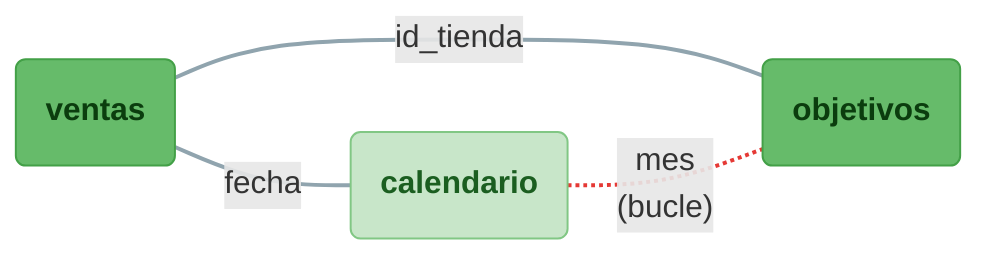
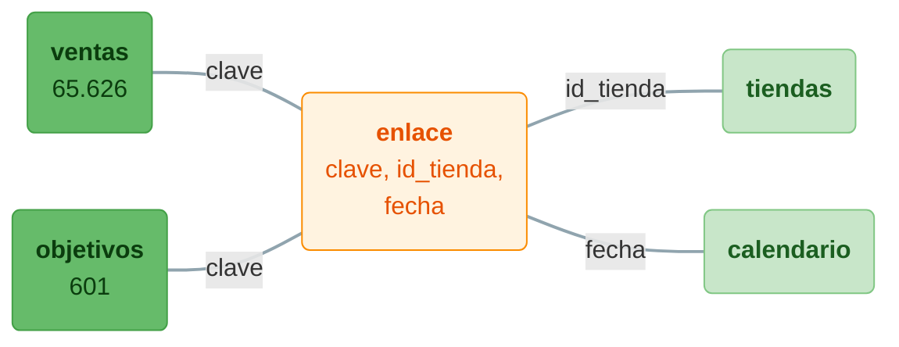
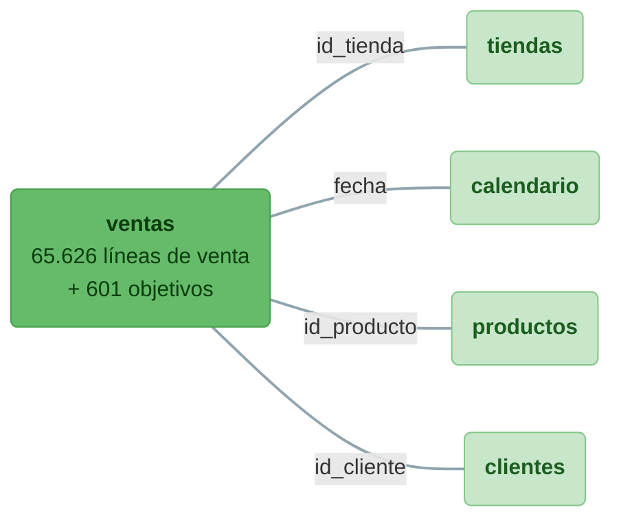

# Qlik Sense: modelo asociativo avanzado, claves sintéticas, referencias circulares y tablas de enlace

**Bloque 9 -- Qlik | Sesión 8 de 11**

[← Volver al índice del curso](../../README.md#bloque-9---qlik)

---

## 1. Introducción

En la 9.1.4 aprendimos las dos reglas básicas del modelado en Qlik: **no cargar** el campo que sobra y **renombrar** el que significa otra cosa. Con ellas resolvimos una clave sintética y una referencia circular, y el modelo de Mercadia quedó como una estrella: `ventas` en el centro y las dimensiones alrededor.

Pero hay problemas que esas dos reglas no arreglan. El más habitual aparece en cuanto el modelo tiene **dos tablas de hechos**. Hoy cargamos por fin `objetivos_mensuales.csv`, los objetivos de venta de cada tienda y mes, y veremos que choca con las ventas de una forma que no tiene solución renombrando: las dos tablas **comparten** dimensiones (la tienda y el tiempo) y **deben** compartirlas, porque queremos comparar ventas y objetivos por tienda y por mes.

Probaremos tres modelos que no funcionan y dos que sí: la **tabla de enlace** y la **tabla de hechos concatenada**. Y cerraremos un asunto pendiente desde la 9.1.5: por qué contar un **campo clave** da resultados que dependen del modelo, y cómo evitarlo.

Al terminar tendremos `Mercadia_9.2.3.qvf` con los objetivos integrados en el modelo y dos medidas maestras nuevas: **Objetivo** y **% Cumplimiento**.

### Objetivos de la sesión
- Reconocer cuándo un modelo tiene **dos tablas de hechos** y por qué eso crea claves sintéticas o referencias circulares.
- Entender qué hace Qlik con una referencia circular (desacoplar una tabla) y por qué los resultados dejan de ser fiables.
- Entender por qué una clave sintética entre dos tablas de hechos da resultados **silenciosamente** erróneos.
- Construir una **clave compuesta** con `AutoNumber`.
- Construir una **tabla de enlace**.
- Construir una **tabla de hechos concatenada** y saber cuándo preferirla a la tabla de enlace.
- Analizar dos tablas de hechos con **distinta granularidad** sin caer en sus trampas.
- Escribir medidas sin contar campos clave.

### Prerequisitos
- `Mercadia_9.2.2.qvf` con el calendario maestro, la subrutina `ComprobarDuplicados` y la sección **Comprobaciones**.
- La 9.1.4 (claves sintéticas, referencias circulares y la regla de oro del modelado) y la 9.2.1 (`CONCATENATE` y `JOIN`).
- Bloque 7: varias tablas de hechos en un mismo modelo de Power BI.

Como siempre, empezamos con una copia: en `Documentos\Qlik\Sense\Apps`, con Desktop cerrado, copiamos `Mercadia_9.2.2.qvf` como `Mercadia_9.2.3.qvf`. Abrimos la copia, le cambiamos el título a `Mercadia_9.2.3` (**Editar detalles**, como en la 9.1.3) y vamos al **Editor de carga de datos**.

---

## 2. El archivo de objetivos

`objetivos_mensuales.csv` tiene tres columnas:

| Campo | Ejemplo | Qué es |
|---|---|---|
| `id_tienda` | `M05` | La tienda, con el mismo código que `ventas` y `tiendas` |
| `mes` | `2025-07` | El año y el mes, como texto |
| `objetivo_ventas` | `820` | El objetivo de ventas netas de esa tienda en ese mes, en euros |

Tiene **601 filas**: 18 tiendas × 33 meses (de enero de 2024 a septiembre de 2026), más 7 meses de `M19`, que abrió en marzo de 2026. Los objetivos suman **331.570 €**.

Es una tabla de **hechos**, no de dimensión: cada fila es una cifra que se suma, igual que las líneas de venta. Pero tiene un **detalle** (granularidad) distinto:

| Tabla | Una fila por cada... | Dimensiones |
|---|---|---|
| `ventas` | Línea de ticket | Tienda, día, cliente, producto, canal... |
| `objetivos` | Tienda y mes | Tienda y mes |

Los objetivos solo se pueden analizar por tienda y por tiempo, y por tiempo solo hasta el **mes**. No tienen cliente, ni producto, ni canal, ni día. Tenlo presente durante toda la sesión: es la causa de casi todo lo que vamos a ver.

---

## 3. Paso 1: cargarlo tal cual, una referencia circular

En la 9.1.4 (ejercicio 1) predijimos que, cargado tal cual, el archivo crearía una clave sintética con ventas por `id_tienda` y `mes`. Desde la 9.2.2 el campo `mes` ya no está en ventas, sino en el calendario, así que el resultado será distinto. Vamos a verlo.

Creamos una sección nueva, **Objetivos**, entre **Calendario** y **Comprobaciones**:

```
objetivos:
LOAD
    id_tienda,
    mes,
    objetivo_ventas
FROM [$(vRuta)objetivos_mensuales.csv]
(txt, utf8, embedded labels, delimiter is ',', msq);
```

Cargamos. La carga termina con la **advertencia de referencias circulares** que conocimos en la 9.1.4, y en el visor del modelo aparecen líneas discontinuas.

<!-- Captura pendiente: 0.Capturas/9.2.3/3.1_Referencia_circular.png -->



El bucle es: `ventas` → `id_tienda` → `objetivos` → `mes` → `calendario` → `fecha` → `ventas`. Para romperlo, Qlik ha **desacoplado** una tabla. Y no ha elegido una cualquiera: en nuestro caso ha desacoplado **`ventas`**, la tabla más importante del modelo. Lo comprobamos en la hoja **Comprobaciones**:

| KPI | Valor | Debería ser |
|---|---|---|
| `Sum(importe_neto)` | **211.065,67 €** | 323.808,28 € |
| `Count(id_linea)` | **42.963** | 65.626 |

Y una tabla con la dimensión `tienda` y la medida `Sum(importe_neto)` muestra **0** en todas las tiendas. Con una tabla desacoplada, las selecciones y los cálculos dejan de propagarse por el modelo como esperamos, y los resultados ya no son fiables.

Además, aunque no hubiera bucle, la asociación por `mes` estaría mal: en el calendario `mes` vale `ene`, `feb`... (el mes del año, sin año) y en los objetivos `2025-07`. Se llaman igual, pero **no son la misma cosa**: la regla de oro de la 9.1.4.

---

## 4. Paso 2: arreglar el mes, una clave sintética

Empezamos por lo evidente: el mes de los objetivos debe asociarse con el calendario, que ahora es el único sitio donde vive el tiempo. El calendario se une a ventas por `fecha`, así que convertimos el mes en una **fecha**: el primer día del mes. Cambiamos el `LOAD`:

```
objetivos:
LOAD
    id_tienda,
    Date(Date#(mes, 'YYYY-MM')) AS fecha,
    objetivo_ventas
FROM [$(vRuta)objetivos_mensuales.csv]
(txt, utf8, embedded labels, delimiter is ',', msq);
```

`Date#(mes, 'YYYY-MM')` interpreta `2025-07` como el 1 de julio de 2025, y `Date()` le da formato. Cargamos. La advertencia de referencias circulares ha desaparecido, pero en el visor del modelo aparece una vieja conocida: **`$Syn 1`**, una tabla sintética de **12.536** filas entre `ventas` y `objetivos`.

<!-- Captura pendiente: 0.Capturas/9.2.3/4.1_Clave_sintetica.png -->

Las dos tablas comparten ahora **dos** campos, `id_tienda` y `fecha`, y Qlik las une con todas las combinaciones de tienda y día que existen. Comprobamos:

| KPI | Valor | ¿Correcto? |
|---|---|---|
| `Sum(importe_neto)` | 323.808,28 € | Sí |
| `Sum(objetivo_ventas)` | 331.570 € | Sí |
| `Sum(objetivo_ventas)` de `M19` | 8.900 € | Sí |
| `Sum(objetivo_ventas)` de julio de 2025 | 13.370 € | Sí |

Todo cuadra... hasta que seleccionamos algo que **solo existe en ventas**. Seleccionamos el canal `Online`: el KPI de objetivos marca **43.610 €**. ¿Un objetivo de ventas online? Los objetivos no tienen canal. Seleccionamos la categoría `Frescos`: **164.670 €** de objetivo. Tampoco tiene sentido.

¿De dónde salen esas cifras? El objetivo de julio de una tienda tiene la fecha 01/07/2025. A través de la clave sintética, queda asociado con las ventas que esa tienda hizo **el 1 de julio**. Si ese día hubo alguna venta online, el objetivo de todo el mes se considera "compatible" con `Online`. El resultado es una cifra que no significa nada, y **no aparece ningún aviso**.

> **Por qué no se arregla renombrando.** En la 9.1.4, renombrar resolvía el problema porque los dos campos eran cosas distintas (la provincia de la tienda y la del cliente). Aquí `id_tienda` es la misma tienda en las dos tablas y `fecha` es el mismo tiempo. Si renombramos `id_tienda` en los objetivos, dejan de asociarse con `tiendas`; si renombramos `fecha`, dejan de asociarse con el calendario. Necesitamos que las dos tablas de hechos lleguen a las mismas dimensiones **sin estar unidas directamente entre sí**.

Hay dos formas de conseguirlo. Vamos a construir las dos.

---

## 5. Paso 3: la tabla de enlace

### La idea

Una **tabla de enlace** (*link table*) es una tabla puente que se coloca entre las tablas de hechos y las dimensiones que comparten:



1. Cada tabla de hechos pierde sus campos compartidos (`id_tienda` y `fecha`) y recibe a cambio una **clave** que los resume.
2. La tabla de enlace guarda, para cada clave, la tienda y la fecha que le corresponden.
3. Las dimensiones se asocian con la tabla de enlace, no con los hechos.

Así, `ventas` y `objetivos` no comparten ningún campo entre sí: solo `clave`, cada una con la tabla de enlace. No hay bucle ni clave sintética.

### La clave compuesta y AutoNumber

La clave de cada fila de ventas es la combinación de su tienda y su día; la de cada objetivo, la de su tienda y su mes. Podríamos guardarla como texto (`M05|01/07/2025`), pero un texto largo como clave ocupa memoria y hace más lentas las asociaciones. Para eso existe **`AutoNumber`**:

```
AutoNumber('M05|01/07/2025', 'clave')    // devuelve 1
AutoNumber('M05|02/07/2025', 'clave')    // devuelve 2
AutoNumber('M05|01/07/2025', 'clave')    // devuelve 1 otra vez
```

`AutoNumber(texto, contador)` asigna un **número entero** a cada texto distinto: 1 al primero que ve, 2 al segundo... y siempre el mismo número al mismo texto, durante toda la carga. El segundo parámetro es el nombre del **contador**: todas las claves que deban poder coincidir tienen que usar el mismo.

Fíjate en que las claves de ventas y de objetivos **nunca coinciden**: las de ventas se construyen con el día (`M05|01/07/2025`) y las de objetivos con el mes (`M05|2025-07`). Cada objetivo tiene su propia fila en la tabla de enlace. Es justo lo que evita el problema del paso 2: un objetivo ya no se asocia con las ventas del día 1.

### El script

Sustituimos el contenido de la sección **Objetivos** por:

```
// Objetivos de venta: una fila por tienda y mes.
// La tienda y la fecha se guardan con otro nombre para que no se asocien:
// solo las usamos para construir la tabla de enlace.
objetivos:
LOAD
    AutoNumber(id_tienda & '|' & mes, 'clave')     AS clave,
    id_tienda                                      AS enlace_tienda,
    Date(Date#(mes, 'YYYY-MM'))                    AS enlace_fecha,
    objetivo_ventas
FROM [$(vRuta)objetivos_mensuales.csv]
(txt, utf8, embedded labels, delimiter is ',', msq);

// Clave de ventas: una por cada combinación de tienda y día
LEFT JOIN (ventas)
LOAD DISTINCT
    id_tienda,
    fecha,
    AutoNumber(id_tienda & '|' & fecha, 'clave')   AS clave
RESIDENT ventas;

// Tabla de enlace: cada clave con su tienda y su fecha
enlace:
LOAD DISTINCT clave, id_tienda, fecha
RESIDENT ventas;

CONCATENATE (enlace)
LOAD clave, enlace_tienda AS id_tienda, enlace_fecha AS fecha
RESIDENT objetivos;

// La tienda y la fecha ya solo están en la tabla de enlace
DROP FIELDS id_tienda, fecha FROM ventas;
DROP FIELDS enlace_tienda, enlace_fecha FROM objetivos;
```

Lo leemos por partes, porque reúne casi todo lo que hemos aprendido en el bloque:

1. **`objetivos`**: carga los objetivos con su clave. La tienda y la fecha se cargan con nombres provisionales (`enlace_tienda`, `enlace_fecha`) para que la tabla no se asocie con nada antes de tiempo.
2. **`LEFT JOIN (ventas)`** (9.2.1): calcula la clave de cada combinación de tienda y día que hay en ventas y la añade a la tabla. El `DISTINCT` garantiza una fila por combinación, así que el `JOIN` no duplica líneas (la regla del `JOIN` de la 9.2.1).
3. **`enlace`**: una fila por cada clave de ventas, con su tienda y su fecha, y a continuación, con `CONCATENATE`, una fila por cada objetivo.
4. **`DROP FIELDS`**: ventas pierde `id_tienda` y `fecha`, y objetivos sus campos provisionales. Desde aquí, la tienda y la fecha solo existen en `enlace`.

> **El orden de las secciones importa.** La sección **Objetivos** va **después** de **Calendario** y de **Maestros**, porque las dos necesitan `fecha` en la tabla de ventas: el calendario para calcular su primera y última fecha, y el historial de compras de la 9.2.1 para `primera_compra` y `ultima_compra`. Después del `DROP FIELDS`, `ventas` ya no tiene `fecha`.

En **Comprobaciones** añadimos una llamada a la subrutina de la 9.2.2, porque una clave repetida en la tabla de enlace duplicaría asociaciones:

```
CALL ComprobarDuplicados('enlace', 'clave');
```

Y añadimos `'objetivos', 'enlace'` a la lista del `FOR EACH` del resumen.

### Comprobar

Cargamos. En el visor del modelo, `ventas` y `objetivos` se unen a `enlace` por `clave`, y `enlace` a `tiendas` y `calendario`. La tabla de enlace tiene **12.945** filas: 12.344 combinaciones de tienda y día con ventas, más los 601 objetivos.

<!-- Captura pendiente: 0.Capturas/9.2.3/5.1_Tabla_de_enlace.png -->

| Comprobación | Valor |
|---|---|
| `Sum(importe_neto)` | 323.808,28 € |
| `Sum(objetivo_ventas)` | 331.570 € |
| Ventas y objetivo de `M05` en julio de 2025 | 798,11 € y 820 € |
| `Sum(objetivo_ventas)` con `canal = Online` seleccionado | **0** (vacío) |
| `Sum(objetivo_ventas)` con `categoria = Frescos` seleccionada | **0** (vacío) |
| Registro de la carga | `OK: clave es único en enlace` |

Ahora, al seleccionar `Online`, el objetivo desaparece. Es la respuesta correcta: **no existe un objetivo de ventas online**. Al seleccionar el canal, quedan posibles las ventas online, sus claves y sus filas de la tabla de enlace; ninguna fila de objetivos comparte clave con ellas, así que todos los objetivos quedan excluidos.

---

## 6. Paso 4: la tabla de hechos concatenada

### La idea

La tabla de enlace funciona, pero ha costado mucho script y una tabla de 12.945 filas. Hay una alternativa mucho más sencilla, que ya conocemos de la 9.2.1: **concatenar** las dos tablas de hechos en una sola.



Las filas de objetivos se añaden a la tabla de ventas. Solo tienen tres campos (`id_tienda`, `fecha` y `objetivo_ventas`); el resto de campos de ventas (`id_linea`, `canal`, `importe_neto`...) quedan **nulos** en esas filas, y `objetivo_ventas` queda nulo en las líneas de venta. Como es una sola tabla de hechos, no puede haber bucles ni claves sintéticas entre hechos: el modelo vuelve a ser una estrella.

### El script

**Borramos** todo el contenido de la sección **Objetivos** (incluida la tabla de enlace) y escribimos:

```
// Objetivos de venta: una fila por tienda y mes.
// Se añaden a la tabla de hechos. Su fecha es el primer día del mes.
CONCATENATE (ventas)
LOAD
    id_tienda,
    Date(Date#(mes, 'YYYY-MM')) AS fecha,
    objetivo_ventas
FROM [$(vRuta)objetivos_mensuales.csv]
(txt, utf8, embedded labels, delimiter is ',', msq);
```

En **Comprobaciones**, quitamos la llamada `CALL ComprobarDuplicados('enlace', 'clave');` y devolvemos la lista del `FOR EACH` a como estaba.

Cargamos. Las cifras son **exactamente las mismas** que con la tabla de enlace: 323.808,28 € de ventas, 331.570 € de objetivos, 798,11 € y 820 € para `M05` en julio de 2025, y objetivo vacío al seleccionar `Online` o `Frescos`. Y las ocho medidas maestras de la 9.1.5 siguen dando los mismos valores, porque todas suman o cuentan campos que en las filas de objetivos son nulos.

<!-- Captura pendiente: 0.Capturas/9.2.3/6.1_Hechos_concatenados.png -->

El resumen del registro dice ahora `ventas: 66227 filas`: 65.626 líneas de venta más 601 objetivos. Es correcto, pero conviene saberlo: **la tabla `ventas` ya no tiene solo ventas**. Lo veremos en la sección 8.

### ¿Tabla de enlace o concatenar?

| | Tabla de enlace | Hechos concatenados |
|---|---|---|
| Script | Largo: claves, `JOIN`, tabla nueva, `DROP FIELDS` | Un `CONCATENATE` |
| Tablas en el modelo | Una más (`enlace`) | Las mismas |
| Rendimiento | Cada cálculo atraviesa la tabla de enlace | Más rápido: hechos y dimensiones unidos directamente |
| Las tablas de hechos... | Se mantienen separadas | Se mezclan en una (con muchos nulos) |
| Mejor cuando... | Los hechos tienen **pocas** dimensiones en común y muchas propias | Los hechos comparten **casi todas** sus dimensiones |

En Mercadia, los objetivos solo tienen dos dimensiones, tienda y tiempo, y las dos están también en ventas: es el caso típico para **concatenar**. Es la solución que nos quedamos. La tabla de enlace es la herramienta para modelos con varias tablas de hechos muy distintas entre sí, por ejemplo ventas, compras a proveedores y movimientos de almacén, que comparten producto y fecha pero tienen cada una sus propias dimensiones.

> **El principio común.** Las dos soluciones hacen lo mismo con dos técnicas distintas: consiguen que las tablas de hechos lleguen a las dimensiones compartidas **sin estar unidas entre sí** por esas mismas dimensiones. Cuando aparece una clave sintética o un bucle entre dos tablas de hechos, esa es la pregunta: ¿cómo hago que solo haya un camino entre cada hecho y cada dimensión?

---

## 7. Paso 5: medidas de cumplimiento

Con los objetivos en el modelo, creamos dos medidas maestras nuevas (**Elementos maestros** → **Medidas** → **Crear nuevo**, como en la 9.1.5):

| Nombre | Expresión | Formato | Valor sin selecciones |
|---|---|---|---|
| Objetivo | `Sum(objetivo_ventas)` | Moneda, `#.##0 €` | 331.570 € |
| % Cumplimiento | `Sum(importe_neto) / Sum(objetivo_ventas)` | Número, `0,0%` | 97,7 % |

Y en una hoja nueva, **Objetivos**, una tabla con la dimensión `tienda` y las medidas **Ventas netas**, **Objetivo** y **% Cumplimiento**:

- **Ninguna tienda alcanza su objetivo.** Todas están entre el **96,8 %** (Murcia) y el **98,9 %** (Valencia Ruzafa).
- Por año: **97,5 %** en 2024, **97,5 %** en 2025 y **98,0 %** en 2026.
- Almería, la tienda nueva: **97,6 %** (8.687,41 € de 8.900 €).

Con una diferencia tan pequeña y tan regular, la conclusión para el comité no es "todas las tiendas van mal", sino "los objetivos se fijan un 2 % o 3 % por encima de lo que las tiendas venden". Es una pregunta para quien fija los objetivos.

### La trampa de la granularidad

Los objetivos están en el **primer día de cada mes**. Mientras analicemos por mes, trimestre o año, todo funciona. Pero prueba esto:

1. Selecciona en el calendario el día **15/07/2025**: el objetivo es **0**. No hay objetivo para un día suelto.
2. Selecciona el día **01/07/2025**: el objetivo es **13.370 €**, el de **todo** el mes.
3. Selecciona `dia_semana` = `sáb` y `dom`: el objetivo es **100.240 €**, la suma de los objetivos de los meses que empezaron en fin de semana.

Ninguna de esas cifras tiene sentido, y el modelo no avisa. Es la consecuencia de mezclar dos granularidades: **los objetivos solo se pueden analizar a nivel de mes o superior**. En una app real se protege la hoja de objetivos (por ejemplo, mostrando solo dimensiones de mes o año). Con la tabla de enlace habría pasado exactamente lo mismo: el problema no es la técnica, es el dato.

---

## 8. Los campos clave en las medidas

En la 9.1.5 vimos que `Count(distinct id_cliente)` marca **4.000** sin selecciones, aunque solo **3.531** clientes han comprado, porque `id_cliente` es un **campo clave** y Qlik cuenta todos sus valores. Lo dejamos con una regla: desconfía de cualquier agregación sobre un campo clave. Ahora que conocemos varios modelos, podemos ver hasta dónde llega el problema.

### El mismo cálculo, tres resultados

Pon un KPI con `Count(fecha)`. ¿Qué cuenta? Depende del modelo:

| Modelo | `Count(fecha)` | Qué está contando en realidad |
|---|---|---|
| Hechos concatenados (el de hoy) | **66.227** | Las filas de `ventas`: líneas **y objetivos** |
| Con tabla de enlace (paso 3) | **12.945** | Las filas de `enlace` |
| Sin objetivos (9.2.2) | 65.626 | Las líneas de venta |

Un campo clave está en **varias tablas** a la vez, y Qlik decide en cuál evaluar la agregación. El resultado cambia con el modelo, sin que cambie la expresión. Si alguien hubiera definido la medida "Líneas" como `Count(fecha)`, al cargar los objetivos habría pasado de 65.626 a 66.227 sin que nadie tocara la medida. `Count(id_linea)`, en cambio, sigue en **65.626** en los tres modelos: `id_linea` solo está en ventas, y en las filas de objetivos es nulo.

### Con selecciones también

El problema no desaparece al seleccionar. Seleccionamos `genero` = `Mujer`:

| Medida | Valor | Qué cuenta |
|---|---|---|
| `Count(distinct id_cliente)` | **2.054** | Todas las clientas del maestro |
| **Clientes activos** (9.1.5) | 1.823 | Las que han comprado |
| `Count(tickets_cliente)` | 1.823 | Las que tienen historial de compras (9.2.1) |

La selección está en `clientes`, así que `id_cliente` cuenta los valores posibles en esa tabla, incluidas las 231 clientas que nunca han comprado.

### Las reglas

1. **No cuentes campos clave.** Cuenta un campo que esté **solo** en la tabla cuyas filas quieres contar: `id_linea` para líneas, `id_ticket` para tickets, `tickets_cliente` o un `If` sobre un campo de ventas para clientes con compras.
2. **En una tabla de hechos concatenada, cuenta campos que solo existan en un tipo de fila.** `Count(id_linea)` cuenta líneas; `Count(objetivo_ventas)` cuenta objetivos (601).
3. **Si necesitas contar las filas de una dimensión**, crea en el script un campo propio para eso, por ejemplo `1 AS num_clientes` en el `LOAD` de clientes, y usa `Sum(num_clientes)`. Es un campo que solo existe en esa tabla y nunca será clave.

---

## 9. El script completo de la sesión

Las secciones quedan en este orden: **Main**, **Configuracion**, **Subrutinas**, **Mapas**, **Ventas**, **Maestros**, **Calendario**, **Objetivos** y **Comprobaciones**.

- **Main**, **Configuracion**, **Subrutinas**, **Mapas**, **Ventas**, **Maestros** y **Calendario**: sin cambios desde la 9.2.2.
- **Objetivos** (nueva):

```
// Objetivos de venta: una fila por tienda y mes.
// Se añaden a la tabla de hechos. Su fecha es el primer día del mes.
CONCATENATE (ventas)
LOAD
    id_tienda,
    Date(Date#(mes, 'YYYY-MM')) AS fecha,
    objetivo_ventas
FROM [$(vRuta)objetivos_mensuales.csv]
(txt, utf8, embedded labels, delimiter is ',', msq);
```

- **Comprobaciones**: sin cambios desde la 9.2.2. En el resumen, `ventas` tiene ahora 66.227 filas.

La hoja **Comprobaciones** queda así:

| Comprobación | Cómo | Valor esperado hoy |
|---|---|---|
| Líneas | KPI `Count(id_linea)` | 65.626 |
| Ventas netas | KPI `Sum(importe_neto)` | 323.808,28 € |
| Objetivos | KPI `Count(objetivo_ventas)` | 601 |
| Objetivo total | KPI `Sum(objetivo_ventas)` | 331.570 € |
| Objetivo online | KPI `Sum(objetivo_ventas)` con `canal = Online` | Vacío |
| Días del calendario | KPI `Count(DISTINCT fecha)` | 1.004 |

Guardamos la app (`Ctrl + S`).

---

## 10. Lo que Qlik ha hecho por debajo

Los cuatro modelos de hoy, uno detrás de otro:

| Modelo | Qué hace Qlik | Resultado |
|---|---|---|
| Objetivos tal cual | Detecta un bucle y desacopla `ventas` | Ventas totales erróneas (211.065,67 €) |
| Objetivos con fecha | Crea `$Syn 1` con 12.536 combinaciones de tienda y día | Totales bien; objetivos absurdos al seleccionar campos de ventas |
| Tabla de enlace | Un solo camino de cada hecho a cada dimensión, a través de `enlace` | Correcto |
| Hechos concatenados | Una sola tabla de hechos | Correcto, y más sencillo |

La lección de fondo es la misma de la 9.1.4, un nivel más arriba. Qlik asocia por nombres de campo, y **entre dos tablas solo puede haber un camino**. Con una tabla de hechos, basta con cuidar los nombres. Con dos tablas de hechos que comparten dimensiones, los nombres no bastan: hay que **diseñar** el modelo para que cada hecho llegue a cada dimensión por un único camino.

---

## 11. Ejercicios

**Ejercicio 1: cumplimiento por formato.** Con la hoja **Objetivos**, cambia la dimensión `tienda` por `formato`. ¿Qué formato tiene el mejor % de cumplimiento? ¿Y entre `Costa` e `Interior` (campo `zona`)?

<details>
<summary>Ver la solución</summary>

- Por formato: **Urbana** 97,8 %, Express 97,7 % y Supermercado 97,6 %. Las diferencias son mínimas.
- Por zona: Costa 97,7 % (162.759,19 € de 166.610 €) e Interior 97,6 % (161.049,09 € de 164.960 €).

Ninguna dimensión de la tienda explica el incumplimiento: es igual en todas. Refuerza la conclusión de la sección 7, el problema está en cómo se fijan los objetivos.

</details>

**Ejercicio 2: ¿qué cuenta cada medida?** En el modelo de hoy (hechos concatenados), sin selecciones, ¿cuánto vale cada medida? Razónalo antes de comprobarlo.

1. `Count(id_linea)`
2. `Count(objetivo_ventas)`
3. `Count(id_tienda)`
4. `Count(id_cliente)`

<details>
<summary>Ver la solución</summary>

1. **65.626**: solo las líneas de venta tienen `id_linea`.
2. **601**: solo los objetivos tienen `objetivo_ventas`.
3. **66.227**: `id_tienda` es un campo clave y Qlik lo cuenta en la tabla de hechos, donde lo tienen las líneas y los objetivos. Ni 19 tiendas ni 65.626 líneas.
4. **43.432**: las filas de ventas con cliente. Las compras sin tarjeta y los objetivos tienen `id_cliente` nulo. Tampoco es el número de clientes (3.531 con compras, 4.000 en el maestro).

Las dos últimas son medidas que nadie debería escribir: cuentan campos clave y su resultado depende del modelo.

</details>

**Ejercicio 3: la granularidad.** Un compañero hace un gráfico de barras con la dimensión `dia_semana` y las medidas **Ventas netas** y **Objetivo**. ¿Qué verá? ¿Qué le dirías?

<details>
<summary>Ver la solución</summary>

Verá las ventas repartidas por día de la semana, que es correcto, y los objetivos concentrados en los días en que empezó cada mes: el día 1 de cada mes cae en un día de la semana distinto, y todo el objetivo del mes va a ese día. Una barra de objetivo para el lunes que es la suma de los meses que empezaron en lunes no significa nada.

Le diría que los objetivos son mensuales y solo se pueden comparar con las ventas por mes, trimestre o año, y por tienda o por sus atributos. Para un análisis por día de la semana, la medida **Objetivo** no debe estar en el gráfico.

</details>

**Ejercicio 4: si los objetivos tuvieran canal.** Imagina que el archivo de objetivos tuviera una cuarta columna, `canal`, con valores `Tienda` y `Online`, y un objetivo por tienda, mes y canal.

1. ¿Seguiría sirviendo la tabla de hechos concatenada?
2. ¿Qué pasaría al seleccionar `Online`?

<details>
<summary>Ver la solución</summary>

1. **Sí.** Bastaría con añadir `canal` al `LOAD` de los objetivos. El campo se llamaría igual que en ventas, con los mismos valores, y la tabla seguiría siendo una sola.
2. El objetivo ya **no** desaparecería: quedarían los objetivos online de cada tienda y mes, y **% Cumplimiento** compararía las ventas online con el objetivo online. Es la ventaja de que los dos tipos de fila compartan un campo: cuantas más dimensiones compartan los hechos, mejor encaja la concatenación.

</details>

**Ejercicio 5: un contador de clientes.** Añade al `LOAD` de clientes un campo `1 AS num_clientes` y crea un KPI con `Sum(num_clientes)`. ¿Cuánto vale sin selecciones, con `genero = Mujer` y con `anio = 2024`? Compáralo con `Count(distinct id_cliente)` en los tres casos.

<details>
<summary>Ver la solución</summary>

Sin selecciones, las dos medidas valen **4.000**, y con `genero = Mujer`, **2.054**: las dos cuentan las filas del maestro compatibles con la selección. Con `anio = 2024`, las dos valen **1.785**: los clientes asociados con alguna venta de 2024.

La diferencia no está en el resultado de hoy, sino en la **fiabilidad**: `num_clientes` solo existe en `clientes`, así que `Sum(num_clientes)` siempre cuenta filas de esa tabla, cambie lo que cambie el modelo. `Count(distinct id_cliente)` depende de en qué tabla decida Qlik evaluar un campo que está en dos.

</details>

---

## 12. Errores comunes y troubleshooting

**1. "Al cargar los objetivos, las ventas han bajado."** Hay una referencia circular y Qlik ha desacoplado `ventas` (sección 3). En el visor del modelo, las líneas discontinuas señalan el bucle. La solución nunca es aceptar el desacoplamiento: hay que rediseñar el modelo.

**2. "Aparece `$Syn 1` entre ventas y objetivos."** Las dos tablas de hechos comparten varios campos (sección 4). Concatenamos los hechos o construimos una tabla de enlace.

**3. "El objetivo tiene valor al seleccionar un canal o una categoría."** Hay una clave sintética entre los hechos, o la tabla de enlace usa la misma clave para las ventas del día 1 y para el objetivo del mes. Las claves de ventas y objetivos no deben coincidir nunca.

**4. "Después de la tabla de enlace, el calendario empieza en otra fecha o el historial de compras está vacío."** La sección **Objetivos** está antes de **Calendario** o de **Maestros**, y el `DROP FIELDS` ha quitado `fecha` de ventas antes de que la usaran. La sección **Objetivos** va después.

**5. "El objetivo de un mes aparece en el día 1 y no en los demás."** No es un error: es la granularidad de los objetivos (sección 7). Se analizan por mes o más.

**6. "Una medida que contaba líneas ha cambiado al cargar los objetivos."** La medida cuenta un campo clave (`fecha`, `id_tienda`) en lugar de un campo propio de las líneas. La cambiamos por `Count(id_linea)`.

**7. "Los objetivos de M19 no aparecen."** El código de la tienda no coincide con el del maestro (espacios, minúsculas) o falta el alta de `M19` de la 9.2.1. Comprobamos con una tabla `id_tienda` × **Objetivo**.

---

## 13. Conclusión

En esta sesión hemos llevado el modelo de Mercadia un paso más allá de la estrella. Al cargar los objetivos mensuales, una segunda tabla de hechos, hemos visto tres modelos que fallan: una referencia circular que desacopla la tabla de ventas, una asociación por un campo `mes` que no significa lo mismo en las dos tablas y una clave sintética que da totales correctos pero objetivos absurdos al seleccionar un canal o una categoría. Ninguno se arreglaba renombrando, porque las dos tablas de hechos comparten de verdad la tienda y el tiempo. Hemos resuelto el problema de dos formas: con una **tabla de enlace**, construida con claves compuestas y `AutoNumber`, y con una **tabla de hechos concatenada**, mucho más sencilla, que es la que nos hemos quedado. Hemos creado las medidas **Objetivo** y **% Cumplimiento**, hemos descubierto que ninguna tienda llega a su objetivo y hemos aprendido la trampa de mezclar granularidades. Y hemos cerrado el asunto de los campos clave: contarlos da resultados que dependen del modelo. El resultado es `Mercadia_9.2.3.qvf`, que cierra el bloque de script avanzado. En la 9.3.1 aprenderemos **Set Analysis**, la forma de escribir medidas que ignoran o fijan selecciones, y reescribiremos con él algunas de las medidas que hoy nos han dado problemas.

---

## 14. Para profundizar

### ¿Son siempre malas las claves sintéticas?

No necesariamente. Una clave sintética es la forma que tiene Qlik de asociar dos tablas por varios campos a la vez, y cuando las tablas y los campos están bien pensados puede dar resultados correctos. Pero casi siempre es el síntoma de un modelo sin diseñar, ocupa memoria y, como hemos visto, entre dos tablas de hechos da resultados erróneos sin avisar. La práctica habitual es no dejar ninguna en el modelo final.

### Repartir el objetivo por días

Si el negocio necesitara de verdad un objetivo diario, por ejemplo para un gráfico de seguimiento a lo largo del mes, la solución está en el script: repartir el objetivo de cada mes entre sus días (en partes iguales o según el peso histórico de cada día) y cargar una fila por tienda y día. Con `IterNo()` y `WHILE`, como en el calendario de la 9.2.2, se generan los días de cada mes. Entonces los objetivos tendrían la misma granularidad que el calendario y la trampa de la sección 7 desaparecería.

### Calendario canónico

Cuando varias tablas tienen fechas distintas que se quieren analizar con el mismo calendario (la fecha de venta, la de alta del cliente, la de apertura de la tienda), se usa una variante de la tabla de enlace: una tabla puente con cada clave, cada fecha y un campo que dice qué tipo de fecha es. Es el **calendario canónico**, una técnica habitual en los modelos de Qlik de empresa.

---

## 15. Recursos

- **Ayuda oficial de Qlik Sense para Windows** (en español, versión May 2026): <https://help.qlik.com/es-ES/sense/May2026/Content/Sense_Helpsites/Home.htm>
- **Qlik Design Blog**, con artículos sobre tablas de enlace, concatenación de hechos y calendarios canónicos: <https://community.qlik.com/t5/Design/bg-p/qlik-design-blog>
- **Qlik Community**: <https://community.qlik.com/>

### Documentación oficial de esta sesión

| Tema | Página de la ayuda |
|---|---|
| Problemas del modelo | [Claves sintéticas][doc-sinteticas] · [Entender y resolver las referencias circulares][doc-circulares] · [Mejores prácticas recomendadas en modelado de datos][doc-buenas-practicas] |
| Claves compuestas | [autonumber][doc-autonumber] · [Funciones de contador][doc-contador] |
| Construir el modelo | [Concatenar tablas][doc-concatenar] · [Combinar tablas con Join y Keep][doc-join-keep] · [Drop][doc-drop] |
| Fechas | [Date#][doc-date-hash] |

---

*Guía del alumno · Sesión 8 · Bloque 9 - Qlik · Mercadia*

[doc-sinteticas]: https://help.qlik.com/es-ES/sense/May2026/Subsystems/Hub/Content/Sense_Hub/Scripting/synthetic-keys.htm
[doc-circulares]: https://help.qlik.com/es-ES/sense/May2026/Subsystems/Hub/Content/Sense_Hub/LoadData/understand-circular-references.htm
[doc-buenas-practicas]: https://help.qlik.com/es-ES/sense/May2026/Subsystems/Hub/Content/Sense_Hub/DataModeling/best-practices-data-modeling.htm
[doc-autonumber]: https://help.qlik.com/es-ES/sense/May2026/Subsystems/Hub/Content/Sense_Hub/Scripting/CounterFunctions/autonumber.htm
[doc-contador]: https://help.qlik.com/es-ES/sense/May2026/Subsystems/Hub/Content/Sense_Hub/Scripting/CounterFunctions/counter-functions.htm
[doc-concatenar]: https://help.qlik.com/es-ES/sense/May2026/Subsystems/Hub/Content/Sense_Hub/LoadData/concatenate-tables.htm
[doc-join-keep]: https://help.qlik.com/es-ES/sense/May2026/Subsystems/Hub/Content/Sense_Hub/LoadData/combine-tables-join-keep.htm
[doc-drop]: https://help.qlik.com/es-ES/sense/May2026/Subsystems/Hub/Content/Sense_Hub/Scripting/ScriptRegularStatements/Drop.htm
[doc-date-hash]: https://help.qlik.com/es-ES/sense/May2026/Subsystems/Hub/Content/Sense_Hub/Scripting/InterpretationFunctions/date_hash.htm
