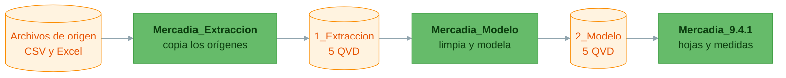

# Qlik Sense: QVDs y buenas prácticas de script

**Bloque 9 -- Qlik | Sesión 10 de 11**

[← Volver al índice del curso](../../README.md#bloque-9---qlik)

---

## 1. Introducción

Hasta ahora, cada vez que pulsamos **Cargar datos**, el script de Mercadia lee los cinco archivos de origen, los limpia, construye el calendario, integra los objetivos y comprueba la calidad. Con 65.000 líneas tarda unos segundos. En una empresa real, el mismo script tendría que leer millones de líneas de una base de datos, y no lo usaría una sola app, sino diez: la de ventas, la de compras, la de clientes... Cada una leería el origen otra vez, repetiría la misma limpieza y tendría su propia copia de la subrutina `ComprobarDuplicados`.

Hoy reorganizamos Mercadia como se organiza en una empresa:

- **QVDs**: el formato de archivo propio de Qlik, para guardar tablas ya cargadas y leerlas muy deprisa.
- **Una arquitectura en tres capas**: una app extrae los datos, otra construye el modelo y la app de análisis solo lee el resultado.
- **Una carga incremental**: cuando llega el archivo de un mes nuevo, se añade al histórico sin volver a leerlo todo.
- **Código compartido** entre apps con `$(Must_Include=...)`, como prometimos en la 9.1.4 y la 9.2.2.
- Un repaso de **buenas prácticas** de script y de rendimiento.

Por el camino nos encontraremos con una trampa de los QVDs que cambia las fechas de 2.023 líneas **sin que cambie ningún total**. Veremos cómo detectarla y cómo evitarla.

Al terminar tendremos tres apps (`Mercadia_Extraccion.qvf`, `Mercadia_Modelo.qvf` y `Mercadia_9.4.1.qvf`) y las ventas de octubre de 2026 incorporadas al modelo.

### Objetivos de la sesión
- Guardar tablas en QVD con `STORE` y leerlas con `LOAD ... (qvd)`.
- Organizar las apps de una empresa en **capas**: extracción, modelo y análisis.
- Compartir código entre apps con `$(Must_Include=...)`.
- Entender qué es una **carga optimizada**, qué la rompe y cuánto se nota.
- Construir una **carga incremental** de solo inserciones con `FileList` y `WHERE NOT Exists`.
- Aplicar las buenas prácticas de script y de rendimiento a un proyecto completo.

### Prerequisitos
- `Mercadia_9.3.1.qvf`, con las medidas maestras de Set Analysis.
- La 9.2.1 (`CONCATENATE` y la concatenación automática), la 9.2.2 (variables, `FOR EACH`, `IF`, subrutinas y la sección **Comprobaciones**) y la 9.3.1 (`P()`).
- Bloque 8: los extractos `.hyper` de Tableau.

---

## 2. Qué es un QVD

Un **QVD** (*QlikView Data*) es un archivo que guarda **una tabla** de Qlik tal y como está en memoria: sus campos, sus valores y sus filas. Se escribe con `STORE` y se lee con un `LOAD` normal:

```
// Guardar una tabla cargada en un archivo QVD
STORE ventas INTO [lib://Mercadia_Capas/1_Extraccion/ventas.qvd] (qvd);

// Leerla después, en esta app o en cualquier otra
ventas:
LOAD * FROM [lib://Mercadia_Capas/1_Extraccion/ventas.qvd] (qvd);
```

| | CSV | Excel | QVD |
|---|---|---|---|
| Lo lee... | Cualquier programa | Excel y casi cualquier programa | Solo Qlik |
| Tipos de datos | Todo es texto; Qlik interpreta al leer | Números, fechas y texto | Los de Qlik, ya interpretados |
| Tamaño de las ventas de Mercadia | 5,1 MB | | **1,8 MB** |
| Velocidad de lectura | Lenta: hay que interpretar cada valor | Lenta | **Muy rápida**, sobre todo en carga optimizada (sección 8) |

Es el equivalente al extracto `.hyper` de Tableau (8.2.5) y, en Power BI, a lo que hace un *dataflow*: una copia intermedia de los datos, en un formato pensado para la herramienta, que varias apps pueden reutilizar.

---

## 3. La arquitectura en tres capas



| Capa | App | Qué hace | Qué **no** hace |
|---|---|---|---|
| **Extracción** | `Mercadia_Extraccion` | Lee los orígenes y los guarda en QVD **tal cual** | No limpia ni transforma |
| **Modelo** | `Mercadia_Modelo` | Lee los QVD de extracción, aplica toda la limpieza y el modelado de las sesiones 9.1.2 a 9.2.3, y guarda las tablas finales en QVD | No tiene hojas |
| **Análisis** | `Mercadia_9.4.1` | Lee las tablas finales y las presenta | No transforma nada |

¿Por qué separar?

- **Se lee el origen una sola vez.** Si mañana hay una app de compras que necesita los productos, lee `productos.qvd`, no el CSV.
- **Cada capa tiene un responsable.** En una empresa, el equipo de datos mantiene la extracción y el modelo; los analistas construyen las apps de análisis sobre un modelo ya validado.
- **La app de análisis carga en un segundo**, aunque el modelo tarde minutos en construirse.
- **Un error en el origen no rompe el análisis**: si un día el CSV no llega, la app de análisis sigue con los QVD de ayer.

### Las carpetas y la conexión

En el Explorador de Windows creamos esta estructura dentro de `Documentos`:

```
Documentos\Mercadia_Capas\
    1_Extraccion\
    2_Modelo\
    Scripts\
```

Las tres apps necesitarán una conexión de carpeta nueva, **`Mercadia_Capas`**, que apunte a `Documentos\Mercadia_Capas`. Recuerda que en Qlik Sense Desktop las conexiones son **de cada app**: la crearemos en las tres, igual que creamos `Mercadia` en la 9.1.2 (**Editor de carga de datos** → **Crear nueva conexión** → **Carpeta**).

> **`STORE` no crea carpetas.** Si la carpeta de destino no existe, la carga falla. Por eso las creamos antes a mano.

---

## 4. Paso 1: el código común

Las tres apps necesitan las mismas rutas, y las dos primeras, la subrutina `ComprobarDuplicados` de la 9.2.2. En lugar de copiarlas en cada app, las escribimos **una vez** en un archivo de texto con extensión `.qvs` (*Qlik View Script*).

Abrimos el **Bloc de notas**, escribimos lo siguiente y lo guardamos como `Documentos\Mercadia_Capas\Scripts\mercadia_comun.qvs` (en **Tipo**, *Todos los archivos*; en **Codificación**, *UTF-8*):

```
// mercadia_comun.qvs
// Configuración y subrutinas comunes a todas las apps de Mercadia.

// Rutas
SET vRuta           = 'lib://Mercadia/';
SET vRutaExtraccion = 'lib://Mercadia_Capas/1_Extraccion/';
SET vRutaModelo     = 'lib://Mercadia_Capas/2_Modelo/';

// Comprueba que un campo no tiene valores repetidos en una tabla
SUB ComprobarDuplicados(pTabla, pCampo)
    _duplicados:
    LOAD * WHERE filas > 1;
    LOAD [$(pCampo)] AS valor_duplicado, Count([$(pCampo)]) AS filas
    RESIDENT [$(pTabla)]
    GROUP BY [$(pCampo)];

    LET vDuplicados = NoOfRows('_duplicados');
    IF vDuplicados > 0 THEN
        TRACE ### AVISO: $(vDuplicados) valores de $(pCampo) repetidos en $(pTabla);
    ELSE
        TRACE OK: $(pCampo) es unico en $(pTabla);
    END IF
    DROP TABLE _duplicados;
END SUB
```

Desde cualquier app, una sola línea lo incluye:

```
$(Must_Include=lib://Mercadia_Capas/Scripts/mercadia_comun.qvs);
```

Al cargar, Qlik sustituye esa línea por el contenido del archivo, como si lo hubiéramos escrito ahí. Si mañana cambia una ruta o mejoramos la subrutina, lo cambiamos en el `.qvs` y todas las apps lo recogen en su siguiente carga.

| Instrucción | Si el archivo no existe... |
|---|---|
| `$(Must_Include=...)` | La carga **falla** con un error |
| `$(Include=...)` | La carga **sigue** como si nada, sin avisar |

Usamos siempre `Must_Include`. Con `Include`, un archivo mal escrito o movido deja la app sin rutas ni subrutinas, y el error aparece mucho después, en un lugar que no tiene nada que ver.

> **El `.qvs` no se ve en el editor de carga.** Para cambiarlo hay que abrirlo con el Bloc de notas (o con Visual Studio Code). Por eso conviene poner en él solo lo que de verdad es común, y documentarlo bien.

---

## 5. Paso 2: la app de extracción

Creamos una app nueva, **`Mercadia_Extraccion`**, con las dos conexiones (`Mercadia` y `Mercadia_Capas`). En la sección **Main** dejamos las variables de formato que Qlik genera (las mismas de la 9.1.2). Creamos tres secciones más:

**Configuracion**:

```
$(Must_Include=lib://Mercadia_Capas/Scripts/mercadia_comun.qvs);
```

**Maestros**:

```
// Maestros: copia completa en cada carga
FOR EACH vTabla IN 'productos', 'clientes', 'objetivos_mensuales'
    [$(vTabla)]:
    LOAD * FROM [$(vRuta)$(vTabla).csv]
    (txt, utf8, embedded labels, delimiter is ',', msq);

    STORE [$(vTabla)] INTO [$(vRutaExtraccion)$(vTabla).qvd] (qvd);
    DROP TABLE [$(vTabla)];
NEXT vTabla

tiendas:
LOAD * FROM [$(vRuta)tiendas.xlsx]
(ooxml, embedded labels, table is Tiendas);

STORE tiendas INTO [$(vRutaExtraccion)tiendas.qvd] (qvd);
DROP TABLE tiendas;
```

El `FOR EACH` de la 9.2.2 recorre los tres CSV de maestros: los carga, los guarda en un QVD con el mismo nombre y borra la tabla de memoria, porque esta app no tiene que construir ningún modelo. `tiendas` va aparte porque es un Excel.

**Ventas**:

```
// Primera carga: el histórico completo
IF IsNull(QvdCreateTime('$(vRutaExtraccion)ventas.qvd')) THEN
    TRACE Primera carga: leemos el histórico completo;
    ventas:
    LOAD * FROM [$(vRuta)ventas_mercadia.csv]
    (txt, utf8, embedded labels, delimiter is ',', msq);

    STORE ventas INTO [$(vRutaExtraccion)ventas.qvd] (qvd);
    DROP TABLE ventas;
END IF
```

`QvdCreateTime` devuelve la fecha en que se creó un QVD, o nulo si el archivo no existe. Así, el histórico solo se lee la primera vez. Es la base de la carga incremental de la sección 9. (Ojo: este `LOAD *` lo cambiaremos en la sección 6.)

Cargamos. En `1_Extraccion` aparecen cinco archivos `.qvd`, y en el registro, `Primera carga: leemos el histórico completo` y `65.670 lines fetched`: todas las filas del CSV, también las de 0 unidades, porque la extracción no filtra.

> **Funciones de QVD.** Además de `QvdCreateTime`, el script tiene `QvdNoOfRecords` (número de filas), `QvdNoOfFields` (número de campos) y `QvdTableName`. Leen la cabecera del archivo sin cargarlo, y solo funcionan en el script, no en los gráficos.

---

## 6. Paso 3: la app de modelo, y la trampa de las fechas

### Construir la app

La app de modelo es el script que llevamos escribiendo desde la 9.1.2, leyendo de los QVD en lugar de los orígenes. La forma más rápida de crearla: con Desktop cerrado, copiamos `Mercadia_9.3.1.qvf` como **`Mercadia_Modelo.qvf`**. Así conserva el script y la conexión `Mercadia`. La abrimos, le cambiamos el título a `Mercadia_Modelo` (**Editar detalles**, como en la 9.1.3), borramos sus hojas (esta app no las necesita), creamos la conexión `Mercadia_Capas` y en el editor de carga hacemos estos cambios:

1. **Configuracion**: sustituimos su contenido por la línea del `Must_Include`.
2. **Subrutinas**: la borramos entera. `ComprobarDuplicados` llega ahora con el `Must_Include`.
3. En **Mapas**, **Ventas**, **Maestros** y **Objetivos**, cambiamos cada origen por su QVD:

| Antes | Después |
|---|---|
| `FROM [$(vRuta)productos.csv]` + formato | `FROM [$(vRutaExtraccion)productos.qvd] (qvd)` |
| `FROM [$(vRuta)ventas_mercadia.csv]` + formato | `FROM [$(vRutaExtraccion)ventas.qvd] (qvd)` |
| `FROM [$(vRuta)tiendas.xlsx]` + formato | `FROM [$(vRutaExtraccion)tiendas.qvd] (qvd)` |
| `FROM [$(vRuta)clientes.csv]` + formato | `FROM [$(vRutaExtraccion)clientes.qvd] (qvd)` |
| `FROM [$(vRuta)objetivos_mensuales.csv]` + formato | `FROM [$(vRutaExtraccion)objetivos_mensuales.qvd] (qvd)` |

`productos` aparece dos veces: en el `MAPPING LOAD` de **Mapas** y en **Maestros**. Las transformaciones (`Date#`, `Num#`, `ApplyMap`, el *preceding load*...) no cambian: el QVD de extracción tiene los mismos campos y los mismos textos que el archivo original. O eso creemos.

4. Al final, una sección nueva, **Guardar**:

```
// Las tablas del modelo, listas para la app de análisis
FOR EACH vTabla IN 'ventas', 'productos', 'tiendas', 'clientes', 'calendario'
    STORE [$(vTabla)] INTO [$(vRutaModelo)$(vTabla).qvd] (qvd);
    LET vFilas = NoOfRows('$(vTabla)');
    TRACE $(vTabla).qvd: $(vFilas) filas;
NEXT vTabla
```

### Comprobar, y descubrir el problema

Cargamos y miramos la hoja **Comprobaciones** (la app la conserva aunque hayamos borrado las demás hojas; si la hemos borrado, la recreamos con los KPIs de la 9.2.3):

| Comprobación | Valor esperado | Valor obtenido |
|---|---|---|
| Ventas netas | 323.808,28 € | 323.808,28 € ✔ |
| Líneas | 65.626 | 65.626 ✔ |
| Días del calendario | 1.004 | 1.004 ✔ |
| Líneas por año | 19.449 · 24.065 · 22.112 | **20.728 · 24.146 · 20.752** ✘ |

Los totales cuadran, el calendario va del 01/01/2024 al 30/09/2026 como siempre... y las líneas por año no. Más de mil líneas han cambiado de año, y ventas de 2026 han ido a parar a 2024. Si no hubiéramos tenido la comprobación por año de la 9.2.2, no nos habríamos dado cuenta.

### Qué ha pasado

En la 9.1.2 vimos que Qlik **interpreta** las fechas al leer un CSV, y que lee mal el formato corto: `25-1-24` (25 de enero de 2024) lo interpreta como año-mes-día, es decir, **24 de enero de 2025**. Para la app de las sesiones anteriores no era un problema, porque `Date#` vuelve a leer el **texto original** de cada fila, `25-1-24`, y lo interpreta bien.

Pero un QVD no guarda el texto de cada fila. Guarda cada **valor distinto** una sola vez, con un único texto, y las filas apuntan a ese valor. Para Qlik, la línea con `25-1-24` y una línea de verdad del 24/01/2025 tienen el **mismo valor** (el número 45.681), así que en el QVD acaban compartiendo **un solo texto**. Unas filas conservan el suyo y otras reciben el de las demás. Cuando la app de modelo aplica `Date#` sobre ese texto, una venta del 24/01/2025 puede salir como del 25/01/2024. En total, **2.023 líneas** cambian de fecha.

### La solución: en la extracción, el texto tal cual

La capa de extracción debe guardar los datos **exactamente como vienen**. Para los campos que el modelo va a interpretar, eso significa guardarlos como texto, con `Text()`, antes de que Qlik los interprete. Cambiamos el `LOAD` de ventas de la app de extracción:

```
    ventas:
    LOAD
        id_linea, id_ticket,
        Text(fecha) AS fecha,
        id_tienda, id_cliente, canal, id_producto, categoria,
        unidades, precio_unitario, descuento_pct, importe_neto
    FROM [$(vRuta)ventas_mercadia.csv]
    (txt, utf8, embedded labels, delimiter is ',', msq);
```

`Text(fecha)` devuelve el texto original de la fila, sin interpretar. Como ya no es un número, cada texto distinto es un valor distinto y ninguno se pierde.

Para repetir la primera carga, **borramos `ventas.qvd`** de la carpeta `1_Extraccion` (si existe, el `IF` se salta el histórico) y recargamos la extracción. Después recargamos el modelo: **19.449 · 24.065 · 22.112**. Todo cuadra.

> **¿Y los demás campos?** Los precios e importes llevan punto decimal (`0.74`) y Qlik no los interpreta como números, así que ya llegan como texto. `fecha_alta` de clientes tiene un único formato y no se mezcla con nada. El único campo con formatos mezclados es `fecha` de ventas. La regla general: **todo campo que el modelo vaya a interpretar con `Date#` o `Num#` se extrae con `Text()`**.

---

## 7. Paso 4: la app de análisis

La app de análisis es nuestra app de siempre, con un script mucho más corto. Con Desktop cerrado, copiamos `Mercadia_9.3.1.qvf` como **`Mercadia_9.4.1.qvf`**, la abrimos, le cambiamos el título a `Mercadia_9.4.1`, creamos la conexión `Mercadia_Capas` y **sustituimos** el script: dejamos **Main**, borramos el resto de secciones y creamos estas tres:

**Configuracion**:

```
$(Must_Include=lib://Mercadia_Capas/Scripts/mercadia_comun.qvs);
```

**Modelo**:

```
// El modelo ya está construido: lo leemos de la capa de modelo
ventas:     LOAD * FROM [$(vRutaModelo)ventas.qvd] (qvd);
productos:  LOAD * FROM [$(vRutaModelo)productos.qvd] (qvd);
tiendas:    LOAD * FROM [$(vRutaModelo)tiendas.qvd] (qvd);
clientes:   LOAD * FROM [$(vRutaModelo)clientes.qvd] (qvd);
calendario: LOAD * FROM [$(vRutaModelo)calendario.qvd] (qvd);

// Última fecha cargada, para el subtítulo de la hoja Resumen comercial (9.2.2)
LET vFechaMax = Num(Peek('fecha', -1, 'calendario'));
```

La última línea es necesaria por una propiedad de las variables que no habíamos visto: **una variable creada en el script se queda en la app con su último valor**, aunque el script deje de calcularla. El subtítulo **Datos hasta el...** del gráfico de evolución (9.2.2) usa `vFechaMax`, y este script ya no tiene la sección **Calendario** que la calculaba. Sin esta línea, el subtítulo seguiría diciendo 30/09/2026 cuando lleguen las ventas de octubre, sin ningún error. `Peek('fecha', -1, 'calendario')` lee la fecha de la última fila del calendario, que es la más reciente porque el calendario se genera en orden. `Num()` la guarda como número, para que `$(vFechaMax)` no se convierta en una división (9.2.2).

**Comprobaciones**:

```
CALL ComprobarDuplicados('clientes', 'id_cliente');
CALL ComprobarDuplicados('productos', 'id_producto');
CALL ComprobarDuplicados('tiendas', 'id_tienda');
CALL ComprobarDuplicados('calendario', 'fecha');
```

Cargamos. Las hojas, las medidas maestras y las variables de la 9.3.1 siguen ahí, porque viven en la app, no en el script. Y como el modelo que llega de los QVD es idéntico, todas las cifras son las de siempre: 323.808,28 €, 65.626 líneas, 36,6 % de marca propia, +27,3 % frente al año anterior.

Hemos pasado de un script de nueve secciones a uno de cuatro. La app de análisis ya no sabe nada de CSV, de formatos de fecha ni de mapas: lee cinco tablas y las presenta.

---

## 8. La carga optimizada

### Qué es

Cuando Qlik lee un QVD **sin transformar nada**, puede copiar sus datos directamente a memoria, sin interpretar valor a valor. Es la **carga optimizada**, y es varias veces más rápida que cualquier otra. En cuanto el `LOAD` hace cualquier cálculo con las filas, Qlik tiene que procesarlas una a una, y la carga deja de estar optimizada.

| `LOAD` desde un QVD | ¿Optimizado? |
|---|---|
| `LOAD *` | Sí |
| Elegir campos y renombrarlos: `LOAD id_linea, importe_neto AS importe` | Sí |
| `WHERE Exists(campo)`, con **un solo** campo | Sí |
| `LOAD DISTINCT` | Sí |
| Un campo calculado: `LOAD *, 1 AS uno` | **No** |
| Cualquier otro `WHERE`: `WHERE unidades <> 0` | **No** |
| `WHERE NOT Exists(campo)`, o `Exists` con dos parámetros | **No** |
| Una función sobre un campo: `Date(fecha)`, `Upper(tienda)` | **No** |

Las cinco cargas de nuestra app de análisis son `LOAD *`: todas optimizadas. Es la razón de construir el modelo en otra app.

### Cuánto se nota

Con 65.000 líneas, la diferencia es de milisegundos. Para verla, hicimos una prueba con una tabla de ventas multiplicada por 30, **2.034.570 filas**, en un portátil normal:

| `LOAD` | Tiempo |
|---|---|
| `LOAD * FROM ventas.qvd (qvd)` (optimizada) | Menos de 1 segundo |
| `LOAD *, 1 AS uno FROM ...` | 3 segundos |
| `LOAD * FROM ... WHERE unidades <> 0` | 4 segundos |

Con los 200 millones de filas de una cadena de supermercados real, es la diferencia entre una carga de un minuto y una de diez.

### Exists: filtrar sin perder la optimización

`WHERE Exists(campo)`, que vimos de pasada en la 9.2.1, es la única forma de **filtrar** un QVD sin perder la carga optimizada: carga solo las filas cuyo valor del campo ya se ha cargado antes en el script. Por ejemplo, para cargar solo las ventas de unas tiendas:

```
_tiendas_elegidas:
LOAD * INLINE [
id_tienda
M05
M17
];

ventas:
LOAD * FROM [$(vRutaModelo)ventas.qvd] (qvd)
WHERE Exists(id_tienda);        // optimizada: solo M05 y M17
```

La usaremos en la 9.4.2 para simular la seguridad por filas.

> **La trampa de `NOT Exists`.** `Exists` comprueba los valores cargados **hasta ese momento**, incluidas las filas que el propio `LOAD` va cargando. Con `WHERE NOT Exists(id_tienda)`, la primera fila de cada tienda pasa el filtro, y desde ese momento esa tienda ya "existe" y el resto de sus filas se descartan. Lo probamos sobre el QVD de extracción después de cargar `M05`: en lugar de las ventas de las demás tiendas, carga **46 filas**, una por cada variante de código de tienda (las 47 que vimos en la 9.1.1, menos `M05`). `NOT Exists` solo es seguro con un campo que no se repite, como `id_linea`.

---

## 9. Paso 5: la carga incremental

### El problema

Mercadia recibe cada mes un archivo con las ventas del mes anterior. En la carpeta del dataset tenemos el primero: **`ventas_mercadia_2026_10.csv`**, con las ventas de octubre de 2026 (2.149 líneas), con los mismos campos y los mismos problemas de calidad que el original: fechas en tres formatos, códigos de tienda en minúsculas o sin cero, canales y categorías sin normalizar.

Podríamos añadirlo al script como un archivo más, pero cada mes habría que tocar el script, y cada carga volvería a leer todo el histórico. Una **carga incremental** lee solo lo nuevo y lo añade a lo que ya teníamos.

### El patrón de solo inserciones

Hay varios patrones incrementales. El más sencillo, y el que corresponde a Mercadia, es el de **solo inserciones**: las líneas de venta, una vez registradas, no cambian ni se borran; solo llegan líneas nuevas. Añadimos al final de la sección **Ventas** de la app de extracción, después del `END IF`:

```
// Cargas siguientes: los archivos de meses nuevos...
FOR EACH vArchivo IN FileList('$(vRuta)ventas_mercadia_*.csv')
    TRACE Archivo nuevo: $(vArchivo);
    ventas:
    LOAD
        id_linea, id_ticket,
        Text(fecha) AS fecha,
        id_tienda, id_cliente, canal, id_producto, categoria,
        unidades, precio_unitario, descuento_pct, importe_neto
    FROM [$(vArchivo)]
    (txt, utf8, embedded labels, delimiter is ',', msq);
NEXT vArchivo

// ...y el histórico, sin las líneas que acabamos de leer
ventas:
LOAD * FROM [$(vRutaExtraccion)ventas.qvd] (qvd)
WHERE NOT Exists(id_linea);

STORE ventas INTO [$(vRutaExtraccion)ventas.qvd] (qvd);
LET vFilas = NoOfRows('ventas');
TRACE ventas.qvd: $(vFilas) filas;
```

Lo leemos por partes:

1. **`FileList`** devuelve los archivos de una carpeta que cumplen un patrón. `ventas_mercadia_*.csv` encuentra `ventas_mercadia_2026_10.csv`, y en el futuro `ventas_mercadia_2026_11.csv`, sin tocar el script. No encuentra `ventas_mercadia.csv`, porque al histórico le falta el `_` después de `mercadia`.
2. **Los archivos nuevos** se cargan primero, con el mismo `Text(fecha)` de la sección 6. Como todos tienen los mismos campos, se van añadiendo a la misma tabla por **concatenación automática** (9.2.1).
3. **El histórico** se añade después, también por concatenación automática, con `WHERE NOT Exists(id_linea)`: solo las líneas cuyo `id_linea` no ha llegado en un archivo nuevo. Es el uso seguro de `NOT Exists`: `id_linea` no se repite.
4. **`STORE`** sobrescribe el QVD con el histórico ampliado.

### Probarlo

Cargamos la extracción. En el registro:

```
Archivo nuevo: lib://Mercadia/ventas_mercadia_2026_10.csv
2.149 lines fetched
67.819 lines fetched
ventas.qvd: 67819 filas
```

65.670 líneas del histórico más 2.149 de octubre. Ahora **cargamos otra vez**: el resultado es de nuevo **67.819**. El archivo de octubre se ha vuelto a leer, pero sus líneas ya estaban en el QVD y `NOT Exists(id_linea)` ha descartado las copias antiguas. La carga es **repetible**: podemos lanzarla diez veces sin duplicar nada.

> **¿Por qué los archivos nuevos primero?** Si una línea llegara corregida en un archivo nuevo (con el mismo `id_linea` y otro importe), la versión nueva entraría primero y la antigua del QVD quedaría descartada. Cargando en este orden, el patrón también sirve para **actualizaciones**, no solo para inserciones.

### Las tres cargas, en orden

Las tres apps dependen unas de otras, así que se cargan **en orden**: primero `Mercadia_Extraccion`, después `Mercadia_Modelo` y por último `Mercadia_9.4.1`. En Desktop lo hacemos a mano; en Qlik Sense Enterprise y en Qlik Cloud se programa una **cadena de tareas** en la que cada carga empieza cuando termina la anterior.

Cargamos el modelo y la app de análisis. La hoja **Comprobaciones**:

| Comprobación | Antes | Con octubre |
|---|---|---|
| Líneas | 65.626 | **67.774** |
| Ventas netas | 323.808,28 € | **334.252,10 €** |
| Tickets | 23.007 | 23.760 |
| Días del calendario | 1.004 | 1.035 |
| Líneas por año | 19.449 · 24.065 · 22.112 | 19.449 · 24.065 · **24.260** |

Octubre aporta **2.148 líneas** (una de las 2.149 tiene 0 unidades y la filtra el modelo), 753 tickets y **10.443,82 €**. El calendario llega solo hasta el 31/10/2026, porque se construye con la primera y la última fecha de ventas (9.2.2). Y la comparación con el año anterior de la 9.3.1 se actualiza sola: ahora compara enero a octubre, 122.399,59 € frente a 97.487,35 €.

### Una consecuencia: el cumplimiento

Vamos a la hoja **Objetivos**. El **% Cumplimiento** ha pasado del 97,7 % al **100,8 %**, y casi todas las tiendas superan su objetivo. ¿Han mejorado las ventas? No: el archivo de objetivos llega hasta septiembre, y octubre tiene ventas pero **no tiene objetivo**. Sumamos 10.443,82 € más en el numerador y nada en el denominador.

Es un caso de la trampa de la granularidad de la 9.2.3, y se arregla con lo que aprendimos en la 9.3.1: las ventas del cumplimiento deben limitarse a los meses que **tienen** objetivo. Editamos la medida maestra **% Cumplimiento**:

```
Sum({<anio_mes = P({<objetivo_ventas = {"*"}>} anio_mes)>} importe_neto)
    / Sum(objetivo_ventas)
```

`objetivo_ventas = {"*"}` son los registros con algún objetivo; `P(...)` da los meses de esos registros, y el numerador solo suma las ventas de esos meses. El cumplimiento vuelve al **97,7 %**, y cuando llegue el archivo de objetivos de octubre, la medida lo incluirá sola.

---

## 10. Buenas prácticas de script

Repasamos las buenas prácticas que hemos ido aplicando en el bloque, y añadimos las de rendimiento. Son las que se esperan de un script profesional.

### Organización

| Práctica | En Mercadia |
|---|---|
| Una sección por cada bloque lógico, en el orden en que se ejecutan | **Main**, **Configuracion**, **Mapas**, **Ventas**... (9.1.2 a 9.2.3) |
| Rutas y parámetros en variables, nunca escritos en cada `FROM` | `vRuta`, `vRutaExtraccion`, `vRutaModelo` |
| Código común en un `.qvs` con `Must_Include` | `mercadia_comun.qvs` |
| Separar extracción, modelo y análisis en capas | Las tres apps de hoy |
| Comprobaciones al final de cada carga | Sección **Comprobaciones** y `ComprobarDuplicados` (9.2.2) |

### Legibilidad

| Práctica | Ejemplo |
|---|---|
| Nombres de campos en minúsculas, sin tildes, con `_` | `importe_neto`, `fecha_apertura` |
| Tablas temporales con `_` delante, y borradas al terminar | `_rango`, `_duplicados` |
| Un comentario que diga **por qué**, no qué | `// Los objetivos van en la tabla de hechos: comparten tienda y fecha` |
| Cada campo en su línea, alineado | Los `LOAD` de ventas de la 9.1.3 |
| `TRACE` en los puntos clave, con `###` en los avisos | `TRACE ### AVISO: ...` |

### Rendimiento

| Práctica | Por qué |
|---|---|
| **Cargas optimizadas** en la app de análisis | Sección 8 |
| **No cargar campos que no se usan** | Cada campo ocupa memoria aunque nadie lo use. En la 9.1.3 quitamos `importe_original` e `importe_calculado` con `DROP FIELDS` |
| **Claves numéricas** con `AutoNumber` cuando son textos largos o compuestas | 9.2.3 |
| **Menos valores distintos** | Qlik guarda cada valor distinto una vez. Un campo de fecha y hora con segundos puede tener millones de valores; separado en `fecha` y `hora` tiene unos pocos miles |
| **Set Analysis antes que `If`** en las medidas | 9.3.1 |
| **Cálculos en el script, no en los gráficos** | Un campo calculado una vez en la carga es más barato que una expresión que se recalcula con cada selección. `es_fidelizado` y `es_devolucion` son ejemplos |

---

## 11. El script completo de la sesión

**`mercadia_comun.qvs`**: el de la sección 4.

**`Mercadia_Extraccion`**: **Main** (variables de formato), **Configuracion** (el `Must_Include`), **Maestros** (sección 5) y **Ventas**:

```
// Primera carga: el histórico completo
IF IsNull(QvdCreateTime('$(vRutaExtraccion)ventas.qvd')) THEN
    TRACE Primera carga: leemos el histórico completo;
    ventas:
    LOAD
        id_linea, id_ticket,
        Text(fecha) AS fecha,
        id_tienda, id_cliente, canal, id_producto, categoria,
        unidades, precio_unitario, descuento_pct, importe_neto
    FROM [$(vRuta)ventas_mercadia.csv]
    (txt, utf8, embedded labels, delimiter is ',', msq);

    STORE ventas INTO [$(vRutaExtraccion)ventas.qvd] (qvd);
    DROP TABLE ventas;
END IF

// Cargas siguientes: los archivos de meses nuevos...
FOR EACH vArchivo IN FileList('$(vRuta)ventas_mercadia_*.csv')
    TRACE Archivo nuevo: $(vArchivo);
    ventas:
    LOAD
        id_linea, id_ticket,
        Text(fecha) AS fecha,
        id_tienda, id_cliente, canal, id_producto, categoria,
        unidades, precio_unitario, descuento_pct, importe_neto
    FROM [$(vArchivo)]
    (txt, utf8, embedded labels, delimiter is ',', msq);
NEXT vArchivo

// ...y el histórico, sin las líneas que acabamos de leer
ventas:
LOAD * FROM [$(vRutaExtraccion)ventas.qvd] (qvd)
WHERE NOT Exists(id_linea);

STORE ventas INTO [$(vRutaExtraccion)ventas.qvd] (qvd);
LET vFilas = NoOfRows('ventas');
TRACE ventas.qvd: $(vFilas) filas;
```

**`Mercadia_Modelo`**: el script de la 9.2.3 con los cambios de la sección 6: **Configuracion** con el `Must_Include`, sin **Subrutinas**, los cinco orígenes leídos de `1_Extraccion` y la sección **Guardar** al final. Orden: **Main**, **Configuracion**, **Mapas**, **Ventas**, **Maestros**, **Calendario**, **Objetivos**, **Comprobaciones** y **Guardar**.

**`Mercadia_9.4.1`**: **Main**, **Configuracion**, **Modelo** y **Comprobaciones** (sección 7).

La hoja **Comprobaciones** de `Mercadia_9.4.1` queda así:

| Comprobación | Cómo | Valor esperado hoy |
|---|---|---|
| Líneas | KPI `Count(id_linea)` | 67.774 |
| Ventas netas | KPI `Sum(importe_neto)` | 334.252,10 € |
| Días del calendario | KPI `Count(DISTINCT fecha)` | 1.035 |
| Líneas por año | Tabla `anio` × `Count(id_linea)` | 19.449 · 24.065 · 24.260 |
| Objetivo total | KPI `Sum(objetivo_ventas)` | 331.570 € |
| % Cumplimiento | Medida maestra | 97,7 % |

Guardamos las tres apps.

---

## 12. Lo que Qlik ha hecho por debajo

Un QVD guarda una tabla en el mismo formato en que Qlik la tiene en memoria, que tiene dos partes:

1. **Las tablas de símbolos**: para cada campo, la lista de sus **valores distintos**, cada uno una sola vez. `canal` tiene dos valores; `id_linea`, uno por cada línea.
2. **La tabla de registros**: para cada fila, un **puntero** a la posición de su valor en cada tabla de símbolos. Son números pequeños, empaquetados en el mínimo de bits posible.

Por eso un QVD ocupa la tercera parte que el CSV: el texto `Online` no se repite miles de veces, sino que se guarda una vez y las filas apuntan a él. Por eso la carga optimizada es tan rápida: Qlik copia esas dos partes a memoria tal cual, sin mirar los valores. Y por eso transformar algo rompe la optimización: hay que reconstruir las filas una a una.

Y por eso ocurrió la trampa de la sección 6. En una tabla de símbolos, cada valor tiene **un solo texto**. Si dos filas tienen el mismo número con textos distintos (`25-1-24` mal interpretado y `24/01/2025`), en el QVD solo sobrevive uno. Mientras leíamos el CSV, cada fila conservaba su texto hasta el `Date#` del modelo. Al pasar por un QVD sin `Text()`, el texto se perdió antes de llegar a él.

---

## 13. Ejercicios

**Ejercicio 1: el tamaño de los QVD.** Mira en el Explorador de Windows el tamaño de los QVD de `1_Extraccion` y de `2_Modelo`. El `ventas.qvd` de la capa de modelo tiene más filas y más campos que el de extracción. ¿Por qué ocupa casi lo mismo?

<details>
<summary>Ver la solución</summary>

El de extracción ocupa unos **1,9 MB**, con 67.819 filas y 12 campos. El de modelo, unos **2,0 MB**, con **68.375** filas (67.774 líneas más los 601 objetivos concatenados en la 9.2.3) y varios campos más (`coste_linea`, `es_fidelizado`, `es_devolucion`, `importe_corregido`, `objetivo_ventas`...). Casi no crece porque sus valores están limpios: `id_tienda` tiene 19 valores en lugar de 47 variantes, `canal` 2, y los campos nuevos como `es_fidelizado` solo tienen dos valores (`Si` y `No`). Como un QVD guarda cada valor distinto una sola vez (sección 12), un campo con pocos valores distintos ocupa muy poco, aunque tenga 68.000 filas. **Limpiar también reduce el tamaño.**

</details>

**Ejercicio 2: mide la carga optimizada.** En una app de pruebas, carga `ventas.qvd` de la capa de modelo y multiplícalo con un bucle (`FOR i = 1 TO 29` con `CONCATENATE (ventas) LOAD * FROM ...`). Guarda el resultado en `ventas_grande.qvd`, borra la tabla y compara el tiempo de cargarlo con `LOAD *` y con `LOAD *, 1 AS uno`. Para medir, guarda `Now(1)` en una variable antes y después de cada `LOAD`.

<details>
<summary>Ver la solución</summary>

```
LET t0 = Now(1);
a: LOAD * FROM [$(vRutaModelo)ventas_grande.qvd] (qvd);
LET t1 = Now(1);
LET vSegundos = Round((t1 - t0) * 86400, 0.01);
TRACE Carga optimizada: $(vSegundos) segundos;
DROP TABLE a;
```

Y lo mismo con `LOAD *, 1 AS uno`. Las fechas de Qlik se miden en días, así que la diferencia se multiplica por 86.400 para pasarla a segundos. Con unos dos millones de filas, la carga optimizada tarda menos de un segundo y la otra varios. Los tiempos dependen del equipo, pero la proporción se mantiene. Al terminar, borra `ventas_grande.qvd`.

</details>

**Ejercicio 3: llega noviembre.** Imagina que mañana llega `ventas_mercadia_2026_11.csv`. ¿Qué hay que cambiar en las tres apps para incorporarlo? ¿Y si por error alguien deja en la carpeta una copia de octubre llamada `ventas_mercadia_2026_10 - copia.csv`?

<details>
<summary>Ver la solución</summary>

**Nada.** `FileList` encuentra el archivo nuevo, la extracción lo añade, y el modelo y el análisis lo recogen al cargar en orden. Es la ventaja del patrón.

Con la copia de octubre, `FileList` también la encuentra (cumple el patrón `ventas_mercadia_*.csv`) y la carga. Pero sus `id_linea` son los mismos que los del archivo original: el primer archivo los carga y, al cargar el segundo, la concatenación automática **sí** los añade, porque el filtro `NOT Exists` solo está en el `LOAD` del histórico. Resultado: las líneas de octubre **duplicadas**. Para protegerse, se añade también `WHERE NOT Exists(id_linea)` al `LOAD` de los archivos nuevos, y la comprobación de duplicados: `CALL ComprobarDuplicados('ventas', 'id_linea');` antes del `STORE`.

</details>

**Ejercicio 4: Exists en la app de análisis.** Haz que la app de análisis cargue solo las ventas de las tiendas de la Comunitat Valenciana, sin perder la carga optimizada de `ventas`. ¿Cuántas líneas y cuántas ventas quedan?

<details>
<summary>Ver la solución</summary>

Cargamos primero `tiendas` con un filtro (esta carga no está optimizada, pero tiene 19 filas) y después `ventas` con `Exists`:

```
tiendas:    LOAD * FROM [$(vRutaModelo)tiendas.qvd] (qvd)
            WHERE comunidad = 'Comunitat Valenciana';
ventas:     LOAD * FROM [$(vRutaModelo)ventas.qvd] (qvd)
            WHERE Exists(id_tienda);
```

Quedan las 5 tiendas valencianas, con **90.024,33 €** de ventas (con octubre). Si cargáramos `ventas` antes que `tiendas`, `Exists` no tendría con qué comparar. Es la técnica de la 9.4.2.

</details>

---

## 14. Errores comunes y troubleshooting

**1. "Cannot open file" al hacer `STORE`.** La carpeta de destino no existe o la conexión `Mercadia_Capas` no apunta a donde creemos. `STORE` no crea carpetas.

**2. "La app no encuentra `vRuta` ni `ComprobarDuplicados`."** El `Must_Include` no está, o está después de las secciones que lo usan. Va en **Configuracion**, justo después de **Main**.

**3. "Error en `Must_Include`: el archivo no existe."** Revisa el nombre y la extensión: el Bloc de notas puede haberlo guardado como `mercadia_comun.qvs.txt`. Activa en el Explorador **Ver** → **Extensiones de nombre de archivo**.

**4. "Los totales cuadran pero las cifras por año no."** La extracción no guarda las fechas con `Text()` (sección 6).

**5. "He añadido el `Text(fecha)` y nada cambia."** El `IF` se salta el histórico porque `ventas.qvd` ya existe. Borra el QVD y recarga.

**6. "Cada vez que cargo, las ventas crecen."** El histórico se carga sin `WHERE NOT Exists(id_linea)`, o los archivos nuevos se cargan después del histórico.

**7. "El modelo no tiene las ventas de octubre."** Las apps se han cargado en otro orden. Siempre: extracción, modelo, análisis.

**8. "El % Cumplimiento pasa del 100 %."** Hay ventas de meses sin objetivo (sección 9).

**9. "La app de análisis ha perdido las hojas."** Se ha copiado otra app, o se ha borrado la app equivocada. Las hojas viven en la app: la de análisis debe ser una copia de `Mercadia_9.3.1.qvf`.

---

## 15. Conclusión

En esta sesión hemos convertido el script de Mercadia en un proyecto con estructura de empresa. Hemos aprendido qué es un QVD, cómo se escribe con `STORE` y por qué ocupa un tercio del CSV y se lee mucho más rápido. Hemos repartido el trabajo en tres capas: una app de extracción que copia los orígenes, una de modelo que aplica toda la limpieza de las sesiones anteriores y una de análisis que se limita a leer cinco tablas con cargas optimizadas. Hemos compartido las rutas y la subrutina de comprobación en un archivo `.qvs` con `Must_Include`. Por el camino hemos descubierto una trampa seria: al pasar por un QVD, 2.023 fechas cambiaron sin que cambiara ningún total, y lo detectamos gracias a la comprobación por año; la solución fue extraer con `Text()`. Hemos construido una carga incremental repetible con `FileList` y `NOT Exists`, que ha incorporado las ventas de octubre de 2026, y hemos corregido con Set Analysis el % de cumplimiento, que esos datos nuevos habían inflado. En la 9.4.2, la última sesión del bloque, veremos la seguridad por filas con Section Access.

---

## 16. Para profundizar

### Incrementales con actualizaciones y borrados

Además del patrón de solo inserciones, hay otros dos clásicos. **Inserciones y actualizaciones**: el origen tiene un campo con la fecha de modificación de cada fila; se leen las filas modificadas desde la última carga, y el histórico se añade con `NOT Exists` de la clave, como hemos hecho. **Inserciones, actualizaciones y borrados**: además, se leen todas las claves que siguen existiendo en el origen y se hace un `INNER JOIN` con el resultado, para eliminar las que se han borrado. Los tres usan la misma idea: lo nuevo primero y el histórico después, sin duplicar claves.

### Carga binaria

`Binary [lib://.../Mercadia_Modelo.qvf];`, como **primera** línea del script, carga el modelo de datos completo de otra app, con todas sus tablas y asociaciones, en un solo paso. Es una alternativa a la capa de QVDs cuando varias apps de análisis comparten exactamente el mismo modelo. Solo puede haber un `Binary` por script.

### QVD por periodos

Con cientos de millones de filas, en lugar de un único `ventas.qvd` se guarda un QVD por mes (`ventas_2026_10.qvd`) y la carga incremental solo reescribe el del mes en curso. La app de análisis lee los que necesita con un `FOR EACH` sobre `FileList`.

### Otros formatos

Las versiones recientes de Qlik Sense también pueden escribir y leer archivos **Parquet**, un formato abierto que entienden otras herramientas (Python, Spark, Databricks). Se usa cuando los datos tienen que compartirse fuera de Qlik.

---

## 17. Recursos

- **Ayuda oficial de Qlik Sense para Windows** (en español, versión May 2026): <https://help.qlik.com/es-ES/sense/May2026/Content/Sense_Helpsites/Home.htm>
- **Qlik Design Blog**, con artículos sobre cargas optimizadas, incrementales y arquitecturas por capas: <https://community.qlik.com/t5/Design/bg-p/qlik-design-blog>
- **Qlik Community**: <https://community.qlik.com/>

### Documentación oficial de esta sesión

| Tema | Página de la ayuda |
|---|---|
| QVD | [Trabajar con archivos QVD][doc-qvd] · [Store][doc-store] · [QvdCreateTime][doc-file] |
| Carga incremental | [Cargar registros nuevos y actualizados con la carga incremental][doc-incremental] · [Exists][doc-exists] · [FileList][doc-filelist] |
| Código compartido | [Include][doc-include] |
| Rendimiento | [Mejores prácticas recomendadas en modelado de datos][doc-buenas-practicas] · [Binary][doc-binary] |

---

*Guía del alumno · Sesión 10 · Bloque 9 - Qlik · Mercadia*

[doc-qvd]: https://help.qlik.com/es-ES/sense/May2026/Subsystems/Hub/Content/Sense_Hub/Scripting/work-with-QVD-files.htm
[doc-store]: https://help.qlik.com/es-ES/sense/May2026/Subsystems/Hub/Content/Sense_Hub/Scripting/ScriptRegularStatements/Store.htm
[doc-file]: https://help.qlik.com/es-ES/sense/May2026/Subsystems/Hub/Content/Sense_Hub/Scripting/FileFunctions/QvdCreateTime.htm
[doc-incremental]: https://help.qlik.com/es-ES/sense/May2026/Subsystems/Hub/Content/Sense_Hub/LoadData/use-QVD-files-incremental-load.htm
[doc-exists]: https://help.qlik.com/es-ES/sense/May2026/Subsystems/Hub/Content/Sense_Hub/Scripting/InterRecordFunctions/Exists.htm
[doc-filelist]: https://help.qlik.com/es-ES/sense/May2026/Subsystems/Hub/Content/Sense_Hub/Scripting/ScriptControlStatements/For%20Each.htm
[doc-include]: https://help.qlik.com/es-ES/sense/May2026/Subsystems/Hub/Content/Sense_Hub/Scripting/ScriptControlStatements/Include.htm
[doc-buenas-practicas]: https://help.qlik.com/es-ES/sense/May2026/Subsystems/Hub/Content/Sense_Hub/DataModeling/best-practices-data-modeling.htm
[doc-binary]: https://help.qlik.com/es-ES/sense/May2026/Subsystems/Hub/Content/Sense_Hub/Scripting/ScriptRegularStatements/Binary.htm
