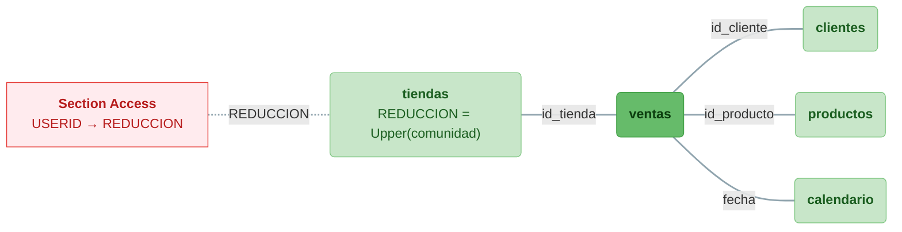

# Qlik Sense: seguridad con Section Access

**Bloque 9 -- Qlik | Sesión 11 de 11**

[← Volver al índice del curso](../../README.md#bloque-9---qlik)

---

## 1. Introducción

Mercadia quiere abrir su app a los responsables regionales. Ana dirige las tiendas de Andalucía, Luis las de la Comunitat Valenciana y Murcia, y Marta las de Madrid y Castilla-La Mancha. Cada uno debe ver **solo sus tiendas**. Además, Luis trabaja con una empresa externa y no debe ver los **costes**. La dirección lo ve todo.

Es el mismo problema que resolvimos en Power BI con la **seguridad a nivel de fila** (RLS) y en Tableau con los **filtros de usuario**. En Qlik se resuelve con **Section Access**: una sección especial del script que dice qué usuarios pueden abrir la app y qué datos ve cada uno.

Hay un inconveniente: **Section Access no funciona en Qlik Sense Desktop**. Desktop es una herramienta personal: no tiene usuarios ni inicio de sesión, y si una app lleva Section Access, la carga falla. Por eso la sesión tiene dos partes. Primero escribiremos el script completo, tal como iría en un servidor de Qlik Sense Enterprise o en Qlik Cloud, y repasaremos sus trampas, que son muchas. Después **simularemos** su efecto en Desktop con una variable de usuario y `WHERE Exists`, para ver con datos reales qué vería cada responsable.

Al terminar tendremos `Mercadia_9.4.2.qvf`, la última app del bloque, con la seguridad escrita y una simulación que se cambia con una sola línea.

### Objetivos de la sesión
- Distinguir **autenticación** (quién eres) y **autorización** (qué puedes ver), y saber qué parte resuelve Qlik.
- Escribir una tabla de **Section Access** con `ACCESS`, `USERID`, un campo de **reducción** y `OMIT`.
- Conectar la tabla de permisos con el modelo mediante el **campo de reducción**.
- Reconocer las trampas de Section Access: mayúsculas, el asterisco, usuarios no listados, `OMIT` y quedarse fuera de la app.
- **Simular** la seguridad en Desktop con `WHERE Exists`.
- Saber cómo se activa Section Access en Qlik Sense Enterprise y en Qlik Cloud.

### Prerequisitos
- `Mercadia_9.4.1.qvf`, la app de análisis que lee el modelo de `2_Modelo`, y las apps `Mercadia_Extraccion` y `Mercadia_Modelo` cargadas.
- La 9.4.1 (cargas optimizadas, `WHERE Exists` y el archivo `mercadia_comun.qvs`) y la 9.2.2 (`IF`, `LET` y `Peek`).
- Bloque 7: roles y RLS en Power BI. Bloque 8: filtros de usuario en Tableau.

Como siempre, empezamos con una copia: en `Documentos\Qlik\Sense\Apps`, con Desktop cerrado, copiamos `Mercadia_9.4.1.qvf` como `Mercadia_9.4.2.qvf`, la abrimos y le cambiamos el título a `Mercadia_9.4.2` (**Editar detalles**, como en la 9.1.3).

---

## 2. Conceptos

### Autenticación y autorización

| | Pregunta | Quién la resuelve |
|---|---|---|
| **Autenticación** | ¿Quién eres? | El servidor: el directorio activo de la empresa en Qlik Sense Enterprise, el proveedor de identidad en Qlik Cloud |
| **Autorización** | ¿Qué puedes ver? | **Section Access**, dentro de la app |

Section Access no pide contraseñas ni comprueba identidades: recibe del servidor el nombre del usuario ya autenticado y lo busca en su tabla de permisos. Por eso no puede funcionar en Desktop: no hay servidor que diga quién es el usuario.

### Dos tipos de restricción

| Restricción | Qué hace | En Section Access |
|---|---|---|
| **Por filas** (reducción de datos) | Cada usuario ve solo algunas filas: las de sus tiendas | Un **campo de reducción** |
| **Por columnas** | Cada usuario ve todos los campos menos algunos: los costes | El campo **`OMIT`** |

### Comparación con Power BI y Tableau

| | Power BI | Tableau | Qlik |
|---|---|---|---|
| Dónde se define | Roles en el modelo, con un filtro DAX | Filtro de usuario o cálculo con `USERNAME()` | Script de carga |
| Cuándo se aplica | Al consultar | Al consultar | **Al abrir la app**: los datos no permitidos se eliminan de la memoria de ese usuario |
| Ocultar columnas | Seguridad a nivel de objeto (OLS) | Permisos sobre el origen | `OMIT` |
| Probarlo en local | **Ver como** rol en Desktop | **Filtrar como usuario** | No: hay que simularlo |
| Si el usuario no está en la tabla | Ve todo o nada, según el diseño | Ve lo que diga el cálculo | **No puede abrir la app** |

La diferencia más importante está en la fila de **cuándo se aplica**. En Qlik, cuando Ana abre la app, el servidor carga en memoria **solo** las filas de Andalucía. Los datos de las demás comunidades no están ocultos ni filtrados: para Ana, **no existen**. Ninguna selección, expresión o Set Analysis puede llegar a ellos.

---

## 3. Anatomía de Section Access

Section Access se escribe en el script, entre dos instrucciones:

```
Section Access;
LOAD * INLINE [
ACCESS, USERID, REDUCCION
...
];
Section Application;
```

- **`Section Access;`** indica que lo que viene a continuación es la tabla de permisos. No forma parte del modelo: no aparece en el visor del modelo ni en los paneles de filtrado.
- **`Section Application;`** vuelve a la carga normal. Todo lo que hemos escrito hasta hoy es *Section Application*, aunque nunca lo hayamos escrito.

La tabla de permisos usa **campos de sistema**, con nombres fijos:

| Campo | Obligatorio | Qué contiene |
|---|---|---|
| `ACCESS` | Sí | `ADMIN` o `USER` |
| `USERID` | Sí (o `USER.EMAIL` en Qlik Cloud) | El usuario: `DOMINIO\usuario` en Qlik Sense Enterprise; el identificador del proveedor de identidad en Qlik Cloud. `*` significa todos los usuarios |
| `USER.EMAIL` | No | El correo del usuario. Solo en Qlik Cloud |
| `GROUP` | No | Un grupo del directorio, para dar permisos a muchos usuarios a la vez |
| `OMIT` | No | El nombre de un campo que este usuario no verá |

Y cualquier otro campo de la tabla es un **campo de reducción**: debe existir con el mismo nombre en el modelo, y cada usuario solo verá los registros asociados a sus valores.

---

## 4. Paso 1: la tabla de permisos de Mercadia

Restringimos por **comunidad autónoma**, el nivel en el que trabajan los responsables regionales:

```
Section Access;
LOAD * INLINE [
ACCESS, USERID, REDUCCION, OMIT
ADMIN, INTERNAL\SA_SCHEDULER, *,
ADMIN, MERCADIA\DIRECCION, *,
USER, MERCADIA\ANA, ANDALUCIA,
USER, MERCADIA\LUIS, COMUNITAT VALENCIANA, COSTE_LINEA
USER, MERCADIA\LUIS, REGION DE MURCIA, COSTE_LINEA
USER, MERCADIA\MARTA, COMUNIDAD DE MADRID,
USER, MERCADIA\MARTA, CASTILLA-LA MANCHA,
];
Section Application;
```

Lo leemos fila a fila:

| Fila | Significa |
|---|---|
| `INTERNAL\SA_SCHEDULER` | La cuenta con la que Qlik Sense Enterprise ejecuta las cargas programadas. Sin esta fila, el servidor no puede recargar la app |
| `MERCADIA\DIRECCION` | Ve todas las comunidades de la tabla (`*`) y todos los campos |
| `MERCADIA\ANA` | Solo Andalucía |
| `MERCADIA\LUIS` (dos filas) | La Comunitat Valenciana **y** la Región de Murcia: un usuario con varias filas ve la suma de todas. Sin el campo `COSTE_LINEA` |
| `MERCADIA\MARTA` (dos filas) | La Comunidad de Madrid y Castilla-La Mancha |

Todo va en **mayúsculas**: los nombres de los campos y los valores. Es la primera regla de Section Access, y la veremos en detalle en la sección 6.

---

## 5. Paso 2: el campo de reducción en el modelo

La tabla de permisos tiene un campo `REDUCCION` con valores como `ANDALUCIA`. Para que reduzca los datos, el modelo necesita un campo **con el mismo nombre** y **los mismos valores**. Los nombres de comunidad del modelo están en minúsculas (`Andalucia`, `Comunitat Valenciana`), así que lo creamos en la tabla de tiendas con `Upper`. En la sección **Modelo** de la app sustituimos la carga de `tiendas`:

```
tiendas:
LOAD *, Upper(comunidad) AS REDUCCION
FROM [$(vRutaModelo)tiendas.qvd] (qvd);
```

Esta carga ya no está optimizada (calcula un campo), pero `tiendas` tiene 19 filas: no se nota. Las demás siguen siendo `LOAD *`.

Así queda el camino de la reducción por el modelo:



Cuando Ana abre la app, Qlik hace lo mismo que si seleccionara `REDUCCION = ANDALUCIA` y **eliminara** todo lo que queda en gris: las tiendas de otras comunidades, sus ventas y sus objetivos, los clientes que nunca han comprado en Andalucía y los productos que no se han vendido allí. Lo que queda es el modelo de Ana.

### El campo que se oculta

`OMIT` contiene el nombre de un **campo** del modelo. Como Section Access convierte todos sus valores a mayúsculas, el campo que se omite también debe llamarse en mayúsculas en el modelo. En la sección **Modelo**, después de las cargas, añadimos:

```
// Section Access trabaja en mayúsculas: el campo que se omite también
RENAME FIELD coste_linea TO COSTE_LINEA;
```

Y en **Elementos maestros** editamos **Margen bruto %**: `Sum(importe_neto - COSTE_LINEA) / Sum(importe_neto)`. Sigue valiendo 31,7 %.

---

## 6. Las trampas de Section Access

Section Access es sencillo de escribir y muy fácil de escribir **mal**. Estas son las trampas que conviene conocer antes de activarlo en un servidor.

### 1. Las mayúsculas

Todos los nombres de campo y todos los valores de la tabla de permisos deben ir en mayúsculas, y Qlik los convierte a mayúsculas aunque no lo estén. Si el campo de reducción del modelo se llamara `reduccion`, o sus valores fueran `Andalucia`, no coincidirían con nada. Por eso usamos `Upper(comunidad)` en el modelo y renombramos `COSTE_LINEA`.

### 2. El asterisco no es "todo"

En la columna de reducción, `*` significa **todos los valores que aparecen en esa columna de la tabla de permisos**, no todos los valores del modelo. La dirección ve las cinco comunidades porque Ana, Luis y Marta las tienen asignadas. Si Mercadia abriera una tienda en Cataluña y nadie tuviera `CATALUNA` en la tabla, **ni siquiera la dirección** vería sus ventas. La solución es añadir una fila con el valor nuevo (por ejemplo, a la propia dirección) o, mejor, generar la tabla de permisos desde los datos (sección 15).

### 3. Quien no está, no entra

Section Access aplica la **exclusión estricta**: un usuario que no aparece en la tabla **no puede abrir la app**. No ve una app vacía: recibe un mensaje de acceso denegado. Lo mismo le pasa a un usuario `USER` cuyos valores de reducción no coinciden con ningún dato (por ejemplo, una comunidad mal escrita).

### 4. Quedarse fuera de la propia app

Si quien desarrolla la app no está en la tabla, o lo está con un valor equivocado, tras la carga **no podrá volver a abrirla** para corregirlo. Por eso:

- La fila del desarrollador (o del grupo de desarrolladores) se escribe la **primera**, como `ADMIN` con `*`.
- Antes de cargar una app con Section Access, se guarda una **copia sin seguridad**.
- Si aun así ocurre, en el servidor se puede abrir la app **sin datos** y corregir el script, siempre que se tengan permisos para editarla y recargarla.

### 5. La cuenta de las cargas programadas

En Qlik Sense Enterprise, las cargas programadas las ejecuta la cuenta `INTERNAL\SA_SCHEDULER`. Si no está en la tabla como `ADMIN`, la app se puede recargar a mano pero falla en la tarea programada.

### 6. OMIT y las medidas

Luis no tiene el campo `COSTE_LINEA`. ¿Qué ve en el KPI **Margen bruto %**? No un error, sino **0,0 %**: para él la expresión resta un campo que no existe, el resultado es nulo y la suma, cero. Un dato falso con apariencia de verdadero. Al usar `OMIT`, hay que revisar qué medidas usan el campo y ocultar esos objetos a quien no lo tiene, por ejemplo con una **condición de visualización** que compruebe si el campo existe. Y nunca se aplica `OMIT` a un campo clave: el campo seguiría apareciendo en el visor del modelo, sin contenido, y las asociaciones dejarían de funcionar para ese usuario.

### 7. Ocultar una hoja no es seguridad

Ocultar una hoja o un gráfico con una condición de visualización **no** protege los datos: siguen en la app, y cualquier usuario puede crear su propia hoja o usar el asistente de IA para verlos. La única seguridad real es la que elimina los datos: Section Access.

---

## 7. Paso 3: lo que pasa en Desktop

Para comprobarlo, en una app de pruebas (nunca en la nuestra) creamos una sección con la tabla de permisos de la sección 4 y cargamos. La carga se detiene en la línea `Section Access` con este error:

```
Section Access
Error: Section access not supported in personal mode
Execution Failed
```

Desktop funciona en **modo personal**: no tiene usuarios, así que no tiene a quién aplicar los permisos, y la carga falla. No hay forma de activarlo.

En nuestra app, creamos una sección **Seguridad** después de **Configuracion** con el script de la sección 4 **comentado**: lo seleccionamos y pulsamos `Ctrl + K`, o lo rodeamos con `/*` y `*/`. Así queda escrito y documentado, listo para descomentarlo el día que la app se publique en un servidor:

```
/*
Section Access;
LOAD * INLINE [
ACCESS, USERID, REDUCCION, OMIT
...
];
Section Application;
*/
```

---

## 8. Paso 4: simular la seguridad en Desktop

Aunque Desktop no pueda aplicar Section Access, podemos **reproducir su efecto** en el script: cargar solo los datos que vería un usuario concreto. Es lo que haría el servidor al abrir la app, hecho por nosotros durante la carga.

### La variable del usuario

En **Configuracion**, después del `Must_Include`:

```
// Usuario que simulamos (en un servidor, lo diría el inicio de sesión)
SET vUsuario = 'MERCADIA\ANA';
```

### La sección Simulacion

Creamos una sección **Simulacion** después de **Seguridad**:

```
// La misma tabla de permisos, como tabla normal
_permisos:
LOAD * INLINE [
ACCESS, USERID, REDUCCION, OMIT
ADMIN, MERCADIA\DIRECCION, *,
USER, MERCADIA\ANA, ANDALUCIA,
USER, MERCADIA\LUIS, COMUNITAT VALENCIANA, COSTE_LINEA
USER, MERCADIA\LUIS, REGION DE MURCIA, COSTE_LINEA
USER, MERCADIA\MARTA, COMUNIDAD DE MADRID,
USER, MERCADIA\MARTA, CASTILLA-LA MANCHA,
];

// Las filas del usuario simulado
_reduccion:
LOAD DISTINCT
    REDUCCION AS comunidad_permitida,
    OMIT      AS campo_omitido
RESIDENT _permisos
WHERE USERID = Upper('$(vUsuario)');

// Exclusión estricta: si no está en la tabla, no entra
IF NoOfRows('_reduccion') = 0 THEN
    TRACE ### Acceso denegado: $(vUsuario) no está en la tabla de permisos;
    EXIT SCRIPT;
END IF

LET vOmitir = Peek('campo_omitido', 0, '_reduccion');

// El asterisco: todos los valores de la columna REDUCCION
IF Peek('comunidad_permitida', 0, '_reduccion') = '*' THEN
    CONCATENATE (_reduccion)
    LOAD DISTINCT REDUCCION AS comunidad_permitida
    RESIDENT _permisos
    WHERE REDUCCION <> '*';
END IF
DROP TABLE _permisos;
```

Cada bloque reproduce una regla de las secciones 4 y 6:

1. **`_reduccion`** se queda con las filas del usuario simulado. Con `Upper` da igual cómo escribamos la variable, como en Section Access. `comunidad_permitida` tiene otro nombre que `REDUCCION` a propósito: así no se confunde con el campo del modelo.
2. **`EXIT SCRIPT`** detiene la carga si el usuario no está: la app queda sin modelo, que es lo más parecido a "acceso denegado".
3. **El asterisco** se sustituye por los valores de la columna `REDUCCION`, **no** por todos los del modelo (trampa 2).

### La sección Modelo, reducida

Sustituimos la sección **Modelo** por:

```
// Las tiendas permitidas...
tiendas:
LOAD *, Upper(comunidad) AS REDUCCION
FROM [$(vRutaModelo)tiendas.qvd] (qvd)
WHERE Exists(comunidad_permitida, Upper(comunidad));

// ...y solo lo que está asociado a ellas
ventas:     LOAD * FROM [$(vRutaModelo)ventas.qvd] (qvd) WHERE Exists(id_tienda);
productos:  LOAD * FROM [$(vRutaModelo)productos.qvd] (qvd) WHERE Exists(id_producto);
clientes:   LOAD * FROM [$(vRutaModelo)clientes.qvd] (qvd) WHERE Exists(id_cliente);
calendario: LOAD * FROM [$(vRutaModelo)calendario.qvd] (qvd);

// Section Access trabaja en mayúsculas: el campo que se omite también
RENAME FIELD coste_linea TO COSTE_LINEA;

// OMIT: el campo que este usuario no ve
IF Len('$(vOmitir)') > 0 THEN
    DROP FIELD [$(vOmitir)];
    TRACE Campo oculto para $(vUsuario): $(vOmitir);
END IF
DROP TABLE _reduccion;
```

Es la técnica de la 9.4.1, encadenada:

1. **`tiendas`** usa `Exists` con **dos parámetros**: carga una tienda si `Upper(comunidad)` está entre los valores de `comunidad_permitida`. No está optimizada, pero son 19 filas.
2. **`ventas`** carga solo las filas de las tiendas que ya se han cargado: `WHERE Exists(id_tienda)`, con un solo campo, así que **sigue optimizada**. Incluye las líneas de venta y los objetivos de esas tiendas.
3. **`productos`** y **`clientes`** se quedan con los que aparecen en esas ventas. Es lo que hace Section Access: elimina lo que no está asociado a los datos permitidos.
4. **`DROP FIELD`** elimina el campo de `OMIT`, si el usuario tiene uno.

El orden es imprescindible: cada `Exists` necesita que la tabla anterior ya esté cargada.

### Probarlo

Cargamos con cada usuario, cambiando solo la línea de `vUsuario`:

| `vUsuario` | Tiendas | Líneas | Ventas netas | Clientes activos | Objetivo | % Cumplimiento | Margen bruto % |
|---|---|---|---|---|---|---|---|
| `MERCADIA\DIRECCION` | 19 | 67.774 | 334.252,10 € | 3.531 | 331.570 € | 97,7 % | 31,7 % |
| `MERCADIA\ANA` | 7 | 22.516 | 111.635,27 € | 1.466 | 110.480 € | 97,7 % | 31,8 % |
| `MERCADIA\LUIS` | 7 | 26.527 | 130.394,58 € | 1.688 | 129.780 € | 97,6 % | **0,0 %** |
| `MERCADIA\MARTA` | 5 | 18.731 | 92.222,25 € | 1.281 | 91.310 € | 97,7 % | 31,7 % |
| `MERCADIA\PEDRO` | Acceso denegado | | | | | | |

<!-- Captura pendiente: 0.Capturas/9.4.2/8.1_Simulacion_Ana.png -->

Comprobamos lo que hemos estudiado:

- Las líneas y las ventas de Ana, Luis y Marta suman exactamente las de la dirección: cada tienda está en una sola comunidad.
- Los **clientes** no suman 3.531, sino 4.435: muchos clientes han comprado en tiendas de más de una comunidad, y aparecen en el modelo de varios responsables.
- Los **objetivos** de cada responsable son los de sus tiendas, y el **% Cumplimiento** de la 9.4.1 se calcula sobre ellos.
- Luis ve **0,0 %** de margen: la trampa 6.
- Pedro no está en la tabla: el registro muestra `### Acceso denegado` y la app se queda sin datos.
- En los paneles de filtrado, Ana solo ve sus 7 tiendas. No hay nada en gris que delate a las demás: para ella **no existen**.

Al terminar, dejamos `vUsuario = 'MERCADIA\DIRECCION'`, cargamos y guardamos la app (`Ctrl + S`).

> **Una simulación no es seguridad.** Cualquiera que pueda abrir esta app en Desktop puede cambiar `vUsuario` y ver otra comunidad. Sirve para **probar** qué verá cada usuario antes de publicar la app con Section Access, no para protegerla.

---

## 9. Activar Section Access en un servidor

El día que la app se publique, los pasos son estos.

### En Qlik Sense Enterprise (servidor propio)

1. Se descomenta la sección **Seguridad** y se borra la sección **Simulacion**, junto con la variable `vUsuario` y los `WHERE Exists` de la sección **Modelo** (vuelve a ser como en la sección 5).
2. Los `USERID` se escriben con el formato del directorio activo de la empresa: `DOMINIO\usuario`.
3. Se comprueba que estén `INTERNAL\SA_SCHEDULER` y al menos un `ADMIN` del equipo de desarrollo.
4. Se guarda una copia de la app sin seguridad, se carga y se prueba con un usuario de cada tipo.

### En Qlik Cloud

Los pasos son los mismos, con dos diferencias:

- Los usuarios se identifican por el **identificador del proveedor de identidad** (`USERID`) o, más cómodo, por su correo: una columna `USER.EMAIL` con valores como `ANA@MERCADIA.ES`. Un script escrito para un servidor propio, con `DOMINIO\usuario`, **no funciona** en Qlik Cloud sin adaptarlo.
- Los grupos (`GROUP`) son los del proveedor de identidad o los grupos propios del espacio de Qlik Cloud.

### Permisos por grupo

Con decenas de usuarios, en lugar de una fila por persona se asignan los permisos a **grupos** del directorio:

```
Section Access;
LOAD * INLINE [
ACCESS, USERID, GROUP, REDUCCION
ADMIN, INTERNAL\SA_SCHEDULER, *, *
USER, *, DIRECCION, *
USER, *, RESPONSABLES_ANDALUCIA, ANDALUCIA
USER, *, RESPONSABLES_LEVANTE, COMUNITAT VALENCIANA
USER, *, RESPONSABLES_LEVANTE, REGION DE MURCIA
];
Section Application;
```

`USERID = *` y un grupo significan "cualquier usuario de ese grupo". Cuando alguien entra en la empresa o cambia de región, se le cambia de grupo en el directorio y no hay que tocar la app.

---

## 10. El script completo de la sesión

Las secciones de `Mercadia_9.4.2.qvf` quedan en este orden: **Main**, **Configuracion**, **Seguridad**, **Simulacion**, **Modelo** y **Comprobaciones**.

- **Main** y **Comprobaciones**: sin cambios desde la 9.4.1.
- **Configuracion**: el `Must_Include` de la 9.4.1 y la variable `vUsuario` (sección 8).
- **Seguridad**: el script de la sección 4, **comentado**.
- **Simulacion** y **Modelo**: los de la sección 8.

Y en **Elementos maestros**, **Margen bruto %** usa `COSTE_LINEA`.

La hoja **Comprobaciones**, con `vUsuario = 'MERCADIA\DIRECCION'`, da los mismos valores que en la 9.4.1: 67.774 líneas, 334.252,10 € y 97,7 % de cumplimiento. Con `MERCADIA\ANA`, los de su fila en la tabla de la sección 8.

---

## 11. Lo que Qlik hace por debajo

En un servidor, una app con Section Access guarda **todos** los datos, de todas las comunidades, en el archivo de la app. La tabla de permisos se guarda aparte, y no es visible en el modelo. Cuando un usuario abre la app:

1. El servidor le pasa a la app el nombre del usuario autenticado y sus grupos.
2. Qlik busca sus filas en la tabla de permisos. Si no hay ninguna, deniega el acceso.
3. Con los valores de reducción del usuario, hace una **selección** en el campo de reducción y la propaga por el modelo asociativo, igual que una selección normal.
4. **Elimina** de la memoria de esa sesión todo lo excluido, y los campos de `OMIT`.
5. Le entrega al usuario el modelo resultante, en el que lo eliminado ya no existe.

Es la misma mecánica asociativa de todo el bloque, aplicada a la seguridad. Y explica por qué en Qlik la seguridad **no se puede saltar** desde la app: no hay ninguna expresión que pueda devolver datos que ya no están en memoria. Nuestra simulación hace lo mismo, pero en el paso de la carga, con `WHERE Exists`.

---

## 12. Ejercicios

**Ejercicio 1: un responsable nuevo.** Mercadia contrata a Pablo como responsable de Castilla-La Mancha, que hasta ahora llevaba Marta. Pablo tampoco debe ver los costes. Cambia la tabla de permisos (en las secciones **Seguridad** y **Simulacion**) y simula a Pablo y a Marta. ¿Cuánto vende cada uno?

<details>
<summary>Ver la solución</summary>

Se borra la fila de Marta con `CASTILLA-LA MANCHA` y se añade:

```
USER, MERCADIA\PABLO, CASTILLA-LA MANCHA, COSTE_LINEA
```

Pablo ve **1 tienda** (Toledo) y **20.686,93 €** de ventas, con el margen a 0,0 %. Marta pasa a ver solo las 4 tiendas de la Comunidad de Madrid: **71.535,32 €**. Juntos suman los 92.222,25 € que antes veía Marta.

</details>

**Ejercicio 2: la tienda de Barcelona.** Mercadia abre la tienda `M20` en Barcelona (Cataluña). Imagina que se añade al maestro de tiendas sin tocar la tabla de permisos. ¿Quién verá sus ventas? ¿Cómo lo arreglarías?

<details>
<summary>Ver la solución</summary>

**Nadie, ni siquiera la dirección.** El `*` de la dirección significa "todos los valores de la columna `REDUCCION` de la tabla de permisos", y `CATALUNA` no aparece en ella (trampa 2). Las ventas de Barcelona quedarían fuera del modelo de todos los usuarios, sin ningún aviso.

Para arreglarlo, se añade una fila con el valor nuevo, por ejemplo `ADMIN, MERCADIA\DIRECCION, CATALUNA,` (la dirección tendría entonces dos filas, `*` y `CATALUNA`), o la del futuro responsable de Cataluña. La solución de fondo es generar los permisos de la dirección desde el propio maestro de tiendas (sección 15), para que una comunidad nueva se incorpore sola.

</details>

**Ejercicio 3: ¿qué falla?** Un compañero ha escrito esta tabla de permisos y ninguno de los usuarios `USER` puede abrir la app. Encuentra los dos errores.

```
Section Access;
LOAD * INLINE [
ACCESS, USERID, comunidad
ADMIN, MERCADIA\DIRECCION, *
USER, MERCADIA\ANA, Andalucia
];
Section Application;
```

<details>
<summary>Ver la solución</summary>

1. **El nombre del campo de reducción.** Section Access convierte `comunidad` en `COMUNIDAD`, y en el modelo el campo se llama `comunidad`, en minúsculas. Son campos distintos y no hay reducción posible. Hay que crear en el modelo un campo en mayúsculas, como nuestro `REDUCCION`.
2. **Los valores.** Aunque el campo coincidiera, el valor `Andalucia` se convierte en `ANDALUCIA`, que no existe en el modelo si no se ha aplicado `Upper`. Un `USER` cuyos valores no coinciden con ningún dato no puede abrir la app (trampa 3).

</details>

**Ejercicio 4: seguridad por tienda.** Los encargados de tienda también van a usar la app, cada uno con su tienda. ¿Añadirías un segundo campo de reducción (`TIENDA_ACCESO`) a la misma tabla de permisos? ¿Qué alternativa hay?

<details>
<summary>Ver la solución</summary>

La documentación de Qlik **no recomienda** varios campos de reducción en la misma tabla: las combinaciones de valores entre los dos campos pueden dar acceso a datos que no se pretendía. La alternativa es un **único** campo de reducción al nivel más detallado, la tienda (`REDUCCION = Upper(id_tienda)` en `tiendas`), y expresar los permisos de los responsables regionales como la lista de sus tiendas: Ana tendría 7 filas, una por cada tienda andaluza. Esas filas no se escriben a mano: se generan en el script cruzando la tabla de responsables y comunidades con el maestro de tiendas (sección 15).

</details>

---

## 13. Errores comunes y troubleshooting

**1. "Section access not supported in personal mode."** Es Desktop. Section Access solo funciona en un servidor; en Desktop se deja comentado y se simula (secciones 7 y 8).

**2. "En el servidor, nadie puede abrir la app."** Revisa las mayúsculas del campo de reducción y de sus valores, en la tabla de permisos y en el modelo (trampa 1).

**3. "La dirección no ve una comunidad."** El `*` no incluye valores que no estén en la tabla de permisos (trampa 2).

**4. "La app se recarga a mano pero falla la tarea programada."** Falta `INTERNAL\SA_SCHEDULER` como `ADMIN` (trampa 5).

**5. "Un usuario ve un margen de 0,0 %."** Tiene el campo de coste en `OMIT` y el objeto no se le oculta (trampa 6).

**6. "En la simulación, Ana ve todas las tiendas."** La carga de `tiendas` no tiene el `WHERE Exists`, o `ventas` se carga antes que `tiendas` y su `Exists` compara con nada.

**7. "La simulación de la dirección no tiene datos."** `vUsuario` está mal escrito y no coincide con ninguna fila: el script ha terminado en `EXIT SCRIPT`. Busca `### Acceso denegado` en el registro.

**8. "`DROP FIELD` falla con el campo de OMIT."** El campo del modelo no se ha renombrado a `COSTE_LINEA`, o el `RENAME` está después del `DROP`.

---

## 14. Conclusión

En esta última sesión hemos protegido la app de Mercadia. Hemos distinguido autenticación y autorización, y hemos visto que Section Access resuelve la segunda dentro del script, con una tabla de permisos, un campo de reducción para las filas y `OMIT` para las columnas. Hemos repasado sus trampas: las mayúsculas, el asterisco que no significa "todo", la exclusión estricta, el riesgo de quedarse fuera de la propia app, la cuenta de las cargas programadas y las medidas que dejan de tener sentido cuando se omite un campo. Como Desktop no permite Section Access, hemos dejado el script escrito y comentado, y hemos simulado su efecto con una variable de usuario y `WHERE Exists`, comprobando con datos reales qué ve cada responsable.

Con esta sesión termina el bloque de Qlik. En once sesiones hemos pasado de instalar Qlik Sense Desktop a construir un proyecto completo: un script que lee y limpia datos con problemas reales, un modelo asociativo con dos tablas de hechos, un calendario maestro, medidas con Set Analysis y `Aggr`, una arquitectura en tres capas con QVDs y carga incremental, y la seguridad por filas. Son las mismas piezas que hemos visto en Power BI y Tableau, resueltas a la manera de Qlik: con un script que lo controla todo y un motor que asocia en lugar de filtrar.

---

## 15. Para profundizar

### Permisos desde un archivo o una base de datos

En una empresa, la tabla de permisos no se escribe con `INLINE`: se lee de un Excel mantenido por el departamento de personas o, mejor, de una tabla de la base de datos de la empresa. Así se puede dar o quitar acceso sin tocar la app. Y se puede **generar**: por ejemplo, las filas de la dirección se pueden construir con un `LOAD DISTINCT Upper(comunidad)` del maestro de tiendas, para que una comunidad nueva se incorpore sola (ejercicio 2).

### Section Access y la capa de QVDs

Con la arquitectura de la 9.4.1, Section Access va **solo** en la app de análisis. Las apps de extracción y de modelo no tienen usuarios finales, y los QVD intermedios se protegen con los permisos de las carpetas del servidor. Hay que tenerlo en cuenta: un QVD no tiene seguridad propia, y quien pueda leer la carpeta puede leer todos sus datos.

### Section Access con carga binaria

Si una app carga el modelo de otra con `Binary` (9.4.1), hereda también su Section Access. Es una forma de mantener la seguridad en un solo sitio cuando varias apps comparten el mismo modelo.

### Restringir hojas por usuario

Section Access restringe datos, no hojas. Para mostrar u ocultar hojas según el usuario, se combina con una **condición de visualización** que use un campo que solo tienen algunos usuarios, por ejemplo un campo `VER_COSTES` que se omite con `OMIT` a quien no deba verlos. La hoja se oculta, y además los datos de coste no están: la condición mejora la experiencia, y Section Access pone la seguridad.

---

## 16. Recursos

- **Ayuda oficial de Qlik Sense para Windows** (en español, versión May 2026): <https://help.qlik.com/es-ES/sense/May2026/Content/Sense_Helpsites/Home.htm>
- **Ayuda oficial de Qlik Cloud** (en español): <https://help.qlik.com/es-ES/cloud-services/>
- **Qlik Community**: <https://community.qlik.com/>

### Documentación oficial de esta sesión

| Tema | Página de la ayuda |
|---|---|
| Section Access | [Gestionar la seguridad con Section Access][doc-sa] · [Section][doc-section] |
| En Qlik Cloud | [Section Access en Qlik Cloud][doc-sa-cloud] |
| Simulación | [Exists][doc-exists] · [Exit][doc-exit] · [Drop field][doc-drop] · [Rename field][doc-rename] |

---

*Guía del alumno · Sesión 11 · Bloque 9 - Qlik · Mercadia*

[doc-sa]: https://help.qlik.com/es-ES/sense/May2026/Subsystems/Hub/Content/Sense_Hub/Scripting/Security/manage-security-with-section-access.htm
[doc-section]: https://help.qlik.com/es-ES/sense/May2026/Subsystems/Hub/Content/Sense_Hub/Scripting/ScriptRegularStatements/Section.htm
[doc-sa-cloud]: https://help.qlik.com/es-ES/cloud-services/Subsystems/Hub/Content/Sense_Hub/Scripting/Security/manage-security-with-section-access.htm
[doc-exists]: https://help.qlik.com/es-ES/sense/May2026/Subsystems/Hub/Content/Sense_Hub/Scripting/InterRecordFunctions/Exists.htm
[doc-exit]: https://help.qlik.com/es-ES/sense/May2026/Subsystems/Hub/Content/Sense_Hub/Scripting/ScriptControlStatements/Exit.htm
[doc-drop]: https://help.qlik.com/es-ES/sense/May2026/Subsystems/Hub/Content/Sense_Hub/Scripting/ScriptRegularStatements/Drop.htm
[doc-rename]: https://help.qlik.com/es-ES/sense/May2026/Subsystems/Hub/Content/Sense_Hub/Scripting/ScriptRegularStatements/Rename.htm
